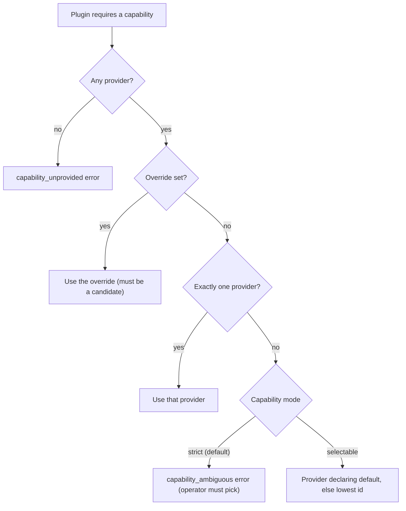

The capability broker lets a plugin depend on a capability instead of a specific app. A plugin
declares an abstract edge such as `requires.capabilities: ["rag"]`. The binding registry
(`apps/core/src/plugins/binding.rs`) resolves it to a concrete provider app and lowers it to a bare
app-id edge. The existing dependency graph then handles enable order, disable cascades, and cycles.

A provider can change (for example, one `web.search` provider for another) without any change to
its consumers.

For the manifest fields, the built-in capabilities, and the override API, see the how-to page
[Capability Broker](/docs/extend/develop/extensions/capability-broker).

## The resolution ladder

For one required capability, the registry looks at every candidate that `provides` it.

The rung for two or more providers depends on the capability's mode:

| Mode | Used by | Two or more providers |
|---|---|---|
| Strict (default) | `rag`, `engines` | Refused until an override is set. Core never picks silently. |
| Selectable | Swappable layers such as `web.search`, `web.extract`, `browser.control`, `computer.control`, `memory` | Deterministic pick: the provider declaring `default`, else the lexicographically lowest id |

A capability is selectable only when every provider declares `provides[].selectable`. One
third-party manifest cannot loosen a strict capability.

A selected-only provider (today Ryu Cloud Search, which bills organization credits) binds only
through an override. When it is the only candidate, binding fails until the user selects it.

Last, the chosen provider's capability `version` must satisfy the consumer's `min_version` floor.
Core checks the floor against the capability version, not the provider app's version.

## Graph lowering

A resolved binding becomes a bare app dependency (no `min_version`) appended to the consumer's
`requires.apps`. The plugin graph (`apps/core/src/plugins/graph.rs`) reads it like a hand-written
app dependency, so these work unchanged:

- Topological enable and disable ordering
- Cycle detection
- Cascades to dependent plugins

The edge carries no version because the graph compares app versions, and a capability floor is a
different number. The registry enforces the floor at bind time instead.

## The enabled-set invariant

Every enabled consumer must bind deterministically over the enabled set: one provider, or an
override. Two enable-time gates keep this true:

1. A consumer with an ambiguous or unbound capability cannot be enabled.
2. Enabling a plugin re-validates every consumer in the resulting enabled set. Enabling a second
   provider that would make an enabled consumer ambiguous is refused, and the error names that
   consumer.

Both gates use the enabled set, not the installed set, so a disabled second provider adds no
ambiguity. Because the invariant holds, a bound consumer also blocks its provider from being
disabled.

## How the broker relates to the Gateway

The broker runs in Core, which decides what runs. When a plugin with a resolved binding is
enabled, Core spawns the provider's sidecar and mounts its routes. Model calls from the provider
still go through the Gateway for governance.

## Related

<Cards>
  <DocCard href="/docs/extend/develop/extensions/capability-broker" />
  <DocCard href="/docs/core/swappable-layers" />
  <DocCard href="/docs/core/app-manifest-lifecycle" />
  <DocCard href="/docs/start-here/architecture/platform-decomposition" />
  <DocCard href="/docs/start-here/architecture/capability-layers" />
</Cards>
