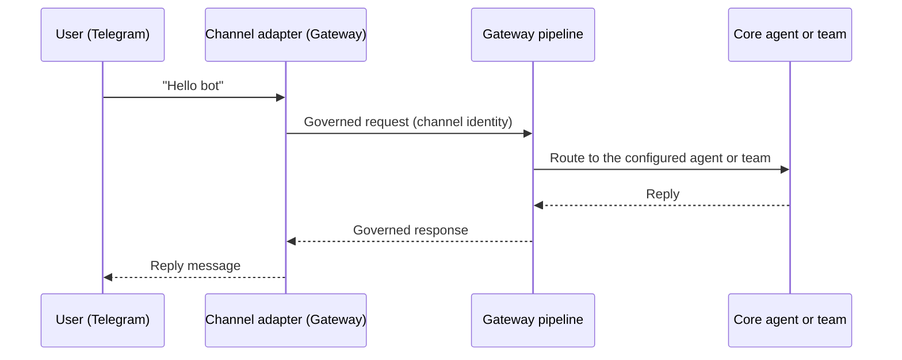

A channel adapter connects a messaging platform to Ryu. The Gateway runs the platform listeners.
Each adapter turns a platform event into a governed request, routes it to the configured Core agent
or team, and sends the reply back to the platform.

For setup, access policy, and per-platform features, see [Channel Bots](/docs/gateway/channels).
That page is the canonical reference.

## Supported channels

The transport adapters live in `crates/gateway/channels/src/`. The Gateway wiring (pipeline call,
registration, and env fallback) is in `apps/gateway/src/channels_host.rs`.

| Channel | Adapter | Headless credentials |
|---|---|---|
| Telegram | `telegram.rs` | `TELEGRAM_BOT_TOKEN` |
| Slack (Socket Mode) | `slack.rs` | `SLACK_APP_TOKEN` and `SLACK_BOT_TOKEN` |
| Discord | `discord.rs` | `DISCORD_BOT_TOKEN` |
| WhatsApp Business (Cloud API) | `whatsapp.rs` | `WHATSAPP_ACCESS_TOKEN`, `WHATSAPP_PHONE_NUMBER_ID`, `WHATSAPP_APP_SECRET`, `WHATSAPP_VERIFY_TOKEN` |
| WhatsApp Personal (OpenWA) | `openwa.rs` | Channel-level OpenWA URL, API key, session, and webhook secret |
| BlueBubbles (iMessage bridge on a Mac) | `bluebubbles.rs` | `BLUEBUBBLES_SERVER_URL` and `BLUEBUBBLES_PASSWORD` |

WhatsApp has two separate channel types. WhatsApp Personal uses the unofficial, self-hosted OpenWA
bridge. WhatsApp Business uses the official Meta Cloud API.

<Callout type="warn">
  WhatsApp Personal (OpenWA) accounts are unofficial and WhatsApp can restrict them. Use a dedicated
  number.
</Callout>

## How it works



The channel adapter:

1. Receives the platform event (message, command, or callback).
2. Applies the channel's access policy (DM and group rules, pairing approvals).
3. Builds a governed request for the bot's configured agent, team, or model.
4. Sends the response back to the platform.

Channel traffic runs with a channel identity (`channel:<name>`) and interactive priority, so it
gets the same firewall, budget, and audit as other Gateway traffic.

## Configure a channel

Configure channels in **Gateway → Channels** in Desktop. Credentials there are write-only.

### Managed Telegram pairing

On deployments that provide it, Desktop can create a user-owned Telegram bot without asking the
user to copy a token.

- A Telegram account can have only one managed setup link waiting for its bot at a time.
- Telegram's bot-created notice does not say which link started it, so a second link is refused
  until the first one finishes or expires (about ten minutes).
- If more than one link was somehow waiting, the new bot is not connected anywhere. Start the setup
  again from the Ryu app, or send `/deletebot` to the manager bot to have it forget the bot.

### Headless configuration

Headless deployments can set the bot tokens in `gateway.toml` or through the environment variables
in the table above.

```toml
[channels.telegram]
token = "<telegram bot token>"

[channels.slack]
app_token = "<slack app-level token>"
bot_token = "<slack bot token>"

[channels.discord]
token = "<discord bot token>"
```

## Related

<Cards>
  <DocCard href="/docs/gateway/channels" />
  <DocCard href="/docs/gateway/configuration" />
  <DocCard href="/docs/core/node-and-presence" />
  <DocCard href="/docs/extend/develop/extensions/channel-bot" />
</Cards>
