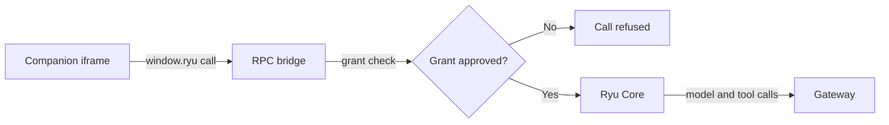

A companion is a panel that a plugin declares and Desktop renders. For a step-by-step build, see
[Build a Desktop Companion](/docs/extend/develop/extensions/desktop-companion).

## The companion surface

Declare a companion in `manifest.json` (`CompanionSurface` in `crates/core/kernel-contracts/src/manifest.rs`).

```json
{
  "id": "com.example.my-plugin",
  "name": "My Plugin",
  "version": "1.0.0",
  "runnables": [],
  "companion": {
    "label": "My Panel",
    "icon": "sparkles",
    "shortcut": "ctrl+shift+m"
  }
}
```

| Field | Required | Description |
|---|---|---|
| `label` | yes | Display label for the panel tab or tooltip |
| `icon` | no | Icon id: an Iconify `prefix:name`, a bare Hugeicons name, or an image URL (see [Icon](/docs/ui/icon)) |
| `shortcut` | no | Keyboard shortcut to toggle the panel, for example `"ctrl+shift+m"` |

## How it connects

Plugin code is untrusted, so Desktop renders the companion in a sandboxed iframe with no direct
network access to Core. The companion calls host methods on `window.ryu`. The capability-gated RPC
bridge (`packages/app-host/src/rpc.ts`) checks each call against the plugin's approved grants
before it reaches Core. Model and tool calls behind the bridge still go through the Gateway.



## Background process bridge

Companion apps that need to show or stop long-running work can use the shared background-process
bridge. Add the `background:control` grant to the plugin's approved permissions, then call the
host API.

```json
{
  "permission_grants": ["background:control"]
}
```

```typescript
const processes = await window.ryu.background.list({ running_only: true });

const process = processes[0];
if (process) {
  console.log(process.command, process.cwd, process.elapsed_ms);
  await window.ryu.background.stop({ process_id: process.process_id });
}
```

The list and stop calls are scoped to the verified caller:

- On an organization-bound node, an anonymous bridge call is refused.
- A signed-in caller can see or control only processes registered under that user.
- A process id from another user cannot be substituted.

`background.stop` queues a stop request for the process owner and returns immediately. The owner
runs its own safe cleanup and publishes the finished snapshot, so list again instead of assuming
the process has already exited. The Desktop pinned summary uses the same bridge and registry.

## Ephemeral toast feedback

Apps, frontend plugins, and inline widgets can show short feedback in the Desktop shell. Request the
`ui:toast` grant, then use the host API under `window.ryu.ui.toast`.

```json
{
  "permission_grants": ["ui:toast"]
}
```

```typescript
const toastId = await window.ryu.ui.toast.show({
  title: "Publishing workflow",
  description: "Uploading the latest version",
  variant: "loading",
  duration: 60_000
});

await window.ryu.ui.toast.update({
  id: toastId,
  title: "Workflow published",
  description: "",
  variant: "success",
  duration: 4_000
});

await window.ryu.ui.toast.dismiss({ id: toastId });
```

`show` returns an opaque id. An app can use that id only to update or dismiss its own toast, and
there is no global clear method. `update` requires the id and at least one changed field. Passing
an empty description clears the previous description.

| Input | Allowed values (`TOAST_LIMITS` in `packages/app-host/src/rpc.ts`) |
|---|---|
| `variant` | `default`, `success`, `info`, `warning`, `error`, or `loading` |
| `title` | Up to 120 characters |
| `description` | Up to 500 characters |
| `duration` | When set, between 1 and 60 seconds |

Frontend plugin activation code can call the same methods through `context.plugin.host.ui.toast`.

<Callout type="info">
  A toast is temporary feedback for the current screen. It does not create an Inbox entry, a
  native system notification, or a durable record. Use the app's notification or approval flow
  when the message must survive dismissal, a restart, or the user leaving the screen.
</Callout>

## Desktop extension host

For richer integration, the SDK exposes a desktop extension host API
(`packages/sdk/src/plugin/ryu-plugin.ts`). `RyuPlugin` offers:

- Registration methods - `registerCommand`, `registerPanel`, `registerRoute`,
  `registerSettingsSection`, and `registerStoreSection`.
- Host services under `host` - for example `listAgents`, `gateway.chat`, and
  `spaces.ingestDocument`.

```typescript
import type { RyuPlugin } from "@ryuhq/sdk/plugin";

export async function activate(context: RyuPlugin): Promise<void> {
  // Register a command-palette entry
  context.registerCommand({
    id: "my-action",
    title: "Run my action",
    run: () => {
      /* ... */
    },
  });

  // Register a panel backed by a webview entry
  context.registerPanel({
    id: "my-panel",
    region: "chat-side-panel",
    title: "My Panel",
    webview: { entry: "panel.html" },
  });

  // Host services
  const agents = await context.host.listAgents();
}
```

<Callout type="warn">
  The desktop extension host is partly live. The manifest carries `contributes` blocks and
  activation events, and the activation runtime wakes plugins on `onStartup`. But the full
  in-process plugin API (registering commands, panels, routes) is still being built. See
  [Plugin Runtime](/docs/extend/develop/extensions/plugin-runtime) for the current state.
</Callout>

## Related

<Cards>
  <DocCard href="/docs/extend/develop/extensions/desktop-companion" />
  <DocCard href="/docs/extend/develop/extensions/plugin-runtime" />
  <DocCard href="/docs/extend/develop/extensions/plugin-json-manifest" />
  <DocCard href="/docs/surfaces" />
</Cards>
