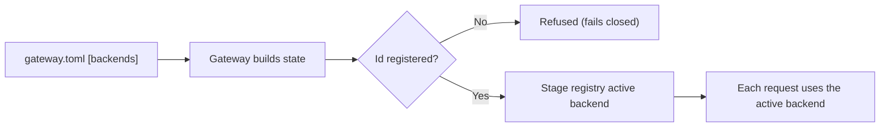
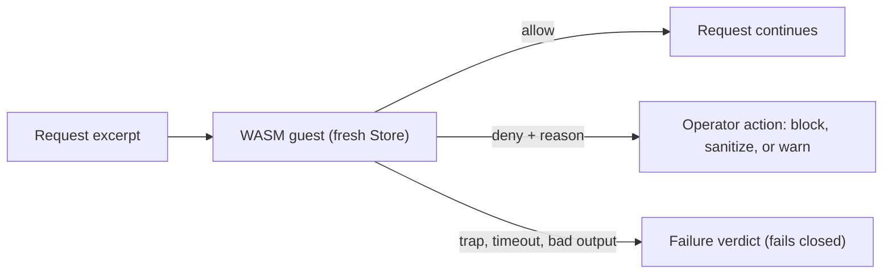

Each governance stage in the Gateway is a registry of interchangeable backends. A built-in backend
is active by default, and configuration selects another registered backend. Most extensions need
only configuration. Code-level backends are Rust types compiled into the Gateway.

## Stage backends

The `[backends]` table in `gateway.toml` names the active backend for each stage
(`StageBackendsConfig` in `apps/gateway/src/config.rs`). Every field defaults to `"builtin"`, so an
absent table keeps the built-in behavior. An id that is not registered is refused when the Gateway
builds its state, so a typo fails closed.



| Stage | Field |
|---|---|
| Budget | `budget` |
| Response cache | `cache` |
| Semantic cache | `semantic_cache` |
| Audit | `audit` |
| Evals | `evals` |
| Circuit breaker | `circuit_breaker` |
| Rate limit | `rate_limit` |
| Firewall | `firewall` |
| Router | `router` |
| Smart router | `smart_router` |
| Passthrough proxy | `passthrough` |
| Connections | `connections` |

`PUT /v1/config` with a partial `backends` object changes one stage and keeps the others:

- The `budget`, `router`, and `connections` selections apply live.
- Other stages take effect on the next Gateway restart.

See [Configuration API](/docs/gateway/configuration-api).

Each registry (for example `RouterRegistry` in `apps/gateway/src/router/mod.rs` and
`FirewallRegistry` in `apps/gateway/src/firewall/mod.rs`) follows the same shape:

- A `BUILTIN` id (`"builtin"`) for the default backend
- `register(id, backend)` to add a backend
- `set_active(id)` to switch backends
- `active()`, which returns a clone of the active `Arc` without holding the lock

## Custom firewall patterns

The firewall (`apps/gateway/src/firewall/mod.rs`) scans inbound and outbound text for PII,
secrets, prompt injection, code injection, toxicity, and bias. Add your own regex patterns in
`gateway.toml`. They merge into the built-in sets.

```toml
[firewall]
enabled = true
policy = "warn_and_continue"

[[firewall.custom_patterns]]
name = "internal_api_key"
regex = "AKIA[0-9A-Z]{16}"
kind = "secret"

[[firewall.custom_patterns]]
name = "custom_token"
regex = "tok_[a-zA-Z0-9]{32}"
kind = "secret"
```

Patterns use the `regex` crate syntax, which does not backtrack, so a pattern cannot cause ReDoS.
An invalid regex is skipped with a warning. Under `sanitize`, a match redacts to
`[REDACTED:<NAME>]`.

| `kind` | Merged into |
|---|---|
| `pii` (default) | PII patterns |
| `secret` | Secret patterns |
| `prompt_injection` | Inbound prompt-injection scanning |
| `code_injection` | Code-injection evaluator (input) |
| `toxicity` | Toxicity evaluator (output) |
| `bias` | Bias and fairness evaluator (output) |

`policy` sets the action for any detection:

| `policy` | Action |
|---|---|
| `block` (default) | Reject the request with a 403 |
| `warn_and_continue` | Log the detection and let the request through |
| `sanitize` | Redact detected PII and secrets, then continue |

See [Security: Firewall & DLP](/docs/gateway/security) for the full firewall configuration.

## Routing

Most routing needs are configuration, not code. See [Routing](/docs/gateway/routing) for
`model_map`, `fallback_chain`, `modality_map`, and `smart_routing`.

The router stage also accepts an upstream router as its backend: `openrouter`, `litellm`, or
`local` (`UPSTREAM_ROUTER_IDS` in `crates/gateway/router/src/lib.rs`). Set `backends.router` to
hand two kinds of request to that router:

- `router/<model>` ids
- models that would otherwise go to the default provider

A selected router whose provider is not configured fails like any unavailable provider. See
[upstream routers](/docs/providers/upstream-routers).

A custom router backend implements `RouterBackend`.

```rust
pub trait RouterBackend: Send + Sync {
    fn route(&self, requested_model: &str) -> RouteDecision;
    fn route_modality_with_slot(
        &self,
        modality: &Modality,
        requested_model: &str,
        slot_provider: Option<&ProviderId>,
        slot_model: Option<&str>,
    ) -> RouteDecision;
    fn fallback_chain(&self, primary: &ProviderId) -> Vec<ProviderId>;
    fn eval_route(
        &self,
        requested_model: &str,
        score_of: &dyn Fn(&ProviderId) -> Option<f32>,
    ) -> Option<RouteDecision>;
}
```

The model map, fallback chain, and tiers are a startup snapshot. Changing them needs a restart.

## WASM policy plugins

A WASM policy plugin (`apps/gateway/src/wasm_policy/mod.rs`) runs untrusted policy code inside the
Gateway. The guest receives a request excerpt and returns a verdict: allow, or deny with a reason.
The operator maps a deny to block, sanitize, or warn. The guest cannot rewrite the request.

The sandbox bounds each call:

- No WASI and no host imports, so the guest has no filesystem, network, clock, or randomness.
- Fuel, an epoch deadline, and a memory limit cap CPU, wall time, and memory.
- Every request gets a fresh `Store`.
- A trap, timeout, or invalid output becomes a failure verdict, which fails closed by default.



<Callout type="warn">
  WASM policy plugins are an advanced extension point, and the API can change. For most governance
  needs, use firewall config, custom patterns, budget rules, or routing config instead.
</Callout>

| Need | Use |
|---|---|
| Block specific content patterns | Custom firewall patterns |
| Rate limit by user or agent | Budget and rate-limit rules |
| Route to different providers | Routing config |
| An allow or deny check that patterns cannot express | WASM policy |

## Passthrough proxy

The passthrough proxy (`apps/gateway/src/passthrough/mod.rs`) forwards native wire formats
(Anthropic Messages, OpenAI Responses) for agents such as Claude Code and Codex. Its backend trait,
`PassthroughBackend`, is crate-private (`pub(crate)`). A replacement proxy, such as a mesh-relayed
or policy-augmented one, is a change inside the Gateway crate, not an external plugin.

## Related

<Cards>
  <DocCard href="/docs/gateway/security" />
  <DocCard href="/docs/gateway/routing" />
  <DocCard href="/docs/gateway/configuration" />
  <DocCard href="/docs/gateway/gateway-for-any-agent" />
  <DocCard href="/docs/gateway/agent-hardening" />
</Cards>
