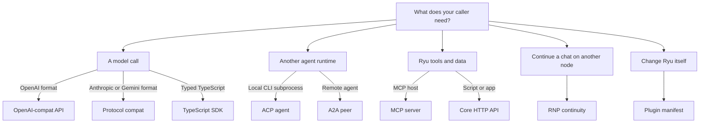

This section is for developers who connect agents, tools, or applications to Ryu. Ryu exposes
eight integration surfaces. Each one serves a different caller, and none requires changes to Ryu
itself.

<Figure name="integrate" />

## Integration surfaces

| Surface | Protocol | Who calls it | Gateway-governed? | Start here |
|---|---|---|---|---|
| **OpenAI-compat API** | OpenAI `/v1/chat/completions` and `/v1/responses` | Any framework, SDK, or raw HTTP client that speaks OpenAI format | Yes (full pipeline) | [OpenAI-compat](/docs/extend/integrate/openai-compat) |
| **Anthropic and Gemini compat** | Anthropic `/v1/messages`, Gemini `/v1beta/models/{model}:generateContent` | Claude Code, Gemini CLI, native-format SDKs | Yes (full pipeline) | [Protocol compat](/docs/extend/integrate/protocol-compat) |
| **ACP agent protocol** | ACP JSON-RPC over a subprocess's stdio | Agent CLIs (Claude Code, Codex, Gemini, Pi, BYO) | On by default for routable agents, with a per-agent opt-out | [ACP Integration](/docs/extend/integrate/acp-integration) |
| **A2A agent protocol** | A2A v1 JSON-RPC or HTTP+JSON, with SSE | Remote agents and other A2A hosts | Trust-gated per peer | [A2A Integration](/docs/extend/integrate/a2a) |
| **RNP continuity** | Authenticated Core HTTP + `ryu://handoff` locator | Ryu clients moving a reviewed chat snapshot between configured nodes | Node ACLs on both ends | [RNP continuity](/docs/extend/integrate/rnp) |
| **MCP server** | MCP over HTTP (`POST /mcp`), or stdio through the `apps/mcp` bridge | MCP hosts (Claude Desktop, IDEs, other agents) | Yes (tool exec) | [MCP Integration](/docs/extend/integrate/mcp-integration) |
| **Core HTTP API** | REST + SSE | Custom apps, scripts, the `@ryuhq/core-client` SDK | Yes (via Gateway) | [API Reference](/docs/extend/develop/api-reference) |
| **TypeScript SDK** | `@ryuhq/sdk` (typed) | Plugin authors, extension builders | Yes (Gateway-mandatory) | [SDK Reference](/docs/extend/develop/sdk) |

## Choose a surface

## Where governance applies

- **Core** decides what runs.
- **The Gateway** decides what is allowed, measured, and paid for. Core-owned model calls use
  Ryu's normal routing and governance.
- **ACP subprocesses and remote A2A peers** own the provider calls made inside their own agent
  runtime. Ryu still governs the task boundary and any Ryu tools exposed to them.

See [Core vs Gateway](/docs/start-here/architecture/core-vs-gateway) for the full split.

## Model APIs

<Cards>
  <DocCard href="/docs/extend/integrate/openai-compat" />
  <DocCard href="/docs/extend/integrate/protocol-compat" />
</Cards>

## Agent protocols

<Cards>
  <DocCard href="/docs/extend/integrate/acp-integration" />
  <DocCard href="/docs/extend/integrate/byo-agent" />
  <DocCard href="/docs/extend/integrate/a2a" />
</Cards>

## Tools and capabilities

<Cards>
  <DocCard href="/docs/extend/integrate/mcp-integration" />
  <DocCard href="/docs/extend/integrate/capability-broker" />
</Cards>

## Platform

<Cards>
  <DocCard href="/docs/extend/integrate/gateway-extensibility" />
  <DocCard href="/docs/extend/integrate/channel-integration" />
  <DocCard href="/docs/extend/integrate/companion-integration" />
  <DocCard href="/docs/extend/integrate/rnp" />
</Cards>

To extend Ryu itself with plugins, hooks, and manifests, start with
[Extensions](/docs/extend/develop/extensions).
