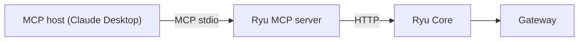
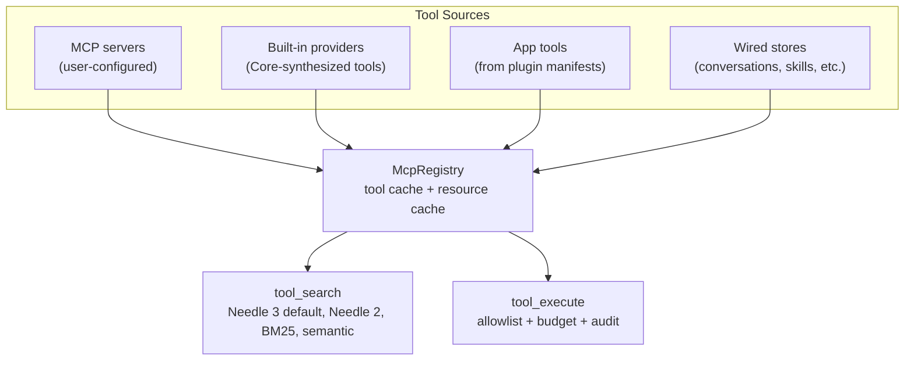
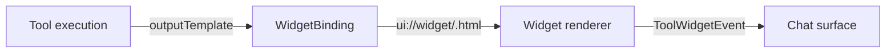

Ryu has two MCP (Model Context Protocol) integration points:

1. **Ryu as MCP server** - an MCP host (Claude Desktop, an IDE, another agent) calls your Ryu node.
2. **Ryu as MCP client** - your agents call tools from external MCP servers.

On both paths, tool execution goes through the Gateway for allowlist gating, budget enforcement,
and audit.

## Ryu as MCP server

Core serves MCP over HTTP at `POST /mcp` and `POST /mcp/:agent_id`. These are the canonical node
MCP endpoints. Both routes need a node or paired bearer token.

For hosts that only accept a stdio command, the `apps/mcp` package (`ryu-mcp`) is a compatibility
bridge. It holds no model and runs no inference. It exposes a fixed set of `ryu_*` tools (for
example `ryu_list_agents`, `ryu_run_workflow`, `ryu_call_mcp_tool`, `ryu_ask`) and translates each
call into a Core HTTP request through `@ryuhq/core-client`.



### Setup

```bash
# The bridge reads RYU_CORE_URL and RYU_CORE_TOKEN.
# A loopback target can resolve its node-auth.token automatically.
RYU_CORE_URL=http://127.0.0.1:7980 RYU_CORE_TOKEN=... \
  bun run apps/mcp/src/index.ts serve
```

Point your MCP host at this stdio command. A bare invocation also runs `serve`. The `login`,
`logout`, and `whoami` subcommands manage the optional Ryu account sign-in. The account session
never replaces the node bearer token.

See [Ryu MCP](/docs/extend/mcp) for the full setup and configuration.

## Ryu as MCP client

Core consumes external MCP servers as tool sources. Register an MCP server and its tools become
searchable and callable from chat.

Remote MCP servers that act on a user's account can declare OAuth in their app or plugin manifest.
Ryu then owns browser authorization, encrypted local tokens, refresh, and disconnect. See
[Authenticated MCP servers](/docs/extend/develop/extensions/authenticated-mcp).

### Register an MCP server

```bash
curl -X POST http://localhost:7980/api/mcp/servers \
  -H "Authorization: Bearer $RYU_TOKEN" \
  -H 'Content-Type: application/json' \
  -d '{
    "name": "my-tools",
    "command": "npx",
    "args": ["-y", "my-mcp-server"],
    "env": { "API_KEY": "..." }
  }'
```

The body also accepts `url`, `headers`, and `type` (`stdio`, `http`, `streamable-http`, or `sse`)
for a remote server, so an entry copied from a Cursor or Claude Desktop `mcp.json` posts unchanged.
The `name` must be unique and must not contain `__`.

### How tools are exposed

Once registered, the MCP server's tools appear in the unified tool catalog. On the ACP plane, the
MCP bridge offers `tool_search` and then `execute` to agents. On the OpenAI-compatible plane, the
Gateway injects a `tool_search` meta-tool into the request body.

Tool execution always goes through two layers.

1. **Core** - tool search ranking and catalog management
2. **Gateway** - allowlist gate, exec budget, exec audit

See [Unified Tool Catalog](/docs/core/unified-tool-catalog) and
[Gateway Tools](/docs/gateway/tools) for the governance details.

## MCP bridge internals

The MCP bridge (`apps/core/src/sidecar/mcp/`) is the central hub for tool management. It handles
tool discovery, dispatch, and the widget system.

### The McpRegistry

`McpRegistry` holds every tool Ryu can call.



### Built-in tool servers

Core synthesizes built-in tools in-process, without spawning external processes. The reserved
built-in servers are listed in `BUILTIN_SERVERS` (`apps/core/src/sidecar/mcp/catalog.rs`), and
`ryu_self_build` is also classified as built-in. Core-provided capability facades such as `web`,
`browser`, `computer`, `memory`, `decision`, and `verify` (`capability_tools.rs`) are wired into
the same registry. `composio.*` tools are classified as Composio, and the synthetic `app` server
holds app tools.

[Built-in Tools Reference](/docs/core/built-in-tools) lists every server, its tool ids, and which
ones are off by default.

### Tool naming convention

Every tool has a fully qualified id. The id is also the allowlist key.

```text
<server>.<tool_name>
```

For example:

- `notify.desktop` - show a desktop notification
- `artifact.create` - write a generated file
- `ui.render` - render generative UI inline
- `composio.<action>` - a Composio action

### Tool principal and tenancy

Every tool call carries a `ToolPrincipal`, the authorization principal resolved from the host
conversation's owner.

| Principal | Meaning | Behavior |
|---|---|---|
| `Unrestricted` | Personal/unbound node | Full access |
| `Owned` | Org-bound principal | Org-scoped access |
| `Unresolved` | Org-bound node, no principal resolves | Fail-closed: the call is refused |

A local (stdio) MCP server shipped by an app or plugin also receives the call's principal in
the request's `_meta["ryu/caller"]`, so it can keep per-user records and authorize them itself.

| Value | Meaning |
|---|---|
| `{ "kind": "node" }` | Personal node, or the node operator: one principal |
| `{ "kind": "user", "userId": "…", "orgId": "…" \| null }` | A verified user on a shared node |
| `{ "kind": "unresolved" }` | A shared node could not resolve the caller; the server should refuse |

Ryu builds this value from the conversation's server-side owner, never from tool arguments, so
a model cannot choose another principal. MCP servers you register yourself and remote servers
never receive it.

## Widget system

Tools can return structured content that renders as inline widgets in the chat surface.

### How widgets work



1. A tool declares `ryu/outputTemplate` (or the `openai/outputTemplate` alias) in its `_meta`,
   with a URI such as `ui://widget/chart.html`.
2. `WidgetBinding` resolves the template from the plugin's UI code.
3. When the tool executes, Core wraps the output in a `ToolWidgetEvent`.
4. The chat surface renders the widget inline.

### Widget promotion

A plugin binds a tool to a widget in `contributes.widgets`. `tool_id` is
`<mcp_servers key>.<toolName>`, and `uri` must match the resource the server serves and the tool's
`_meta` output template.

```json
{
  "contributes": {
    "widgets": [{
      "tool_id": "my_server.render",
      "uri": "ui://widget/my-widget.html"
    }]
  }
}
```

Optional fields are `mime` (default `text/html+skybridge`), `default_display_mode` (`inline`,
`fullscreen`, or `pip`), and `ui_entry` (the source entry `ryu pack` builds).

The widget promotion gate requires both of these.

- `contributes.widgets[]` in the manifest of an enabled plugin
- the `widget:render` permission grant

A plugin that declares widgets without the grant still runs, but its widgets fall back to plain
text.

The built-in `ui.render` tool and app tools ([Ryu Apps](/docs/extend/develop/extensions/ryu-apps))
also return widget content.

## Pre/post tool hooks

Plugins can intercept tool calls at two boundaries.

### Pre-tool hooks (`pre_tool_use`)

Fires before a tool executes. It can block the call.

```json
{
  "contributes": {
    "turn_hooks": [{
      "id": "guard.shell",
      "on": "pre_tool_use",
      "match": { "tools": ["bash*"] },
      "code_file": "hooks/guard-shell.js"
    }]
  }
}
```

The hook body is a flat `.js` file under the plugin's `hooks/` folder. Packing inlines it as
`code`. Return `{ kind: "deny", reason }` from the body to block the call.

| Directive | Effect |
|---|---|
| `{ kind: "deny", reason }` | Block the tool call; the reason is returned as the tool error |
| `{ kind: "none" }` | Allow the call to proceed |

### Post-tool hooks (`post_tool_use`)

Fires after a tool returns, detached from the tool call. It is observation only and adds no
latency. To rewrite a result before the model sees it, declare a `tool_result` hook instead. That
phase is awaited and accepts a `transform` directive with the new `output`. See
[Hooks & Lifecycle](/docs/extend/develop/extensions/hooks-lifecycle).

### Tool glob gate

`match.tools` is evaluated in Rust before Core spawns the sandbox. A pattern is a tool id with
optional leading or trailing `*`.

| Pattern | Matches |
|---|---|
| `*` | Everything |
| `bash*` | Prefix: `bash`, `bash_read`, and so on |
| `*write` | Suffix: `file_write`, `web_write` |
| `*edit*` | Substring: `file_edit`, `inline_edit` |
| `exact_name` | Exact match only |

A hook whose gate does not match the current tool never spawns the JS sandbox.

## Prompt injection defense

Core wraps untrusted tool results in boundary markers (`apps/core/src/sidecar/untrusted.rs`).

```text
<<<EXTERNAL_UNTRUSTED_CONTENT>>>
... tool output ...
<<<END_EXTERNAL_UNTRUSTED_CONTENT>>>
```

The markers tell the model that the wrapped text is data, not instructions. This reduces the
risk that a tool output can redirect the agent.

## MCP tool format

MCP tools use the standard JSON-RPC methods.

- `tools/list` - returns available tools with names, descriptions, and input schemas
- `tools/call` - executes a tool by name with arguments

The stdio bridge translates these into Core HTTP requests.

## Security

- Tool execution requires the Gateway's allowlist to include the tool ID.
- The exec budget caps execution count and wall-clock time per rolling window.
- Every execution emits an audit event.
- Pre-tool hooks can block dangerous calls before execution.
- Tool principal enforcement prevents tenancy bypasses.

See [Security](/docs/extend/mcp/security) and [Agent Hardening](/docs/gateway/agent-hardening).

## Related

<Cards>
  <DocCard href="/docs/extend/mcp" />
  <DocCard href="/docs/extend/mcp/quickstart" />
  <DocCard href="/docs/extend/mcp/tools" />
  <DocCard href="/docs/core/unified-tool-catalog" />
  <DocCard href="/docs/gateway/tools" />
  <DocCard href="/docs/extend/develop/extensions/hooks-lifecycle" />
</Cards>
