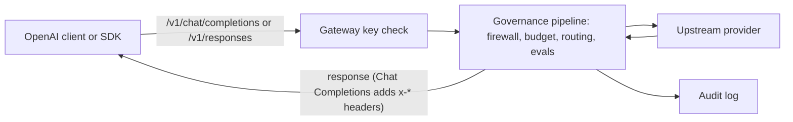

The Gateway accepts OpenAI Chat Completions and Responses create requests. Change the `baseURL` and
add a Gateway API key. Each request then runs through Ryu's governance pipeline before it reaches
the upstream provider.

## The endpoint

```text
POST http://localhost:7981/v1/chat/completions
```

The Gateway listens on `http://127.0.0.1:7981` by default. Send
`Authorization: Bearer <gateway-key>` with each request.



## Responses API

`POST /v1/responses` runs on the same governed pipeline as Chat Completions. The Gateway returns
Responses-shaped objects or semantic SSE events.

```bash
curl http://localhost:7981/v1/responses \
  -H "Authorization: Bearer YOUR_GATEWAY_KEY" \
  -H "Content-Type: application/json" \
  -d '{
    "model": "gpt-4o",
    "instructions": "Answer briefly.",
    "input": [{
      "role": "user",
      "content": [{ "type": "input_text", "text": "Hello from Ryu!" }]
    }]
  }'
```

### Supported request features

- Text and image-URL input
- Custom function tools, tool namespaces, and text custom tools
- Bounded regex constraints and structured JSON formats
- Reasoning effort and text verbosity
- Streaming and `previous_response_id` continuations
- Prompt-cache hints and service tier, forwarded through the shared Chat Completions pipeline
- `top_logprobs` (0 to 20) or `include: ["message.output_text.logprobs"]`, which return provider
  token logprobs on each `output_text` part and on streamed `response.output_text.delta` events.
  If the routed provider returns no logprobs, the response fails instead of returning text without
  them.

Unknown top-level request fields and unsupported input or tool types are rejected, not ignored.
Codex's `client_metadata` diagnostic field accepts an object with string values. It stays local to
the incoming request and does not change the upstream messages or routing policy.

### Streaming and continuations

Set `"stream": true` for Responses SSE events such as `response.created`,
`response.output_text.delta`, and `response.completed`. Use the returned `id` as
`previous_response_id` for a follow-up.

Continuation history is held in bounded process memory (`RESPONSE_TTL` in
`apps/gateway/src/responses_store.rs`). It is lost when any of these happens:

- four hours pass
- the Gateway restarts
- capacity eviction removes it

`"store": false` skips retaining the new response, so send the full input history on later turns.
Use `store: false` with full history whenever a process-local continuation id is unsuitable.

### Hosted tools

Hosted web search uses the Gateway web service and requires a separate web-search permission. An
inference grant does not include that permission. With `external_web_access: false`, search uses
only cached results, never live search, and calls report unavailable when no cached-search backend
exists.

`max_tool_calls` caps Gateway-hosted tool calls (hosted web search) for one response:

- When the cap is reached, the hosted tool is withdrawn.
- A further hosted call is reported as a failed `web_search_call` with `max_tool_calls_exceeded`.
- Client tool calls are returned to you and do not count toward the cap.

### Not supported

- Other hosted tools, including file search and code interpreter
- Lark grammar constraints (rejected before model inference)
- File-ID inputs and audio or video items
- Server-managed conversations and background responses
- Response retrieval and deletion endpoints
- Non-text function-call outputs

Each rejection names the supported alternative. The `reasoning.encrypted_content` include hint is
accepted for Pi compatibility, but this Chat-backed adapter does not return reasoning items or
encrypted reasoning content.

## Ryu Chatbot Template

The public [Ryu Chatbot Template](https://github.com/amajorai/ryu-chatbot-template) is a Next.js
and shadcn starter for this API. It keeps the upstream shadcn chatbot's streaming UI, typed GitHub
lookup, and questionnaire example, then adds Ryu model discovery and a Gateway-aware composer.

```bash
git clone https://github.com/amajorai/ryu-chatbot-template.git
cd ryu-chatbot-template
pnpm install
cp .env.example .env.local
pnpm dev
```

In `.env.local`, set two variables:

- `RYU_GATEWAY_URL` - the Gateway origin, for example `http://127.0.0.1:7981`.
- `RYU_GATEWAY_KEY` - the Gateway key, when Gateway auth is enabled.

The app server normalizes the URL to `/v1`, discovers models from `GET /v1/models`, and keeps the
key out of browser code. Its chat route uses the AI SDK Chat Completions adapter
(`gateway.chat(model)`), which matches Ryu's `POST /v1/chat/completions` contract.

<Callout type="warn">
  The starter's `/api/chat` route is a public demo proxy. Add application auth, rate limiting, and
  request-size controls before you deploy it for real users. Gateway key budgets remain the final
  limit on provider spend.
</Callout>

## Framework examples

### OpenAI SDK (TypeScript)

```typescript
import OpenAI from "openai";

const client = new OpenAI({
  baseURL: "http://127.0.0.1:7981/v1",
  apiKey: "YOUR_GATEWAY_KEY",
});

const response = await client.chat.completions.create({
  model: "gpt-4o",
  messages: [{ role: "user", content: "Hello from Ryu!" }],
});
// The Gateway applied firewall, budget, and audit to this call
```

### Vercel AI SDK

```typescript
import { createOpenAI } from "@ai-sdk/openai";
import { generateText } from "ai";

const gateway = createOpenAI({
  baseURL: "http://127.0.0.1:7981/v1",
  apiKey: "YOUR_GATEWAY_KEY",
});

const result = await generateText({
  model: gateway.chat("gpt-4o"),
  prompt: "Write a haiku about Rust.",
});
```

### Mastra

```typescript
import { createOpenAI } from "@ai-sdk/openai";

const ryuGateway = createOpenAI({
  baseURL: "http://127.0.0.1:7981/v1",
  apiKey: "YOUR_GATEWAY_KEY",
});

// Use ryuGateway.chat("gpt-4o") as your model provider
```

### LangChain (TypeScript)

```typescript
import { ChatOpenAI } from "@langchain/openai";

const model = new ChatOpenAI({
  model: "gpt-4o",
  apiKey: "YOUR_GATEWAY_KEY",
  configuration: {
    baseURL: "http://127.0.0.1:7981/v1",
  },
});
```

### Raw HTTP (any language)

```bash
curl http://localhost:7981/v1/chat/completions \
  -H "Authorization: Bearer YOUR_GATEWAY_KEY" \
  -H "Content-Type: application/json" \
  -d '{
    "model": "gpt-4o",
    "messages": [{"role": "user", "content": "Hello!"}]
  }'
```

## Response headers

Chat Completions responses carry diagnostic headers.

| Header | Meaning |
|---|---|
| `x-provider` | Which upstream handled the call (`openai`, `anthropic`, `local`, …) |
| `x-request-id` | Unique ID for the audit log |
| `x-routed-model` | The actual model after routing (may differ from requested) |
| `x-cache` | `HIT` or `MISS` (non-streaming only) |
| `x-budget-scope`, `x-budget-action`, `x-budget-used`, `x-budget-limit`, `x-budget-currency`, `x-budget-unit` | Budget state and the action taken, when a budget applies |
| `x-eval-score` | Eval score, when an evaluator ran |
| `x-ryu-policy-alert` | Base64-encoded policy alert when a rule fires |

## Tool calling on this surface

When tools are enabled, the Gateway injects a `tool_search` meta-tool into the request body. The
model discovers tools through search, then calls them by exact id. The Gateway gates execution against
the allowlist and audits every call.

See [Gateway tools](/docs/gateway/tools) for the full tool-loop mechanics.

## Chat Completions streaming

Streaming works the same as the OpenAI API. Send `"stream": true` and receive SSE events.
The Gateway buffers tool-call rounds on the OpenAI-compat plane, then streams the final response.

## Available models

`GET http://localhost:7981/v1/models` returns the routable model list. See
[the Gateway model list](/docs/gateway/routing#the-model-list) for the full catalog.

## Auth configuration

See [Gateway Configuration > Auth](/docs/gateway/configuration-access#auth-and-api-keys) for API key
setup, per-key rate limits, and budget caps.

## Related

<Cards>
  <DocCard href="/docs/gateway/gateway-for-any-agent" />
  <DocCard href="/docs/gateway/tools" />
  <DocCard href="/docs/gateway/configuration" />
  <DocCard href="/docs/start-here/architecture/providers" />
</Cards>
