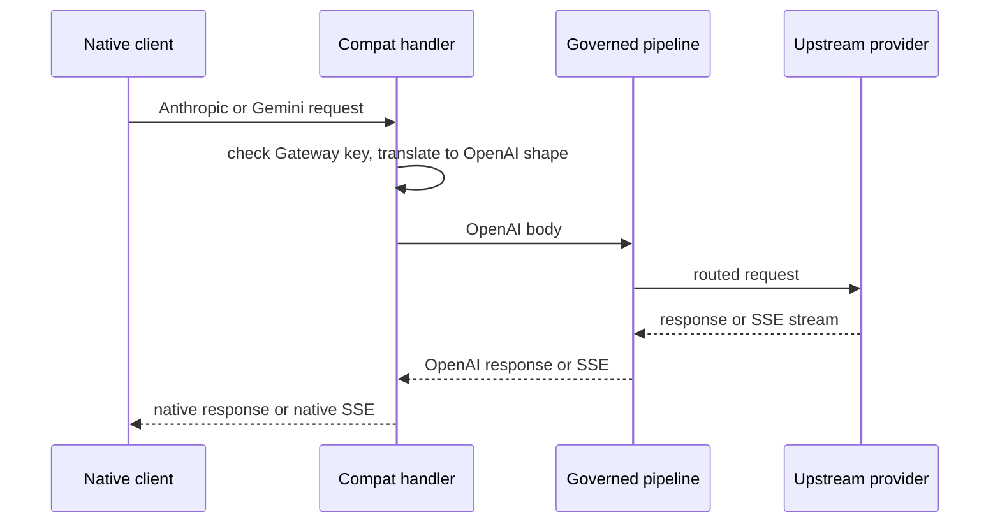

The Gateway also speaks the Anthropic Messages and Google Gemini wire formats. Change the `baseURL`
of a native-format client and add a Gateway API key.

Each request then runs through the same governed pipeline as the
[OpenAI-compatible API](/docs/extend/integrate/openai-compat): budgets, firewall, routing, audit,
and the live-traffic feed. The handlers live in `apps/gateway/src/api/compat.rs`. They translate
the request and response between the native dialect and the pipeline's OpenAI shape.

## Anthropic Messages (`POST /v1/messages`)

```text
POST http://localhost:7981/v1/messages
```

Point Claude Code's `ANTHROPIC_BASE_URL` at this endpoint. The handler translates the Anthropic
request into the pipeline's OpenAI body, runs the full governance pipeline, and projects the
response back into the Anthropic wire format. The translation:

- hoists `system`
- converts between `tool_use`/`tool_result` and `tool_calls`
- maps stop reasons

Messages that mix text or thinking blocks with `tool_use` or `tool_result` blocks keep their tool
calls and results, so multi-turn tool use works.

Streaming (`"stream": true`) emits Anthropic-style SSE events: a `message_start`,
`content_block_start`, one `content_block_delta` per text fragment, then `content_block_stop`,
`message_delta`, and `message_stop`. The `message_delta` carries the token usage, including usage
the upstream reports after its final content chunk.

```bash
curl http://localhost:7981/v1/messages \
  -H "Authorization: Bearer YOUR_GATEWAY_KEY" \
  -H "Content-Type: application/json" \
  -H "anthropic-version: 2023-06-01" \
  -d '{
    "model": "claude-sonnet-4-5",
    "max_tokens": 1024,
    "messages": [{"role": "user", "content": "Hello from Claude Code via Ryu!"}]
  }'
```

## Gemini (`POST /v1beta/models/{model}:generateContent`)

```text
POST http://localhost:7981/v1beta/models/gemini-2.0-flash:generateContent
```

Gemini carries the model on the URL path, not in the body. The route captures the whole trailing
segment (`{model}:generateContent`), so one route serves every model. The `:streamGenerateContent`
suffix selects streaming.

```text
POST http://localhost:7981/v1beta/models/gemini-2.0-flash:streamGenerateContent
```

Streaming output is a bare `data: {candidates...}` line per chunk (no named events), matching the
Gemini protocol. When the upstream reports usage after the finishing chunk, it arrives as a final
`usageMetadata` chunk. Point a Gemini SDK or the Gemini CLI base URL at this endpoint.

Function calling round-trips:

- `functionDeclarations` become OpenAI tools.
- The model's calls come back as `functionCall` parts.
- The `functionCall` and `functionResponse` parts a client sends back in `contents` become OpenAI
  `tool_calls` and `tool` messages.

A `functionResponse` pairs with its call by `id` when that id matches a call in the preceding
model turn. Otherwise (no `id`, or a client-generated one the call never carried), it pairs with
the earliest unanswered call of the same name.

A local or self-hosted Gateway also accepts the key as Gemini's `?key=` query parameter. The hosted
Ryu Gateway does not, because URLs end up in proxy logs:

- It refuses an `rgw_` token in any query parameter with `401`.
- It ignores other `?key=` values.

Send the key in the `Authorization` or `x-goog-api-key` header there.

```bash
curl http://localhost:7981/v1beta/models/gemini-2.0-flash:generateContent \
  -H "Authorization: Bearer YOUR_GATEWAY_KEY" \
  -H "Content-Type: application/json" \
  -d '{
    "contents": [{"parts": [{"text": "Hello from a Gemini client via Ryu!"}]}]
  }'
```

## How the translation works

Each compat handler checks the same Gateway key as `/v1/chat/completions`. It reads the key from
`Authorization: Bearer`, then from the native header (`x-api-key` for Anthropic clients,
`x-goog-api-key` for Gemini clients).



Translation happens in pure functions (`apps/gateway/src/compat/{anthropic,gemini}.rs`). The
streaming variants translate the pipeline's OpenAI SSE byte stream into the native SSE dialect as
it arrives.

## Response headers

Compat responses carry `x-request-id` and `x-routed-model`, so you can trace a compat call through
the audit log like any other call.

## Desktop usage

The **API & traffic** tab of the Gateway dialog in Desktop shows copyable endpoint URLs for all three
dialects (OpenAI, Anthropic, Gemini), issues local API keys, and shows a live traffic dashboard. See
[Gateway configuration](/docs/gateway/configuration).

## Related

<Cards>
  <DocCard href="/docs/extend/integrate/openai-compat" />
  <DocCard href="/docs/gateway/loopback-routes" />
  <DocCard href="/docs/gateway/configuration" />
  <DocCard href="/docs/gateway/gateway-for-any-agent" />
</Cards>
