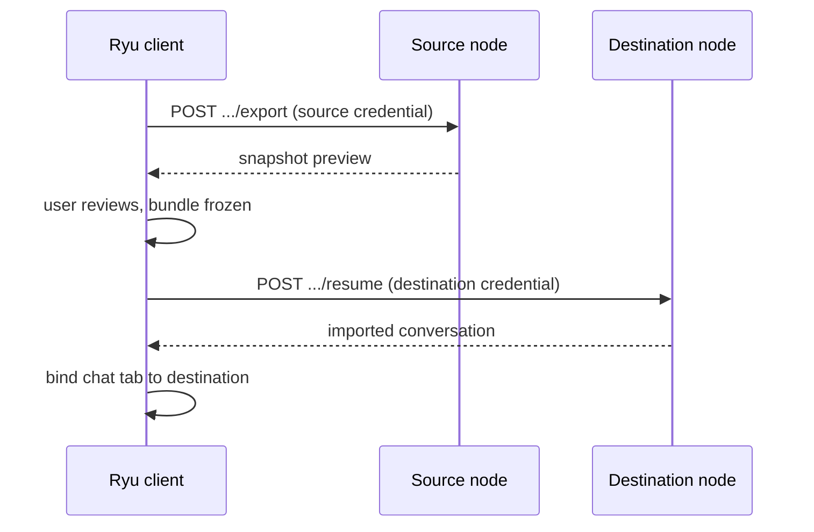
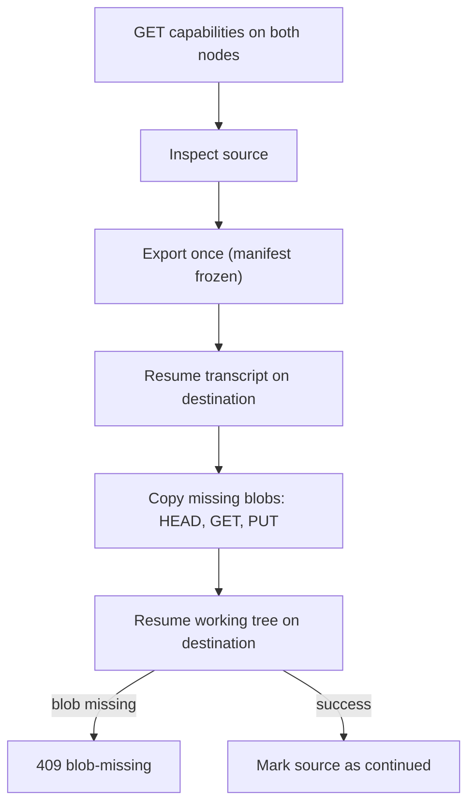

Ryu Node Protocol v0 (RNP v0) is the continuity layer between Ryu surfaces and Core nodes. Its first contract moves a bounded, user-approved chat snapshot from one node to another. It uses the existing authenticated Core API instead of a new transport.

RNP does not replace the protocols around it:

| Contract | Job |
|---|---|
| RHP ([Ryu Hardware Protocol](/docs/hardware/protocol)) | Physical device audio, display, and control frames |
| ACP | A node-local agent process session |
| MCP (Model Context Protocol) | Tool discovery and calls |
| `ryu://` | User-facing navigation and handoff links |
| RNP | Logical conversation continuity between configured nodes |

## Continue a chat on another node

1. Open a saved chat and choose **Continue on another node**.
2. Select a node you already configured.
3. Review the exact visible messages that will move.

Ryu exports the preview with the source node's credential and freezes that bundle. It then imports the same reviewed data with the destination node's credential. A lost response can be retried without creating a new bundle, and Ryu binds the chat tab to the destination only after the import succeeds.



The default snapshot contains up to the latest 50 visible user and assistant messages. You can add a short context note and optionally suggest the same agent.

- Ryu saves the note as a visible user message. It never becomes a hidden system instruction.
- The transfer never sends a chat turn automatically.

RNP v0 does not move:

- Node credentials, structured authentication data, and access-control fields
- Attachments, and files unless you choose to bring the working tree (below)
- Source filesystem paths (the destination chooses its own folder)
- Structured tool calls, tool results, and provider provenance
- Run state and node-local ACP session IDs

The next message starts or resumes an execution session on the destination node from the imported transcript.

## Bring the working tree

When the chat works in a git repository and both nodes support it, the review shows a **Bring working tree** section. It lists:

- The repository, branch, starting commit, and how many commits are not pushed yet
- The remote URL the destination will clone or fetch from, so you can confirm it
- The changed tracked files
- A checklist of untracked files with their sizes. Files whose names look like secrets (`.env*`, `*.pem`, `*.key`, `id_*`, `.npmrc`, `.netrc`, `credentials*`) start unticked and highlighted. Ignored files are never listed and never move.

The destination clones the repository into its handoffs folder, rebuilds the work in a new git worktree on a `handoff/<thread>` branch, and points the chat at it. Your source folder, branch, and staging area are not changed.

After the destination succeeds, the source chat's sidebar row shows **on** and the destination computer's name. This reminds you not to keep editing the same branch on both computers:

- The source chat is not locked.
- Choose **Take back here** from the row's menu to clear the reminder.
- In **All computers** mode the same badge and action appear on the source computer's group.

<Callout type="warn">
  A handed-off folder is never trusted automatically on the destination. Trust it there before
  letting agents run tools in it.
</Callout>

The chat opens on the destination with its run mode set to **Local**. Keep it there for a handed-off folder. Ryu refuses to fork a second isolated worktree from it, because that fork would leave the handed-off uncommitted changes behind.

Folders that are not git repositories are not handed off, and the review omits the section.

## HTTP contract

```text
POST /api/rnp/v0/conversations/:id/export
POST /api/rnp/v0/conversations/:id/resume
```

| Endpoint | Access rule |
|---|---|
| `export` | Read access to the source conversation. Includes only its selected visible branch. |
| `resume` | Creates a private conversation for the verified caller, or requires write access when that conversation already exists on the destination. |

Stable conversation, message, bundle, and context IDs make retries of the frozen review idempotent and let optional cloud sync converge on the same data later.

The TypeScript contract is available from `@ryuhq/protocol/continuity` (`RNP_CONTINUITY_LIMITS`). The encoded bundle is capped at 2 MiB, with at most 200 messages and 16 text context items. Implementations reject unsupported versions and oversized data instead of guessing or truncating silently.

### Working-tree endpoints

The working tree uses separate endpoints instead of a new field in the v0 bundle, because a node that predates them would ignore an unknown field. Clients probe first.

```text
GET    /api/rnp/v0/capabilities                          → { version: 0, features: ["workspace"] }
POST   /api/rnp/v0/conversations/:id/workspace/inspect   (source)
POST   /api/rnp/v0/conversations/:id/workspace/export    (source)
GET    /api/rnp/v0/workspace-blobs/:sha256               (source, exporting caller only)
HEAD   /api/rnp/v0/workspace-blobs/:sha256               (destination: already stored?)
PUT    /api/rnp/v0/workspace-blobs/:sha256               (destination, application/octet-stream)
POST   /api/rnp/v0/conversations/:id/workspace/resume    (destination)
POST   /api/rnp/v0/conversations/:id/continued           (source: mark)
DELETE /api/rnp/v0/conversations/:id/continued           (source: take back)
```

A node that answers 404 on the capability probe does not support working-tree handoff, and clients hide the option. The order is as follows.



1. Inspect the source, then export once with `ifHead` (the reviewed commit), `ifUpdatedAt`, and the ticked untracked paths. The export returns a manifest and stages its blobs for the caller that exported them. The review freezes that manifest and resends it unchanged on retry.
2. Resume the transcript as before.
3. Copy each blob: `HEAD` on the destination skips blobs it already has, otherwise `GET` from the source and `PUT` to the destination. Blobs are content-addressed. The destination checks the SHA-256 digest and stores a blob only once.
4. Resume the working tree on the destination. A replay of the same `workspaceId` returns `unchanged` with the same paths. A missing blob returns `409` with code `blob-missing`.
5. Mark the source with `continued`, only after step 4 succeeded.

Inspect and export need read access to the conversation and return `409` (`turn-running`) while a reply is still being generated. Resume needs write access and the agent-edit permission. The result always carries the `workspace-untrusted` warning.

The manifest contains:

- the repository (`name`, credential-free `remoteUrl`, `baseCommit`, `branch`)
- an optional git bundle of unpushed commits, with its prerequisite commits
- an optional binary patch, with the list of files it touches
- the selected untracked files
- the omitted paths, each with a reason

Every path is repo-relative with `/` separators. These are rejected: absolute paths, drive letters, backslashes, `..`, `.git` segments, control characters, and names that collide by case or Unicode normalization.

`RNP_WORKSPACE_LIMITS` in the same module sets the working-tree limits.

| Limit | Value |
|---|---|
| Git bundle of unpushed commits | 32 MiB |
| Patch of working-tree changes | 8 MiB |
| Untracked files | 256 files, 1 MiB each, 4 MiB in total |
| Paths in the manifest | 2000 |
| Path length | 4096 bytes |
| Manifest JSON | 256 KiB |

Unlike the transcript, a working-tree resume makes the destination contact a git remote that came from another computer. The destination guards that contact:

- It accepts only credential-free HTTPS URLs and `git@` SSH URLs.
- It refuses loopback, private, link-local, and cloud-metadata hosts.
- It uses the destination's own git credentials.
- Git runs with repository hooks, filters, external diff drivers, and textconv disabled.
- Staged and received blobs expire after a short time.

## Handoff links

```text
ryu://handoff/<conversation-id>?source=<node-url>&v=0
```

A handoff link is a locator, not the transcript. It carries only the conversation ID, protocol version, and a credential-free HTTPS source-node URL (HTTP is accepted only for loopback Core).

The receiver must match that URL to a node already configured on the device and show the exported transcript review. Unknown nodes fail closed. Extra fields, tokens, prompts, context, query-bearing node URLs, and embedded credentials are rejected.

## Cloud sync is optional

Cloud conversation sync can make the referenced conversation available before the handoff starts. RNP may treat the last included message ID as a readiness checkpoint and skip duplicate inserts. Sync is an optimization, not a requirement: the explicit export and resume flow still works when cloud sync is off.

## Related

<Cards>
  <DocCard href="/docs/surfaces/desktop/user-guide/deep-links" />
  <DocCard href="/docs/core/node-and-presence" />
  <DocCard href="/docs/core/conversations-sessions" />
  <DocCard href="/docs/extend/integrate/acp-integration" />
  <DocCard href="/docs/start-here/architecture/runnable-model" />
</Cards>
