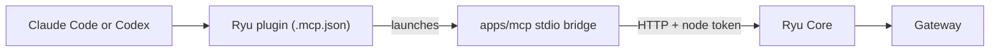

This page shows how to connect Claude Code or Codex to a running Ryu Core node. Both are MCP (Model Context Protocol) hosts, so they use the same `apps/mcp` stdio bridge as any other host.

Ryu ships an installable plugin for each agent (`apps/plugins/claude-code` and `apps/plugins/codex`), so you do not hand-edit a host config file. Enable the plugin and the agent gains Ryu's tools. Claude Code also gains a set of `/ryu:*` slash commands.

The plugin adds no backend. It packages three existing pieces:

- the MCP bridge at `apps/mcp`
- two skills, `setup-ryu` and `ryu-tools`
- the command flows



See [Ryu MCP](/docs/extend/mcp) for how the bridge works and [Tools](/docs/extend/mcp/tools) for the full tool list.

<Callout type="warn">
  The plugins currently launch the bridge from a Ryu source checkout (`apps/mcp/src/index.ts`), so run the coding agent **from the Ryu repo root**. The bridge is packaged as `@ryuhq/mcp` for npm; once a version is published, the plugins can launch it with `bunx @ryuhq/mcp` from any project. See [Use the plugin outside the repo](#use-the-plugin-outside-the-repo).
</Callout>

## What the plugin gives you

Once enabled, the agent can drive your node with the 21 `ryu_*` tools the bridge exposes:

- health and system status
- model search and activation
- agent and team listing
- workflow runs
- RAG search across memory and Spaces
- a one-shot `ryu_ask`
- `ryu_call_mcp_tool`, to reach any MCP server Ryu has registered

<Cards>
  <DocCard href="/docs/extend/mcp/tools" />
  <DocCard href="/docs/extend/mcp/security" />
</Cards>

## Prerequisites

- **Bun** on PATH - the bridge runs under `bun`.
- A reachable Ryu Core node. A local desktop or headless Core listens on `http://127.0.0.1:7980` (see [Quickstart](/docs/extend/mcp/quickstart) for starting one).

## Install into Claude Code

The marketplace manifest lives at `apps/plugins/.claude-plugin/marketplace.json`. From the Ryu repo root:

```sh
claude plugin marketplace add ./apps/plugins
claude plugin install ryu@ryu
```

On enable, Claude Code prompts for the two `userConfig` options in `apps/plugins/claude-code/.claude-plugin/plugin.json`.

- `ryu_core_url` - base URL of your node, default `http://127.0.0.1:7980`.
- `ryu_core_token` - optional node-admittance bearer (marked sensitive). Leave blank for a local loopback node.

Those values flow into the plugin's `.mcp.json`, which launches the bridge as the `ryu` MCP server and passes them through as the `RYU_CORE_URL` and `RYU_CORE_TOKEN` environment variables.

```json
{
  "mcpServers": {
    "ryu": {
      "command": "bun",
      "args": ["run", "${CLAUDE_PROJECT_DIR}/apps/mcp/src/index.ts"],
      "env": {
        "RYU_CORE_URL": "${user_config.ryu_core_url}",
        "RYU_CORE_TOKEN": "${user_config.ryu_core_token}"
      }
    }
  }
}
```

The tools appear when the plugin is enabled. In a session started from the repo root, run this command to confirm the wiring.

```text
/ryu:status
```

## Slash commands (Claude Code)

The Claude Code plugin ships five slash commands in `apps/plugins/claude-code/commands/`. Each is a short flow over the `ryu_*` tools.

| Command | What it does | Tools it drives |
|---|---|---|
| `/ryu:status` | Report node health, active engine and running state, Gateway reachability, active model, and a hardware headline. Stops if Core is unreachable. | `ryu_health`, `ryu_system_status`, `ryu_get_active_model`, `ryu_system_info` |
| `/ryu:models [query]` | Search the model catalog and optionally activate an installed model, confirming the switch. | `ryu_search_models`, `ryu_get_active_model`, `ryu_set_active_model` |
| `/ryu:ask <question>` | Ask your node one synchronous question, routed to its side-question model (no tools, no agent run). | `ryu_ask` |
| `/ryu:workflow [id]` | List the workflows on your node and run one by id, gathering inputs first and reporting the run state. | `ryu_list_workflows`, `ryu_run_workflow` |
| `/ryu:retrieval <query>` | Unified RAG search across memory and every Space, or scope to a single Space. | `ryu_search_retrieval`, `ryu_list_spaces`, `ryu_search_space` |

`/ryu:models`, `/ryu:workflow`, and `/ryu:ask` change state or consume model budget. See [read versus write](/docs/extend/mcp/tools#read-versus-write).

## Install into Codex

The Codex marketplace manifest lives at the repo-root `.agents/plugins/marketplace.json`. From the Ryu repo root:

```sh
codex plugin marketplace add ./.agents/plugins
codex plugin install ryu
```

Codex has no slash-command surface. The Codex plugin (`apps/plugins/codex/.codex-plugin/plugin.json`) carries the same flows in two ways:

- its `setup-ryu` and `ryu-tools` skills
- a `defaultPrompt` list of starter suggestions: check status, search and activate a model, ask the node, list and run a workflow, and search memory and Spaces

Its `.mcp.json` launches the same bridge.

```json
{
  "mcpServers": {
    "ryu": {
      "command": "bun",
      "args": ["run", "apps/mcp/src/index.ts"],
      "env_vars": [
        "RYU_CORE_URL",
        "RYU_CORE_TOKEN",
        "RYU_DIR",
        "RYU_PROFILE",
        "RYU_AUTH_URL"
      ]
    }
  }
}
```

Codex plugins have no install-time options, and Codex starts MCP servers with a minimal environment. `env_vars` forwards each listed variable that is set in the shell you start Codex from. Point the plugin at a node from that shell.

```sh
export RYU_CORE_URL=https://node.example.com   # only for a non-default node
export RYU_CORE_TOKEN=<token-for-that-node>    # only for a node that is not local
codex
```

With neither set, the bridge targets the local Core on `http://127.0.0.1:7980` and reads that node's local token itself. Toggle the plugin off any time with `enabled = false` under it in `~/.codex/config.toml`.

## Use the plugin outside the repo

The bridge is packaged for npm as `@ryuhq/mcp`, with a `ryu-mcp` command. It is a single Node-compatible bundle (Node 20 or later, or Bun) that needs no Ryu checkout.

Once a version is published (check with `npm view @ryuhq/mcp version`), change only the launch line in the plugin's `.mcp.json`. Keep its `env` (Claude Code) or `env_vars` (Codex) block.

```json
{
  "command": "bunx",
  "args": ["@ryuhq/mcp"]
}
```

Use `"command": "npx"` with `"args": ["-y", "@ryuhq/mcp"]` on a machine without Bun.

Until a version is published, you can still run the agent from another directory. Replace the script path in `args` with an absolute path to `apps/mcp/src/index.ts` in your checkout.

### Sign in

`ryu-mcp login` signs the bridge in to your Ryu account through the browser device-approval flow, for account tools such as `ryu_whoami`. It uses the hosted Ryu control plane by default; set `RYU_AUTH_URL` to use a self-hosted one. Signing in does not replace the node token used for Core calls.

```sh
bunx @ryuhq/mcp login
bunx @ryuhq/mcp whoami
```

## Next

<Cards>
  <DocCard href="/docs/extend/mcp/quickstart" />
  <DocCard href="/docs/extend/mcp/configuration" />
  <DocCard href="/docs/extend/mcp/tools" />
</Cards>
