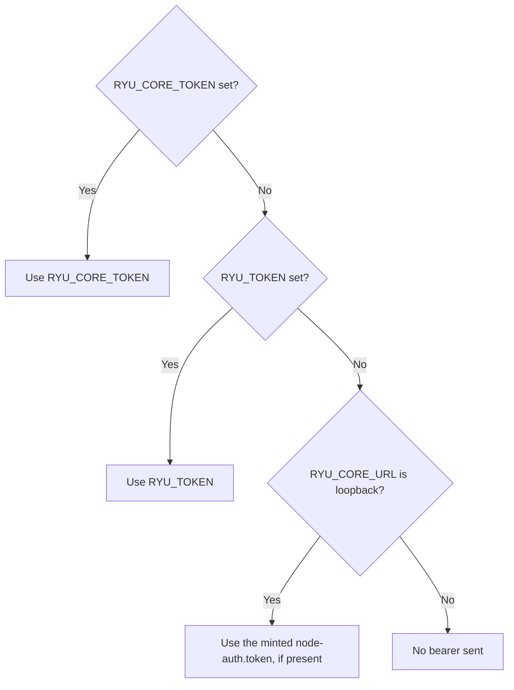

The `apps/mcp` compatibility bridge has one target. It does not maintain a node registry or choose between local and managed nodes.

## Environment variables

| Variable | Default | Meaning |
|---|---|---|
| `RYU_CORE_URL` | `http://127.0.0.1:7980` plus the `RYU_PROFILE` port offset | The Core node used by the stdio bridge. |
| `RYU_PROFILE` | unset (release) | Selects the default Core port. `dev` adds 1000, `canary` 2000, `nightly` 3000, and `beta` 4000. It also selects the default `RYU_AUTH_URL`. |
| `RYU_CORE_TOKEN` | unset | Explicit bearer for the target Core. It wins over every other source. |
| `RYU_TOKEN` | unset | Operator-provisioned node token. The bridge uses it when `RYU_CORE_TOKEN` is unset. |
| `RYU_DIR` | unset | Core's relocated data directory. The bridge uses it to find `secrets/node-auth.token` and the default session file. When unset, the bridge resolves the data folder the same way Core does. |
| `RYU_AUTH_URL` | `https://api.ryuhq.com` (`http://localhost:3000` when `RYU_PROFILE=dev`) | Better Auth control-plane URL used by `ryu-mcp login`, `logout`, and `whoami`. It must use HTTPS unless it points at loopback. |
| `RYU_MCP_AUTH_FILE` | `<data dir>/secrets/mcp-auth.json` | Local file for this bridge's Better Auth session. |

The bridge picks its bearer in this order: `RYU_CORE_TOKEN`, then `RYU_TOKEN`, then the node's minted `node-auth.token`. It reads the minted token only when `RYU_CORE_URL` is loopback, so it never sends this machine's node secret to a remote URL.



`RYU_CORE_TOKEN` and the session created by `ryu-mcp login` are different values. The first admits the bridge to Core. The second identifies a person to the control plane.

## Local target

```json
{
  "mcpServers": {
    "ryu-local": {
      "command": "bun",
      "args": ["run", "apps/mcp/src/index.ts"],
      "env": {
        "RYU_CORE_URL": "http://127.0.0.1:7980"
      }
    }
  }
}
```

For a local Core, the bridge reads `node-auth.token` automatically. An explicit `RYU_CORE_TOKEN` wins over the file.

## Self-hosted remote target

Use the remote node's reachable URL and its node or paired token.

```json
{
  "mcpServers": {
    "ryu-self-hosted": {
      "command": "bun",
      "args": ["run", "apps/mcp/src/index.ts"],
      "env": {
        "RYU_CORE_URL": "https://node.example.com",
        "RYU_CORE_TOKEN": "<token-for-that-node>"
      }
    }
  }
}
```

The URL can be a private Tailscale or Headscale address. For Tailcat, run a Tailcat client or proxy that exposes
the temporary connection to the MCP host's HTTP client. The Tailcat address itself is a connection token, not a
URL. The network layer handles reachability, and Core still checks the bearer on every request.

## Managed target

Do not point the stdio bridge at the control-plane URL. The control plane lists managed nodes, but it is not the Core API for those nodes.

For an external MCP host, use the hosted resource:

```text
https://<ryu-service>/mcp/<node-id>/<agent-id>
```

The MCP host authenticates with Better Auth OAuth and PKCE. The service resolves the node's registered HTTPS URL and forwards the request with a short-lived, node-and-agent delegation.

The Desktop node selector performs this discovery itself through `GET /api/control-plane/nodes`. It uses a short-lived managed user JWT (see [MCP Credentials and Security](/docs/extend/mcp/security#direct-local-or-self-hosted-mcp) for how Core checks it). This cloud list does not replace a local, LAN, or self-hosted node.

## Secrets in MCP server entries

When Core calls another MCP server, keep that server's credential out of `mcp.json` and store it in the
[Secret Vault](/docs/security/secret-vault). Use a `secret:NAME` reference in a server's
`headers` or `env` map. Core resolves it only during the governed MCP call.

The reference does not grant the server access by itself. Registration, the agent allowlist,
node scope, Gateway policy, and any approval still apply.

## Multiple nodes

Register one stdio entry per direct node and give each a distinct name, for example `ryu-local` and `ryu-office`. Each entry has its own URL and bearer. A host cannot switch the bridge's target by changing a tool argument.

If you need a single hosted endpoint that names the destination in its URL, use hosted MCP instead.

<Callout type="info">
  Core's canonical direct MCP route is `/mcp/<agent-id>`. The stdio bridge exposes a fixed compatibility list of `ryu_*` wrappers, so newly registered Core tools may only appear through the canonical Core route.
</Callout>

Continue with [MCP](/docs/extend/mcp), [MCP quickstart](/docs/extend/mcp/quickstart), [MCP security](/docs/extend/mcp/security), [Core MCP registry](/docs/core/mcp-registry), and [MCP tools](/docs/extend/mcp/tools).
