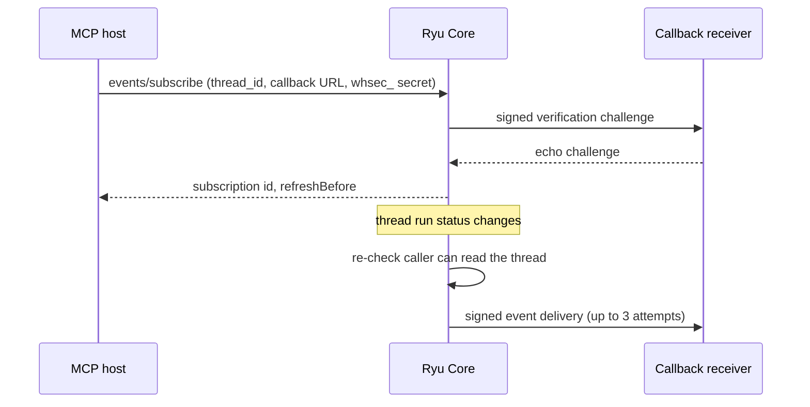

Ryu Core supports the webhook delivery subset of [OpenAI MCP Events](https://developers.openai.com/plugins/build/mcp-events) on authenticated direct and hosted node endpoints. MCP Events is an application-change webhook API. It is separate from MCP's `subscriptions/listen` notification stream.

The endpoint uses MCP protocol `2026-07-28`. `server/discover` advertises the `events` capability, and `events/list`, `events/subscribe`, and `events/unsubscribe` run on the same `/mcp/<agent-id>` endpoint as tools.



## Available event

Ryu exposes one event.

| Name | Subscription filter | Payload data |
|---|---|---|
| `thread.run_status_changed` | `thread_id`, the exact thread to monitor | `thread_id` and `status` (`running`, `completed`, `failed`, or `interrupted`) |

Core lists this event only for an MCP principal whose allowlist grants a `threads.*` tool. It checks that the caller can read the selected thread when subscribing and before every delivery. If access is revoked, Core removes the subscription and stops sending updates. Subscription state is encrypted at rest.

Every delivery uses this envelope. The stable `eventId` stays the same for all retry attempts. The `timestamp` and signature are fresh for each attempt.

```json
{
  "eventId": "evt_…",
  "name": "thread.run_status_changed",
  "timestamp": "2026-09-30T10:22:30.000Z",
  "data": { "thread_id": "thread_123", "status": "completed" },
  "cursor": null
}
```

Example `events/subscribe` body (the 2026 request metadata and HTTP routing headers are omitted here):

```json
{
  "jsonrpc": "2.0",
  "id": 7,
  "method": "events/subscribe",
  "params": {
    "name": "thread.run_status_changed",
    "arguments": { "thread_id": "thread_123" },
    "delivery": {
      "mode": "webhook",
      "url": "https://receiver.example.com/mcp-events/callback",
      "secret": "whsec_<base64-encoded-key>"
    },
    "ttlMs": 604800000,
    "cursor": null
  }
}
```

Use a `whsec_` secret whose base64 value decodes to 24–64 bytes. Core sends a signed verification request first:

```json
{ "type": "verification", "challenge": "<random challenge>" }
```

Return the same `challenge` in a successful JSON response. Core activates the subscription only after the echo matches. The `events/subscribe` result includes the stable subscription `id`, its `refreshBefore` time, and a null cursor.

## Delivery and limits

### Callback destination

- Callback URLs must be public HTTPS.
- Core resolves and checks the destination at connection time, pins the validated address, blocks private/local IPs, and does not follow redirects.

### Signing and payload

- Each delivery contains one event object, is signed with Standard Webhooks headers, and is limited to 256 KiB.
- Verify `webhook-signature` as `v1,<base64>` over `webhook-id.webhook-timestamp.<exact request body>` using the decoded `whsec_` key.
- `webhook-id` is the stable event ID. `webhook-timestamp` changes on retries. Core also sends `X-MCP-Subscription-Id`.
- Event data contains only the thread ID and status. It does not include the thread title or transcript.

### Retries and persistence

- Transient failures receive up to three attempts with a fresh signing timestamp and the same event ID. HTTP 410 and 413 responses are not retried.
- Subscriptions persist across Core restarts. Run-status events are not replayable: Ryu returns `cursor: null`, and changes during downtime are missed.

### Lifetime, refresh, and unsubscribe

| Case | Behavior |
|---|---|
| `ttlMs` missing | Seven-day lifetime |
| `ttlMs` set | Granted up to 90 days |
| `ttlMs: null` | Requests a non-expiring subscription. On a shared node the caller's verified identity or delegation expiry is always the upper bound; refresh with a new authorized request to continue delivery. |
| Refresh | Call `events/subscribe` again with the same event, filter, and callback URL. |
| New signing secret | Replaces the stored key. Core signs with both keys during a five-minute rotation window. |
| `events/unsubscribe` | Idempotent. Uses the original event name, filter, and callback URL. |

The anonymous public website and documentation MCP servers are read-only and do not expose event subscriptions. For node and hosted credentials, see [MCP security](/docs/extend/mcp/security) and [MCP quickstart](/docs/extend/mcp/quickstart).
