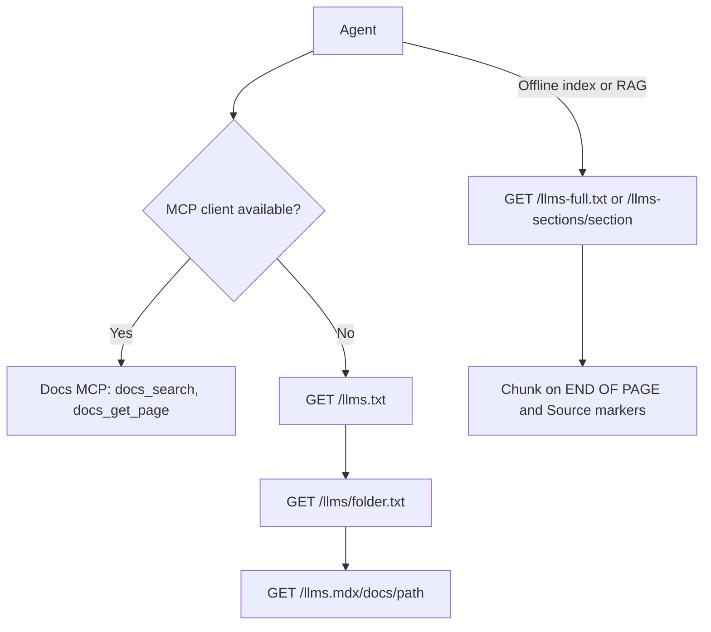

The docs site serves every page as plain Markdown, so a coding agent, a RAG pipeline, or a custom crawler can read it without scraping HTML. Reading these endpoints requires no API key. Responses advertise a one-day public cache lifetime; hosting-level traffic controls can still apply.

Two access models cover most hosts.

- **Plain text over HTTP** - the `llms.txt` family below. It works anywhere `curl` works, including hosts with no MCP support.
- **MCP server** - the same content behind three tools (`docs_search`, `docs_get_page`, `docs_index`) at [`/mcp`](/docs/extend/mcp/docs-server). Use it when the agent should find pages by search instead of following a list.

## Endpoints

| Endpoint | Format | Use case |
|---|---|---|
| `GET /llms.txt` | Compact Markdown index | Discover each section and its main pages, with links to the folder indexes. |
| `GET /llms/<folder>.txt` | Markdown index, one folder | List every page in one docs folder (e.g. `/llms/extend/mcp.txt`). |
| `GET /llms-sections/<section>` | Full text per section | Pull one section's pages (e.g. `gateway`, `extend`). |
| `GET /llms-full.txt` | Full text, all pages | Bulk ingestion of the whole docs. |
| `GET /llms.mdx/docs/<path>` | Markdown, one page | Fetch a single page by slug. |
| `GET /docs/<path>.md` | Markdown, one page | Fumadocs' standard Markdown suffix. |
| `GET /docs/<path>.mdx` | Markdown, one page | Processed Markdown used by the page actions. |

The base URL is `https://docs.ryuhq.com`. Every endpoint returns `Content-Type: text/markdown; charset=utf-8` and `Cache-Control: public, max-age=86400`.

The site also advertises the index the standard way: the document `<head>` ships `<link rel="alternate" type="text/plain" title="LLM-friendly docs index" href="/llms.txt">`, which clients can use to discover the Markdown index.

### Content negotiation

The normal HTML page URL also serves processed Markdown when the `Accept` header lists `text/markdown`, `text/x-markdown`, or `text/plain` with a weight above zero, even if it gives HTML a higher weight. A browser's default `Accept` header and a bare `*/*` receive the HTML page. One canonical URL serves both browsers and agents.

```sh
curl -H 'Accept: text/markdown' https://docs.ryuhq.com/docs/extend/mcp/quickstart
```

A zero weight, such as `text/markdown;q=0` or `text/markdown;q=0.0`, declines that type, and so does a negative weight or a `q` parameter without a number. A request that accepts none of these types receives the HTML page. Media type names are case-insensitive on both sites, so `TEXT/MARKDOWN` is the same request as `text/markdown`.

Use the explicit `.md` or `.mdx` suffix when a client cannot set request headers. If a deployment puts the HTML and negotiated Markdown behind a shared cache, configure that cache to vary on `Accept`. Next.js may otherwise remove the header while finalizing an App Router page response.

### The index: `/llms.txt`

The index follows the [llmstxt.org](https://llmstxt.org/) shape: an H1, a one-line summary, and one H2 per top-level section with Markdown links. It is a compact navigation index, not a list of every page.

The complete page tree is too large for one index. Each section lists its overview page and its direct children, and links each folder to that folder's own index. The root index stays below 30,000 characters. Fetch it first, follow the folder indexes that matter, then fetch those pages individually.

```sh
curl https://docs.ryuhq.com/llms.txt
```

Its `Optional` section links `/llms-full.txt`, the [Docs MCP server](/docs/extend/mcp/docs-server), and the sitemap. `/llms.txt?locale=<code>` lists only the pages translated into that locale.

### Folder indexes: `/llms/<folder>.txt`

Every docs folder has its own index at `/llms/<folder path>.txt`, for example `/llms/extend/mcp.txt` for the pages under `/docs/extend/mcp`. A folder index names its parent index and the number of pages it holds:

- A folder that fits lists every page.
- A larger folder lists one level and links each subfolder to its own index.

```sh
curl https://docs.ryuhq.com/llms/extend/mcp.txt
```

A folder whose direct pages alone do not fit in one index, such as a large generated API reference group, is split into pages. The first page is the plain URL, and the rest are at `?page=2`, `?page=3`, and so on. Each page ends with a `More pages` list that links the previous and next page.

A folder or page number that does not exist returns `404`. Folder indexes are English only.

### Per-page Markdown: `/llms.mdx/docs/<path>`

Fetch one page as processed Markdown. Use the docs URL slug without the `/docs` prefix.

```sh
curl https://docs.ryuhq.com/llms.mdx/docs/extend/mcp/quickstart
```

Each page starts with a header that agents can parse.

```text
Source: https://docs.ryuhq.com/docs/extend/mcp/quickstart
Title: Quickstart
Description: ...
Tags: ...

<body markdown>
```

### Per-section: `/llms-sections/<section>`

All pages under one top-level section, concatenated and delimited by `--- END OF PAGE ---`.

Valid section names are the top-level realms, in sidebar order: `start-here`, `learn`, `surfaces`, `mobile`, `browser-extension`, `hardware`, `apps`, `plugins`, `providers`, `core`, `gateway`, `security`, `extend`, `ui`, `standalone`, `ci`, `showcase`, `reference`, `billing`, `programs`, `legal`, `release-notes`, `roadmap`, and `rsi`.

Legacy names such as `desktop`, `develop`, `skills`, `mcp`, `cookbook`, and `academy` remain aliases.

```sh
curl https://docs.ryuhq.com/llms-sections/gateway
```

Use it to load one area of the docs, such as the Gateway, without the whole site.

### Full text: `/llms-full.txt`

Every English page in one response, with its full Markdown content, headed by a summary of the other endpoints. Use it when you need the content, not just the navigation that `/llms.txt` gives. The response is large. Prefer `/llms-sections/` or per-page fetches unless you are building an offline index.

```sh
curl https://docs.ryuhq.com/llms-full.txt -o ryu-docs.txt
```

## Using it from an agent



### Direct fetch (any agent)

Point your agent's instructions at the index so it fetches pages as needed. Add this to `AGENTS.md`.

> Ryu docs are served as Markdown. Fetch `https://docs.ryuhq.com/llms.txt` to find the section, follow its folder index (`/llms/<folder>.txt`) to list that folder's pages, then fetch `https://docs.ryuhq.com/llms.mdx/docs/<path>` to read one. Prefer this over guessing.

With `curl`.

```sh
# list sections, then one folder's pages, and pick a slug
curl -s https://docs.ryuhq.com/llms.txt
curl -s https://docs.ryuhq.com/llms/extend/develop.txt

# read one page
curl -s https://docs.ryuhq.com/llms.mdx/docs/extend/develop/quickstart
```

### MCP server

The [Docs MCP](/docs/extend/mcp/docs-server) server exposes the same content as tools. `docs_search` finds pages by query, `docs_get_page` reads one, and `docs_index` lists a section. Host setup for Claude Code, Cursor, VS Code, and Claude Desktop is on that page.

The plain-text endpoints are the fallback for hosts that cannot run an MCP client.

### RAG / offline ingestion

For an embedding pipeline, fetch `/llms-full.txt` (or a section) and chunk on the `--- END OF PAGE ---` and `Source:` markers. They map one-to-one onto pages and URLs, so every chunk can cite its source page.

```sh
curl -s https://docs.ryuhq.com/llms-full.txt
```

## Search, links, and citations

The [XML sitemap](https://docs.ryuhq.com/sitemap.xml) lists canonical documentation URLs. HTML pages provide page-specific titles, descriptions, canonical links, and social preview images. Preview images stay crawlable so shared links can show their cards.

The Markdown index does not guarantee indexing or citation by a search engine. Link to a page's canonical HTML URL, and read its Markdown form from an agent.

The HTML pages, Markdown exports, and Docs MCP use the same documentation source. Use the `Source:` URL to cite the canonical page, and check its documented version before you apply a command or configuration example.

Generated pages describe interfaces and package capabilities:

- Generated API reference pages derive from the API schema.
- Catalog pages derive from package manifests and catalog data.

They are not evidence of a working provider connection or a production deployment. A catalog entry without a useful description or README stays readable but is marked `noindex, follow` on the website.

## Website discovery and authentication

The main website publishes a [curated LLM index](https://ryuhq.com/llms.txt). Its `/llms-full.txt` redirects to the docs corpus above.

### Page reads

Public website pages also support Markdown reads and a `read_page` tool on the website MCP server and in WebMCP:

- The MCP server's `read_page` reports a page that does not exist as a not-found error, with the same next steps as the Markdown `404`. It reports a moved page with its new URL instead of following the redirect.
- WebMCP's `read_page` returns an error for a page that does not exist.

Those reads return the anonymous, server-rendered page, including comparison tables, source links, and FAQ questions with their answers. Loading placeholders, serialized rendering payloads, and interface controls are omitted. Cite the canonical page URL.

### Machine-readable files

The website publishes these other machine-readable files:

| URL | Content |
|---|---|
| `/platform/llms.txt`, `/marketplace/llms.txt`, `/download/llms.txt`, `/compare/llms.txt` | Per-section LLM indexes (`text/plain`). The root and platform indexes have a Standalone services section that links each service's OpenAPI document with its server and status. |
| `/.well-known/api-catalog` | RFC 9727 API catalog: the public and documentation MCP servers, the hosted API, local Core, the hosted Managed Agents (preview) and Mail APIs, Messaging (early access, enabled per organization), the early-access hosted Notify and Box hosts, and the hosted MCP endpoint that serves the [Mail tools](/docs/standalone/sdk/mcp-hosted-mail) |
| `/pricing.md` | Plans, prices, included usage, and limits, generated from the plan catalog |
| `/.well-known/agent-skills/index.json` | Agent Skills discovery index with a `sha256` digest per skill |
| `/.well-known/agent-card.json` | A2A agent card. Its only interface is the website MCP server; the site runs no A2A endpoint. |
| `/.well-known/ard.json`, `/.well-known/ai-catalog.json` | Agentic resource discovery manifest and AI catalog (same entries) |
| `/schemamap.xml` | NLWeb Schema Map that lists the schema.org feeds below |
| `/feeds/marketplace.jsonl`, `/feeds/blog.jsonl` | schema.org objects as JSON Lines |

`/robots.txt` points to the Schema Map with a `schemamap:` line and to the ARD manifest with an `Agentmap:` line. The website MCP server and the NLWeb `/ask` endpoint are described in [Website MCP and NLWeb](/docs/extend/mcp/website).

Both sites publish `/robots.txt`, `/sitemap.xml`, `/manifest.webmanifest`, favicons, Apple touch icons, and social preview metadata. Robots rules guide crawlers. They do not authorize access to private resources.

### Catalogs and API descriptions

The [AI capability catalog](https://ryuhq.com/.well-known/ai-catalog.json) indexes:

- the public MCP server card and the A2A agent card
- the published agent skills and the API catalog
- the Core and hosted API OpenAPI documents
- the [service OpenAPI documents](/docs/standalone/sdk/openapi)
- the documentation index

The same entries are at `https://ryuhq.com/.well-known/ard.json`. The catalog uses the AI Catalog data model with stable `urn:air` identifiers and representative queries. Its public JSON response allows cross-origin reads. Each entry references its native artifact, and the catalog does not grant access to protected APIs.

The hosted API at `https://api.ryuhq.com/api/v1` is described by [`/openapi/v1.json`](https://ryuhq.com/openapi/v1.json). Its error codes, rate-limit fields, idempotency keys, and versioning policy are in the [hosted API reference](/docs/reference/api). The homepage response also lists the API catalog, both OpenAPI documents, the ARD manifest, and the AI catalog in its `Link` header.

### Account access and OAuth

For account-based API access, read [auth.md](https://ryuhq.com/auth.md) and [Authentication and discovery](/docs/reference/api/authentication). Ryu documents dynamic client registration followed by authorization code with PKCE and interactive user consent. Public documentation does not require this flow. The docs site's `/auth.md` redirects to the same authentication guide.

OAuth discovery names `https://api.ryuhq.com/api/auth` as the issuer. Fetch its [RFC 8414 metadata](https://api.ryuhq.com/.well-known/oauth-authorization-server/api/auth) and check the issuer before registering.

- The metadata carries no `agent_auth` block: WorkOS identity assertions and claim-token grants are not supported.
- Registration alone grants no access.
- Token revocation uses the issuer's advertised revocation endpoint. No revocation event receiver is advertised.

DNS-AID service bindings under `_agents.ryuhq.com` can also locate the website's discovery and MCP services.

<Callout type="warn">
  Require DNSSEC-authenticated responses before you trust DNS-AID discovery. A signature alone does not prove a complete trust chain.
</Callout>

### Security reports

Report vulnerabilities privately to [security@amajor.ai](mailto:security@amajor.ai). The reporting policy is at [`/.well-known/security.txt`](https://ryuhq.com/.well-known/security.txt). The main site's `/security.txt` and both security-file paths on the docs site redirect to that policy. The file includes a review expiry, so treat it as stale after that date.

### Markdown on the main site

Each public page on `https://ryuhq.com` also has a Markdown twin at `<page>.md`, for example `https://ryuhq.com/download.md`.

- The homepage twin is `https://ryuhq.com/index.md`, and `/<section>/index.md` is the twin of `/<section>`.
- `/auth.md`, `/pricing.md`, and `/setup-ryu.md` are their own Markdown documents.
- A redirecting page answers its twin with the same redirect, pointing at the target's `.md` form when the target has one.

Public content pages on the main site negotiate only `text/markdown` and read its weight the same way as the docs site: a weight above zero returns Markdown even when HTML is weighted higher, while a zero, negative, or numberless weight returns the HTML page.

`text/plain` and `text/x-markdown` receive the HTML page there. Signed-in pages such as the dashboard and organization settings are never converted to Markdown.

| Request | Response |
|---|---|
| `GET` or `HEAD` with `Accept: text/markdown` (weight above zero) | Markdown |
| `GET` or `HEAD` from a documented AI agent fetcher such as `ChatGPT-User`, `Claude-User`, or `PerplexityBot`, with any `Accept` that does not refuse `text/markdown` | Markdown |
| Search crawlers such as `Googlebot`, `bingbot`, and `Applebot` | HTML |
| Browsers | HTML, with `Link: <https://ryuhq.com/<page>.md>; rel="alternate"; type="text/markdown"` |

Markdown responses use these headers:

- `Content-Type: text/markdown; charset=utf-8`
- `Vary: Accept, User-Agent`
- `Cache-Control: private, no-store`
- `Link: <canonical>; rel="canonical"`

The body opens with YAML frontmatter that holds the page `title`, and its `description`, `canonical` URL, and `last-updated` date when the page has them, followed by a `# ` heading.

A page that does not exist returns `404` with a Markdown body. The HTML page answers the same way: an unknown blog post, help article, changelog entry, Marketplace item, or other page path returns HTTP `404`, not a `200` page that only shows a not-found message.

The 404 body names the requested URL and links to `/llms.txt`, `/sitemap.xml`, the documentation, and `/index.md`. A request to `https://ryuhq.com/api/...` or `https://ryuhq.com/v1/...` that matches no route returns an `application/problem+json` 404 instead (see [Errors](/docs/reference/api/errors)).

## Related

<Cards>
  <DocCard href="/docs/extend/mcp/docs-server" />
  <DocCard href="/docs/extend/mcp" />
  <DocCard href="/docs/extend/develop/agent-integration-guide" />
</Cards>
