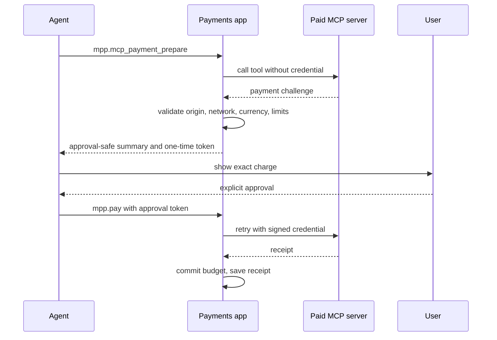

Ryu supports the Machine Payments Protocol (MPP) payment extension for MCP (Model Context Protocol).
The payment policy, protocol client, signing, and spending stay inside the optional
**Payments** app (`@ryu/mpp`). The app uses Ryu's per-app encrypted custody and namespaced storage
for its signing secrets; Core owns the sealing key and the app never receives it.

## Challenge and continuation

A paid MCP server can request payment in either of the protocol's standard forms. The first is a JSON-RPC error.

```json
{
  "jsonrpc": "2.0",
  "id": 2,
  "error": {
    "code": -32042,
    "message": "Payment required",
    "data": {
      "httpStatus": 402,
      "challenges": ["<MPP challenge object>"]
    }
  }
}
```

The second returns the same `challenges` data under `result._meta["org.paymentauth/payment-required"]`.

Core preserves the structured challenge and returns a safe payment-required envelope to the caller. It does not sign, retry, or expose a wallet by itself. The Payments app runs the governed continuation.

1. `mpp.mcp_payment_prepare` initializes the allowlisted remote server and calls the tool without a credential.
2. The app validates the challenge, checks the origin, network, currency, per-request limit, and daily budget, then returns an approval-safe summary.
3. After explicit approval, `mpp.pay` signs the exact captured challenge and retries with `_meta["org.paymentauth/credential"]`.
4. The server returns `_meta["org.paymentauth/receipt"]`; Ryu commits the budget reservation and saves a safe receipt projection.



The one-time approval expires after five minutes or when the server challenge expires, whichever comes first. A changed challenge, reused token, missing receipt, expired MCP session, or exhausted budget fails closed.

The app's outbound HTTP uses Core's shared DNS-pinned egress primitive. The app still
owns the MPP origin allowlist and same-origin redirect rule, while Core owns private
address rejection, IP pinning, timeouts, and response-size limits.

## Discovery

The Marketplace includes the read-only MPP Services remote server at `https://mpp.dev/mcp/services`. Installing it lets agents browse compatible services; it does not grant payment permission or access to the Payments wallet.

## Stripe Link and x402 providers

The Marketplace also lists [Stripe Link Agent Wallet](https://github.com/stripe/link-cli) as the
recommended default wallet for supported U.S. Link accounts. Its local CLI can create:

- one-time card credentials for standard checkouts
- Link Pay Tokens for eligible Stripe-hosted checkouts
- Shared Payment Tokens for merchants that accept Stripe's MPP payment method

When no payment method is specified, Link uses the account's default eligible method. The Link CLI
owns its authentication session and approval policy. Those controls are separate from the Tempo
policy and receipt ledger in the Payments app.

<Callout type="warn">
  Stripe Link Agent Wallet works only with U.S. Link accounts.
</Callout>

Install the **Stripe Link Agent Wallet** MCP entry from Marketplace, review it, and enable the
`stripe-link` server in MCP settings. Catalog installs begin disabled. Finish Link sign-in and any
purchase approval through Link. Keep one-time payment credentials out of chat and logs.

The **x402 MCP** Marketplace entry is for services that request x402 stablecoin
payments over HTTP 402. It is a separate provider with its own wallet and rules; installing Link
does not change or authorize x402 payments.

## Current scope

<Callout type="warn">
Paid MCP calls through the Payments app use Streamable HTTP over an allowlisted HTTPS origin. That
app's wallet supports Tempo testnet `tempo/charge` challenges denominated in pathUSD. Other payment
methods, currencies, networks, and mainnet spending are rejected there; Stripe Link and x402 run as
separate MCP providers.
</Callout>

See [Machine payments](/docs/surfaces/desktop/user-guide/payments) for wallet setup, policy controls, approvals, and receipt behavior.
