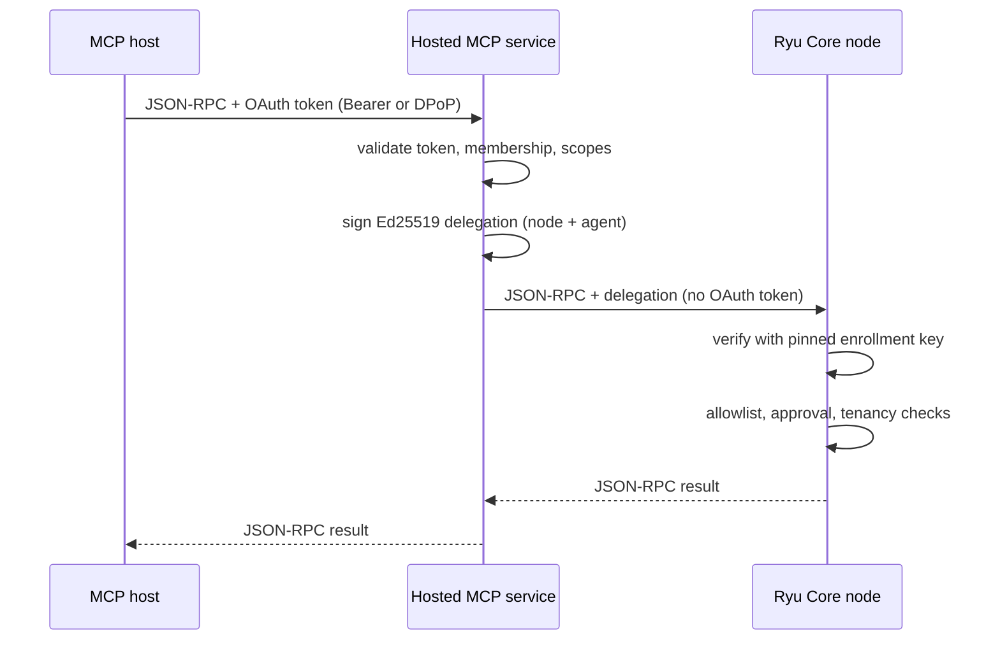

An MCP request crosses more than one boundary. Each boundary has its own credential and its own check.

## Credential map

| Credential | Where it is checked | What it grants |
|---|---|---|
| Better Auth session or device token | Ryu control plane | A signed-in user and their organization memberships |
| Node bearer or paired token | Core | Access to one Core node, with paired capabilities and bindings |
| Managed user JWT | An organization-bound Core node | The user's role plus organization, team, or personal-node scope for direct managed-node requests |
| Hosted MCP OAuth grant | Hosted MCP service | Consent, resource audience, and requested MCP scopes; hosted Mail tools also need the organization to allow the app's client id on its Security page |
| Ed25519 node delegation | Core | One hosted request, one node, one agent, and a short expiry |
| Third-party provider credential | Core MCP registry / Passport | Core's request to one configured external MCP server |

These values are not interchangeable. Website sign-in does not pair a node. A node token does not sign a user into the website. A plugin's provider credential does not grant access to Ryu.

## Direct local or self-hosted MCP

The direct endpoint takes a node or paired bearer.

```text
POST https://<node>/mcp/<agent-id>
Authorization: Bearer <node-or-paired-token>
```

Core checks the bearer before it reads the JSON-RPC message. For `tools/list`, the caller needs `tools:read`. For `tools/call`, it needs `tools:exec`. Core then requires an exact known agent id and checks that agent's allowlist.

For a managed node selected by Desktop, the bearer can instead be the short-lived
`userJwt` returned by `GET /api/control-plane/nodes`. Desktop also sends it as
`x-ryu-user-jwt`. Core then:

1. Verifies the signature.
2. Matches the organization.
3. Checks team or personal ownership.
4. Applies the route capability.

Desktop gets the JWT with the user's Better Auth session, refreshes it before it expires, and
keeps it in memory. It is not written into `nodes.json` as a node secret. This managed shortcut is
not available on an unbound local or self-hosted node.

Local Core creates `node-auth.token` on first boot. A local stdio bridge can read it when the target URL is loopback. A browser or another machine cannot read that file, so it uses the node pairing flow instead. Pairing approval happens on the node and can work without a control-plane account.

## Managed or organization-bound MCP

The hosted endpoint takes a Better Auth OAuth token.

```text
POST https://<ryu-service>/mcp/<node-id>/<agent-id>
Authorization: Bearer <Better-Auth-OAuth-token>
```

A client that asked for a sender-constrained (DPoP, RFC 9449) access token presents it under the
`DPoP` scheme, with a fresh proof signed by the key the token is bound to:

```text
POST https://<ryu-service>/mcp/<node-id>/<agent-id>
Authorization: DPoP <Better-Auth-OAuth-token>
DPoP: <proof JWT for this method and URL>
```

The proof names the request method and URL, carries the hash of the token, and is accepted once.
A DPoP-bound token sent as a bearer token is refused, as is a bearer token sent under the `DPoP`
scheme. Such a refusal, or a refused proof, answers `401` with a `DPoP` challenge that lists the
accepted proof algorithms, the same ones the protected-resource metadata advertises.

The hosted service does the following.

1. Validates the OAuth token (and, for a DPoP-bound token, its proof), client, session, resource
   audience, and expiry.
2. Checks organization membership, personal or team ownership, and requested scopes.
3. Intersects the OAuth grant with the user's organization role.
4. Signs a short-lived Ed25519 delegation bound to the exact node and agent.
5. Forwards the JSON-RPC request to the node's `/mcp/<agent-id>` endpoint.

The hosted service never forwards the original OAuth token to Core. Core verifies the delegation locally using the public key pinned during node enrollment. It also checks the node id, organization, team, agent, issuer, scope, and expiry.



The Desktop node selector uses a related direct path with a managed user JWT. See [Direct local or self-hosted MCP](#direct-local-or-self-hosted-mcp).

## Tool execution after authentication

Authentication only admits the request. Before dispatch, Core still applies:

- the MCP method capability
- the agent allowlist and approval policy
- app lifecycle checks
- tenancy rules
- Passport bindings

In remote mode Passport owns the provider credential and long-lived authenticated transport.

The Gateway is not the node-discovery service. For model calls, Core sends traffic through the Gateway, where routing, firewall rules, budgets, billing, and audit apply. Core's MCP registry connects to the configured external MCP server over stdio, Streamable HTTP, or legacy SSE.

When Ryu screens and pins an outbound MCP destination, it connects directly to the checked addresses instead of handing destination resolution to a system HTTP proxy. Explicitly exempt destinations keep their configured transport behavior.

## Revocation and storage

- Revoke a paired client in the node's **Gateway → Connections** settings. This does not rotate the node owner's credential.
- Revoke a managed node or organization membership in the control plane. Future hosted delegations stop, and existing delegations expire quickly.
- Keep direct node tokens out of source control and MCP host prompts.
- `ryu-mcp login` stores its user session in `<data dir>/secrets/mcp-auth.json`. It is separate from Desktop's encrypted credential store and does not replace the node bearer used for Core calls.

MCP Event subscriptions inherit the exact agent and verified caller from the authenticated request. Signing secrets are encrypted at rest. The thread access checks are under [Available event](/docs/extend/mcp/events#available-event), and the callback URL rules are under [Delivery and limits](/docs/extend/mcp/events#delivery-and-limits).

The public website MCP endpoint is a separate anonymous, read-only service. It has no account session and no node access.

Continue with [MCP](/docs/extend/mcp), [MCP configuration](/docs/extend/mcp/configuration), [MCP tools](/docs/extend/mcp/tools), [authentication and pairing](/docs/security/authentication-and-pairing), and [Gateway security](/docs/gateway/security).

