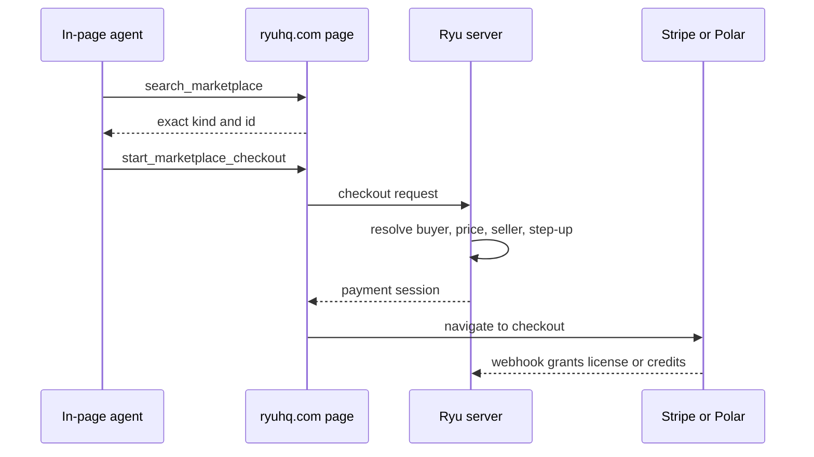

WebMCP lets a browser agent discover tools that a page registers with `document.modelContext`. The current W3C Community Group draft exposes `registerTool`, `getTools`, and `executeTool` for in-page agents. `navigator.modelContext` is a deprecated alias retained by some browser previews.

Ryu registers tools from each public site's root layout, so they are available while browsing rather than only on one product page.

WebMCP is a browser surface, not an alternative public API. It runs in the visitor's browser and can use that browser's signed-in Ryu session on `ryuhq.com`. The public `https://ryuhq.com/mcp` server stays read-only (see [Ryu MCP](/docs/extend/mcp)).

## Register tools on a website

Use `registerTool()` to expose one focused action with a JSON Schema and a browser-side
implementation. Tie registration to the page or component lifecycle with an abort signal:

```js
function registerPageTool() {
  const controller = new AbortController();
  void document.modelContext.registerTool(
    {
      name: "read_current_title",
      title: "Read current title",
      description: "Read the title of the page currently open.",
      inputSchema: { type: "object", properties: {}, additionalProperties: false },
      annotations: { readOnlyHint: true, untrustedContentHint: true },
      execute: async () => document.title,
    },
    { signal: controller.signal },
  ).catch(() => undefined);

  // In React, return this cleanup from the effect that owns registration.
  return () => controller.abort();
}

const unregisterPageTool = registerPageTool();
```

Keep tool implementations narrow and let the server re-check identity, permissions,
prices, and any state-changing policy. Use the annotations to describe each tool:

- `untrustedContentHint` - the tool returns untrusted page data.
- `consequentialHint` - the action has real-world or hard-to-reverse effects.
- `debugging` - the tool is meant for developer diagnostics.

## Marketing site tools

| Tool | What it does | Changes state? |
|---|---|---|
| `read_page` | Reads a Ryu page as Markdown. | No |
| `list_agent_skills` | Lists the skills published by Ryu. | No |
| `search_marketplace` | Finds Marketplace items and returns their id, kind, version, price, and description. Searches every kind by default; `kind: "template"` covers Agent Templates, Stack Templates, and Workflows. | No |
| `get_marketplace_item` | Reads one public Marketplace item's current details. | No |
| `get_cloud_instance_catalog` | Lists public Cloud instance specs, monthly prices, locations, and live/fallback status. | No |
| `start_marketplace_checkout` | Starts a checkout for one paid Marketplace item. | Starts a checkout |
| `start_plan_checkout` | Starts checkout for a public Ryu plan, with an optional Teams or Business seat count. | Starts a checkout |
| `start_cloud_instance_checkout` | Starts checkout for one paid Cloud instance add-on, using a catalog type and optional region, inference mode, desktop flag, and organization. | Starts a checkout |
| `start_credit_topup` | Starts checkout for a fixed or bounded custom organization credit top-up. | Starts a checkout |

The checkout tools carry `consequentialHint` and start a payment session. They do not charge a card directly. The browser navigates to Stripe or Polar, where the visitor reviews the final amount and confirms payment. A paid Marketplace license or credit balance is granted later by the existing webhook flow.



Cloud checkout is also a recurring hosted payment:

- Call `get_cloud_instance_catalog` first and pass the returned instance `type` and optional `location`. Ryu re-resolves the live price and availability on the server.
- The free plan-included base node (`cx23`) is not a checkout option.
- If `organizationId` is supplied, the server verifies that the signed-in caller can manage billing for that organization. Otherwise the active billing scope is used.
- The browser records the organization server view before navigation, so a successful Cloud checkout can return there.
- Transfer acceptance remains a separate organization flow and is not exposed through this generic tool.

## Example discovery

An in-page agent can inspect the registered tools and then execute one with a JSON object:

```js
const tools = await document.modelContext.getTools();
const checkout = tools.find(
  (tool) => tool.name === "start_marketplace_checkout",
);

if (checkout) {
  await document.modelContext.executeTool(checkout, {
    kind: "plugin",
    id: "publisher/example-plugin",
  });
}
```

Agents should call `search_marketplace` or `get_marketplace_item` first and use the exact `kind` and `id` returned by the catalog. They should not infer an item id, price, seller, organization, redirect URL, or payment details.

`getTools()` returns registered tools with their source `origin`. A page can also read tools from descendant frames when the browser permissions policy and the registering frame's `exposedTo` list allow it.

Ryu's assistant widget displays each tool's origin and keeps duplicate names from different frames distinct. It requires an extra review step for tools that are not read-only or carry `consequentialHint`.

## Authorization and safety

- The tools are registered only for the current page's same origin. Ryu does not opt an arbitrary third-party origin into access with `exposedTo`.
- Marketplace checkout resolves the signed-in buyer, active organization, stored item price, seller payout account, waitlist state, and billing step-up on the server.
- Plan checkout resolves the billing principal on the server. Teams and Business seat counts are checked against live organization membership and plan limits.
- Cloud checkout resolves the instance type, live price, regional availability, organization scope, billing role, and Cloud entitlement on the server. `inferenceMode` is only a managed-versus-BYOK mode flag; provider keys are never accepted by the tool.
- Credit top-ups require the server's `billing.manage` (owner or billing manager) and managed-inference checks. The server computes the deposit fee and the credited face value.
- Read-only and untrusted-output hints are included in the registered metadata. Marketplace and published-skill content should be treated as untrusted text, not as instructions.
- If billing step-up is required, the existing Ryu confirmation UI asks the visitor to prove the current factor before the checkout request is sent. Cancelling that prompt does not start checkout.

The public HTTP MCP server does not expose these checkout tools. It has no user session to authorize, so it continues to expose only public read operations.

## Docs site tools

The same floating **Ask Ryu** widget is present on `docs.ryuhq.com`. That site registers these read-only tools:

| Tool | What it does |
|---|---|
| `docs_search` | Searches the public documentation. Pass a locale to get results linked under that language's URL prefix; pages not yet translated are served in English. |
| `docs_get_page` | Reads one documentation page as Markdown. |
| `docs_index` | Lists the public documentation index or one section. |

The docs-site tools use `credentials: omit`, stay on the docs origin, and label fetched content as untrusted. They do not expose product checkout tools from the docs origin.

## Ask Ryu widget

When the browser implements WebMCP and the page exposes tools, open the floating **Ask Ryu** widget and choose **Page tools**. The widget:

- reads tools returned to its document by `getTools()`
- renders bounded arguments from the schema
- shows each source origin
- adds results to the chat as untrusted page content

Read-only tools run after their arguments are submitted. Other tools require a second review click. The local browser model is never allowed to silently turn a natural-language answer into a tool call.

## Browser support

WebMCP is an evolving [browser proposal](https://webmachinelearning.github.io/webmcp/). Browsers without `document.modelContext` ignore Ryu's registration component, and normal website navigation and checkout buttons continue to work.

The in-app Ryu Browser also discovers and executes tools from the active page using the current `executeTool(registeredTool, inputObject)` shape.

Continue with [MCP](/docs/extend/mcp), [MCP quickstart](/docs/extend/mcp/quickstart), [documentation server](/docs/extend/mcp/docs-server), [MCP tools](/docs/extend/mcp/tools), and [MCP integration](/docs/extend/integrate/mcp-integration).
