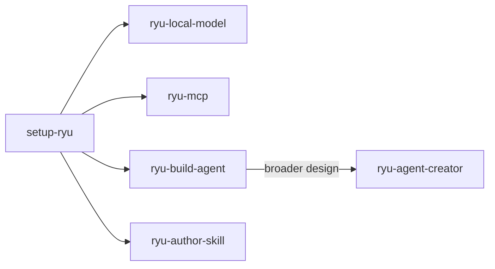

The `apps/skills` directory is Ryu's maintained collection of agent skills. Each one is a `SKILL.md` instruction pack you can install to the universal skills directory and activate per agent. [setup-ryu](/docs/extend/skills/setup-ryu) is the entry point; the other packs cover specific parts of Ryu.

<Callout type="info">
  This page lists the set Ryu ships, not every skill in the ecosystem. Run `skills.search` from an agent to see what is installed on your node right now.
</Callout>

## Built-in specialists

Five specialists are embedded in Ryu: **ryu-creator**, **ryu-configurator**, **ryu-agent-creator**, **ryu-health-audit**, and **pdf**. They are marked **Built in** in the [table below](#shipped-skills).

- Ryu installs them locally on startup, without a catalog download.
- They are enabled on first installation and load on demand through normal skill discovery.
- Existing copies, edits, and disabled states are preserved.
- Agent skill allowlists still apply. Having a skill does not grant tools, administrator access, or permission to publish.

Example prompts: "Use ryu-creator to build a Companion app for reviewing documents" or "Use ryu-configurator to let this team run an agent while keeping its Space private."

You can inspect their instructions in the Skills source view and disable any of them through the usual activation control. They provide guidance; the host still enforces policy.

## Built-in pstack pack

Ryu also embeds the [MIT-licensed pstack skill pack](https://github.com/cursor/plugins/tree/main/pstack) from Cursor's public plugin repository. It contributes 47 built-in skills, including `poteto-mode`, engineering playbooks, and the principles that the playbooks reference.

The complete skill trees are installed with their playbooks, references, and scripts. Progressive loading can therefore use the same relative resources as the upstream pack.

The pack is guidance only. Ryu still owns tool access, approvals, model routing, filesystem boundaries, and the activation and per-agent allowlist. The Cursor-specific agent definitions and Benny automation are not bundled, because they are not Agent Skills and require Cursor host contracts.

## Shipped skills

| Skill | What it teaches |
|---|---|
| **ryu-agent-creator** | Design, create, test, and package saved node agents or SDK agents with scoped capabilities, lifecycle, hooks, orchestration, and evals. Built in. See [Ryu Agent Creator](/docs/extend/skills/ryu-agent-creator). |
| **ryu-creator** | Build and package plugins and apps with Ryu primitives, manifest contracts, and the design system: Companion surfaces, chat widgets, sidecars, hooks and their phase/directive rules, capability adapters, workflow composition, permission tests, and rendered verification. Built in. |
| **ryu-configurator** | Inspect effective settings and configure nodes, agents, integrations, roles, resource access, grants, secrets, budgets, or privacy, then verify both allowed and denied access. Built in. |
| **ryu-health-audit** | Audit a Marketplace listing, configured agent, or Gateway doctor report with an advisory score and prioritized recommendations. Built in. |
| **pdf** | Create, render, inspect, and transform PDFs with pdfcn/Takumi/Forme and reliable local PDF tooling. Built in. See [PDF](/docs/extend/skills/pdf). |
| **pstack** | Rigorous engineering workflows, playbooks, parallel-review patterns, and 23 reusable principles. Built in; MIT licensed. |
| **setup-ryu** | The entry point. Teaches an agent how Ryu is structured so it can install, configure, and operate a node accurately. See [setup-ryu](/docs/extend/skills/setup-ryu). |
| **ryu-app-ui** | Compose Companion surfaces using Ryu App UI v1, semantic tokens, shared controls, and host-owned navigation. |
| **ryu-app-icon** | Design layered Ryu app and plugin artwork and render it with Icon Composer. |
| **ryu-local-model** | How to browse, download, and run local GGUF/MLX models through the model catalog and llama.cpp sidecar. |
| **ryu-mcp** | How to register, configure, and use MCP servers through Core's MCP registry, and which tools read versus write. |
| **ryu-connect** | How a calling agent finds and calls tools through Ryu Connect over REST and MCP: call cost, failure codes and retries, `Idempotency-Key`, connection prompts for unlinked accounts, and masked credentials. |
| **ryu-author-skill** | How to author a new Ryu agent skill: the SKILL.md format, progressive disclosure, and how to test and publish. |
| **ryu-build-agent** | Focused REST guide for creating and configuring saved agents on a node. For broader agent design, SDK authoring, lifecycle, and testing, use ryu-agent-creator. |

## How they relate

`setup-ryu` is the entry point. The rest are focused packs you load when an agent will work in that area.

Under progressive disclosure you can keep all of them installed. An installed skill adds only its name and description until a turn loads it. See [Skills](/docs/extend/skills#progressive-disclosure) for how disclosure works.

To write your own and add it to a collection, see [authoring](/docs/extend/skills/authoring) and [publishing](/docs/extend/skills/publishing).
