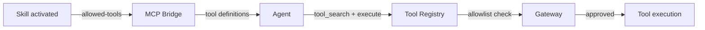
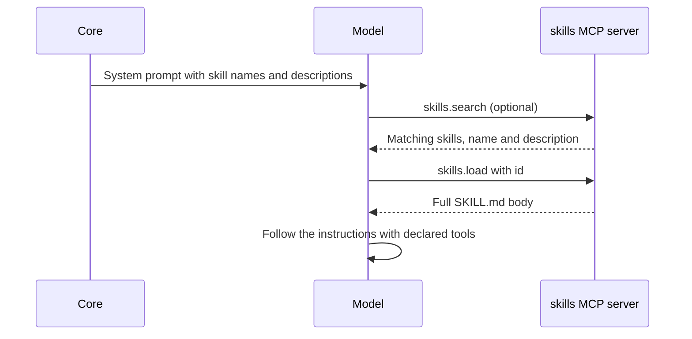
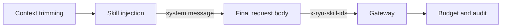

This page explains how a skill works with the tool system, the Gateway, the request body, and
turn hooks. The `SKILL.md` format and the disclosure modes are on [Skills](/docs/extend/skills).

## How skills interact with tools

A skill declares the tools it needs in the `allowed-tools` front-matter.

```yaml
---
name: "Web Researcher"
allowed-tools:
  - "agentbrowser"
  - "spider"
---
```

When the skill is active, Core surfaces those tools to the MCP bridge for the turn. The Gateway
enforces the grant, so a declared tool that the caller is not granted stays uncallable.



## Discovery and loading

Under progressive disclosure, a skill reaches the model in four phases. Agents discover and load
skills through the `skills` MCP server.

1. **Selection.** Core injects each enabled skill's `name` and `description` into the system
   prompt.
2. **Decision.** The model decides which skill fits the turn. It can call `skills.search` to rank
   the installed skills by intent; results carry the name and description only.
3. **Loading.** The model calls `skills.load` with the skill id. Core returns the full `SKILL.md`
   body into the context.
4. **Execution.** The model follows the skill's instructions and uses the tools it declared.



An `always-on: true` skill skips phases 2 and 3: its full body is injected up front. Use it for a
critical skill or a model that cannot reliably load skills itself.

```yaml
---
name: "Security Checker"
always-on: true
---
You MUST check every outbound request for PII before sending.
```

## Skill injection into requests

When a skill is active, Core injects its instructions into the outgoing request body as part of
the system message, then forwards the request to the Gateway.



- Injection happens **after** context trimming. The context window manager reserves a flat 512
  tokens (`SKILLS_RESERVE`) for it. This is an approximation, not an exact count.
- The `x-ryu-skill-ids` header lists the active skill ids. The Gateway counts the call toward
  budget and audit for those skills.

## Skill-tool interaction patterns

### Pattern 1: Skill declares tools, agent uses them

```yaml
---
name: "Code Reviewer"
allowed-tools:
  - "file_read"
  - "git_diff"
---
Review the code changes in the current branch. Use git_diff to see
the changes, then file_read to inspect specific files.
```

The agent loads the skill, sees the declared tools, and uses them in sequence.

### Pattern 2: Skill provides decision logic, agent picks tools

```yaml
---
name: "Data Analyst"
description: "Decides which analysis tools to use based on data type"
---
Analyze the user's data. Choose the right tool:
- CSV data → use csv_parser
- JSON data → use json_analyzer
- Database → use sql_runner
```

The skill does not declare `allowed-tools`. The agent discovers tools through `tool_search` and
picks one based on the skill's instructions.

### Pattern 3: Skill + turn hook

A skill provides the instructions, and a turn hook provides the automation.

```json
{
  "contributes": {
    "turn_hooks": [{
      "id": "auto-review",
      "on": "post_assistant_turn",
      "code_file": "hooks/auto-review.js"
    }]
  }
}
```

The hook body in `hooks/auto-review.js` runs after the assistant turn. In this example it checks
whether code was modified and injects a review follow-up when the "Code Reviewer" skill is active.

## Reviewing hooks in Gateway

The Desktop **Gateway → Hooks** tab is where you review and trust hooks such as the one above. See
[Review hooks in Gateway](/docs/extend/develop/extensions/hooks-authoring#review-hooks-in-gateway)
for the scope order and the trust rules.

## Skill lifecycle

| Phase | What happens |
|---|---|
| **Install** | SKILL.md scanned from the shared skills roots (`~/.claude/skills/`, then `~/.agents/skills/`; or `RYU_SKILLS_DIR`) plus the built-in defaults |
| **List** | `GET /api/skills` lists installed skills; `GET /api/skills/catalog` lists catalog skills |
| **Activate** | `POST /api/skills/activate` with `{ "id": "<id>", "active": true }` turns injection on |
| **Inject** | On each turn, active skills' metadata is injected |
| **Load** | The model calls `skills.load`, and Core injects the full body |
| **Deactivate** | `POST /api/skills/activate` with `"active": false` turns injection off |

## Related

<Cards>
  <DocCard href="/docs/extend/skills" />
  <DocCard href="/docs/extend/skills/authoring" />
  <DocCard href="/docs/extend/skills/catalog" />
  <DocCard href="/docs/core/unified-tool-catalog" />
  <DocCard href="/docs/gateway/tools" />
  <DocCard href="/docs/extend/develop/extensions/agent-skills" />
</Cards>
