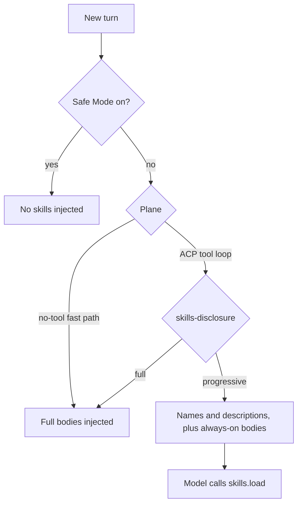

A Ryu agent skill is an instruction pack that teaches a model one task. It is a single `SKILL.md` file: a YAML front-matter header that names and describes the skill, and a Markdown body that Core injects into the model's context when the skill is active. A skill changes model behavior without code changes or fine-tuning.

<Figure name="skills" />

Ryu follows the open Agent Skills standard. It reads the same `~/.claude/skills/<id>/SKILL.md` layout as Claude Code and the skills CLI, so a skill works in all of them. Core also reads `~/.agents/skills/<id>/SKILL.md`; [Publishing and Loading](/docs/extend/skills/publishing) lists every root. The skills Ryu ships live in `apps/skills`, starting with [setup-ryu](/docs/extend/skills/setup-ryu).

<Callout type="info">
  Core owns skill selection, loading, and instruction injection into the outgoing request body. The Gateway owns what is allowed, measured, and paid for. Core tags each skill-carrying call with the `x-ryu-skill-ids` header, and the Gateway counts it toward budget and audit.
</Callout>

## The SKILL.md format

A `SKILL.md` file starts with a YAML front-matter block between `---` lines, followed by the Markdown instruction body. Core ignores unknown front-matter keys, so skills written for newer spec versions still load in older Cores.

```markdown
---
name: "Web Researcher"
description: "Enables web search and tells the model when to use it."
allowed-tools:
  - "agentbrowser"
  - "spider"
enabled: true
always-on: false
---
You have access to web-search tools. Search the web when you need
factual, up-to-date information, then cite what you used.
```

| Field | Required | Default | Meaning |
|---|---|---|---|
| `name` | Yes | None | The human-readable display name. |
| `description` | No | None | A one-line summary. Under progressive disclosure the model sees this line up front and uses it to decide whether to load the skill. |
| `allowed-tools` | No | Empty | Tool names the skill declares it needs. Core surfaces them to the tool bridge for the turn; the Gateway enforces the grant. |
| `enabled` | No | `true` | When `false`, the skill is installed but skipped during selection. |
| `always-on` | No | `false` | When `true`, Core injects the full body up front instead of loading it on demand. |

## Progressive disclosure

By default Ryu uses progressive disclosure. Core injects only each skill's name and description up front. The model loads a full body through the `skills.load` tool when it decides the skill is relevant, so the context stays small even with many skills installed.



- **Planes.** Progressive disclosure needs a tool loop, so it runs only on the ACP plane. The no-tool, OpenAI-compatible fast path always injects full bodies, so a model that cannot call tools still receives the skill.
- **Mode.** The `skills-disclosure` preference selects `progressive` (the default) or `full`. In the desktop app it is the **Load skills on demand** switch under **Skill loading** in the Memory settings.
- **Always-on.** An `always-on` skill is always injected in full. Use it for a critical skill or for a model that cannot reliably load skills itself.
- **Index cap.** The up-front index lists at most 20 on-demand skills, ordered by id. Past that, it ends with a line that points the model to `skills.search`, which ranks every enabled skill.
- **Safe Mode.** Safe Mode injects no skills.

### Changes reset the prompt cache

The skill list is part of the system prompt of every thread that loads skills. In the desktop app, these actions first ask "Apply now? This resets the prompt cache":

- installing, enabling, or disabling a skill;
- installing a pack or bundle that adds skills;
- updating an enabled skill (**Update all** asks once and names the enabled skills).

When you apply, each affected thread re-sends its conversation uncached once. Cancel leaves the skill unchanged. A disabled skill updates without asking.

## In this section

<Cards>
  <DocCard href="/docs/extend/skills/setup-ryu" />
  <DocCard href="/docs/extend/skills/catalog" />
  <DocCard href="/docs/extend/skills/pdf" />
  <DocCard href="/docs/extend/skills/ryu-agent-creator" />
  <DocCard href="/docs/extend/skills/authoring" />
  <DocCard href="/docs/extend/skills/publishing" />
  <DocCard href="/docs/extend/skills/ecosystem" />
</Cards>
