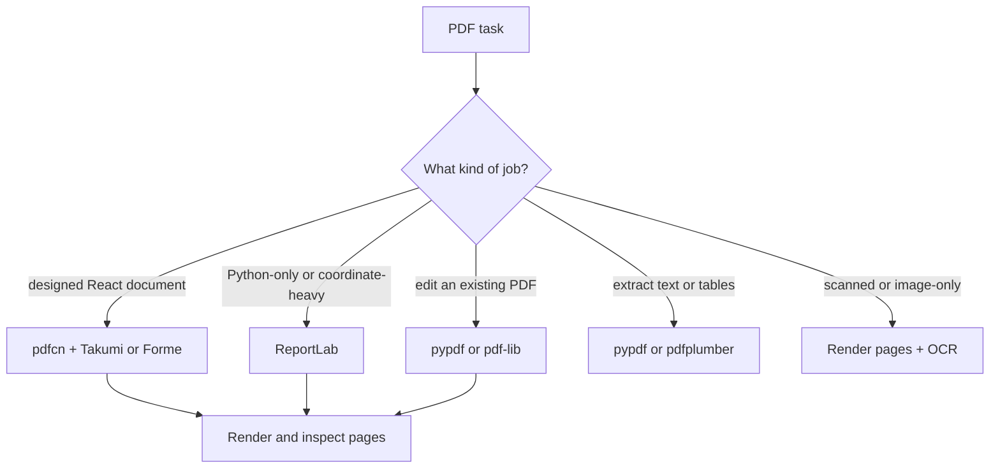

The `pdf` skill is bundled with Ryu and installed locally without a catalog download. It loads on demand when an agent needs to create, inspect, edit, extract, merge, fill, OCR, or visually verify a PDF.

The skill supplies workflow guidance. Core and Gateway still own tool selection, permissions, and execution policy. See the [skills catalog](/docs/extend/skills/catalog) for the other maintained Ryu skill packs.

## How the skill picks a tool



## Designed document generation

For branded invoices, reports, statements, and security reports, the skill uses [pdfcn](https://www.pdfcn.dev/) as a React-first component layer. pdfcn is a shadcn-compatible registry of copy-paste components and blocks. The application chooses the renderer explicitly:

- [Takumi](https://takumi.kane.tw/docs/pdf) for JSX, HTML, and CSS rendering without a headless browser.
- [Forme](https://docs.formepdf.com/quickstart) when the existing project uses Forme or needs its renderer-specific forms, accessibility, archival, or certification features.

In a Bun workspace, install only the block or components the document needs.

```bash
bunx shadcn@latest add @pdfcn/takumi/invoice-minimal
bunx shadcn@latest add @pdfcn/takumi/theme-minimal
```

The skill keeps these layout choices explicit: page size, margins, fonts, theme tokens, page breaks, repeated headers and footers, table behavior, and keep-together rules. A visual PDF task is not complete until representative pages are rendered and inspected.

## Existing PDF workflows

The same skill chooses lower-level tools when the job is not a designed React document:

- `pypdf` or `pdf-lib` for structural edits, merging, splitting, rotation, metadata, encryption, and watermarks.
- `pypdf` for straightforward text extraction and `pdfplumber` when layout or table geometry matters.
- `ReportLab` for Python-only generation or coordinate-heavy output.
- Page rendering plus OCR for scanned or image-only documents, while preserving the original input.

Form work begins by checking for real AcroForm fields before placing annotations. Output is checked for:

- page count;
- selectable text where required;
- missing glyphs;
- clipping and overflow;
- page-break errors.

## Try it

Ask an agent to "use the pdf skill to create a two-page branded security report with a table and page numbers, then render and inspect the first and last pages."

The skill chooses the renderer, keeps the PDF source and output separate, and returns the generated file plus visual proof.
