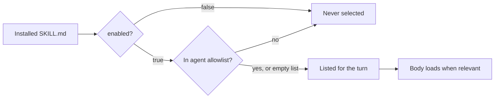

Ryu reads skills from the same directories that Claude Code and the skills CLI use. A skill is available when its `SKILL.md` is in one of them. It is active when selection allows it.

## The universal location

Skills load from the universal Agent Skills directory.

```text
~/.claude/skills/<id>/SKILL.md
```

To publish a skill to a node, put its `SKILL.md` in this directory on that node. Claude Code reads the same path, so a skill you install for Ryu is available there too, and the reverse holds.

| Root | Layouts read | Notes |
|---|---|---|
| `~/.claude/skills` | `<id>/SKILL.md` and legacy flat `<id>.md` | Scanned first. Wins on an id collision. Ryu installs here unless `RYU_SKILLS_DIR` is set. |
| `~/.agents/skills` | `<id>/SKILL.md` only | The vendor-neutral root. |
| `RYU_SKILLS_DIR` | `<id>/SKILL.md` and legacy flat `<id>.md` | When set, replaces both roots above with this one directory. |

## Installed versus active

A skill in the directory is installed. Whether it is active for a given turn is a separate decision.

- The `enabled` front-matter flag gates the skill globally. An `enabled: false` skill is installed but never selected.
- A per-agent allowlist gates which installed skills an agent may use, so two agents on the same node can see different skill sets. An empty allowlist allows every enabled skill.
- Under progressive disclosure, an active skill still only loads its full body when the model decides it is relevant.



With this split, you can install many skills and let selection and disclosure surface only the ones a turn needs.

## Install a skill from a source

You can write the skill directory by hand, or publish it somewhere and install it through Core.
The from-source installer (`apps/core/src/skills_catalog/from_source.rs`) takes a source string
through `POST /api/skills/install-from-source`. It copies each whole skill directory, including
references and scripts, into `~/.claude/skills/<name>/` (or `RYU_SKILLS_DIR` when it is set).

| Source form | Strategy |
|---|---|
| `owner/repo` | GitHub tarball at the default branch |
| `https://github.com/owner/repo` | GitHub tarball |
| `https://github.com/owner/repo/tree/<ref>/<subdir>` | GitHub tarball at `<ref>`, scoped to `<subdir>` |
| `https://gitlab.com/owner/repo` (and subgroups) | GitLab tarball |
| `/abs/path` or `./rel/path` (existing dir) | Local copy |
| `git@host:owner/repo.git`, `ssh://`, or another Git host URL | Refused. Remote `git clone` is disabled; use an HTTPS GitHub or GitLab source |

The public skills.sh directory uses the catalog routes instead:

- `GET /api/skills/catalog` lists catalog skills.
- `GET /api/skills/catalog/detail` shows one skill.
- `POST /api/skills/catalog/install` installs it.

End users browse and install from the desktop Skills page.

<TryInRyu page="skills" />

## How an agent discovers and loads a skill

On the ACP plane, an agent works with skills through two tools.

- `skills.search` lists the installed skills and their descriptions, so the model can find one by intent.
- `skills.load` pulls a specific skill's full body into context on demand.

Core injects each active skill's name and description up front, then lets the model load bodies as needed. The Gateway attributes skill-carrying calls through the `x-ryu-skill-ids` header. [Skills Ecosystem](/docs/extend/skills/ecosystem#discovery-and-loading) shows the full sequence.

<Callout type="warn">
  Skills are instructions, not sandboxes. A skill can declare tools through `allowed-tools`, but the Gateway still enforces every grant. Review a skill's body and its tool list before installing one from a source you do not control.
</Callout>

## Shipping with the collection

To add a skill to Ryu's maintained set, contribute it to the `apps/skills` collection so it ships alongside [setup-ryu](/docs/extend/skills/setup-ryu) and the rest of the [catalog](/docs/extend/skills/catalog). The collection is `SKILL.md` files laid out by id, the same shape an agent reads at runtime.
