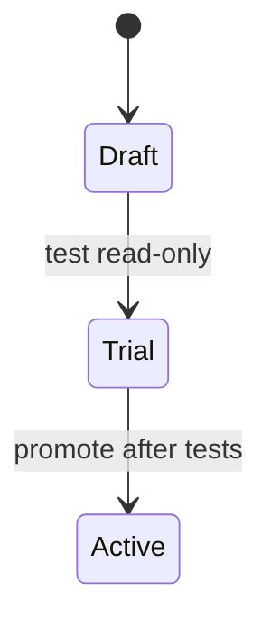

`ryu-agent-creator` is a built-in skill that guides an agent through designing, building, testing, and delivering a Ryu agent. Ryu installs it locally without a catalog download and enables it on first installation.

It loads on demand and respects global activation and per-agent skill allowlists. It supplies instructions, not additional privileges.

## What it covers

| Task | Guidance |
| --- | --- |
| Create a saved assistant | Builder studio, Settings or the supported node API; instructions, model/runtime, tools, skills, Spaces and memory |
| Author an agent in code | SDK Runnables, typed tools/workflows, Gateway model access, optional primitives and cancellation |
| Choose when it may run | Draft, read-only Trial, tested promotion to Active, and the selected safety profile |
| Add hooks | Correct phase/directive selection, agent/conversation scope, grants, flags, redaction, retries and bounded continuations |
| Coordinate work | Agent groups, workflows, requested routines, channels and durable harness sessions/runs |
| Test behavior | Representative success and failure cases, access denial, tool traces, Prompt Studio/evals, and saved product evidence |
| Deliver it | Reopen the saved agent, verify its entry point, or validate a portable template/package |

The lifecycle above is the one the skill teaches:

- A Draft is a saved design that cannot run.
- A Trial is read-only on Core-governed tools, even when a broader profile is stored for later. Native ACP tools outside the governed bridge are not automatically covered by Trial guarantees.
- Draft straight to Active is not a valid shortcut. Test in Trial first.
- Active takes one safety profile: read-only, approval required, verified plans only, or autonomous.

Try "Use ryu-agent-creator to build a read-only researcher grounded in this Space" or "Use ryu-agent-creator to write an SDK agent with a resumable workflow." The skill builds the form you ask for; an agent does not have to become a new app.

## Related specialists

- **ryu-creator** owns plugin/app packaging, shared UI and architecture. Its hook guidance distinguishes blocking, transformation and observation phases, both context planes, host grants, and failure behavior.
- **ryu-configurator** owns effective settings and access diagnosis, including hook activation/flags, capability bindings, agent safety/lifecycle and routines.
- **ryu-build-agent** remains the focused saved-agent REST guide; it is not the SDK authoring guide.

## Updates and evidence

- Installation preserves existing skill copies, edits, and disabled states. Updated bundled text does not overwrite a local copy, so inspect the skill's source before relying on guidance from an older installation.
- Health checks and eval scores are evidence about specific checks only. The skill also calls for a real run using the selected runtime and permitted tools.
- Neither a skill nor a passing configuration score bypasses Core or Gateway policy.

See the [catalog](/docs/extend/skills/catalog) for all maintained skills and [Agents](/docs/surfaces/desktop/user-guide/agents) for the product workflow.
