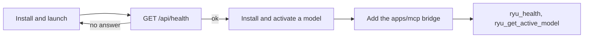

`setup-ryu` is the entry-point skill in the `apps/skills` collection. It gives an agent step-by-step instructions to set up a Ryu node for a user and then connect the user's other agents to it. The skill tells the model to use only the real routes it lists.

## What it covers

The skill body first explains what Ryu is. Core is the HTTP API on `http://127.0.0.1:7980`. The Gateway is the OpenAI-compatible inference gateway on `http://127.0.0.1:7981`. Desktop starts both.

It then works through five steps:

| Step | What the agent learns |
|---|---|
| 1. Install and launch | Install and open Desktop, or run Core headless from `apps/core`. |
| 2. Verify health | Call `GET /api/health` before anything else. `GET /api/system/status` and `GET /api/system/info` give reachability and hardware details. |
| 3. Activate a local model | Search `GET /api/models/catalog`, inspect `GET /api/models/catalog/detail`, install with `POST /api/models/catalog/install`, then activate with `POST /api/models/active`. |
| 4. Connect other agents | Add the `apps/mcp` stdio bridge to the agent's MCP config with `RYU_CORE_URL` (and `RYU_CORE_TOKEN` when the node needs it). |
| 5. Confirm the loop | Call `ryu_health`, then `ryu_get_active_model`, through the bridge. |



For bridge configuration details, see [MCP configuration](/docs/extend/mcp/configuration). For the tool list, see [MCP tools](/docs/extend/mcp/tools).

## When to load it

Load `setup-ryu` when an agent will help a user install or start Ryu, check that a node is healthy, or connect another MCP host to the node. For deeper work, the skill points to `ryu-local-model`, `ryu-mcp`, `ryu-build-agent`, and `ryu-author-skill` in the [catalog](/docs/extend/skills/catalog).

<Callout type="info">
  `setup-ryu` is an instruction pack, not an installer. It does not perform privileged actions on its own. Anything that changes the node still goes through Core routes and tools under normal policy.
</Callout>

## Install it

`setup-ryu` installs to the universal skills directory like any other skill:

```text
~/.claude/skills/setup-ryu/SKILL.md
```

See [publishing](/docs/extend/skills/publishing) for how agents discover, install, and activate it.

## Give an agent the setup prompt

The same instructions are available as Markdown at [ryuhq.com/setup-ryu.md](https://ryuhq.com/setup-ryu.md). Give that URL to an agent when you want it to install Ryu, check that Core is healthy, activate a local model, and connect the Ryu MCP bridge.
