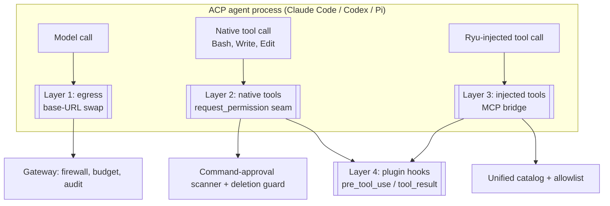

An ACP agent is a **whole harness**, not a model behind an API. Claude Code, Codex, and Pi each own
their tool loop, native tools, permission prompts, and credentials. Routing an ACP agent through
the Gateway therefore covers separate paths: model traffic, file writes, injected tools, and hooks
can each have different enforcement.

Ryu governs an ACP agent in **four independent layers**.



## Layer 1: Model egress

The agent's HTTP client is pointed at the Gateway instead of the provider, so completions pass
through the firewall, spend budgets, and the audit log.

The mechanism differs per agent family because the wire formats and credentials differ. Each
mechanism keeps the user's subscription working. Full detail is in
[Gateway for any agent](/docs/gateway/gateway-for-any-agent).

| Agent | Mechanism | Credential |
|---|---|---|
| Claude Code | `ANTHROPIC_BASE_URL` → `/passthrough/anthropic` | The user's own OAuth bearer, forwarded unchanged. An API key is never injected, because either `ANTHROPIC_API_KEY` or `ANTHROPIC_AUTH_TOKEN` would take precedence over Pro/Max OAuth and flip the account onto API-key billing |
| Codex | Isolated `CODEX_HOME` → `/passthrough/openai-responses` | OAuth bearer plus `ChatGPT-Account-ID`, forwarded unchanged |
| Pi (managed) | `OPENAI_BASE_URL` + a session credential, plus a `models.json` pin | With a Core-managed local Gateway, a local credential for that agent session (see below); otherwise a Gateway token. The pin is required because Pi does not honour `OPENAI_BASE_URL` on its own |
| BYO OpenAI-compatible | `OPENAI_BASE_URL` + a session credential | With a Core-managed local Gateway, a local credential for that agent session (see below); otherwise a Gateway token |

Subscription passthroughs refuse upstream redirects, so credentials and prompt bodies stay at the
configured destination. Ambiguous paths (dot segments, encoded separators, backslashes, and
embedded query or fragment markers) are rejected before forwarding. Pass query parameters in the
URL query string. When inbound scanning is enabled, prompt requests must contain readable JSON.
Compressed or malformed prompt bodies are refused.

When Ryu manages the local Gateway, a pooled Pi or BYO OpenAI-compatible agent does not hold a
Gateway token. Its `OPENAI_BASE_URL` points at Ryu on the same machine, and its key is a local
credential issued for that one agent process. On every model request Ryu exchanges it for a
short-lived Gateway token scoped to the agent (and, for Pi, to the conversation), so a long chat
keeps the same agent process while the token behind it is renewed, and the token's lifetime does
not grow. An agent limited to certain model providers keeps that limit on every renewed
token. Ryu accepts the credential only for model endpoints, and only while the agent is
answering a turn or has just finished one. It stops working when the agent
process exits or is stopped to free a slot.

Subscription-preserving routing for Claude Code and Codex is **on by default** for new and
auto-installed routable agents. An explicit `false` in `claude-gateway-routing` or
`codex-gateway-routing` keeps that agent's subscription egress direct. Generic BYO ACP egress is
also **on by default**: an absent `agent-gateway-routing` entry means Gateway-governed traffic, and
an explicit `false` is the direct-egress opt-out. The managed Pi remains Gateway-routed according
to its provider setting.

When the routed provider is OpenRouter, the agent-scoped URL lets the Gateway attach the ACP
agent to the request before it records OpenRouter's response-reported `usage.cost`. That keeps
ACP model spend in the same per-agent USD cap as ordinary Ryu chat. The Gateway's OpenAI tool loop
and the in-process ACP MCP bridge also emit one separate charge for each successful Composio
action; the agent's **Paid tools** budget toggle controls whether those charges count.

Native subscription passthroughs are not OpenRouter calls, so OpenRouter's generation endpoint
cannot recover their provider cost. Direct-egress ACP traffic is likewise outside Ryu's Gateway
budget. Local/self-hosted inference has no upstream billing feed and uses the configured estimate
when a local budget is enabled.

## Layer 2: The agent's own native tools

Every ACP tool call passes through the **permission-request seam** before the agent is granted
permission to proceed, and Ryu scans it there. Claude Code's own `Bash`, `Write`, and `Edit`
calls are governed, not merely the tools Ryu injected. A `deny` verdict rejects the permission
outright, including in a headless session that would otherwise auto-approve.

Permanent file and directory deletion is a stronger default-deny policy than ordinary risk
approval. Core checks the command locally before any Gateway request or fallback, and the Ryu-
managed Codex entry adds a global `PreToolUse` hook plus user-level `forbidden` command rules in
its isolated Codex home. The hook must be reviewed and trusted once in Codex; the Core check stays
active even if that hook is not trusted. Ryu directs the agent to the host's recoverable Trash or
Recycle Bin and never silently rewrites the requested command. The managed Codex process also runs
through an OS-aware Ryu child runner: Linux Landlock and macOS Seatbelt deny unlink/removal/rename;
Windows refuses the managed route until its native AppContainer boundary is available.

This also covers file mutation. Native coding agents edit through tools shaped
`{ file_path, content }` with no command string, so Ryu synthesizes a `write <path>` representation
and scans it. See
[Command approval and HITL](/docs/security/command-approval).

## Layer 3: Ryu-injected tools

When the bridge is active the agent also receives Ryu's meta-tools (`tool_search`, `describe`,
`execute`, `resume`, and the `skills.*` tools) over MCP. These resolve against the
[unified tool catalog](/docs/core/unified-tool-catalog) and are gated by the agent's allowlist on
the call path. Search is open; execution is allowlisted. See
[Tool governance](/docs/gateway/tools).

## Layer 4: Plugin hooks

Installed plugins can intercept any tool call on either plane: `pre_tool_use` can `deny` it, and
`tool_result` can `transform` the result before the model sees it. This is where per-organization
policy that is too specific for a general scanner belongs. See
[Hooks and lifecycle](/docs/extend/develop/extensions/hooks-lifecycle).

## Each layer has its own switch

The layers are independent.

- **Layer 1 is per agent family**, each with its own preference: `claude-gateway-routing`,
  `codex-gateway-routing`, the managed-Pi routing mode, and a generic per-agent toggle for BYO
  agents. Claude, Codex, and generic BYO routing default to Gateway governance; they are separate
  because turning any one off changes how a subscription credential flows, and that is a decision
  per agent, not per node.
- **Layer 2 is node-wide**, armed unless explicitly turned off.
- **Layer 3** follows whether the bridge is injected for that agent.
- **Layer 4** follows which plugins are installed and enabled.

In Desktop, **Gateway → Safety filters → Agent tools and model traffic** lists these settings for
the selected node. If the node cannot be read, the panel shows an error and **Retry** action rather
than an empty agent list; use Retry to reload the current policy before changing a switch.

<Callout type="warn">
  An agent with Layer 1 off sends model calls **straight to the provider**. Those calls are
  unmetered, unfiltered, and absent from the audit log. The setting applies per agent.
  When you need a node where nothing is ungoverned, confirm Layer 1 for each installed agent rather
  than assuming a node-level setting covers them.
</Callout>

## ACP session lifecycle and resource bounds

ACP sessions are pooled per conversation so a follow-up message can reuse the same
agent process. On a node with many old threads, that resident state can otherwise
consume memory indefinitely. The Gateway's **ACP agent runtime** settings put a bound
around the pool:

- **Stop idle ACP sessions after** - defaults to 5 minutes (1 to 1,440). When a session has no
  new turn for that long, Ryu tears down its ACP subprocess. The next message
  starts it again, so the first reply can take longer.
- **Maximum parallel ACP agents** - defaults to **Auto**. Auto sizes the limit
  from the node's CPU cores and memory, keeping memory in reserve for the system,
  up to 32 agents. For example, a 2 vCPU / 4 GiB node runs about 14 agents at
  once. In a container with a memory limit, Auto and the low-memory check use
  that limit rather than the host's RAM. The selected **Auto** option shows the computed limit in
  parentheses, such as **Auto (14)**. When the limit is reached, or the node runs low on
  memory, Ryu stops the longest-idle agent that has been idle for a short grace
  (one second per agent slot, at most 15 seconds); otherwise new ACP sessions
  wait in arrival order until a slot is available, and a chat restarting its own
  agent reuses that agent's slot. A session that has waited twice the grace may
  stop any idle agent, so chats that never pause cannot hold every slot. A manual
  limit from 1 to 32 is available when the node's workload is known.
- **Keep this device awake while agents run** - on by default for local nodes.
  Ryu asks the operating system to prevent idle system sleep only while an ACP
  process is active; the display can still turn off. It does not keep a remote
  device awake. Desktop checks run sequentially, and a node that stops responding
  triggers a request to release local sleep prevention after the check times out.

Desktop reloads these settings when the selected node or its credentials change,
so another account's cached settings are not displayed.
If the settings cannot be loaded, the controls stay disabled until **Retry ACP runtime settings** succeeds.
While a save is pending, all three controls stay disabled. A failed save leaves the previously saved
values in place; selecting the change again explicitly retries it.

The same settings can be written in `gateway.toml` when managing a node without
the desktop UI:

```toml
[acp]
idle_timeout_minutes = 5
# Omit max_parallel_agents for Auto; set it to 1..32 for a manual limit.
max_parallel_agents = 4
keep_computer_awake = true
```

This is built-in node enforcement, not a plugin-owned control. Plugins may observe
or report the resulting runtime state, but disabling a plugin must not remove the
resource guard that protects the node hosting every ACP agent.

This ACP timeout releases the agent subprocess and its native session state. Desktop has a separate
tab-memory control for the mounted chat route: **Settings → General → Tabs → Unload inactive tabs**
unmounts inactive thread views while keeping their durable transcripts available for reload. The
two controls can therefore reclaim both subprocess memory and renderer memory without deleting a
conversation.

## Agent resource permissions

On a shared organization or team node, the agent-management route has two checks. The route
capability admits the caller to the Agents surface, then Core checks `agent.view` or `agent.edit`
against the exact agent id before it resolves or starts an ACP process. This applies to ACP
configuration and capability probes, authentication and logout, account labels and account
changes, session listing, loading and deletion, and the observed tool list. A denial happens before
an ACP subprocess is started or the account vault is read or changed.

Native-history listing requires `agent.view`. Importing a native thread requires both `agent.view` for
the source agent and `agent.edit` for the import operation before Core reads the transcript.
Re-import deduplication is scoped to the conversation's creation tenancy, so a different member
gets a separate conversation instead of appending to another member's private import. The
background sync service may reuse organization-shared imports only.

The local personal-node owner keeps the node's existing control boundary. Resource ACLs can still
grant or deny an agent operation on a shared node. The ACP account view is agent-scoped, while
managed Pi provider accounts remain owned by their provider scope. Agents that share a
provider login continue to refer to that shared account. The agent ACL controls who may use the
route; it does not split one provider credential into separate agent accounts.

A managed node remains closed to resource operations while its control-plane registration is still
resolving. This prevents a temporary missing binding from being treated as a local personal node.

Runtime package updates keep their node-wide `app.update` authority because updating an installed
agent runtime is a lifecycle operation. The read-only update check uses `agent.view` before it
probes the installed and latest versions.

## What this does not do

Ryu governs at seams the agent must pass through: its HTTP egress, its permission requests, its
injected tools, and (for the managed Codex entry) its generated Codex hook/rules layer. It does not
contain a process that decides to ignore those seams. The command scanner is accident prevention,
not a sandbox. For folders you have not trusted, Ryu adds an OS sandbox around the agent and
refuses modes that skip permission prompts; see [Workspace trust](/docs/security/workspace-trust).
That sandbox narrows what a hijacked agent can reach but still runs it as you. For untrusted code
the isolation boundary is
[the sandbox](/docs/core/sandbox) and
[programmatic tool calling](/docs/core/programmatic-tool-calling), which run code in a separate
process with deny-by-default permissions.

The scanner is also **stateless per call**: it judges the command in front of it, not the session's
history. A policy like "require approval to push once this session has installed a new dependency"
is a stateful policy, and the scanner cannot express it.

## Related

- [Gateway for any agent](/docs/gateway/gateway-for-any-agent) - the base-URL swap and passthrough proxy in full
- [Command approval and HITL](/docs/security/command-approval) - Layer 2 in full
- [Agent hardening](/docs/gateway/agent-hardening) - tightening an agent's blast radius
- [Routing planes](/docs/gateway/routing-planes) - model routing vs agent routing
- [Credential and environment scrubbing](/docs/security/credential-scrubbing) - why ACP agents keep their own credentials
