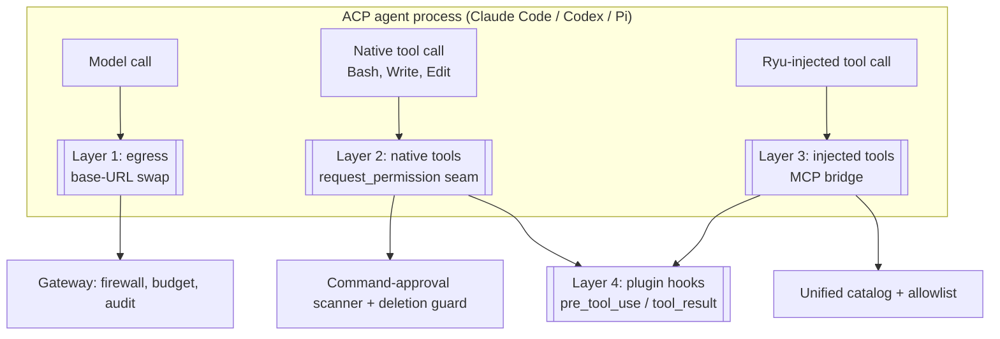
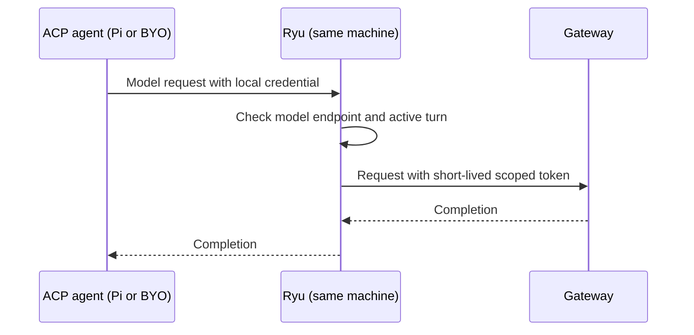
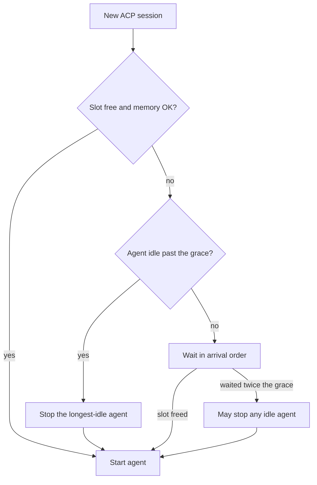

An ACP agent is a **whole harness**, not a model behind an API. Claude Code, Codex, and Pi each own
their tool loop, native tools, permission prompts, and credentials. Routing an ACP agent through
the Gateway therefore covers separate paths: model traffic, file writes, injected tools, and hooks
can each have different enforcement.

Ryu governs an ACP agent in **four independent layers**.



## Layer 1: Model egress

The agent's HTTP client is pointed at the Gateway instead of the provider, so completions pass
through the firewall, spend budgets, and the audit log.

The mechanism differs per agent family because the wire formats and credentials differ. Each
mechanism keeps the user's subscription working. Full detail is in
[Gateway for any agent](/docs/gateway/gateway-for-any-agent).

| Agent | Mechanism | Credential |
|---|---|---|
| Claude Code | `ANTHROPIC_BASE_URL` → `/passthrough/anthropic` | The user's own OAuth bearer, forwarded unchanged |
| Codex | Isolated `CODEX_HOME` → `/passthrough/openai-responses` | OAuth bearer plus `ChatGPT-Account-ID`, forwarded unchanged |
| Pi (managed) | `OPENAI_BASE_URL` + a session credential, plus a `models.json` pin | A local session credential with a Core-managed local Gateway; otherwise a Gateway token |
| BYO OpenAI-compatible | `OPENAI_BASE_URL` + a session credential | A local session credential with a Core-managed local Gateway; otherwise a Gateway token |

- Ryu never injects an API key for Claude Code. Either `ANTHROPIC_API_KEY` or
  `ANTHROPIC_AUTH_TOKEN` would take precedence over Pro/Max OAuth and move the account onto API-key
  billing.
- Pi needs the `models.json` pin because it does not honour `OPENAI_BASE_URL` on its own.

### Passthrough request rules

- Subscription passthroughs refuse upstream redirects, so credentials and prompt bodies stay at the
  configured destination.
- Ambiguous paths (dot segments, encoded separators, backslashes, and embedded query or fragment
  markers) are rejected before forwarding. Pass query parameters in the URL query string.
- When inbound scanning is enabled, prompt requests must contain readable JSON. Compressed or
  malformed prompt bodies are refused.

### Local session credentials

When Ryu manages the local Gateway, a pooled Pi or BYO OpenAI-compatible agent does not hold a
Gateway token. Its `OPENAI_BASE_URL` points at Ryu on the same machine, and its key is a local
credential issued for that one agent process.



- On every model request Ryu exchanges the credential for a short-lived Gateway token scoped to the
  agent (and, for Pi, to the conversation).
- A long chat keeps the same agent process while the token behind it is renewed. The token's
  lifetime does not grow.
- An agent limited to certain model providers keeps that limit on every renewed token.
- Ryu accepts the credential only for model endpoints, and only while the agent is answering a turn
  or has just finished one.
- The credential stops working when the agent process exits or is stopped to free a slot.

### Routing defaults

| Agent | Default | Opt-out |
|---|---|---|
| Claude Code | Gateway-routed for new and auto-installed routable agents | Explicit `false` in `claude-gateway-routing` |
| Codex | Gateway-routed for new and auto-installed routable agents | Explicit `false` in `codex-gateway-routing` |
| Generic BYO ACP | Gateway-routed; an absent `agent-gateway-routing` entry means governed | Explicit `false` in `agent-gateway-routing` |
| Managed Pi | Gateway-routed according to its provider setting | Its provider setting |

### Spend accounting

When the routed provider is OpenRouter, the agent-scoped URL lets the Gateway attach the ACP agent
to the request before it records OpenRouter's response-reported `usage.cost`. ACP model spend then
counts against the same per-agent USD cap as ordinary Ryu chat.

The Gateway's OpenAI tool loop and the in-process ACP MCP bridge also emit one separate charge for
each successful Composio action. The agent's **Paid tools** budget toggle controls whether those
charges count.

Some traffic has no Gateway cost feed:

- Native subscription passthroughs are not OpenRouter calls, so OpenRouter's generation endpoint
  cannot recover their provider cost.
- Direct-egress ACP traffic is outside Ryu's Gateway budget.
- Local or self-hosted inference has no upstream billing feed. It uses the configured estimate when
  a local budget is enabled.

## Layer 2: The agent's own native tools

Every ACP tool call passes through the **permission-request seam** before the agent is granted
permission to proceed, and Ryu scans it there. Claude Code's own `Bash`, `Write`, and `Edit`
calls are governed, not merely the tools Ryu injected. A `deny` verdict rejects the permission
outright, including in a headless session that would otherwise auto-approve.

### Permanent deletion guard

Permanent file and directory deletion is a stronger default-deny policy than ordinary risk
approval. Ryu directs the agent to the host's recoverable Trash or Recycle Bin and never silently
rewrites the requested command.

- **Core check.** Core checks the command locally before any Gateway request or fallback.
- **Codex hook and rules.** The Ryu-managed Codex entry adds a global `PreToolUse` hook plus
  user-level `forbidden` command rules in its isolated Codex home. The hook must be reviewed and
  trusted once in Codex. The Core check stays active even if that hook is not trusted.
- **OS runner.** The managed Codex process runs through an OS-aware Ryu child runner. Linux
  Landlock and macOS Seatbelt deny unlink, removal, and rename. Windows refuses the managed route
  until its native AppContainer boundary is available.

### File writes

This also covers file mutation. Native coding agents edit through tools shaped
`{ file_path, content }` with no command string, so Ryu synthesizes a `write <path>` representation
and scans it. See
[Command approval and HITL](/docs/security/command-approval).

## Layer 3: Ryu-injected tools

When the bridge is active the agent also receives Ryu's meta-tools (`tool_search`, `describe`,
`execute`, `resume`, and the `skills.*` tools) over MCP. These resolve against the
[unified tool catalog](/docs/core/unified-tool-catalog) and are gated by the agent's allowlist on
the call path. Search is open; execution is allowlisted. See
[Tool governance](/docs/gateway/tools).

## Layer 4: Plugin hooks

Installed plugins can intercept any tool call on either plane: `pre_tool_use` can `deny` it, and
`tool_result` can `transform` the result before the model sees it. This is where per-organization
policy that is too specific for a general scanner belongs. See
[Hooks and lifecycle](/docs/extend/develop/extensions/hooks-lifecycle).

## Each layer has its own switch

The layers are independent.

- **Layer 1 is per agent family**, with the preferences listed under
  [Routing defaults](#routing-defaults). They are separate because turning one off changes how a
  subscription credential flows, and that is a decision per agent, not per node.
- **Layer 2 is node-wide**, armed unless explicitly turned off.
- **Layer 3** follows whether the bridge is injected for that agent.
- **Layer 4** follows which plugins are installed and enabled.

In Desktop, **Gateway → Safety filters → Agent tools and model traffic** lists these settings for
the selected node. If the node cannot be read, the panel shows an error and a **Retry** action
instead of an empty agent list. Use Retry to reload the current policy before you change a switch.

<Callout type="warn">
  An agent with Layer 1 off sends model calls **straight to the provider**. Those calls are
  unmetered, unfiltered, and absent from the audit log. The setting applies per agent.
  When you need a node where nothing is ungoverned, confirm Layer 1 for each installed agent rather
  than assuming a node-level setting covers them.
</Callout>

## ACP session lifecycle and resource bounds

ACP sessions are pooled per conversation so a follow-up message can reuse the same agent process.
On a node with many old threads, that resident state could otherwise consume memory indefinitely.
The Gateway's **ACP agent runtime** settings bound the pool.

| Setting | Default | Range | Effect |
|---|---|---|---|
| **Stop idle ACP sessions after** | 5 minutes | 1 to 1,440 minutes | Tears down the ACP subprocess of a session with no new turn for that long. The next message starts it again, so the first reply can take longer |
| **Maximum parallel ACP agents** | **Auto** | Auto, or 1 to 32 | Caps how many ACP agents run at once |
| **Keep this device awake while agents run** | On for local nodes | On or off | Prevents idle system sleep only while an ACP process is active |

### How Auto sizes the agent limit

- Auto sizes the limit from the node's CPU cores and memory, keeps memory in reserve for the
  system, and stops at 32 agents. For example, a 2 vCPU / 4 GiB node runs about 14 agents at once.
- In a container with a memory limit, Auto and the low-memory check use that limit instead of the
  host's RAM.
- The selected option shows the computed limit in parentheses, such as **Auto (14)**.
- Set a manual limit from 1 to 32 when the node's workload is known.

### When every slot is in use



- When the limit is reached, or the node runs low on memory, Ryu stops the longest-idle agent that
  has been idle for a short grace. The grace is one second per agent slot, at most 15 seconds.
- Otherwise new ACP sessions wait in arrival order until a slot is available.
- A chat that restarts its own agent reuses that agent's slot.
- A session that has waited twice the grace may stop any idle agent, so chats that never pause
  cannot hold every slot.

### Sleep prevention

The display can still turn off while sleep prevention is active. The setting does not keep a remote
device awake. Desktop checks run sequentially. When a node stops responding, Desktop asks to release
local sleep prevention after the check times out.

### Editing the settings

- Desktop reloads these settings when the selected node or its credentials change, so another
  account's cached settings are not displayed.
- If the settings cannot be loaded, the controls stay disabled until **Retry ACP runtime settings**
  succeeds.
- While a save is pending, all three controls stay disabled.
- A failed save leaves the previously saved values in place. Select the change again to retry it.

The same settings can be written in `gateway.toml` when you manage a node without the desktop UI.

```toml
[acp]
idle_timeout_minutes = 5
# Omit max_parallel_agents for Auto; set it to 1..32 for a manual limit.
max_parallel_agents = 4
keep_computer_awake = true
```

This is built-in node enforcement, not a plugin-owned control. Plugins may observe or report the
resulting runtime state, but disabling a plugin must not remove the resource guard that protects
the node hosting every ACP agent.

<Callout type="info">
  The ACP idle timeout releases the agent subprocess and its native session state. Desktop's
  separate **Settings → General → Tabs → Unload inactive tabs** control unmounts inactive thread
  views while keeping their durable transcripts available for reload. Together they reclaim
  subprocess memory and renderer memory without deleting a conversation.
</Callout>

## Agent resource permissions

On a shared organization or team node, the agent-management route has two checks:

1. The route capability admits the caller to the Agents surface.
2. Core checks `agent.view` or `agent.edit` against the exact agent id before it resolves or starts
   an ACP process.

A denial happens before an ACP subprocess is started or the account vault is read or changed.

| Operation | Permission |
|---|---|
| ACP configuration and capability probes, authentication and logout, account labels and account changes, session listing, loading and deletion, observed tool list | `agent.view` or `agent.edit` on the agent |
| Native-history listing | `agent.view` |
| Importing a native thread | `agent.view` on the source agent and `agent.edit` for the import, checked before Core reads the transcript |
| Read-only runtime update check | `agent.view`, checked before it probes the installed and latest versions |
| Runtime package update | Node-wide `app.update`, because updating an installed agent runtime is a lifecycle operation |

### Imports and accounts

- Re-import deduplication is scoped to the conversation's creation tenancy. A different member gets
  a separate conversation instead of appending to another member's private import.
- The background sync service may reuse organization-shared imports only.
- The ACP account view is agent-scoped, while managed Pi provider accounts remain owned by their
  provider scope. Agents that share a provider login continue to refer to that shared account.
- The agent ACL controls who may use the route. It does not split one provider credential into
  separate agent accounts.

### Node scope

- The local personal-node owner keeps the node's existing control boundary. Resource ACLs can still
  grant or deny an agent operation on a shared node.
- A managed node stays closed to resource operations while its control-plane registration is still
  resolving. A temporary missing binding is therefore never treated as a local personal node.

## What this does not do

Ryu governs at seams the agent must pass through: its HTTP egress, its permission requests, its
injected tools, and (for the managed Codex entry) its generated Codex hook and rules layer. It does
not contain a process that decides to ignore those seams.

- **The command scanner is accident prevention, not a sandbox.**
- **Untrusted folders get an OS sandbox.** For folders you have not trusted, Ryu adds an OS sandbox
  around the agent and refuses modes that skip permission prompts. See
  [Workspace trust](/docs/security/workspace-trust). That sandbox narrows what a hijacked agent can
  reach, but it still runs the agent as you.
- **Untrusted code needs real isolation.** For untrusted code the isolation boundary is
  [the sandbox](/docs/core/sandbox) and
  [programmatic tool calling](/docs/core/programmatic-tool-calling), which run code in a separate
  process with deny-by-default permissions.

The scanner is also **stateless per call**: it judges the command in front of it, not the session's
history. A policy like "require approval to push once this session has installed a new dependency"
is a stateful policy, and the scanner cannot express it.

## Related

- [Gateway for any agent](/docs/gateway/gateway-for-any-agent) - the base-URL swap and passthrough proxy in full
- [Command approval and HITL](/docs/security/command-approval) - Layer 2 in full
- [Agent hardening](/docs/gateway/agent-hardening) - tightening an agent's blast radius
- [Routing planes](/docs/gateway/routing-planes) - model routing vs agent routing
- [Credential and environment scrubbing](/docs/security/credential-scrubbing) - why ACP agents keep their own credentials
