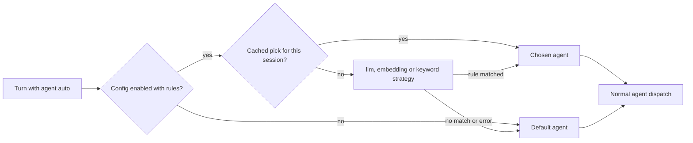

[Smart model routing](/docs/gateway/smart-routing) is **Plane A**: it picks a *model* inside one
governed completion. Agent-auto is a separate, higher-level route that picks the *agent* that serves
the turn.

The universal picker's **"Auto"** entry sets the chat's agent to the sentinel id `auto`. Core
resolves the concrete agent per turn from your own rules, then continues exactly as if you had
picked that agent (`apps/core/src/agent_routing/auto.rs`).



## Configuration

Agent-auto reuses the **same strategy vocabulary** as smart routing (`llm`, `embedding`,
`keyword`), but the rule *targets are agent ids*, not model ids. It is configured by the Core
`agent-auto-routing` preference.

```jsonc
{
  "enabled": true,
  "strategy": "embedding",          // llm (default), embedding, or keyword
  "classifier_model": "gemma-3-270m-it-qat-Q4_0", // optional; blank uses the local classify tier
  "embedding_model": "",            // for embedding; empty -> default local embedder
  "similarity_threshold": 0.35,
  "rules": [
    { "description": "writing, refactoring or debugging code", "agent_id": "claude-code" },
    { "description": "quick web lookups and browsing",         "agent_id": "ryu" },
    { "description": "long-form research and analysis",         "agent_id": "gemini" }
  ],
  "default_agent_id": "ryu",        // when no rule matches
  "cache_by_session": true,         // default false
  "timeout_ms": 5000                // classifier timeout; default 5000
}
```

- Agent-auto runs only when `enabled` is true and `rules` is not empty.
- When `default_agent_id` is empty, the fallback is the node's default agent, then `ryu`.
- `cache_by_session` classifies once per conversation and reuses that pick.

Desktop's agent-auto editor writes this preference for the active Core node. If the settings read
fails, use **Retry**. A failed save keeps the draft open so you can correct the connection and try
again.

<Callout type="info">
  The default LLM classifier is the local 270M Gemma classify tier, so agent-auto adds a small local
  classification step instead of sending the user's turn to a second hosted model. If the
  classifier is unavailable, times out, or returns an unusable result, Core fails open to the
  default agent.

  The Plane B backend split (the Gateway governs an OpenAI-compatible agent's chat;
  an ACP agent self-routes) is explained on [Routing planes](/docs/gateway/routing-planes).
</Callout>

<Callout type="warn">
  Auto may pick a different harness than last turn (Ryu/Pi → Claude Code → Gemini). ACP agents own
  stateful subprocesses, so switching agents starts a fresh session for the newly chosen agent. The
  previous one is kept warm for a switch-back.

  Conversation history is replayed into the new agent as prior context, but live in-subprocess
  state is not. Files an ACP agent had open, its working buffers, and similar state are lost across
  a harness switch. Set `cache_by_session` so the harness does not change every turn.
</Callout>

## The auto routes, disambiguated

Four different features use the name "Auto":

| Name | Plane | Picks | Config | Where it runs |
|---|---|---|---|---|
| Ryu smart-route | A | A **model** (rewrites `body["model"]`) | Gateway `smart_routing` (+ per-agent `agent_routes`) | Gateway pipeline |
| Ryu agent-auto | B | An **agent id** | Core `agent-auto-routing` preference | Core, before backend dispatch |
| `openrouter/auto` | (neither) | An upstream model, chosen by OpenRouter | A model id in the request | OpenRouter, after the Gateway forwards |
| `openrouter/pareto-code` | (neither) | A coding model chosen by OpenRouter's Pareto Router | A model id in the request; optionally add the `pareto-router` plugin | OpenRouter, after the Gateway forwards |

`openrouter/auto` is not a Ryu router. It is a model id (it appears in `GET /v1/models`) that
the Gateway routes to the OpenRouter provider, which then selects an upstream model. It has no rules
and no Ryu-side classifier.

For coding tasks, `openrouter/pareto-code` uses OpenRouter's current coding shortlist and picks a
model from the requested quality tier, favoring the cheapest available model in that tier. It is
also a model id, so Ryu's firewall, budgets, routing, and usage accounting still run before the
request leaves the Gateway.

OpenRouter documents the optional `pareto-router` plugin and its
`min_coding_score` setting in the [Pareto Router guide](https://openrouter.ai/docs/guides/routing/routers/pareto-router).

<Callout type="info">
Managed inference is not one undifferentiated supply. Which model you pick decides
which of your balances pays for the request. See
[Provider-specific credits](/docs/billing/credits#how-credits-work). If you hold granted credit
under a specific name, pick the matching entry in the model picker rather than a
generic auto-router, or the request is declined even though your total balance is
positive.
</Callout>

## Related

<Cards>
  <DocCard href="/docs/gateway/smart-routing" />
  <DocCard href="/docs/gateway/routing-planes" />
  <DocCard href="/docs/gateway/routing" />
</Cards>
