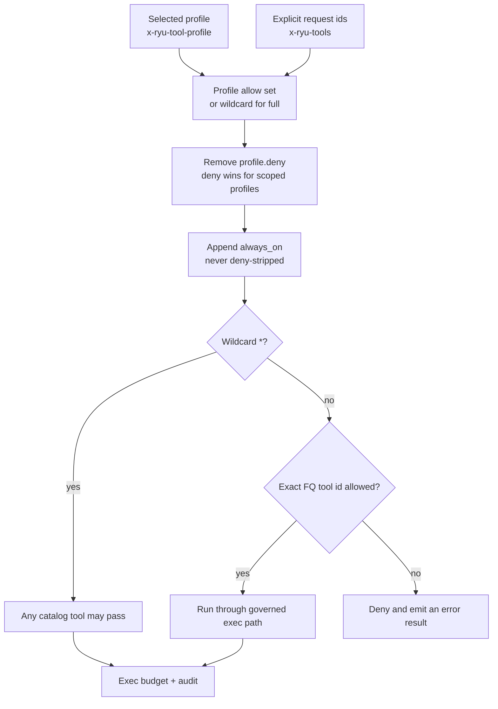

The [firewall](/docs/gateway/security) protects prompt and response text. The controls on this
page harden the *tool* surface: what an agent may call, how misconfigurations are reported, where a
tool's network egress is screened, and how poisoned tool output is neutralized before it re-enters
the model.

Each control either ships off (no profiles configured, no drift warnings on stock defaults) or
ships on and affects only untrusted paths (egress screening, tool-result wrapping).

## Tool-policy profiles

The per-agent allowlist ([Gateway tools](/docs/gateway/tools)) is a raw CSV of fully-qualified tool
ids carried on `x-ryu-tools`. Tool-policy profiles add a named preset layer above it: a request
selects a profile by name and the Gateway resolves it to an effective allowlist that the explicit
per-request allow/deny still overrides.

A profile lives in `ToolsConfig.profiles` (`apps/gateway/src/config.rs`), a map of name to
`ToolProfile` with these fields.

| Field | Type | Meaning |
|---|---|---|
| `allow` | `string[]` | Fully-qualified tool ids this profile grants. Ignored when `unrestricted` |
| `deny` | `string[]` | Ids this profile denies. Deny wins over `allow` and over the per-request grant |
| `unrestricted` | `bool` | The `full` preset: resolves the allow set to the wildcard `"*"` (allow-any) |

A request picks a profile with the `x-ryu-tool-profile` header. The resolution runs in
`effective_tool_allowlist` (`apps/gateway/src/pipeline/tool_loop_select.rs`) in a fixed order (profile, then
allow/deny).

1. Seed the allow set from `profile.allow` (or the wildcard `"*"` when `unrestricted`).
2. Union the explicit `x-ryu-tools` CSV on top.
3. Strip any id listed in `profile.deny` (deny wins).
4. Append `always_on` tools last. These are never deny-stripped, preserving the always-on contract.

```toml
[tools.profiles.messaging]
allow = ["slack.send_message", "gmail.send"]
deny  = ["shell.exec"]

[tools.profiles.full]
unrestricted = true
```

```http
x-ryu-tool-profile: messaging
x-ryu-tools: spider.crawl
```

With the request above, the effective allowlist is the messaging grants plus `spider.crawl`, minus
anything in `deny`, plus `always_on`.



<Callout type="info">
  Profiles are opt-in and default-safe. `ToolsConfig.profiles` defaults to an empty map, so with no
  profiles configured (or an unknown profile name) `effective_tool_allowlist` returns the
  `x-ryu-tools` CSV plus `always_on`, the same result as a request with no profile. The empty default is
  the gate; there is no separate feature flag.
</Callout>

The wildcard is honored by a single branch in `ToolLoopContext::is_allowed`
(`apps/gateway/src/tools/mod.rs`): a lone `"*"` entry, produced only by an explicitly-selected
`unrestricted` profile, permits any catalog tool. Absent `"*"`, the exact-match, deny-by-default
gate is unchanged, and `tool_search` is always permitted first.

<Callout type="warn">
  Known limitation: an `unrestricted` (`full`) profile that also lists `deny` entries does not
  enforce those denies, because the `"*"` wildcard short-circuits `is_allowed`. Deny is fully
  honored for scoped (messaging-style) profiles through the resolution stripping in step 3. If you
  need to deny a specific tool, use a scoped profile with an explicit `allow` set rather than
  `unrestricted`.
</Callout>

Profiles are reported like the firewall: `GET /v1/config` surfaces a redacted `tools` view
(`{ enabled, profiles }`), and `PUT /v1/config` accepts an optional `tools` patch that persists and
takes effect on the next restart, the same as routing.

## Policy-drift detection

`detect_drift` (`apps/gateway/src/policy/drift.rs`) is a pure, warn-only detector for dangerous
configuration combinations: a control is enabled while its compensating control is defeated. It
never blocks anything.

Every rule is a *contradiction* rule that returns nothing on the stock defaults
(`GatewayConfig::default()` + `EffectivePolicy::default()`), an invariant locked by a mandatory unit
test so a stock install never shows a warning.

| Code | Severity | Fires when |
|---|---|---|
| `exec_without_firewall` | high | Tool or Composio execution is enabled but the DLP firewall is off, so tool inputs and outputs flow with no inspection |
| `composio_guardrails_advisory` | medium | Composio tools can execute while the firewall policy is `warn_and_continue`, so detections are logged but never blocked or sanitized |
| `exec_budget_stop_ineffective` | medium | The exec-budget action is `stop` but both `max_count` and `max_wall_clock_secs` are 0, so the hard stop can never trigger |
| `locked_guardrails_firewall_off` | high | The distributed policy requires locked guardrails but the local firewall is disabled, so the mandated guardrails are not enforced |
| `secret_redaction_disabled` | high | The firewall policy is `sanitize` but `redact_secrets` is off, so detected secrets pass through unredacted |

An empty Composio action allowlist raises no warning: Composio fails closed, so with no allowlisted
actions it offers and executes none.

Each warning is a `DriftWarning { code, severity, message }`. The type is output-only (it derives
`Serialize` but not `Deserialize`), so nothing accepts a drift warning as input.

The detector runs in two places:

- **At startup** - `main.rs` emits one `warn!` per warning after the control-plane policy block, so
  a standalone Gateway with no control plane also runs the check.
- **On `GET /v1/config`** - the response carries a `drift: DriftWarning[]` field populated from the
  live firewall config (so a `PUT /v1/config` hot-swap is reflected immediately) plus the
  `tools`, `composio`, and `exec_budget` startup snapshots and the current policy snapshot.

## Doctor: configuration, security, and performance checks

Drift warnings cover contradictions. The read-only Doctor report also checks whether a node is
exposed, missing a provider, running an incomplete firewall, or allowing unbounded local work, and
adds the Core-side checks that the Gateway cannot see.

- Gateway bind/auth exposure, firewall and audit pipeline stages, inbound/outbound scanning,
  redaction, and untrusted tool-result wrapping.
- Rate limits, local-engine concurrency, provider circuit breakers, default-provider reachability,
  classifier availability, and ineffective execution budgets.
- Core approval mode, native command scanning, and whether Claude, Codex, or generic agent routes
  bypass Gateway coverage.

Use `GET /v1/doctor` with the Gateway admin credential, or use Core's authenticated
`GET /api/gateway/doctor` proxy from the desktop. Findings are structured with `checkId`,
`category`, `severity`, `settingPath`, and `recommendedAction`; the report never mutates config and
does not include credentials. Desktop renders the same report under **Gateway → Diagnostics** and
on the onboarding safety step. The report contract, the `ryu-cli doctor` command, recovery actions, and
Safe Mode are documented in
[Gateway operations](/docs/gateway/configuration-operations#diagnostics-and-safe-mode).

<Callout type="info">
  The Gateway has no approval, elevation, or security-level config of its own. Interactive
  approval lives in Core (`apps/core/src/sidecar/mcp/sandbox.rs`), a different crate. The
  closest Gateway-side check is `locked_guardrails_firewall_off`, which flags a distributed policy
  that mandates guardrails while the local firewall that would enforce them is off.
</Callout>

## Agent tool-egress SSRF screening

An agent tool that fetches a URL is a server-side request forgery risk: a poisoned page or a crafted
argument can point the crawler at a loopback service, an RFC1918 host, or the cloud metadata
endpoint (`169.254.169.254`). The Spider plugin runs a crawler CLI as a child process, and that
child resolves DNS itself, follows redirects, and crawls links Core never saw, so screening only the
first URL is not enough.

Core applies two layers to a command tool that declares `egress_url_arg`.

1. **Before the child starts**, `screen_agent_egress_url` (`apps/core/src/server/mod.rs`) parses the
   URL argument, requires `http` or `https`, refuses internal hostnames, and resolves the host,
   rejecting loopback, RFC1918, link-local (including the `169.254.169.254` metadata address),
   unique-local, and CGNAT targets. Ports other than 80 and 443 are refused too.
2. **For every connection the child makes**, Core starts a loopback forward proxy for that one
   tool call (`apps/core/src/tool_exec/egress_broker.rs`) and points the child at it through
   `HTTP_PROXY`, `HTTPS_PROXY`, and `ALL_PROXY`, with `NO_PROXY` removed. The proxy requires a random
   per-call credential, canonicalizes and re-screens each `CONNECT` tunnel or plain HTTP request
   with the same rules, connects only to the address it validated (closing the DNS-rebinding
   window), caps concurrent connections, and shuts down when the child exits or the tool times out.

The proxy mediates clients that honor the standard proxy variables, which the Spider CLI's HTTP
stack does in `spider_cli` 2.53.9, the version the [Spider plugin](/docs/plugins/spider) tells you
to install. Because proxy support is a property of a specific release, a command tool that declares
`egress_url_arg` must also declare a `bin_version` requirement, and Core refuses the call when the
installed binary reports a version outside it (see
[command tool version requirements](/docs/extend/develop/extensions/plugin-json-manifest#command-tool-version-requirements)).
The proxy is not an operating-system network sandbox, so only Core-allowlisted command binaries
reach this path.

<Callout type="warn">
  This control lives in Core, not the Gateway. The reusable SSRF primitives (`is_blocked_ip`,
  `resolve_guarded_host`) and the command-tool runner are both in `ryu-core`, and nothing in the
  Gateway is on the agent tool-egress path. It is listed here with the other agent-hardening
  controls.
</Callout>

The screen is on by default and blocks.

| Env var | Default | Effect |
|---|---|---|
| `RYU_AGENT_EGRESS_SSRF_GUARD` | on | Set `0`/`false`/`off`/`no` to disable the egress screen |
| `RYU_AGENT_EGRESS_ALLOW_HOSTS` | empty | Comma-separated, case-insensitive allowlist that bypasses the screen. Entries may be a bare host (`example.internal`) or a host and port (`127.0.0.1:3000`). Model-supplied crawler URLs and the crawler's egress proxy honor only `host:port` entries |

Prefer the `host:port` form. A bare host exempts **every** port on that host, and the
allowlist is process-wide. It also applies to URLs the model supplies to the agent's
own fetch tools. Allowlisting a bare `127.0.0.1` to reach one local service therefore
opens every other local service, including Ryu's own API, to model-chosen URLs.
`127.0.0.1:3000` grants only that port.

## Untrusted-content wrapping (tool results)

A tool result is untrusted input. A malicious MCP server or a poisoned web page can return text that
impersonates the chat transcript (`<|im_start|>system ...`) or smuggles new instructions to steer a
high-privilege model. On the OpenAI-compatible plane the tool loop (`run_tool_loop`) folds each tool
result back into the conversation as a `role:"tool"` message that goes straight to the provider, so
that seam needs neutralizing.

`apps/gateway/src/untrusted.rs` does two things to a tool result before it re-enters the model:

- **Strip template tokens** - remove known chat-template control tokens (`<|im_start|>`, `<|im_end|>`,
  `<|system|>`, `<|user|>`, `<|assistant|>`, `<|eot_id|>`, `<|start_header_id|>`, `<|end_header_id|>`,
  `<|endoftext|>`, `<|begin_of_text|>`, `<|end_of_text|>`) and the literal boundary markers
  themselves (anti-spoof, so a result cannot embed a fake closing marker to break out of the wrapper).
- **Wrap** - surround the stripped text in explicit boundary markers,
  `<<<EXTERNAL_UNTRUSTED_CONTENT>>>` ... `<<<END_EXTERNAL_UNTRUSTED_CONTENT>>>`, so the model sees a
  clear trust boundary.

Only a *successful external* tool result is neutralized: a catalog tool result in the unified tool
loop, a Composio action result in the legacy Composio loop, and a hosted web search result on
`/v1/responses`. `tool_search` descriptor envelopes and gateway-generated denial or execution-error
envelopes are never wrapped, so the discovery and governance contracts stay unchanged.

Wrapping is a mitigation, not a guarantee: a model can still follow instructions inside the
markers. Treat it as one layer alongside the firewall inspection below, tool allowlists, and
approvals.

Wrapping is gated by `FirewallConfig.wrap_untrusted_tool_results` (serde default `true`).
`FirewallScanner::new` seeds the in-process flag at startup and on every config hot-swap, and the
tool loop reads it synchronously. It is on by default because it touches only untrusted tool output,
never user text.

## Firewall inspection inside the tool loop

The pipeline scans the request before the first completion, but a buffered tool loop sends its
follow-up completions straight to the provider. Both Gateway tool loops (the unified loop and the
legacy Composio loop) therefore screen each round's new content themselves before the next
provider call. They read only what the round adds, never the earlier history, and never rewrite it:

- **Model turn and tool arguments**: before any model-chosen call executes, the model's turn (its
  text and every call's arguments) is screened. Under `block`, a match ends the request with 403
  `policy_violation` and no call runs. Under the other policies, a call whose tool id and arguments
  match the same inbound scan as `/v1/exec/tool` is denied and the model gets a denial result
  instead, so injected instructions cannot exfiltrate data through tool arguments.
- **Tool results**: each raw result is screened before it re-enters the model. Under `block`, a
  match ends the request with 403 `policy_violation` before the next provider call. `sanitize`
  redacts PII and secrets in an external result (and withholds it if a match cannot be redacted),
  and `warn_and_continue` logs and forwards it.
- **What is read**: every string in the turn or result, at any depth and inside stringified JSON,
  plus every object key. URLs are read too, including under `url` and `image` style keys, because
  a tool result is text the model receives. A result that carries a credential in a query string
  (for example a presigned storage URL with an access key id) therefore ends the loop under
  `block`. Only encoded bytes (base64 `data:` URIs and long base64 runs under a media key) are
  skipped. Arguments a provider returns as a JSON object instead of a string are screened and
  passed to the tool like string arguments.
- **Injected tool definitions**: the definitions the loop adds itself, after a `tool_search` call
  or from capability hints, are screened for secrets before they join `tools`, the same rule the
  request's own tool definitions get. A match ends the request with 403 `policy_violation` before
  the round that would send them, under every policy except `warn_and_continue`.
- **Locked guardrails**: control-plane locked guardrails apply to all of these under every policy,
  even when the local firewall is off, and end the request with 403 `policy_violation`.

A request stopped this way is not retried on a fallback provider, so its tools never run twice.

Hosted web search results on `/v1/responses` are inspected by the regular pipeline scan on the next
completion.

<Callout type="info">
  Core applies the same neutralization on its own tool-result seams (the ACP/MCP bridge and the PTC
  plane), gated by the `untrusted-content-wrapping` preference. The two crates carry independent but
  shape-identical helpers because they do not share a workspace. See
  [Unified tool catalog](/docs/core/unified-tool-catalog) for the Core side.
</Callout>

## Related

<Cards>
  <DocCard href="/docs/gateway/security" />
  <DocCard href="/docs/gateway/tools" />
  <DocCard href="/docs/gateway/governance" />
  <DocCard href="/docs/core/unified-tool-catalog" />
  <DocCard href="/docs/core/sandbox" />
</Cards>
