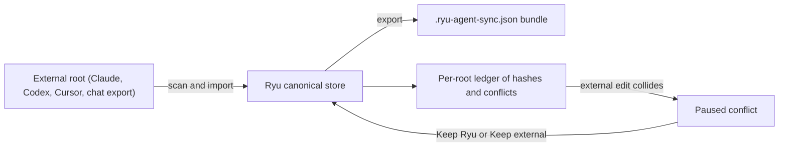

Agent sync moves agent setup between Ryu and the **Claude**, **Codex**, and **Cursor** setup
roots on a node. Open it from **Gateway → Import agents**. Ryu is the canonical store: importing
reads the external root and writes into Ryu. It never edits the source folder.

## Import

The scan preview can include project instructions, skills, MCP servers, plugins, memories,
subagents, slash commands, and native threads where the format is verified.

- Claude and Codex native history is read through their supported import adapters.
- Cursor native conversation history is reported as unsupported and stays portable-bundle-only.

### Saved roots

Save a root to get independent **Import** and **Export** switches. Both default to off.

A root has one profile, one single-flight operation, and one ledger of source hashes, generated
hashes, operation ids, and conflicts. Repeating a scan or retrying after a crash converges instead
of creating duplicate conversations or duplicate schedulers.

- If profile or root detection data cannot be loaded, the section shows the error and offers
  **Retry**.
- Changing the selected profile clears the previous scan preview. Scan the new root before you
  choose items to import.
- **Save root + enable import** saves the root first and enables automatic import only after that
  save succeeds.

### Organization permissions

On an organization-bound node, the Core node permissions sync reads and writes.

| Operation | Permission |
|---|---|
| Scans and status | `agent.view` |
| Profile changes, imports, exports, and conflict resolution | `agent.edit` |
| ACP session resume | `agent.run` |

- Status only shows ACP bindings whose agent is visible to the caller and whose linked conversation
  is readable.
- Ledger items tied to a recognized provider are also filtered by that provider's agent ACL.
- An import or export that names a profile must use that profile's configured root, so a profile id
  cannot be paired with a different filesystem destination.

### Watched export folders

A root can also be an unzipped ChatGPT or Claude data export. With **Import** on, Ryu imports its
chats, projects, and saved context, then checks the folder again about every 30 seconds.

- An export whose files have not changed is not scanned again.
- When the files change, for example when a newer export is unzipped over the folder, the next
  check adds only the messages Ryu does not have yet.
- Files that arrive while an import is running are not counted as imported, so the next check
  brings them in.
- Only the conversation, project, and memory files count as a change. Images and other attachments
  next to them do not, however many there are.
- A failed import is not retried until the export changes. Import it again from **Import agents**
  to retry at once.

<Callout type="info">
  On a node bound to an organization, the automatic check cannot import chat exports because no
  signed-in member is acting for it, so it records the item as failed. A signed-in member imports
  the export from **Import agents** instead.
</Callout>

## Export

Gateway → **Export Ryu** writes a versioned `.ryu-agent-sync.json` bundle to an explicit
destination. The bundle contains agent definitions and, only when you tick **Conversation
transcripts**, Ryu conversation transcripts.

<Callout type="warn">
  Transcripts are off by default. The bundle is written in plain text outside Ryu's encrypted data
  folder, so anyone or any tool that can read that folder can read them. Bundle contents may also
  include private prompts and tool configuration. Choose a destination with the same privacy
  expectations as the agent's own history directory.
</Callout>

- The transcript choice is saved per export destination, and the automatic export follows it.
  Destinations created before this option export no transcripts until you tick it.
- The bundle is written owner-only. Leftover temporary bundle files from an interrupted export are
  removed on the next export.
- Ryu does not invent undocumented Claude, Codex, or Cursor history files, so native conversation
  export is reported as unsupported.
- Generated output is hash-recorded and suppressed during the next import pass to prevent loops.
- API keys and credentials are not exported as agent secrets.

On an organization-bound node:

- export requires the caller's `agent.edit` permission;
- the bundle includes only agent definitions the caller may view and conversations the caller may
  read;
- ACP resume metadata is subject to the conversation-read check and, when a binding is present, the
  bound agent's resource check;
- setup ledger items without a canonical Ryu agent identity remain governed by the sync route
  permission.

## Dry-run previews

Setup imports and bundle exports support read-only previews. Native thread imports
support the same boundary. A preview reads and reconciles the source transcript without
creating a conversation, appending messages, recording an ACP binding, or emitting an
import notification.

| Route | Preview body |
|---|---|
| `POST /api/agent-sync/threads/import` | `{ "agentId": "...", "threadId": "...", "dryRun": true }` |
| `POST /api/agents/{id}/threads/import` | `{ "thread_id": "...", "dry_run": true }` |

The response reports `messages_added`, `already_imported` when an existing conversation
would be updated, and `would_create` when a new conversation would be created. A preview
returns `conversation_id: null` when a new conversation would be created.

## ACP sessions

When an ACP agent reports session metadata, Ryu persists its native session id, engine, working
directory, capabilities, and node or device id against the Ryu conversation.

- Agents that advertise session load or resume can use that binding. Otherwise Ryu replays the
  canonical Ryu transcript.
- Session listing is optional, so missing native session storage is a visible capability state,
  not an error.
- ACP resume checks that the caller can read the linked Ryu conversation before it uses a stored
  native session binding. A binding alone never grants access to the conversation transcript.

## Conflicts

Ryu pauses a conflicting item and preserves the external content for review. The operator chooses
**Keep Ryu** or **Keep external** before projection continues, so an external edit is never
silently overwritten.

| Choice | Result |
|---|---|
| **Keep Ryu** | Re-projects the selected canonical item immediately |
| **Keep external** | Adopts the external file as the new baseline. Ryu preserves it while the canonical item is unchanged, and raises a new conflict if the canonical item changes later |

A resolution applies only to the selected conflict. Other paused items stay visible until they are
resolved too.

## Choosing the right portability tool

Agent sync is an interchange bundle for setup and transcripts, not a portable Marketplace package.

| You want | Use |
|---|---|
| A code project's redacted, commit-linked transcript | [Portable Git history](/docs/core/conversations-sessions#portable-git-history). Its checkpoints use dedicated Git refs and an explicit push/fetch action, and never write native Claude, Codex, or Cursor conversation files |
| A versioned agent, workflow, plugin, theme, or other installable definition | [Portable packages](/docs/extend/develop/extensions/portable-packages) |
| A complete node copy, including chats, sessions, and memory | [Data Folder & Storage](/docs/surfaces/desktop/user-guide/data-and-storage) |
