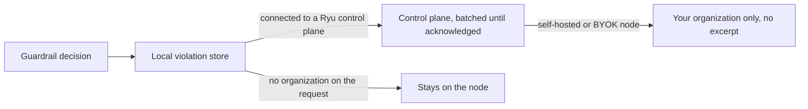

The Gateway audit log records model calls, sandbox executions, and credential-read events in a
node-local store. Disable audit recording in Gateway settings when the node should not retain these
records; queries then return no stored entries. Quality scoring of the same traffic is covered by
[Gateway evals](/docs/gateway/evals).

<Figure name="observability" />

## Storage and retention

Audit data is stored locally by the Gateway. Set `db_path` under `[audit]` in `gateway.toml` when
the default storage location does not suit the node.

| Bound | Default | Environment variable |
|---|---|---|
| Age | 90 days | `RYU_AUDIT_RETENTION_DAYS` |
| Row count | 1,000,000 rows | `RYU_AUDIT_MAX_ROWS` |

Set either variable to `0` to disable that bound. Owners apply the configured bounds with
`POST /v1/audit/prune` (or Core's `POST /api/gateway/audit/prune`). The prune endpoint does not
accept SQL or a path.

- **Pruning removes rows only.** Lifetime usage totals, which back per-key token budgets and the
  spend reported for shared budgets, are kept separately. They do not decrease when old rows are
  removed.
- **Recording is best-effort per row.** Under a heavy burst or a storage error an individual record
  can be dropped. Its usage still counts toward the lifetime totals, and a failed totals write is
  retried.

## Record schema

Each row captures the request, its tenant attribution, usage, and quality. The `event_type`
discriminator separates a `model_call`, `exec_call`, `credential_read`, `widget_follow_up`,
`control_change`, or `service_call` (direct Gateway web service work, neither a model call nor a
sandbox execution).

| Field | Notes |
|---|---|
| `request_id` | Gateway-internal id, also returned as the `x-request-id` response header |
| `api_key` | Redacted to a short prefix in audit query results |
| `user_name`, `org_id`, `team_id`, `project_id` | Tenant attribution |
| `user_id`, `agent_id` | Verified caller and stable agent attribution when Core has it |
| `provider`, `model` | Resolved route for the call |
| `input_tokens`, `output_tokens`, `cache_hit`, `latency_ms` | Usage and timing |
| `cache_read_tokens`, `cache_write_tokens` | Provider-reported cache activity; null when the provider omitted the count |
| `eval_score` | The `overall` eval score when this request was sampled, else null |
| `skill_ids` | Comma-separated active Agent Skill ids, from `x-ryu-skill-ids` |
| `session_id` | Core conversation/session id, from `x-ryu-session-id` |
| `error` | Error message when the call failed |
| `event_type`, `backend`, `command`, `duration_ms`, `exit_code` | Exec, credential-read, and control fields; null when not applicable |
| `feature` | Product surface; control rows use `control` |
| `widget_instance_id` | Bounded widget-render correlation for widget tool/follow-up rows |
| `purpose` | Background feature behind the call (`x-ryu-purpose`, such as compaction or title generation); null for chat turns and untagged calls |

- The usage rollup under [Querying](#querying) reports `purpose` per bucket and can filter by it.
  Raw audit search does not filter on it.
- The Cache misses card in Agent observability derives OpenRouter's uncached residual from input
  tokens minus cache reads and writes. The audit row keeps the provider-reported read and write
  counts. It does not store that derived residual.

## Querying

`GET /v1/audit` returns matching rows newest-first with `count` and `entries`. Every filter is an
optional query-string parameter combined with `AND`. Filters cannot inject SQL (the WHERE clause is
fully parameterized), and `limit` is clamped to a maximum of 1000 (default 100).

| Filter | Matches on |
|---|---|
| `api_key` | The full (unredacted) API key |
| `org_id`, `team_id`, `project_id` | Tenant scope |
| `provider`, `model` | Resolved route |
| `request_id` | A single Gateway request |
| `session_id` | All rows belonging to one Core session |
| `agent_id` | All model, tool, credential, widget, and control rows attributed to one agent |
| `event_type` | `model_call`, `exec_call`, `credential_read`, `widget_follow_up`, `control_change`, or `service_call` |
| `errors_only` | Only rows that recorded an error |
| `limit` | Row cap, 1 to 1000 |

### Access

`GET /v1/audit` is master-key only. Audit data is tenant-wide and sensitive, so a per-tenant key
cannot read it.

- The one exception is no-auth mode from a loopback peer.
- That loopback trust is withdrawn when [mesh](/docs/core/node-and-presence) is enabled, because a
  tailnet peer can appear as `127.0.0.1`.
- From Core, `GET /api/gateway/audit` proxies the supported filters for the node owner. It returns
  `reachable: false` instead of an error when the Gateway is down.

### Usage analytics

For complete usage analytics, use `GET /v1/audit/usage?from=<rfc3339>&until=<rfc3339>`. It returns
model and execution activity in canonical 15-minute UTC buckets, aggregated across the complete
range with no raw-row limit.

- `from` is inclusive, `until` is exclusive, and the maximum range is 400 days.
- Optional `provider` and `model` filters use the same exact-match semantics as raw audit search.
- Each bucket carries `purpose`, so background work such as compaction or title generation is
  reported separately from the chat turns it supports. An optional `purpose` filter narrows the
  rollup to one background feature.
- Each bucket also carries `cacheReadTokens` and `cacheWriteTokens`, summed from the
  provider-reported cache counts.

Core exposes the owner-only proxy at `GET /api/gateway/audit/usage`. It forwards the same filters
and returns a fail-soft `reachable` status when the Gateway is unavailable.

### Organization aggregation view

The signed-in organization aggregation view is a read-only projection of the latest Gateway
reports. It does not become a second measurement or billing source.

- KPI cards show Gateway count and request, error, token, and cost totals.
- Horizontal bar charts rank Gateway cost and provider eval scores.
- The recent audit rows sit below the charts.

The KPI cards and charts are visible to every organization member. The recent audit rows need the
`audit.view` permission and are not shown for family workspaces. Members without it still see the
charts and a short note in place of the rows.

## Control activity and agent traceability

Successful administrator changes are recorded as `control_change` rows as well as being reflected
in the owning configuration. Raw policy bodies, API keys, and other request payloads are never
copied into the row.

| Column | Holds |
|---|---|
| `user_name` | The actor label |
| `user_id` | The verified user id, when available |
| `model` | The target, for example `gateway_config` |
| `command` | A compact action plus changed-section summary |

Direct Gateway-admin calls are attributed to the authenticated local admin boundary. Core proxies
carry the already-verified signed-in user id and email across that boundary.

### Agent-management changes

Core agent-management mutations also emit a bounded `control_change` row: create, edit, delete,
capability changes, prompt-version changes, runtime authentication, imports, and session operations.
The row carries the verified organization caller and the stable `agent_id`. It never carries the
agent prompt, tool arguments, credentials, or request body.

With these rows, an Agent passport shows both what the agent did and which person changed its
controls.

### Organization Audit log page

The organization Audit log page merges these Gateway rows with organization control-plane
activity: policy, config-as-code, firewall, key, budget, server, role, and membership changes.

- The combined view is permission-gated by `audit.view` and can be filtered to organization or
  Gateway scope.
- `agentId=<stable-agent-id>` narrows the projection to one agent's control changes.
- The organization aggregation audit query uses the same `agentId` filter for its model and tool
  activity rows. It also requires `audit.view` and is not available for family workspaces.
- That query's `eventType` filter accepts only request event types (`model_call`, `exec_call`,
  `credential_read`, `widget_follow_up`). Other values return `400`.

### Desktop views

- The Desktop Gateway activity view shows the same agent, caller, request, session, event, and
  result columns.
- An agent's **Agent passport** combines its read-only identity and configuration snapshot with the
  latest organization activity and the Gateway's redacted execution rows.
- Run history remains the place to open the full persistent transcript for a correlated session.

### Violation events

When a guardrail decides something about a request, the Gateway records one violation event per
detector and safety category. Warnings, and plain provider, budget, and transport errors, never
create one.

Events are recorded for:

- a hazard screener block or flag;
- an output block, or a stream the Gateway cut;
- a regex firewall block or redaction;
- a [provider safety refusal](/docs/gateway/account-standing#provider-safety-refusals) of a request
  on the hosted Gateway, in the `abuse.upstream_content_refused`,
  `abuse.upstream_identifier_blocked`, or `abuse.upstream_account_warning` category. The event
  carries the provider and the opaque identifier the request was sent under, never the provider's
  message.

Violation events are kept apart from the audit log, in their own local store beside it, so a large
audit backlog never delays them. They are recorded even when audit recording is turned off (in
memory only in that case).

#### Event fields

| Field | Meaning |
|---|---|
| Organization and credential | The organization the request belonged to and the credential that sent it |
| Category | For example `hazard.S9` |
| Detector and action | What decided and what it did |
| Screening id | The id the client received |
| Route | The route the request came in on, including a stream cut after the response started |
| Direction | Where the content was going: the request, the response, the model's own tool-call arguments, or a tool result |
| Attempt and provider | `0` for the first attempt; `1` or more for a fallback provider or a tool round, with the provider that attempt ran on; `255` for a provider safety refusal of one of the Gateway's own model calls that send the request's text, such as the traffic inspector or a smart routing judge |

While the hosted Gateway's classifier cannot decide and only the regex floor screens, its events
say so with `classifier_unavailable_regex_floor`.

#### Excerpts

An event never carries the full prompt or response. At most it carries a redacted excerpt.

- On Ryu's hosted Gateway and on Ryu-managed nodes, for most categories, the Gateway may keep a
  short redacted excerpt of the screened text, at most 2 KB, encrypted on disk.
- That local copy is deleted once the control plane has received it, and after 72 hours in any
  case. The 72-hour limit applies only to the Gateway's local copy.
- A self-hosted node keeps no excerpts.
- Child-safety verdicts (`hazard.S4`) never keep an excerpt. Only a keyed hash of the input is
  stored, and any excerpt already held for that request is erased.

#### Delivery

A Gateway connected to a Ryu control plane sends these events to it in batches and retries until
they are acknowledged.

On a self-hosted or BYOK node, events are stored for your own organization only, carry no excerpt,
and never count toward Ryu's enforcement, because those nodes are not bound by Ryu's platform floor.
Events from requests that carry no organization stay on the node.

#### What the control plane keeps

For traffic through Ryu's hosted Gateway and Ryu-managed nodes, the control plane receives each
event together with its redacted excerpt, if the Gateway kept one. It stores the excerpt encrypted,
apart from the event.

| What | How long Ryu keeps it |
|---|---|
| The excerpt | 30 days after it is stored |
| An excerpt held by an open case, ban or appeal | Until the last hold is released, then 90 days |
| The violation event (category, detector, action, hashed identifiers; no excerpt) | 400 days |

So a flagged excerpt can stay with Ryu for much longer than the 72 hours the Gateway keeps its own
copy. Tell your end users the periods in this table, not the Gateway's local limit.

### Usage windows

Ryu's hosted Gateway and Ryu-managed nodes also send the control plane a usage window for each
hosted credential and each finished UTC minute. A self-hosted or BYOK node never sends usage
windows, because Ryu's platform floor does not bind it.

A window counts the credential's model requests in that minute and carries:

- how each request ended: allowed, warned, sanitized, or blocked;
- which layer decided, for example the platform floor, your organization's policy, a rate limit,
  or a budget;
- the safety categories involved;
- token totals and the charged cost;
- request counts per model and per provider;
- how many requests fell into each latency range.

A window holds counts and names only. It never carries prompt or response text, request ids, keys,
or client addresses.

Ryu uses windows for usage baselines and abuse detection on traffic through its hosted Gateway and
managed nodes. A refusal because Ryu's screening was unavailable or throttled, or because a request
was too large to screen, is never counted as a platform floor block. An outage on Ryu's side
therefore does not read as your credential probing the floor.

A window is sent once its minute has ended and is retried until the control plane acknowledges it.
A retry is the same window, so it is never counted twice.

## Correlating audit with Core traces

<Callout type="info">
  The Gateway records tokens, cost, and quality. Core records sequencing and latency. The two are
  joined by `session_id`, which Core forwards as `x-ryu-session-id`. See
  [Observability](/docs/core/observability).
</Callout>
