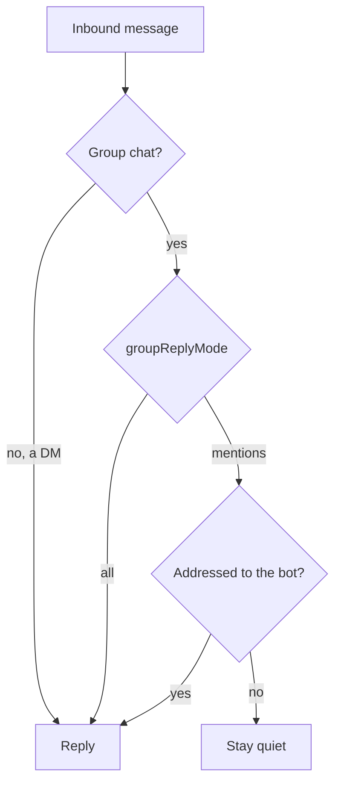

Part of the [Channel Bots](/docs/gateway/channels) guide.

## Routing to an agent or a group

The **Routes to** picker decides what answers the bot.

| Target | Persisted field | Core dispatch | Reply shape |
|---|---|---|---|
| A single agent | `agentId` | `run_reply_text` | One agent reply |
| A group | `teamId` (`team:` sentinel) | `run_team_reply_text` | One combined, attributed reply |

A group's reply is produced by the lead agent orchestrating its members under the group's coordination
strategy (Broadcast, RoundRobin, DebateSynthesis, or Router). The strategies and how a group is built
live in [Agent Groups](/docs/core/agent-teams).

## Group chats: when the bot speaks

Each channel carries a `groupReplyMode` that gates only **group** chats. Direct messages always get
a reply. Each connector applies the decision from the channel's `groupReplyMode` value.

| `groupReplyMode` | Group behavior | DM behavior |
|---|---|---|
| `mentions` (default) | Reply only when the bot is addressed | Always reply |
| `all` | Reply to every message | Always reply |

The connector auto-detects group vs DM from the platform payload, so no manual per-chat flag is
needed. Telegram treats a chat as a group when its `type` is `group` or `supergroup`; Discord's
watched channels are always guild (multi-user) channels, so the mode applies to all of them.

### When a group message counts as addressed

In `mentions` mode a group message counts as addressed when it:

- @mentions the bot;
- is a reply to one of the bot's own messages (Telegram);
- starts with a `/command` (Telegram or BlueBubbles);
- matches a configured platform pattern.

Slack and Discord also keep an active reply thread available when their thread-mention option is
off.

Telegram and Discord resolve their own identity at startup, and Slack uses `auth.test`. If an
identity call fails, private chats and `all` mode remain available, while the mentions gate fails
closed for the affected group surface.

### What the agent receives

Before a matched group message is routed to Core, adapters remove their native bot mention where
the platform exposes one. The agent sees a clean prompt instead of the raw addressing token.

- Telegram prefixes the legacy pipeline text with the speaker's first name.
- Core-bound Telegram and Discord turns carry the display name separately as conversation metadata.
- Slack and BlueBubbles keep their platform sender id as the access identity and do not invent a
  display-name prefix.

<Callout type="info">
  The default is mentions-only, so a group bot stays quiet in a busy room unless addressed. Telegram,
  Discord, Slack, and BlueBubbles each apply the gate independently.
  WhatsApp Business is DM-only. WhatsApp Personal and BlueBubbles apply their group policy locally;
  hosted entry points may apply their own mentions-only detection rather than reading this per-channel
  field.
</Callout>

## Commands

A channel bot offers the same slash commands as Desktop. Core serves the list, which holds commands
contributed by enabled plugins plus installed skills, at `GET /api/channels/commands`.
Telegram publishes them with `setMyCommands`; platforms without a menu recognize them as text and
answer `/help` with the list.

A plugin command is intercepted by a `pre_user_turn` hook inside Core's `run_reply_text`, which the
channel path runs, so the command text only has to reach Core intact.

<Callout type="warn">
  A command from a *disabled* plugin is never published. The endpoint applies the same enabled-plugin
  filter as the Desktop contributions endpoint, through one shared helper, so a bot never advertises
  a command that does nothing.
</Callout>

## Voice, photos and files

Inbound media is normalized and folded into the turn.

- **Voice notes and audio** are downloaded and transcribed through Core's `POST /api/voice/transcribe`,
  and the transcript becomes the message text. A transcription failure degrades to a placeholder so
  the user still gets an answer that acknowledges the voice note.
- **Images, video and documents** are annotated onto the turn (`[attached image: cat.png]`) so the
  agent knows what arrived. An image with no caption becomes the whole prompt.
- Every download is capped, because a channel is an untrusted ingress.

### Spoken replies

Outbound speech is opt-in per bot. A spoken reply is sent **alongside** the text, never instead of
it.

| Setting | Behavior |
|---|---|
| `never` (default) | Text only |
| `mirror` | Speak only when the user sent a voice note |
| `always` | Speak every reply |

| Platform | How speech is sent |
|---|---|
| Telegram | Audio |
| Slack | An uploaded audio file |
| Discord and BlueBubbles | Playable audio attachments |
| WhatsApp Personal | Core's WAV converted through OpenWA |
| WhatsApp Business (Cloud API) | Not sent; generated speech stays text-only |

## Threads and topics

Threaded platforms need two ids to answer (the room and the thread), but Core takes one opaque
`conversation_id`. Slack, Telegram forum topics, and Discord threads pack both as
`"<channel>:<thread_ts>"`. Because Core stores history against the packed key, **each thread keeps
its own conversation history**.

- **Discord** can also open a thread per triggering message (`threadReplies`). Messages that arrive
  inside an existing Discord thread continue in that thread and its conversation history. If a
  Discord thread cannot be created, the reply still lands in the parent channel.
- **Slack** can keep replies in the triggering thread or broadcast them back to the parent channel.
- **Telegram** forum and private-message topics keep their native topic id.
- **BlueBubbles and WhatsApp** have no native thread surface and answer in the chat.

## Where config lives

Channels are account-owned and not scoped to the active Core node like the rest of the Gateway
dialog. When an organization is active, the record is associated with that organization, and the
Gateway reads only the enabled records for that organization. In a multi-tenant deployment, the
matching Gateway listener serves a bot you create from Desktop.

Channels are managed inside the Gateway settings dialog. The shared `ChannelsView`
(`@ryu/blocks/desktop/channels`) backs the UI.

## Related

<Cards>
  <DocCard href="/docs/core/agent-teams" />
  <DocCard href="/docs/surfaces/desktop/user-guide/agents" />
  <DocCard href="/docs/gateway/configuration" />
</Cards>
