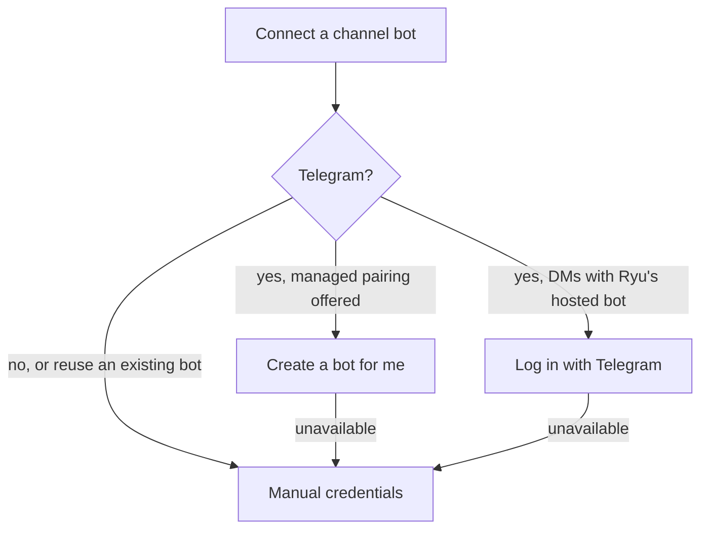

Part of the [Channel Bots](/docs/gateway/channels) guide.

## Set up a bot

<TryInRyu page="channels" />

There are three ways to connect a bot. Pick the first one that fits.



In the web **Channel Bots** list, **Disable** or **Enable** changes a saved bot's enabled state,
and its delete button removes the saved configuration.

If a request fails, the list preserves the bot and shows an error. Retry the action after access or
connectivity is restored; a successful retry clears the error. Reload the page to read the saved
state again.

### Telegram: create a bot for me

On deployments that provide managed Telegram pairing, choose **Telegram → Create a bot for me** in
the Channels dialog. You do not need to visit BotFather or copy a token.

1. Enter the channel name and choose the agent or team, model, prompt, group policy, and enabled
   state you want to save.
2. Open the QR code or deep link in Telegram. Telegram creates a bot that belongs to your Telegram
   account, and the dialog waits for the result.
3. Check the returned `@username`. Choose **Connect @username** only when it is the bot you just
   created. The `Not mine, discard` button or **Cancel** abandons the pairing and revokes the unaccepted bot
   credential. Pairing links expire after a short window.

The managed option is a desktop convenience and is not available on every deployment. If managed
pairing is unavailable, the node cannot reach the pairing service, or you want to reuse an existing
bot, use the manual token flow below.

### Telegram Login: use Ryu's hosted bot

Desktop onboarding may also offer **Log in with Telegram**. The shortcut only appears when the
deployment has configured Telegram Login for its official bot.

1. The public **Connect Telegram** page requires a signed-in Ryu account before it starts the flow.
2. It opens Telegram's official `https://oauth.telegram.org/auth` authorization page. Sign in and
   approve the request for direct messages.
3. Ryu links that Telegram account to your personal Ryu Cloud workspace.

Telegram's `telegram:bot_access` permission lets the linked Ryu bot send you direct messages after
you approve it. See Telegram's
[Log In With Telegram guide](https://core.telegram.org/bots/telegram-login) for the provider-side
setup and permission details.

- The flow does not create a customer-owned bot, copy a token, or add a local Gateway channel.
- Each Ryu account can link one Telegram account this way, and each link uses one of your plan's
  hosted channel users.
- If your account is already linked to a different Telegram account, or the allowance is full, the
  page says so and nothing new is connected.
- If you cancel, the attempt expires, or hosted login is unavailable, the page explains the state
  and lets you retry or use managed pairing or the manual token flow.

### Manual credentials

1. Get the credential for the platform: a Telegram BotFather token, a Slack bot token, a Discord
   bot token, or one of the two WhatsApp setups below. For iMessage there is no token - you run
   [BlueBubbles Server](https://bluebubbles.app) on a Mac and paste its URL and password.
2. In the desktop, open the built-in **WhatsApp** app for a WhatsApp number, or open **Channels**
   for any supported platform. Both use the same account-level channel records.
   - The WhatsApp app opens the native setup tab with **WhatsApp Business (Cloud API)** selected.
   - Choose **WhatsApp Personal** in the platform picker when you use OpenWA.
3. Add a channel: pick the platform, paste the token, and set the **Routes to** target. The picker
   lists your agents and groups; a group is selected with a `team:` sentinel value and persisted as
   `teamId` (otherwise `agentId`) on the channel config.
4. Save. Ryu stores the channel configuration for the active account or organization, and the
   Gateway listener starts handling inbound messages when the channel is enabled.

Saved organization channels run only on organization-scoped servers. Team and personal servers
cannot load organization channel credentials, so a server enrolled for a team or for one person
does not start the organization's saved channel bots; it runs only the channels set up in its own
file-based Gateway configuration.

Changing the platform clears the credentials entered for the previous platform. **Cancel** or
Escape closes the setup dialog and discards its unsaved values.

Every WhatsApp credential set is stored on its own channel record. Two bots can use
different WhatsApp numbers, OpenWA sessions, webhook secrets, agents, policies, and listener paths;
nothing is taken from a global provider setting.

## Let Ryu say hello first

Every channel can use the same assistant-first welcome as the desktop. Turn on **Say hello first**
and enter the chat address or phone number of a chat that is already approved for that bot.

Ryu sends one short welcome through the platform's normal message API, then asks what you would
like help with. No synthetic user message is added to the conversation.

The welcome has these safeguards.

- It needs an explicit destination and an existing pairing or allowlist entry.
- It waits and retries when a local model is still being installed or starting.
- It uses one stable delivery key, so restarting the Gateway does not create another welcome.
- It never guesses a recipient or broadcasts to every chat.

The setting is shared by Telegram, Slack, Discord, WhatsApp Personal, WhatsApp Business, and
BlueBubbles. In a file-based Gateway setup, use these keys.

```toml
[channels.telegram]
proactive_opening = true
proactive_target = "the-approved-chat-address-or-phone-number"
```

Use the same two keys under the channel you are configuring. For Discord and BlueBubbles,
`home_channel` can also provide the destination, but **Say hello first** still has to be enabled.
For paid or already-ready models the welcome can be sent immediately; local models remain quiet
until they are ready.
