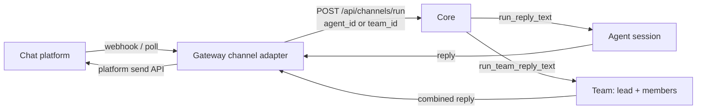

A channel bot turns a chat platform into a front door for Ryu. The Gateway runs the platform
listeners; each inbound message is normalized and routed to a Core agent or team, so a Telegram,
Discord, Slack, or BlueBubbles user talks to the same agent you use in Desktop, with the
same memory, tools, and Gateway governance on the path.

Channels are configured in **Gateway settings**, not on a Core node. They belong to your account
and, when an organization is active, are stored and served within that organization.

Current members can see channels shared with their active organization. Creating an organization
channel requires the `channel.manage` permission. A creator can edit a shared channel while they
remain a member; editing another member's channel also requires `channel.manage`.
Credentials remain write-only and are never returned to Desktop in
cleartext. Deleting a channel is a separate `channel.delete` action and does not delete its shared
Core conversation history.
Leaving or being removed from an organization also removes access to channels you created there.
Live channel-status streams recheck access before updates and close when membership is no longer
valid. Personal channels remain accessible to their creator.

Hosted channel bots require an active managed Pro, Max, Teams, or Business plan. A Major Pass
only grants supported paid Marketplace app access and cannot enable hosted channel users.

## What each platform can do

Each adapter declares its platform's capabilities. The shared path uses the best verb available and
falls back to plain text. Nothing below is emulated: a cell is marked only where the platform has a
real API for it.

| | Telegram | Slack | Discord | WhatsApp Personal | WhatsApp Business (Cloud API) | BlueBubbles / iMessage |
|---|---|---|---|---|---|---|
| Typing indicator | Yes | Best-effort<sup>1</sup> | Yes | Yes | Yes | Private API<sup>2</sup> |
| Rich text replies | Yes | mrkdwn<sup>3</sup> | Markdown | WhatsApp formatting | WhatsApp formatting | Plain text + media |
| Streaming drafts | DMs only<sup>4</sup> | - | - | - | - | - |
| Threads / topics | Yes | Yes | Yes | - | - | - |
| Interactive buttons | Reply keyboards + inline buttons<sup>10</sup> | - | - | - | - | - |
| Command menu | Yes | Manifest slash commands<sup>5</sup> | Native slash commands<sup>6</sup> | `/help` text | `/help` text | `/help` text<sup>7</sup> |
| Voice replies | Yes | Yes | Audio attachment | Yes<sup>8</sup> | -<sup>9</sup> | Audio attachment |
| Attachments in | Yes | Yes | Yes | Yes | Yes | Yes |
| Reactions | Yes | Yes | Yes | Yes | Yes | Private API |

1. Slack bots cannot send a true typing indicator (only the retired RTM API could). The adapter uses
   the assistant thread status, which fails harmlessly for a plain bot.
2. BlueBubbles typing, read receipts and tapbacks need the Private API helper installed on the Mac.
3. Slack's mrkdwn is not CommonMark, so the adapter converts rather than emitting raw markdown that
   would render as literal asterisks.
4. `sendMessageDraft` is private-chat-only, and Core's channel endpoint is non-streaming today, so
   this shows a "Thinking..." draft and then the finished rich message - not live tokens.
5. A Slack slash command must be declared in the app manifest by the operator; the Gateway cannot
   register one at runtime.
6. Discord slash commands are registered as application commands and arrive over the identified
   Gateway WebSocket. Text commands remain available as a fallback.
7. BlueBubbles has no native command menu. Commands typed as text still work, and `/help` lists them
   for senders and chats the channel's access policy admits. Anyone else gets the same answer as any
   other message: nothing, or only the pairing prompt.
8. OpenWA converts Core's WAV through its optional ffmpeg endpoint before sending an OGG/Opus voice note.
9. The Cloud API accepts audio but not Core's WAV output. The adapter answers with text instead of sending an
   unplayable file.
10. Telegram supports reply-keyboard buttons that send ordinary chat text and inline buttons that
    send a typed callback action or open a URL. Plugins and apps can attach these through turn hooks;
    other channel adapters currently deliver the reply text without buttons.

## Interactive buttons and plugin actions

The shared channel contract lets a plugin or app offer the next useful step beside its reply. A
reply-keyboard button sends its label as an ordinary message. An inline callback sends a typed
`channel_action` event to Core, where the next `pre_user_turn` hook can handle it without a model
call or decide to continue the conversation. Inline URL buttons open an HTTPS link or Telegram deep
link.

Callback payloads are user-controlled input. Hooks must check authorization and current state before
performing an action. Telegram callback data is limited to 64 bytes, so the contract validates and
rejects oversized button actions before delivery. See [Building turn hooks](/docs/extend/develop/extensions/hooks-authoring)
for manifest and JavaScript examples.

## Live calls

The **Voice replies** row above means a voice note or playable audio attachment. It does not mean that a
channel bot can join a live call. Live calls use a separate duplex transport and are not enabled by the
current channel adapters.

| Surface | Current status |
|---|---|
| PSTN / phone number | Use the separate [Ryu Phone Assistant](/docs/gateway/phone-assistant) for inbound and outbound calls |
| WhatsApp Business | Conditional on an eligible WhatsApp Business Calling API number |
| WhatsApp Personal | Not supported as a native-call transport |
| Discord guild voice | Conditional on a guild voice connection and current Discord voice requirements |
| Discord direct-message calls | Not supported by the bot surface |
| Telegram native bot calls | Not supported by the Bot API; use voice notes or a Ryu Mini App instead |

Phone calls through Twilio, including how each call's conversation and voice ticket are bound,
are covered on [Phone Assistant](/docs/gateway/phone-assistant#call-conversations).

<Callout type="info">
  Telegram uses long polling by default and can switch to an authenticated webhook. Slack uses
  Socket Mode, while Discord keeps an identified Gateway WebSocket with heartbeats and an online
  presence. BlueBubbles receives webhook events from the Mac server and sends through its REST API.
  Ryu's liveness dot reports the adapter's control-plane heartbeat for all four. Webhook callbacks
  are claimed by their provider event id before acknowledgement; duplicate or in-flight deliveries
  do not create a second turn.
</Callout>

## How a bot turn works

Each platform has an adapter that owns only its transport and platform verbs. The access gate, media
ingest, the Core call, and reply delivery are shared, so a new channel only implements the channel
contract.

When the channel is bound to an agent or a group, the adapter routes the turn through Core's session
seam rather than a one-shot Gateway-pipeline call.



1. The platform delivers a message to the channel's adapter. Webhook deliveries are authenticated
   before parsing and durably claimed by a bounded provider-delivery ledger. Telegram uses
   `update_id`, WhatsApp uses its `wamid`, OpenWA uses its message/delivery id, and BlueBubbles
   uses its message `guid`. A callback that cannot be accepted returns a retryable failure instead
   of acknowledging work that was never queued.
2. The adapter normalizes it and POSTs to `POST <core_url>/api/channels/run` with the channel's
   `agent_id` xor `team_id`. Store-backed channel records add their own channel identity to the
   platform chat id, so two bot records never accidentally share a transcript. Each sender keeps a
   persistent Core conversation that Desktop can open as well.
3. Core dispatches: a non-empty `team_id` invokes the team reply path (the lead agent orchestrates
   members and returns one combined, attributed reply); otherwise the single-agent reply path runs.
   Both reuse the same chat path, memory, and Gateway routing that Desktop uses.
4. The model calls still flow Core to Gateway, so routing, firewall, budgets, and audit stay on the
   path.
5. The reply is sent back via the platform's send API.

Outbound retries, the 30-day delivery ledger, and the `idempotencyKey` replay that
`POST /api/channels/run` uses are described in
[Delivery retries and duplicate webhooks](/docs/gateway/channel-controls#delivery-retries-and-duplicate-webhooks).

A channel with neither `agent_id` nor `team_id` falls back to the legacy Gateway pipeline path (a
single non-streaming call with the channel's configured model and system prompt). Bind an agent or
team instead: that path persists conversation history and reaches Core memory and tools.

## Multiple bots and shared sessions

Every saved channel is an independent bot record. You can connect several Telegram bots, several
Discord bots, or several WhatsApp numbers, and give each record its own credentials, agent or team,
policies, and platform options. A channel record is not limited to one bot per platform.

When a channel message is routed through Core, the channel and platform chat are used to keep one
stable shared session. You can continue the same conversation from Desktop chat and
from the channel, with the same history and agent context. Different bot records remain separate
even when they listen to the same platform.

A node only loads the channel credentials its own scope allows. An organization node runs the
organization's shared channels. A team node runs the shared channels that have no team, plus its
own team's channels; it never receives another team's bots. A personal node runs only channels
bound to that node, never the organization's shared or team channels.

When Ryu's managed provider inventory is enabled, managed Ryu Cloud nodes also get a dedicated
Telegram and Discord channel slot for the default Ryu agent. Each node receives its own provider
credential; Ryu never sends one customer's bot token to another customer's node, even when the nodes
are in the same organization. If the inventory is temporarily unavailable, the slot stays disabled
until it is ready, and you can paste your own token into that channel instead.

Channel credentials are delivered only to nodes enrolled with organization-level authority. A node
enrolled for a single team or for one member's personal use does not receive the organization's
shared channel tokens and cannot report status for those channels. Run shared organization bots on
an organization-level node. When a managed Ryu Cloud node is removed, its node credentials stop
working at once, even if the background cleanup that revokes them is still being retried. That
cleanup also turns off every channel bound to the removed node, including channels that use a
token you pasted yourself. Ryu-managed bot credentials for the node are erased. A token you pasted
stays saved on its channel but is no longer delivered to any node.

When a managed channel is ready, its channel card includes a platform action using that bot's public
identity. Telegram shows **Open in Telegram** and opens the dedicated bot's `t.me` link so you can
press **Start**. Discord shows **Install in Discord** and opens that dedicated application's install
flow so someone with **Manage Server** permission can choose a server. These actions are per-node
links, never expose the bot token, and do not create a second shared bot or transfer provider ownership.

Pasting a customer-owned token changes that channel to customer-managed credentials while keeping
the same agent binding and channel history. Provider ownership transfer is not an automatic part of
this switch: Telegram and Discord ownership changes remain subject to each platform's own account,
installation, and transfer rules.

### Ryu Cloud's shared WhatsApp front door

Ryu Cloud's managed service can operate one official WhatsApp Business number for every managed
organization. The hosted cloud-bot owns that single webhook and outbound sender, then uses the
admin-granted WhatsApp phone identity to select exactly one organization's managed node and agent.
An administrator-provided node address must be a public HTTPS origin; paths, query strings,
fragments and local addresses are rejected before the hosted bot connects.

An administrator-entered sender ID also needs a one-time claim code sent from that account before
its messages route to a node. For older ID grants that have not been verified, reissue the claim
code in the grant settings and share it with the intended sender.
Pending IDs do not reserve a platform identity globally; only the sender's confirmed claim binds it.
Changing the node address, allowed agents or teams, or intended username issues a new code and
pauses routing until that sender confirms again.
Members do not create a Meta app, buy a phone number, or paste provider credentials. An unknown
phone receives onboarding information and is not assigned to an organization automatically.

### Proactive WhatsApp templates

The hosted bot's authenticated `POST /push` operation accepts `whatsappTemplate` for
approved WhatsApp Business text templates. Set `platformType` to `whatsapp` and select
the recipient with `platformUserId`, `ryuUserId`, or `organizationId`. This example
uses an illustrative template name; create and approve it in Meta before sending:

```json
{
  "platformType": "whatsapp",
  "platformUserId": "+6591234567",
  "whatsappTemplate": {
    "name": "job_finished",
    "language": { "code": "en_US" },
    "components": [
      {
        "type": "body",
        "parameters": [{ "type": "text", "text": "Report ready" }]
      }
    ]
  }
}
```

The template uses Meta's component fields. Text header and body parameters, URL
button text parameters, and quick-reply button payloads are supported; media,
currency, and date-time parameters are not. Component types and button indices
must be unique. Omit `components` for a template without dynamic parameters.

A template request does not require `text`. If both are provided, only the template
is sent. Invalid templates are rejected before delivery; provider failures appear
in the push result's `errors` with `failed` incremented. The bot does not retry a
rejected template as free-form text. Free-form replies still use `text` and remain
subject to Meta's customer-service window. Template approval, available languages,
and delivery permissions are managed by Meta, not granted by Ryu.

This managed front door is separate from the per-node WhatsApp `ChannelConfig` used by self-hosted
or customer-managed Cloud API connections. Model and tool work performed on behalf of a routed
organization continues through its normal Gateway policy and organization credit wallet. The shared
phone line is Ryu platform infrastructure; it is not silently charged as a customer-owned number.

Deleting an agent does not delete its channel records or their Core history. If one of those channels
receives a later message, Ryu routes that turn to the configured default agent and shows a warning on
the channel until you rebind it. Deleting a channel is separate: it removes the bot credentials and
configuration while keeping the shared Core conversation history.

## Focused guides

<Cards>
  <DocCard href="/docs/gateway/channel-setup" />
  <DocCard href="/docs/gateway/channel-controls" />
  <DocCard href="/docs/gateway/channel-routing" />
</Cards>

For a guided lesson, see [Channel bots in Ryu Academy](/docs/learn/academy/cloud/channel-bots).
