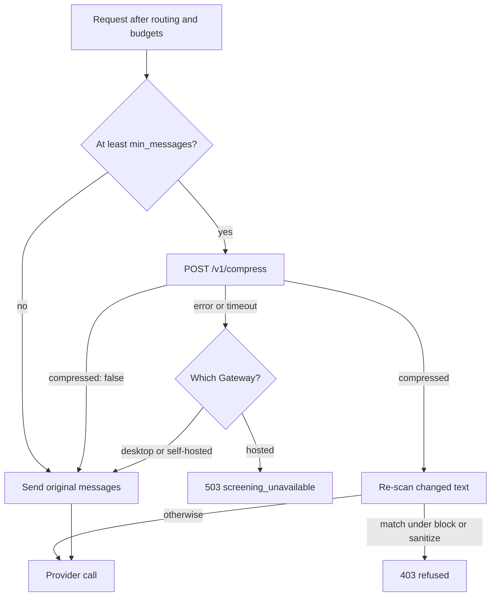

The Gateway can compress the messages of eligible OpenAI-format model calls before they reach the
provider. It uses the [headroom](https://github.com/chopratejas/headroom) engine and applies to every
agent whose calls take that path. Results depend on workload and configuration, so measure token usage
and answer quality on representative requests.

<Callout type="warn">
  Compression is off by default. When enabled, it applies to the default OpenAI-compatible chat path.

  - Gateway routing alone does not give compression coverage for every ACP runtime or protocol.
  - Provider-native passthrough and direct-egress paths do not use this transform.
  - Compression coverage is separate from firewall and audit coverage.

  Check [runtime routing](/docs/surfaces/desktop/engines/agent-runtimes) and test the actual request
  path before you rely on compression.
</Callout>

## Why it lives in the Gateway

Compressing a request changes what is shared with the provider. That is a Gateway concern, not a
Core one (see [Core vs Gateway](/docs/start-here/architecture/core-vs-gateway)).

Compression is an egress transform on the Gateway pipeline, applied just before the upstream
provider call. The compression service is set by configuration, so any service that implements
headroom's `/v1/compress` contract works.

## Enable it

1. Install the headroom proxy (the minimal extra, without serena or the ML stack):

   ```bash
   pipx install --python python3.13 "headroom-ai[proxy]"
   ```

2. Enable the [Headroom Compression](/docs/plugins/headroom) plugin. The plugin's enabled state is
   the switch. For a headless run, `RYU_HEADROOM_ENABLED=1` seeds the default before the plugin
   state is read:

   ```bash
   export RYU_HEADROOM_ENABLED=1
   ```

On startup Core launches the headroom proxy (`headroom proxy`) and tells the Gateway to compress
against it. Eligible OpenAI-format requests then call `POST /v1/compress` on the compression service
before going upstream, subject to `min_messages`.

## How it works



### Who does what

- **Core decides what runs.** It manages the optional `headroom proxy` process
  (`apps/core/src/sidecar/headroom.rs`). When compression is enabled, it sets the Gateway's
  compression env on spawn.
- **Gateway owns the transform.** `apps/gateway/src/compression.rs` posts the request messages to
  the compression service and swaps in the compressed result before the provider call.
- **It runs once per request.** The transform runs after routing and budgets, once for the whole
  fallback chain, so routing, caching, and budgets stay intact.

### Screening the result

The text the compression service changed or added is scanned by the inbound firewall and locked
guardrails before the provider call. The service cannot add content the original request would
have been refused for.

A media URL (such as an `image_url`) is not scanned inbound. If the service moves one into message
text, it counts as new text and is scanned there. A match is refused with a 403 under the `block`
and `sanitize` policies (see [Security](/docs/gateway/security)).

### Failure behavior

- **Fails open on your own Gateway.** If headroom is absent, unhealthy, slow, or returns an unusable
  response, a desktop or self-hosted Gateway leaves the original messages untouched and the call
  proceeds. This fallback does not guarantee unchanged answer quality or rule out other request
  failures.
- **Fails closed on the hosted Gateway.** Ryu's hosted Gateway refuses the request instead, with a
  503 whose `error.code` is `screening_unavailable` and a `Retry-After` header. Retry after the
  stated delay.
- **A decline is not a failure.** A service that answers `compressed: false` has declined to
  compress, and every Gateway sends the original messages.

Compression reuses the Gateway's HTTP connections across requests. The compression timeout applies
to each request. Conversations with fewer than `min_messages` messages skip the compression service.

## Configuration

| Setting | Env var | Default |
|---|---|---|
| Seed for compression on (Core) | `RYU_HEADROOM_ENABLED` | off |
| Headroom proxy URL (Core) | `RYU_HEADROOM_URL` | `http://127.0.0.1:8787` |
| Core-managed proxy | `RYU_HEADROOM_MANAGED` | on |
| Headroom binary (Core) | `RYU_HEADROOM_BIN` | `headroom` on `PATH` |
| Gateway compression toggle | `GATEWAY_COMPRESSION_ENABLED` | set by Core |
| Gateway compression URL | `GATEWAY_COMPRESSION_URL` | set by Core |
| Gateway compression bearer token | `GATEWAY_COMPRESSION_TOKEN` | none |
| Per-request timeout (ms) | `GATEWAY_COMPRESSION_TIMEOUT_MS` or `gateway.toml [compression] timeout_ms` | 4000 |
| Min messages before compressing | `GATEWAY_COMPRESSION_MIN_MESSAGES` or `gateway.toml [compression] min_messages` | 4 |

Core normally manages the Gateway settings. To run the Gateway standalone, set
`GATEWAY_COMPRESSION_ENABLED=1` and point `GATEWAY_COMPRESSION_URL` at any service that implements
headroom's `/v1/compress` contract.

See also [Reliability & Budgets](/docs/gateway/reliability) and [Routing](/docs/gateway/routing).
