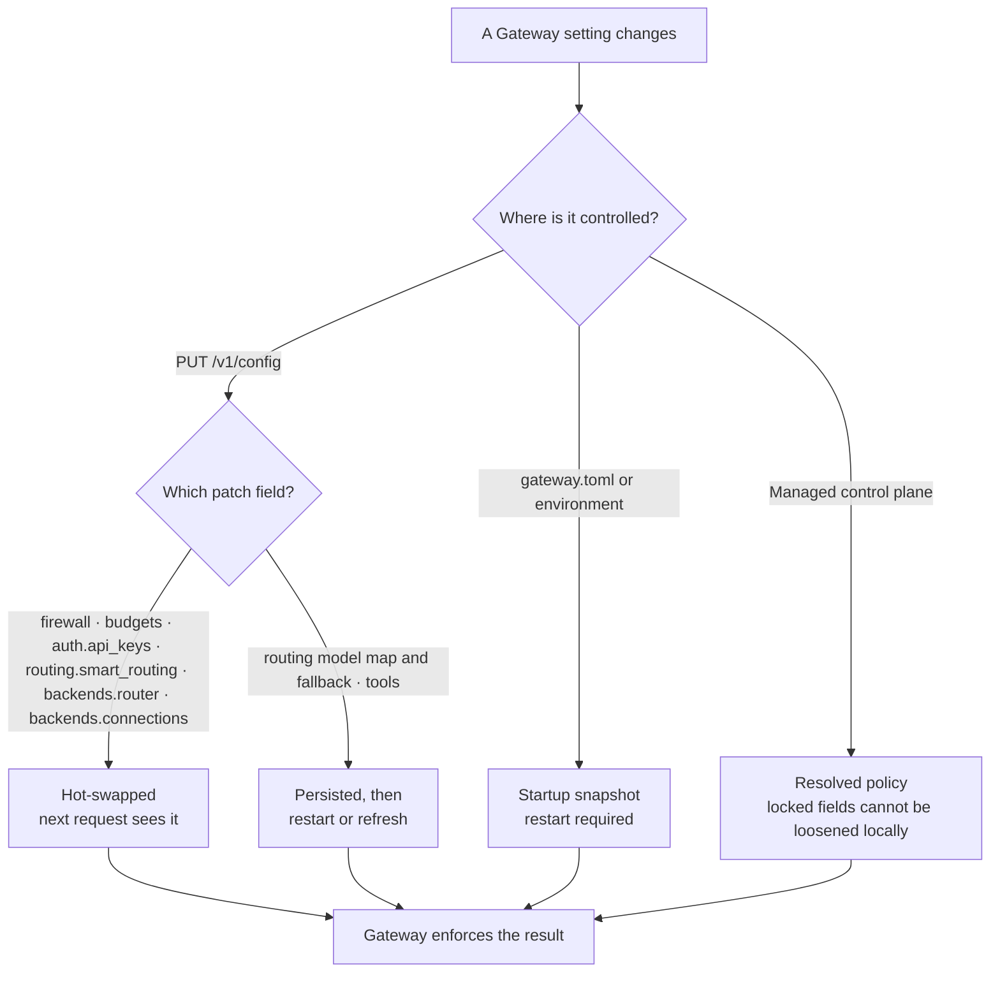

Part of the [Configuration & Auth](/docs/gateway/configuration) guide.

## Runtime config over the API

### Read and edit configuration

Read and edit config without restarting the process. The examples use the release profile's
default local address, `127.0.0.1:7981`; other profiles use a different port.

```bash
# Read the live config (secrets are redacted)
curl http://localhost:7981/v1/config \
  -H "Authorization: Bearer $GATEWAY_MASTER_KEY"

# Patch firewall settings live
curl -X PUT http://localhost:7981/v1/config \
  -H "Authorization: Bearer $GATEWAY_MASTER_KEY" \
  -H "Content-Type: application/json" \
  -d '{
    "firewall": {
      "enabled": true,
      "policy": "warn_and_continue"
    }
  }'

# Patch budget rules live
curl -X PUT http://localhost:7981/v1/config \
  -H "Authorization: Bearer $GATEWAY_MASTER_KEY" \
  -H "Content-Type: application/json" \
  -d '{
    "budgets": {
      "users": {
        "default": { "limit": 5000000, "window": "daily", "action": "stop" }
      }
    }
  }'
```

`GET /v1/config` returns the live firewall, budgets, routing, and a redacted view of providers and
auth. Provider `api_key` fields become `"***"` and API key values are masked, so secrets never
leave the process (`ConfigView` / `redact_providers` / `redact_auth`, `apps/gateway/src/api/config.rs`).

`PUT /v1/config` accepts a partial patch (`ConfigPatch`). The common fields are `firewall`,
`budgets`, `auth`, `routing`, `backends`, `egress`, and `tools`; each one you send replaces that
section. Budget rules are charged-spend caps in micro-USD (`limit`, with `window`, `action`, and
optional `downgrade_to`, `restrict_max_tokens`, `alert`, and `include`). It persists first, then applies the live changes, so a failed file write leaves
the running config untouched.

### What applies live vs on restart



| Patch field | Effect |
|---|---|
| `firewall` | Hot-swapped live |
| `budgets` | Hot-swapped live |
| `auth.api_keys` | Hot-swapped live (full replacement: any key not in the list is removed) |
| `routing.smart_routing` | Hot-swapped live (the smart-routing toggle and rules) |
| Other `routing` fields | Persisted, but take effect only on the next Gateway restart |
| `tools` | Persisted, but takes effect only on the next Gateway restart |
| `backends.router` | Hot-swapped live. Selects the [routing layer](/docs/providers/upstream-routers) |
| `backends.connections` | Hot-swapped live. Selects the [connections layer](/docs/gateway/connection-calls) provider |
| Other `backends` stages | Persisted, but take effect on the next Gateway restart (`backends.budget` is also live) |

A `backends` patch is merged onto the saved selection, so name only the stages you are changing.
`GET /v1/config` returns the full `backends` selection.

The `ModelRouter` holds a snapshot of `RoutingConfig` taken at startup. Model map, fallback chain,
and provider tier changes are write-then-restart operations.

`[concurrency]` is snapshotted at startup and is not patchable over the API. Changes to
`local_max_in_flight` or `local_max_queued` require a Gateway restart.

Provider credentials, `master_key`, and `require_auth` are not writable through `PUT /v1/config`.
Set `master_key` and `require_auth` in the startup configuration. For provider keys, see
[Access and tools](/docs/gateway/configuration-access#auth-and-api-keys).

<Callout type="info">
When Core manages the Gateway, it restarts the Gateway with `gateway.refresh()` after a routing or
compression policy change. Desktop changes therefore apply without a manual restart, even though the
process re-reads its routing config on startup.
</Callout>

### Admin authorization

Both `GET` and `PUT /v1/config` are admin surfaces gated the same way as `GET /v1/audit`. The master
key always passes. Without it, only a loopback peer while `require_auth = false` is admitted. A
remote caller always needs the master key (`require_local_admin`, `apps/gateway/src/api/config.rs`).

<Callout type="warn">
Loopback trust is neutralized when the mesh is on. Under userspace networking, inbound tailnet peers
appear as `127.0.0.1`, so `admin_loopback_allowed` returns false when `mesh_enabled()` is true and
the admin surface then requires the master key. Do not rely on no-auth loopback access on a
node with `RYU_MESH_ENABLED` set.

The same applies to a [hosted Gateway](/docs/gateway/managed-data-plane#hosted-gateway-restrictions)
and to any Gateway in fleet mode (`fleet = true` or `RYU_GATEWAY_FLEET=1`), self-hosted ones
included. Behind a co-located load balancer every caller arrives from `127.0.0.1`, so such a
Gateway never treats a loopback peer as the local operator, and it refuses to start with
`require_auth = false` even on a loopback listener. Fleet mode also refuses `/passthrough/*` with
`403`. It only hardens exposure: it does not make a Gateway hosted.
</Callout>

## From Core

When the Gateway runs as a Core sidecar, Desktop never calls `/v1/config` directly. Core
relays it.

| Core route | Relays to | Notes |
|---|---|---|
| `GET /api/gateway/config` | `GET /v1/config` | Proxies the Gateway's exact status; returns a `502` with `reachable: false` when the Gateway is down |
| `PUT /api/gateway/config` | `PUT /v1/config` | Writes a validated TOML subset (firewall, budgets, auth, routing) |
| `GET /api/gateway/status` | read-only | Health, metrics, and a credential-redacted effective config; always `200`, with `reachable: false` when the Gateway is down |

Core attaches the Gateway token as a bearer when relaying (`gateway_get_config`,
`apps/core/src/server/mod.rs`), so Desktop config surfaces work without the operator handling
the master key.

<Callout type="warn">
The standalone front-of-agent setup (binding the Gateway, pointing an agent at its base URL, and
owning `gateway.toml` yourself) is documented on
[Gateway for any agent](/docs/gateway/gateway-for-any-agent). Parts of that path are opt-in and not
live-verified end to end; see the caveats on that page.
</Callout>

## Related

<Cards>
  <DocCard href="/docs/gateway/gateway-for-any-agent" />
  <DocCard href="/docs/gateway/routing" />
  <DocCard href="/docs/gateway/governance" />
  <DocCard href="/docs/gateway/security" />
</Cards>
