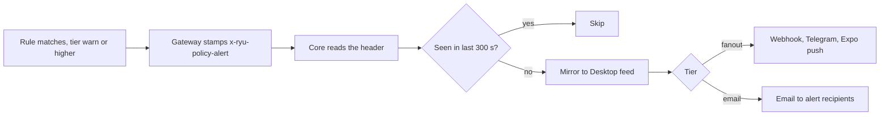

Part of the [Configuration & Auth](/docs/gateway/configuration) guide.

## Credits

`[credits]` enables the wallet debit hook. After each metered model call, the Gateway debits the
request's organization wallet in the control plane. With `enabled = false` the hook is a no-op.
Managed deployments provide their service credential outside this file.

```toml
[credits]
enabled = false
base_url = "http://127.0.0.1:3000/api"  # defaults to control_plane.base_url
markup_bps = 0                          # platform markup in basis points (0 = pass-through)
wallet_empty_action = "stop"            # "stop" | "downgrade"
wallet_empty_downgrade_to = ""
timeout_ms = 3000

[credits.provider_billing.openrouter]
mode = "pass_through"                  # raw provider cost; other providers inherit markup_bps
```

| Field | Default | Meaning |
|---|---|---|
| `enabled` | `false` | Master switch. Also `GATEWAY_CREDITS_ENABLED` |
| `base_url` | inherits `control_plane.base_url` | Credits endpoint base. Also `GATEWAY_CREDITS_URL` |
| `markup_bps` | `0` | Platform markup in basis points applied to `costMicroUsd`. `0` = pass-through at cost. Also `GATEWAY_CREDITS_MARKUP_BPS` |
| `provider_billing.<provider>.mode` | `inherit_global` | `pass_through` charges that Gateway provider's raw cost without `markup_bps`; omitted providers inherit the global markup. The key is the actual Gateway provider id, not a Core catalog label. `GATEWAY_CREDITS_PASS_THROUGH_PROVIDERS` is a CSV shorthand. |
| `wallet_empty_action` | `stop` | `stop` - reject next request with `402`; `downgrade` - reroute to `wallet_empty_downgrade_to` |
| `wallet_empty_downgrade_to` | - | Model to route to on `downgrade`. Falls back to `stop` if unset |
| `reserve_enabled` | `true` | Hold an estimate against the balance while a request runs. Also `GATEWAY_CREDITS_RESERVE` |
| `min_reserve_micro_usd` | `10000` | Floor for one request's hold. Also `GATEWAY_CREDITS_MIN_RESERVE_MICRO_USD` |
| `timeout_ms` | `3000` | Per-debit POST timeout in milliseconds |
| `top_up_url` | `https://ryuhq.com/organizations/billing` | Link returned as `top_up_url` when a [connection call](/docs/gateway/connection-calls#paying-for-connection-calls) is refused for credit. Empty omits it. Also `GATEWAY_CREDITS_TOP_UP_URL` |

The debit is **post-call** (after the model call completes) and the budget gate is **pre-call**, so
an empty wallet blocks the next request rather than the one that exhausted it.

### Per-call rates

Each rate has a working default, so set one only to override it. All are also available as `GATEWAY_CREDITS_COST_PER_<NAME>`.

| Field | Default | Meaning |
|---|---|---|
| `cost_per_tool_call_micro_usd` | `500` | Per Composio tool execution (`$0.50` per 1,000, Composio's managed-app rate). Override when your contract differs |
| `cost_per_gpu_second_micro_usd` | `975` | Replicate's published L40S rate. The media fallbacks below derive from it |
| `cost_per_image_micro_usd` | `1950` | Flat fallback for one image generation (2 GPU-seconds) |
| `cost_per_video_micro_usd` | `58500` | Flat fallback for one video render (60 GPU-seconds) |
| `cost_per_tts_micro_usd` | `975` | Per speech synthesis (1 GPU-second) |
| `cost_per_stt_micro_usd` | `975` | Per transcription (1 GPU-second) |

How media is metered:

- **Image and video** use the provider's **reported** compute time. Replicate returns
  `metrics.predict_time` and fal returns `metrics.inference_time`; both are normalized to
  `usage.compute_seconds` and priced at `cost_per_gpu_second_micro_usd`. Queue wait is not included,
  and neither provider charges for it.
- **Flat image and video rates** apply only to a response that carries no timing. The ledger
  `taskLabel` is then `<modality> (estimated cost)`; a measured debit keeps the plain label and
  stores the reported duration separately.
- **Speech synthesis and transcription** have no compute-time path. Their flat rate is the price
  unless the provider reports the request's cost, as OpenRouter does.

<Callout type="warn">
  A rate of `0` does not mean "free". The debit is guarded by `if cost > 0`, so a zero rate skips
  the debit while the provider still bills you. With `enabled = true`, an explicit `0` on any
  tool-call or media rate is a **startup failure**. To give a modality away on purpose, set
  `GATEWAY_CREDITS_ALLOW_FREE_MODALITIES=1`.
</Callout>

## Control plane

`[control_plane]` connects the Gateway to the control-plane API for shared budget reconciliation and
usage reporting. Disabled unless `gateway_key` is set (or `CONTROL_PLANE_KEY` is in the
environment).

```toml
[control_plane]
enabled = false
base_url = "http://127.0.0.1:3000/api"  # also CONTROL_PLANE_URL
gateway_key = "..."                      # also CONTROL_PLANE_KEY; also flips enabled
report_interval_secs = 60
audit_limit = 200
shared_budget_id = ""                    # also CONTROL_PLANE_SHARED_BUDGET_ID
cost_per_1k_micro_usd = 2000
```

| Field | Default | Meaning |
|---|---|---|
| `enabled` | `false` | Auto-enabled when `CONTROL_PLANE_KEY` is set |
| `base_url` | `http://127.0.0.1:3000/api` | Control-plane API base URL |
| `gateway_key` | - | Gateway credential (sent as `X-Gateway-Key`) to authenticate and resolve the org |
| `report_interval_secs` | `60` | How often to push a usage/audit report |
| `audit_limit` | `200` | Max audit rows per report push. Keep it in the hundreds: the control plane refuses a report whose per-key or per-team rollups exceed 50,000 entries, and the Gateway resends the same slice |
| `shared_budget_id` | - | Optional shared budget for cross-Gateway spend caps. A team node can use only its team's budget; a personal or organization-wide node only an organization-wide budget. Any other is reported as not found |
| `cost_per_1k_micro_usd` | `2000` | Estimated cost in micro-USD per 1k tokens for spend attribution |

<Callout type="info">
`[control_plane]` handles **reporting and shared budgets only**. Grant validation and manifest
signing are on [Grants and Manifest Signing](/docs/gateway/governance).
</Callout>

## Policy alert delivery

Budget, session-budget, wallet-empty, and firewall rules can each request a notification tier when
they match, independent of the enforcement action they take. The Gateway decides the tier and
stamps it on the response. Core delivers it, because Core owns notification channels.



### Alert tiers

`AlertTier` (`crates/gateway/contracts/src/lib.rs`) is set per rule with an `alert` field on budget
rules, the session budget, firewall config, and the wallet-empty action. It defaults to `Silent`.

| Tier | Wire value | Delivery |
|---|---|---|
| Silent | `silent` (default) | No alert |
| Warn | `warn` | Live SSE warning to Desktop only, no external fan-out |
| Fanout | `fanout` | Fan out to webhook / Telegram / Expo push |
| Email | `email` | Email the node's alert recipients only (no webhook / Telegram / push) |

The Gateway only builds a stamp at `warn` or higher. The verdict is written to the
`x-ryu-policy-alert` response header as `base64(json)` (`PolicyAlert`,
`apps/gateway/src/policy_alert.rs`). It is stamped on **both** the success (2xx) response and the
error response (a budget `402` or a firewall-block `403`), so an alert on a blocked request is not
dropped.

### How Core delivers

Core reads the header off every Gateway-fronted response (`apps/core/src/policy_alerts/mod.rs`)
and delivers it when it parses. A malformed header is a silent no-op, never fatal.

- **Dedupe.** The stamp carries a stable `dedupe_key` (a fixed sha256 over source / scope /
  subject / limit, deterministic across restarts). Core claims it atomically with a 300-second
  cooldown, so a chat turn whose tool loop re-reads the same stamp delivers it once.
- **SSE mirror.** Every delivered alert is mirrored to the live Desktop feed regardless of tier.
- **Fan-out per tier.** `Fanout` calls `notify_all` over the node's webhook / Telegram / Expo-push
  targets. `Email` calls it over the configured email recipients only, using the BYO SMTP transport
  (`resolve_transport`, `apps/core/src/email/mod.rs`, a lettre client).

Core exposes the delivery config over these routes (`apps/core/src/server/mod.rs`):

| Route | Purpose |
|---|---|
| `GET` / `PUT /api/email/transport` | The node's non-secret SMTP transport config |
| `POST /api/email/test` | Send a test email over the configured transport |
| `GET` / `PUT /api/alerts/delivery` | The node's policy-alert delivery targets (fan-out channels + email recipients) |

In Desktop, open **Gateway → Email & alerts** on a self-hosted node:

- **Save** stores SMTP transport changes.
- **Send test** requires a recipient. It saves the current transport first, then tests the saved
  relay; a relay rejection is shown with the node's error message.
- Alert email and webhook fields save when you leave the field; removing a target saves
  immediately. Telegram and Expo push targets configured elsewhere are kept.
- Managed nodes show a cloud-ownership note instead of the node-local editor.
- Switching nodes reloads both editors and discards unsaved edits.

The **STARTTLS** switch picks how the node secures its SMTP connection:

- **On** upgrades a submission connection (usually port 587) with STARTTLS.
- **Off** uses implicit TLS (SMTPS, usually port 465) for any remote relay, so credentials never
  cross the network unencrypted.
- **Exception.** With STARTTLS off, a relay on the node's own machine (`localhost` or loopback) on
  a port other than 465, such as a local Postfix on port 25, is reached in plaintext.

Budget rules are on [Reliability](/docs/gateway/reliability); firewall policy is on
[Security](/docs/gateway/security).

<Callout type="warn">
Delivery is best-effort. A failing sink logs and drops the alert so one channel never blocks the
others. The self-host BYO SMTP transport needs a real mail relay to verify end to end and has not
been exercised against a live relay. On a managed node the email leg goes through the control
plane instead of the local SMTP sink.
</Callout>

## Key environment variables

These override `gateway.toml` keys at load time. Setting `GATEWAY_MASTER_KEY` also forces
`require_auth = true` (`apps/gateway/src/config.rs`).

| Variable | Purpose |
|---|---|
| `GATEWAY_CONFIG` | Explicit path to `gateway.toml`; otherwise `<os-config>/ryu<suffix>/gateway.toml` |
| `GATEWAY_BIND` | The address the Gateway binds |
| `GATEWAY_MASTER_KEY` | The master key; also flips `require_auth` on |
| `GATEWAY_CORE_RELAY_KEY` | Trusted Core forwarding credential; keep distinct from the inference relay and master key |
| `GATEWAY_CORE_PROOF_KEY` | Proof-only Core signer; validates agent identity proofs and is never accepted as a bearer |
| `OPENAI_API_KEY` / `OPENAI_BASE_URL`, `ANTHROPIC_API_KEY` / `ANTHROPIC_BASE_URL`, `OPENROUTER_API_KEY` / `OPENROUTER_BASE_URL` | OpenAI, Anthropic, and OpenRouter provider credentials |
| `MODAL_API_KEY` / `MODAL_BASE_URL` | Modal serverless GPU provider. Built only when both are set; there is no default URL |
| `LOCAL_LLM_URL` | The local engine URL (Core sets this to the active engine) |
| `CORE_URL` / `CORE_TOKEN` | Reach Core for tool execution (set by Core's `gateway_spawn_env`) |
| `COMPOSIO_API_KEY` / `COMPOSIO_ENTITY_ID` | Composio integration; `api_key` also flips `composio.enabled` |
| `CONTROL_PLANE_URL` / `CONTROL_PLANE_KEY` | Control-plane relay; `CONTROL_PLANE_KEY` also flips `control_plane.enabled` |
| `CONTROL_PLANE_SHARED_BUDGET_ID` | Cross-Gateway shared budget coordinator ID |
| `GATEWAY_FIREWALL_ENABLED` / `GATEWAY_FIREWALL_POLICY` | Firewall toggle and policy |
| `GATEWAY_TOOLS_ENABLED` | Unified tool loop master switch |
| `GATEWAY_COMPRESSION_ENABLED` / `GATEWAY_COMPRESSION_URL` | Egress compression toggle and service URL |
| `GATEWAY_COMPRESSION_TIMEOUT_MS` / `GATEWAY_COMPRESSION_MIN_MESSAGES` | Compression timeout and minimum message count |
| `GATEWAY_CREDITS_ENABLED` / `GATEWAY_CREDITS_URL` | Credits debit hook toggle and endpoint |
| `GATEWAY_CREDITS_MARKUP_BPS` | Platform markup on metered usage in basis points |
| `GATEWAY_SMART_ROUTING_ENABLED` / `GATEWAY_SMART_ROUTING_MODEL` | Smart routing toggle and classifier |
| `RYU_CRASH_REPORTS_ENABLED` | Opt-out crash reporting (default on). Core forwards the user's Desktop privacy preference here |
| `RYU_DIAGNOSTICS_EXPORT_ENABLED` | OpenTelemetry diagnostics export (default off). Core sets `1` only when the user opts in and an OTLP endpoint is configured |
| `OTEL_EXPORTER_OTLP_ENDPOINT` / `OTEL_EXPORTER_OTLP_HEADERS` | OTLP/HTTP base URL (`/v1/traces` is appended unless already present) and comma-separated `key=value` headers. Used only while export is on |
| `OTEL_SEMCONV_STABILITY_OPT_IN` | Include `gen_ai` to emit GenAI attributes on model-call spans. Core sets it when it forwards consented export |
| `OTEL_SERVICE_NAME` / `OTEL_RESOURCE_ATTRIBUTES` | Override the exported resource (default `service.name=ryu-gateway` plus `service.version`) |
| `RYU_DIAGNOSTICS_CONTENT_MODE` | `metadata_only` (default) or `content`. Content mode adds prompts, responses, and tool data to model-call spans after outbound firewall redaction. No effect while export is off; a standalone Gateway also needs `gen_ai` in `OTEL_SEMCONV_STABILITY_OPT_IN` |
| `RYU_DIAGNOSTICS_MAX_CONTENT_BYTES` | Per-span content cap (default `750000`). Larger content is truncated and marked `ryu.content.truncated=true` |
| `TELEGRAM_BOT_TOKEN`, `SLACK_APP_TOKEN` + `SLACK_BOT_TOKEN`, `DISCORD_BOT_TOKEN`, `WHATSAPP_ACCESS_TOKEN` | Channel bot credentials (see [Channels](/docs/gateway/channels)) |

Managed deployments may add private service variables that are not part of this reference. The
diagnostics export variables are explained in the
[diagnostics reference](/docs/surfaces/desktop/diagnostics-reference).

## Safety posture and Doctor

The Desktop Gateway page and first-run onboarding show a three-position safety posture slider.
It sets Gateway and Core safety controls. It does not change provider credentials, billing, or agent
routing.

| Posture | Gateway | Core |
|---|---|---|
| **Guarded** | Firewall `Block`, inbound/outbound scans, redaction, and tool-result wrapping on | Command scan on, approval mode `Manual` |
| **Balanced** (default) | Same safety baseline with `Block` | Command scan on, approval mode `Smart` |
| **Autonomous** | Scans, redaction, and wrapping stay on; detections use `Sanitize` | Command scan on, approval mode `Off` |

Changing the slider shows a preview and requires an explicit **Apply**. If individual settings no
longer match a preset, the UI reports **Custom** rather than overwriting the operator's choices.

Claude Code, Codex, and other ACP agent traffic follow each agent's own Gateway routing switch (on
by default, see [Governing an ACP agent](/docs/gateway/acp-agent-governance#layer-1-model-egress)).
Posture changes do not flip those switches or change which credentials the agents use.

The same Gateway dialog has an **Onboarding** panel under **This device**. A node administrator can
reset the node's Personal or Team setup there without deleting chats, Spaces, memories or themes;
the next Desktop launch asks for the node context again. This is separate from the Desktop-only
onboarding reset in **Settings → General → Setup & recovery**.

### Doctor

The Doctor checks configuration, security, performance, connectivity, and agent coverage.

- `GET /v1/doctor` is the read-only audit, available to local admins.
- `GET /api/gateway/doctor` is Core's aggregate. It adds Core's approval preferences and
  agent-routing coverage.

A report includes stable check IDs, severity, the affected setting path, and a recommended action.
It also carries `schemaVersion`, `rulesetVersion`, `profile: "lint"`, and `readOnly: true` so CI and
integrations can identify the contract they consumed. Existing drift warnings remain included in
`GET /v1/config` for compatibility.

The terminal client (`ryu-cli`) exposes the same audit and an explicit safe-repair flow.

```bash
ryu-cli doctor             # read-only audit
ryu-cli doctor --dry-run   # preview protective changes; writes nothing
ryu-cli doctor --fix       # apply only the allowlisted protective changes
```

Desktop uses the same contract: **Run audit** → **Preview safe fixes** → **Apply safe fixes**.
Through Core, the repair route is `POST /api/gateway/doctor/fix`; send `{ "dryRun": true }` to
preview without writing.

- **What it repairs.** Automatic repairs are narrow and idempotent. They cover firewall activation
  and scanning, redaction, and untrusted tool-result wrapping.
- **What it leaves alone.** Bind and auth choices, routing, approvals, providers, budgets, and
  performance limits remain operator decisions.
- **What it reports.** The fix response returns the planned and applied setting paths so an
  automation system can audit exactly what changed.

### Diagnostics and Safe Mode

Gateway → **Diagnostics** shows the active node's Core, Gateway, Desktop, and installed helper
status. From there you can start or restart Core, restart Gateway or an installed helper, copy a
diagnostics bundle, or report an issue. Failed recovery actions show their returned error so you
can retry after addressing it.

When local Core is down, the boot preflight tries one automatic start and provides **Restart in
Safe Mode** for the next boot. Safe Mode temporarily skips apps, plugins, skills, user MCP servers,
and the scheduler without uninstalling them.

**Settings → General → Troubleshooting → Safe Mode** applies to the selected node:

- **Local node.** Saving restarts Core. If Core is unreachable, the desktop can still save its local
  recovery flag.
- **Remote node.** Saving changes that node's next boot preference and shows a pending restart;
  restart the remote node to apply it. The preflight page offers the same save without starting or
  restarting local Core.
- **Failed remote request.** The setting stays unchanged and can be retried. It never changes the
  desktop's recovery flag or restarts local Core.

The Safe Mode banner describes what the running node has suppressed until that node restarts. If
Safe Mode is forced by the node's environment, remove that override before clearing it.

Turning Safe Mode on or off changes every thread's system prompt, so each thread's next message
after the restart is sent without the prompt cache.

### On-demand agent audit

Doctor keeps its deterministic checks as the default. **Audit with agent** sends its current
report and the shared `ryu-health-audit` skill to your default chat agent through the normal Core
agent runtime. Normal permissions and approval rules apply, including for ACP agents. The optional
**Health audit agent** override in Gateway settings applies across Marketplace, agent health, and
Doctor.

The agent returns an advisory score, confidence, evidence, prioritized recommendations, and
limitations. It must distinguish the supplied report from any live read-only checks. Auditing does
not authorize changing posture or applying fixes; Doctor's repair preview and apply actions remain
separate.

- **Open audit conversation** inspects or continues the review.
- Failed requests can be retried. Incomplete responses are labeled partial without inventing a
  score.
- Refreshing the evidence clears the previous assessment. No audit runs automatically.
