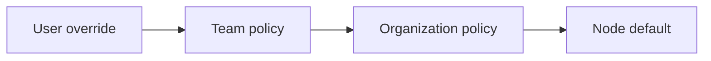

Part of the [Configuration & Auth](/docs/gateway/configuration) guide.

## The config sections

`gateway.toml` groups settings by subsystem. The main sections are listed below.

| Section | Controls | Documented |
|---|---|---|
| `[auth]`, `[[auth.api_keys]]` | Base auth, per-key limits, trusted forwarders | [Access and tools](/docs/gateway/configuration-access#auth-and-api-keys) |
| `[providers.*]` | Per-provider API keys and base URLs | [Routing](/docs/gateway/routing) |
| `[routing]` | Model map, fallback chain, smart routing | [Routing](/docs/gateway/routing) |
| `[firewall]` | Detection toggles and policy | [Security](/docs/gateway/security) |
| `[screening]` | Hazard screener backends and the self-hosted opt-in | [Model screening](/docs/gateway/model-screening#hazard-screener) |
| `[budgets]` | Per-user, per-agent, and per-session charged-cost budgets (micro-USD) | [Reliability](/docs/gateway/reliability) |
| `[rate_limit]` | Request, token, and burst limits | [Reliability](/docs/gateway/reliability) |
| `[cache]`, `[semantic_cache]` | Exact and semantic caching | [Reliability](/docs/gateway/reliability) |
| `[embedding_cache]` | `/v1/embeddings` vector cache (memory or Redis) | [Reliability](/docs/gateway/reliability#embedding-cache) |
| `[redis_cache]` | Shared Redis/Valkey cache backend settings (URL from `RYU_GATEWAY_REDIS_URL`) | [Reliability](/docs/gateway/reliability#shared-redis-cache-backend) |
| `[prompt_cache]` | Model-aware provider prompt-cache markers | [Provider prompt caching](/docs/gateway/prompt-caching) |
| `[circuit_breaker]` | Per-provider failure thresholds and reset timeout | [Reliability](/docs/gateway/reliability) |
| `[evals]`, `[audit]` | Sampling and the audit DB path | [Gateway audit](/docs/gateway/audit) |
| `[compression]` | Egress compression | [Context compression](/docs/gateway/compression) |
| `[channels.*]` | Bot tokens and webhooks | [Channels](/docs/gateway/channels) |
| `[concurrency]` | Local-engine admission control | [Access and tools](/docs/gateway/configuration-access#concurrency) |
| `[exec_budget]` | Sandbox / tool execution rate caps | [Access and tools](/docs/gateway/configuration-access#exec-budget) |
| `[tools]` | Unified tool loop (search-based) | [Access and tools](/docs/gateway/configuration-access#tools) |
| `[computer_use]` | Node-wide Ghost device-control permissions, including locked use | [Device settings](#device-settings) |
| `[composio]` | Composio integration and action allowlist | [Access and tools](/docs/gateway/configuration-access#composio) |
| `[credits]` | Platform-credits wallet debit hook | [Credits and operations](/docs/gateway/configuration-operations#credits) |
| `[control_plane]` | Control-plane relay, shared budgets, reporting | [Credits and operations](/docs/gateway/configuration-operations#control-plane) |

## Gateway settings in Desktop

The Desktop Gateway dialog groups the controls that affect a selected node. In addition to the
Gateway TOML sections above, it includes **Hooks**, **Git**, **Worktrees**, and **Environments**.

### Choosing the computer

The **Settings for** picker at the top of the dialog's sidebar shows which computer you are
configuring. Choose another computer there to configure it without closing the dialog.

- The choice applies only inside the dialog. Every section reads and saves that computer's
  settings, while chats keep using the computer selected in the sidebar.
- Each time you open the dialog it starts on the computer your chats use. If the chosen computer is
  removed, it returns to that computer.
- **Use for chats too** in the same menu also makes the chosen computer the one your chats use. It
  works like the sidebar's computer selector and turns off **Auto-select computer**.

Gateway status refreshes while this dialog is open and stops when it closes. Reopening the dialog
fetches a fresh snapshot for the selected node. Slow status requests finish before the next poll
starts, so they do not accumulate in the background.

### Scope layering

The scope strip on these tabs follows the same effective-configuration idea used by managed MCP and
skill access. The most-specific declared field wins:



- An explicit off or deny value is still a value, so a user can turn one hook off without removing
  the team's other settings.
- Hook **trust** is the exception. A user override can withdraw trust from a hook, but cannot trust
  a hook that the node or an organization or team administrator marked untrusted.
- Hook overrides apply to the whole node. On a node shared by an organization or team, changing the
  user-scope hook override needs the `gateway.configure` permission.

On a managed node, organization and team layers are resolved by the control plane, and Core applies
them before a hook runs. On an unmanaged node, those layers are shown as unavailable; the UI never
presents a local value as an organization policy.

### Budgets

**Gateway → Spending limits** has separate per-user and per-agent rules plus one global
per-session rule. User and agent rule keys are the identity values forwarded to the Gateway. Each
rule stores an integer micro-USD cap, action, charge categories, and notification tier.

- The Desktop inputs accept a non-negative USD amount with up to six decimal places. A cap of `0`
  is unlimited.
- Editing or removing one user or agent updates only that entry and preserves the other budget
  scopes.
- The **Restrict** action also requires a positive whole-number token cap. Blank, zero,
  fractional, or unsafe integer values are rejected before the rule is saved.

See [charged-spend budgets](/docs/gateway/reliability#budgets) for enforcement details.

### Integrations

The Desktop Integrations tab saves:

- optional Hugging Face and Artificial Analysis credentials;
- the Artificial Analysis cached or live data mode;
- the node's webhook-ingress backend. A self-hosted relay's public URL can be saved before that
  backend is selected.

If Core rejects a backend change, the previous selection stays active; failed credential or URL
saves remain available to retry. If the node cannot return the saved values when the tab opens, the
tab shows an error and offers **Retry**. It keeps the affected fields read-only so a save cannot
overwrite values it never loaded.

### Hooks

**Gateway → Hooks** lists lifecycle hooks from supported configuration sources and installed plugins.
Hooks are grouped by source, owner, and lifecycle phase. Expand a hook to review its handler kind,
source path, matcher, priority, and required grant. The handler body is not sent to Desktop.

Trust and enablement are separate controls:

- **Trust** allows a reviewed handler to become eligible for execution.
- **Enable** allows a trusted handler to dispatch at its lifecycle boundary.
- The owning plugin must still be installed and enabled, its declared grants must be approved, and
  Core's sandbox must be available.

New third-party hooks require review by default. First-party hooks may be trusted by their built-in
policy.

- A user or authorized node administrator can create a local override. Managed team and
  organization policy is administrator-controlled.
- Core remains the enforcement point, so a client-side toggle cannot authorize a hook by itself.
- If saving a local policy fails, the Hooks tab keeps the current policy visible and offers a retry.

### MCP inventory

**Gateway → MCP server** is a read-only view of the selected node's registered MCP servers and the
tools advertised by enabled servers. Add or edit servers on the Desktop **Tools** page.

- Search matches server names, tool names, and fully qualified tool IDs.
- Server rows show transport, enabled state, availability, and authentication status.
- **Refresh** reloads both lists after a failed request or when the node's inventory has changed.

### Git

**Git** stores defaults for:

- branch prefixes;
- merge or review delivery, draft pull requests, and force-push;
- pull-request watching: auto-merge, auto-addressing new pull-request comments from repository
  collaborators, and archiving a chat when its pull requests close;
- prompt guidance for commit and pull-request text. Guidance is text passed to the relevant prompt;
  it is not an executable script.

In Desktop, **Effective** shows the resolved value and saves edits as a user override. **User** and
**Node** edit that layer directly; team and organization policy are read-only here.

- Node edits require `gateway.configure`.
- Branch prefixes are trimmed and must be at most 80 bytes with no whitespace or `..`.
- The controls wait for the governance snapshot before enabling edits.
- If a read or save fails, Desktop shows a retry; a save retry repeats the same scoped values.

### Worktrees

**Worktrees** stores the fetch, cleanup, and retention defaults for managed worktrees.

- The filesystem root is node-local, because an absolute path cannot safely be shared across
  machines. Organization and team policy can control portable cleanup settings but cannot
  distribute a node path. Desktop only enables the root field in Node scope.
- The auto-delete limit is a whole number from 1 to 100. Desktop validates it before sending a
  write.
- Read and save failures use the same visible retry behavior as Git settings.

Open **Worktrees** for these controls:

| Setting | Default | Behavior |
| --- | --- | --- |
| Worktree root | Blank | Uses the repository's `.ryu-worktrees` folder. Select **Node** to set an absolute directory on that machine. |
| Always fetch upstream before creating worktrees | Off | Fetches remote branch updates before creating a new worktree. A failed fetch stops creation. Existing conversation worktrees are reused. |
| Automatically delete old worktrees | On | Retains completed worktrees up to the limit, then snapshots and prunes the oldest. Active conversation worktrees are kept. |
| Auto-delete limit | 15 | Keeps between 1 and 100 completed worktrees per repository and root. Disabled when automatic deletion is off. |

Cleanup runs when Ryu releases a managed worktree. Turning it off retains completed folders and
branches for manual management. Worktrees left active after an interrupted process are kept for
manual review.

Snapshots preserve commits, staged changes, and nonignored working files in the original
repository. Ignored files are excluded. See
[worktree recovery](/docs/surfaces/desktop/user-guide/git-workspace#managed-worktree-settings-and-recovery)
for recovery commands.

### Environments

**Environments** lists local projects and opens the existing project environment editor. Setup and
cleanup scripts, variables, and actions remain with the project on its node. Do not put plaintext
credentials in environment variables intended for managed distribution.

In **Environments → Add project**, changing the typed folder path clears the previous selection.
The folder can be added only after the selected node validates the new path.

## Device settings

The `[computer_use]` section is the node-wide policy for Ghost, Ryu's device-control
provider. In Desktop, it appears as **Gateway → Device settings** for the selected device.

```toml
[computer_use]
locked_use = false
security_key = false
```

| Field | Default | Desktop label | Meaning |
|---|---|---|---|
| `locked_use` | `false` | **Allow locked use** | Grants Ghost permission to request the platform's locked-session execution path |
| `security_key` | `false` | **Allow hardware security key** | Records whether features that use a hardware security key (such as a FIDO2 or WebAuthn key) connected to that device may do so |

`locked_use` does not unlock the operating system or bypass its local safety and privacy controls.
Ghost still needs the operating system permissions and a provider path that supports locked use.
If that path is unavailable, device actions remain foreground-only.

No current feature uses a security key, so turning `security_key` on does not change what Ryu can
do today. A key always requires its own touch or PIN. Gateways that predate the field do not store
it; Desktop shows the switch as unavailable until the device's Gateway is updated.
