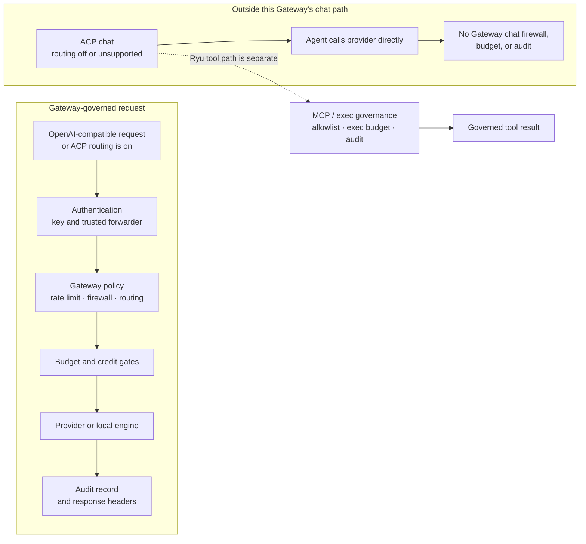

The Gateway reads one TOML file, applies environment variable overrides, and exposes a runtime API
for live edits. When Core runs the Gateway as a sidecar, Core sets most of this. When you run the
Gateway standalone in front of your own agents, you own the file. For that standalone
setup, see [Gateway for any agent](/docs/gateway/gateway-for-any-agent).

## Credential purposes

Managed nodes do not use one bearer for every Gateway operation. Initial enrollment uses a
single-use bootstrap exchange. The response separates a **node-control** credential for lifecycle
and resolution calls from an **inference-relay** credential for model traffic. Each route declares
the purpose and operation it accepts; an ambiguous, missing, or wrong-purpose credential fails
closed. Core persists the pair before acknowledging bootstrap consumption, so a crash cannot adopt
credentials that were never made durable.

Standalone API keys remain separate from this managed lifecycle. They do not become control-plane
credentials, and a control credential cannot be used as an inference bearer.

## Where config comes from

The Gateway resolves `gateway.toml` from `GATEWAY_CONFIG` if set, otherwise from
`<os-config>/ryu<suffix>/gateway.toml`, where the suffix is empty for the `release` profile and
`-<profile>` otherwise (`GatewayConfig::config_path`, `apps/gateway/src/config.rs`). Values
from the file are the base; specific environment variables override individual keys at load time
(`from_env` in the same file). Writes through the API are persisted back to the same path through a file
transaction that checks the file revision before it commits (`GatewayConfig::save`).

```text
gateway.toml          base config (TOML)
  + environment vars   per-key overrides applied at startup
  + PUT /v1/config      runtime edits, persisted back to the file
```

### Credentials in the file are encrypted

Every credential in `gateway.toml` (provider and account keys, `[auth]` client keys and
`master_key`, channel tokens and secrets, and the `[composio]`, `[control_plane]`, `[credits]`,
and `[compression]` secrets) is stored as a sealed `encc:v1:` value. Other settings stay readable.
You can still type a credential in plaintext when you edit the file by hand: the Gateway reads it
and seals it in place on its next start, keeping your comments and layout.

The sealing key is derived from Ryu's master key. When Ryu starts the Gateway it supplies that key
automatically. A Gateway you run on its own needs that key to read sealed values or to save new
credentials. Give it one of these:

- The output of `ryu-core gateway-seal-env`, run as the same user and profile as Ryu. It prints
  `RYU_SEAL_KEY` and `RYU_SEAL_SCOPE` for the Gateway's environment. This is the Gateway's derived
  key, not the master key, but it opens every credential in the file, so keep it in a secret
  manager rather than in a file.
- `RYU_MASTER_KEY`, when you already run Ryu with an operator-supplied master key. Use the same
  value for both.

Without a key, a plaintext file still loads, but the Gateway refuses to write a new credential in
plaintext. When the Gateway is external (`RYU_GATEWAY_MANAGED=0`) and the file holds no sealed
credential yet, Ryu also refuses to save a new credential into it until you have done one of the
above, because the Gateway could not read the sealed value. Ryu still saves other settings, and
leaves credentials you typed in plaintext as they are. Environment-variable
credentials are never written to the file. See
[Gateway configuration sealing](/docs/core/encryption-credential-files#gateway-configuration).

## Ask the assistant to change it

You can ask the Ryu assistant to change Gateway settings for you, for example "route coding requests
to my local model" or "cap spend at $20 a month". The assistant reads the current settings first,
changes only what you asked for, and shows a permission prompt in the chat before every change:
**Allow once** or **Deny**. It asks even when the approval mode is `off`.

- On a node that belongs to an organization, the assistant acts with your role. Reading Gateway
  settings needs `gateway.view` and changing them needs `gateway.configure`; ask an admin if your
  role does not include them. It only does this from a private chat.
- The assistant never adds or changes provider API keys, service accounts, or hook overrides, and
  never prunes the audit log. It also leaves the firewall (DLP and prompt-injection checks), egress
  proxies, API keys and authentication, channels, and audit settings to you in Settings. Add keys
  under **Gateway → AI providers** yourself; don't paste them into a chat.
- Rate limits, the response cache, and circuit-breaker settings live in `gateway.toml` and are not
  changed through the API.

See [Self-API](/docs/extend/develop/extensions/self-api) for how these calls are checked.

## Read the governance boundary

The setting you change and the agent path you use determine what the Gateway can enforce. An
OpenAI-compatible request, or an ACP agent with gateway routing enabled, crosses the Gateway policy
chain. An ACP agent whose routing switch is off (or whose client does not support the injected base
URL) can send its own model calls directly to a provider. Its Ryu MCP and exec tool path is still a
separate governed surface.



Use the per-agent routing switch to choose whether model egress enters the left branch. Do not
interpret that switch as a master off-switch for Ryu tool governance: ACP tool calls still use the
MCP bridge or governed exec front.

## Focused guides

<Cards>
  <DocCard href="/docs/gateway/configuration-settings" />
  <DocCard href="/docs/gateway/configuration-access" />
  <DocCard href="/docs/gateway/configuration-operations" />
  <DocCard href="/docs/gateway/configuration-api" />
</Cards>
