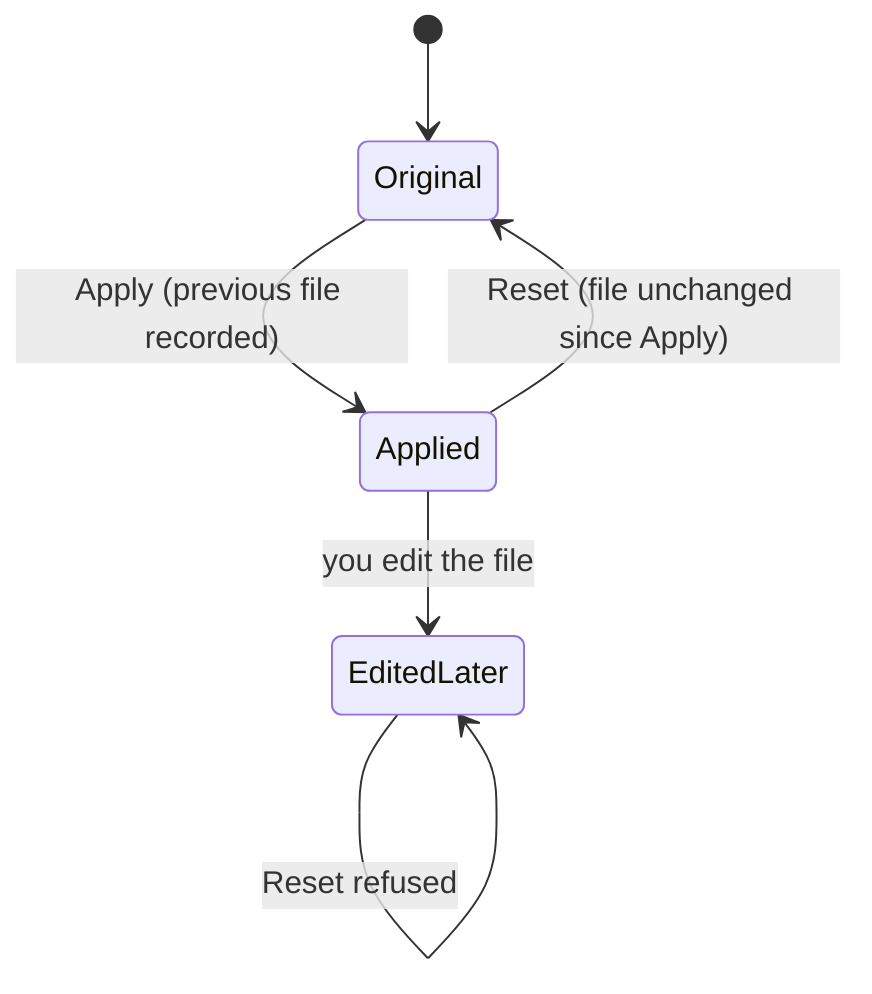

Desktop can point a local coding CLI at the Ryu Gateway with a Gateway client key, and put the CLI
back the way it was later.

## Apply and reset

1. In Desktop, open **Gateway → API & traffic → Gateway client API keys**.
2. Create a named key.
3. Under **Connect a local CLI**, enter a model ID and choose **Apply** next to the CLI you use.

Apply edits that CLI's user-level config on this computer. A remote Ryu node cannot edit this
computer's CLI files, so run this from the local Desktop app.

Ryu records the previous file for **Reset**. Reset restores the prior file only while it still
matches Ryu's applied version; it refuses to overwrite changes made afterward.

## What changes for the CLI

After Apply, the CLI sends its model requests through the Ryu Gateway with the client key and the
selected model. This selects Gateway provider routing and billing for that CLI, including when it
previously used its own subscription or account sign-in. The original CLI authentication file is
left in place.

For Claude Code and Codex CLI, use the
[subscription-preserving passthrough](/docs/gateway/gateway-for-any-agent#subscription-preserving-passthrough-claude-code-codex)
instead to keep subscription billing.

<Callout type="warn">
The client key is written into the local CLI config. Keep that file private, and revoke the client
key if it may have been exposed.
</Callout>

## Supported CLIs

| CLI | Config Ryu edits |
|---|---|
| Claude Code | `~/.claude/settings.json` (`env.ANTHROPIC_BASE_URL`, `ANTHROPIC_AUTH_TOKEN`, `ANTHROPIC_MODEL`) |
| Codex CLI | `~/.codex/config.toml` (a `ryu-gateway` model provider using the Responses API) |
| OpenCode | `~/.config/opencode/opencode.json`, or the existing `opencode.jsonc` |
| Gemini CLI | `~/.gemini/settings.json` and `~/.gemini/.env` |
| Pi | `~/.pi/agent/settings.json` and `~/.pi/agent/models.json` |
| Factory Droid | `~/.factory/settings.json` |
| OpenClaw | `~/.openclaw/openclaw.json` |
| Hermes Agent | `~/.hermes/config.yaml` |
| Continue | `~/.continue/config.yaml` |
| Kilo Code | `~/.config/kilo/kilo.json`, or the existing `kilo.jsonc` |
| Cline CLI | `~/.cline/data/settings/providers.json` |
| iFlow CLI | `~/.iflow/settings.json` |
| Qwen Code | `~/.qwen/settings.json` |

In every case Reset restores the original file only when no later edits would be lost. Project
configs, environment variables, and other overrides in each CLI can still take precedence over the
user-level file.

## Per-CLI notes

### OpenCode

- Adds a `ryu-gateway` OpenAI-compatible provider and selects the chosen model in the global config.
- Keeps comments and unrelated settings. Adds OpenCode's schema declaration when missing so normal
  CLI startup preserves the written file.
- Reset restores the original file exactly.
- Project configs and OpenCode's custom config environment variables can override global settings;
  see the [OpenCode configuration guide](https://opencode.ai/docs/config/) if requests still use
  another endpoint.

### Gemini CLI

- Updates both files together. Selects `gemini-api-key` authentication and sets the Gateway root
  URL, client key, model, and `v1beta` API version.
- Preserves unrelated settings and environment entries. Reset checks both files for later edits
  before restoring them.
- Uses Gateway routing instead of the CLI's native OAuth subscription.
- Shell variables, project settings and environment files, system policy, and workspace trust can
  override or prevent the global setup from loading. See the
  [Gemini CLI configuration reference](https://geminicli.com/docs/reference/configuration/).

### Pi

- Updates both files together. Adds the `ryu-gateway` provider with the Gateway's OpenAI Responses
  endpoint, the selected model, and the client key, then selects them for new Pi sessions.
- Other provider entries and settings are retained. Reset checks both files for later edits.
- Project settings or a Pi agent-directory override can take precedence; see Pi's
  [model configuration](https://pi.dev/docs/latest/models) and
  [settings reference](https://pi.dev/docs/latest/settings).

### Factory Droid

- Adds a `Ryu Gateway` custom model and selects it as the default for new sessions. Other custom
  models and settings are kept.
- Uses Droid's `generic-chat-completion-api` provider with the Gateway `/v1` endpoint and client key.
- If another custom model already uses the selected model ID, Apply stops without changing the file.
- Custom model IDs differ in some older Droid headless releases. If a pinned release does not
  recognize the selected default, choose the Ryu Gateway model from `/model` or update Droid. See
  Factory's [custom model guide](https://docs.factory.ai/model-independence/byok).

### OpenClaw

- Adds a `ryu-gateway` OpenAI-compatible provider, registers the selected model in the default
  agent's allowlist, and selects it as the default model.
- Clears the default agent's fallback list so the Gateway owns fallback routing. Explicit per-agent
  model selections remain separate.
- Accepts JSON5 input, including comments and unquoted keys; Apply writes formatted JSON. Reset
  restores the exact original JSON5 bytes.
- A conflicting `ryu-gateway` provider stops Apply. Config and agent-directory overrides can take
  precedence; see
  [OpenClaw's custom-provider guide](https://docs.openclaw.ai/gateway/config-tools/custom-providers).

### Hermes Agent

- Adds a named `ryu-gateway` provider and selects `custom:ryu-gateway` as the main provider. Its
  client key belongs to that provider, so another provider's key is not reused for Ryu.
- Clears main-model fallbacks so Gateway routing owns failover. Explicit auxiliary-model settings
  are retained.
- Apply rewrites YAML formatting; Reset restores the exact original file. A conflicting provider
  name stops Apply.
- Shell variables and `HERMES_HOME`, `HERMES_CONFIG`, or profile overrides can change which config
  Hermes loads.

Hermes versions that support `session_affinity_header` send the conversation ID in
`x-ryu-session-id` for stable Gateway account selection. Older versions ignore that option; upgrade
Hermes to enable automatic conversation affinity. See the
[Hermes model configuration guide](https://hermes-agent.nousresearch.com/docs/user-guide/configuring-models).

### Continue

- Adds a `Ryu Gateway` OpenAI-compatible model at the start of the config. Sets the `/v1` URL,
  client key, and selected model for chat, edit, and apply roles.
- Choose a tool-capable Gateway model for Agent mode.
- Existing models, rules, MCP servers, and embedding settings remain. Apply rewrites YAML
  formatting; Reset restores the original bytes.
- A conflicting model name or unsupported config schema stops Apply.

The Continue CLI and IDE extensions share this format. For the CLI, use
`cn --config ~/.continue/config.yaml` to override a previously saved config selection. In the IDE,
select the local config and `Ryu Gateway` model. See
[Continue's config reference](https://docs.continue.dev/reference) and
[CLI config precedence](https://docs.continue.dev/cli/configuration).

### Kilo Code

- Writes a named `ryu-gateway` OpenAI-compatible provider and selects the Gateway model.
- Enter the model's actual context and maximum output token limits in the setup row. These values
  enable Kilo's context management; Ryu does not guess limits for a routing alias or custom model.
- Choose a tool-capable model for coding-agent use.
- JSONC comments and unrelated settings are retained. Reset restores the selected file exactly. A
  conflicting `ryu-gateway` provider stops Apply.

The current Kilo CLI and its CLI-backed editor extension share this config contract; older extension
releases may use another settings store. See
[Kilo's custom-model reference](https://kilo.ai/docs/code-with-ai/agents/custom-models).

### Cline CLI

- Targets Cline's current version-1 provider settings. Unsupported provider-settings versions stop
  Apply.
- Selects the OpenAI-compatible provider with the Gateway `/v1` URL, client key, and chosen model.
  Other provider entries remain intact.
- The previous OpenAI-compatible settings and active selection are included in Ryu's exact-file
  backup.
- Cline's normal UTC `updatedAt` refresh for that provider is metadata and does not block Reset.
  Credential, model, URL, and other changes still prevent Reset from overwriting the file.

This is the Cline CLI configuration contract, not the older globalState/secrets migration shortcut
or the editor extension's settings store. `CLINE_DATA_DIR` or `CLINE_PROVIDER_SETTINGS_PATH` can
select another store at launch; see
[Cline's CLI reference](https://github.com/cline/cline/blob/main/docs/cli/cli-reference.mdx).

### Qwen Code

- Uses Qwen Code's documented OpenAI-compatible model-provider configuration with settings schema
  version 4, through its API-key route.
- Adds a model using the local Gateway and a dedicated `RYU_GATEWAY_API_KEY` entry, selects OpenAI
  authentication, and preserves other providers and preferences.
- Existing conflicting model IDs or key entries require review before Apply.
- Shell and workspace overrides can still affect the effective connection. See
  [Qwen authentication](https://qwenlm.github.io/qwen-code-docs/en/users/configuration/auth/).

### iFlow CLI

- Writes `selectedAuthType: "openai-compatible"`, the Gateway client key, base URL, and model.
  Existing preferences are retained.
- Environment, project, and system settings can override this file, as described in the
  [iFlow configuration reference](https://github.com/iflow-ai/iflow-cli/blob/main/docs_en/configuration/settings.md).

In custom OpenAI-compatible mode, iFlow's provider-owned WebSearch, WebFetch, built-in multimodal
features, and tool-call optimization are unavailable. See the
[custom-model migration guide](https://vibex.iflow.cn/t/topic/4868).

## Related

<Cards>
  <DocCard href="/docs/gateway/gateway-for-any-agent" />
  <DocCard href="/docs/gateway/configuration-access" />
  <DocCard href="/docs/gateway/agent-sync" />
</Cards>
