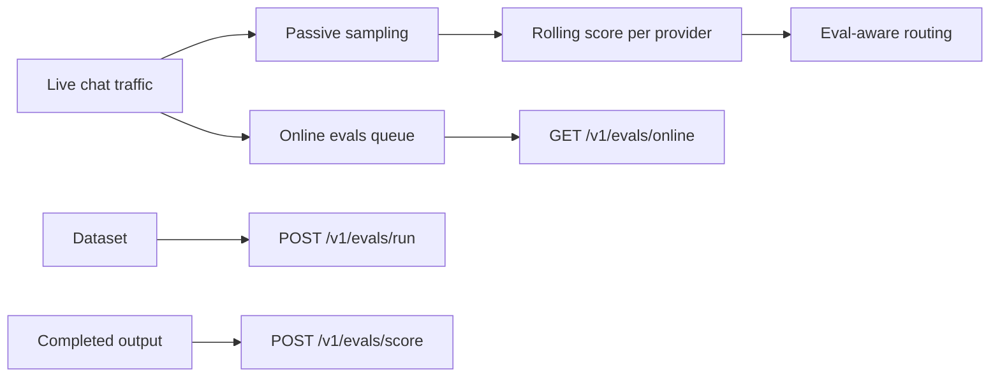

Gateway evals score model responses: passively on sampled live traffic, on demand over a dataset, and
online for outputs you already have. This page is the reference for the eval runner and its routes. The
evaluators that score runs and guard live traffic are listed in the
[evaluator catalog](/docs/gateway/evaluators). For request-level records, see [Gateway audit](/docs/gateway/audit).

<Figure name="evals" />

## Eval runner

The eval runner (`EvalsRunner`) does three jobs:

- **Passive scoring.** It scores sampled live responses and folds those scores into a rolling
  per-provider average. This is **on by default** (`EvalsConfig.enabled` defaults to `true` and
  `sample_rate` defaults to `1.0`).
- **Dataset runs.** It replays a dataset on demand for explicit eval runs.
- **Online scoring.** It scores already-completed outputs through the online scoring endpoint.

Separately, [online evals](#online-evals) score a sampled fraction of production traffic with
catalog evaluators.



### Dimensions

Each scored response combines three normalized dimensions into one weighted `overall` value.

| Dimension | Range | How it is computed |
|---|---|---|
| `latency_score` | 0 to 1 | `1 - (latency_ms / max_latency_ms)`, clamped. 1.0 is instant, 0.0 is at or beyond `max_latency_ms` |
| `token_efficiency` | 0 to 1 | `output_tokens / input_tokens`, normalized so 2x output caps at 1.0 |
| `policy_pass` | bool | Whether the request cleared all firewall and policy checks |

The weighted score is `0.4 * latency + 0.3 * token_efficiency + 0.3 * policy`. A sampled response
carries its `overall` value back in the `x-eval-score` response header.

Every case reports `latency_available` and `policy_available`. Normal pipeline runs measure both;
precomputed outputs can mark either dimension unavailable. An unmeasured dimension is not treated as
a zero or a pass. It is omitted from:

- the case's weighted `overall`;
- the corresponding aggregate average or pass rate;
- the available-case counts.

### Sampling

Sampling is deterministic, with no RNG. `EvalsRunner::should_sample` increments a counter and keeps a
request every `1/sample_rate` boundary, so a `sample_rate` of `0.25` scores exactly one request in
four. A rate of `1.0` scores every request (the default), `0.0` scores none. This keeps scoring overhead
predictable and even rather than bursty.

### Rolling scores

Each sampled score is folded into a per-provider exponential moving average (`EMA_ALPHA = 0.2`),
stored lock-free so the routing path reads it without a mutex.

`eval_routing` consumes these averages to bias provider choice toward the current leader. It
reserves an `explore_ratio` of traffic for non-leaders, so scores stay fresh. See
[Routing](/docs/gateway/routing) for the full A/B selection logic.

```http
GET /v1/evals
```

returns the live config plus the current rolling score per provider:

```json
{
  "enabled": true,
  "sample_rate": 1.0,
  "max_latency_ms": 10000,
  "providers": { "openai": 0.84, "anthropic": 0.79 }
}
```

This operational snapshot requires the same admin authorization as configuration and audit.
For an authorized caller, disabled evals return `200` with `enabled: false` and an empty
`providers` map.

### Configuration

`EvalsConfig` lives under `[evals]` in `gateway.toml`. All fields have defaults, so no configuration
is required.

| Field | Default | Description |
|---|---|---|
| `enabled` | `true` | Master switch. Set to `false` to disable all passive scoring |
| `sample_rate` | `1.0` | Fraction of completed requests to score, in `[0.0, 1.0]` |
| `max_latency_ms` | `10000` | Latency (ms) at which `latency_score` drops to 0 |
| `default_model` | unset | Model that `POST /v1/evals/run` and `POST /v1/evals/score` use when a request names no `model` or `models`. When unset, the model pinned for chat in `routing.modality_map` is used. With neither configured, eval runs return 400 asking for `model`; online scoring returns 400 only when it needs a judge (a model-graded assertion or LLM-judge evaluator) and otherwise records the model as `unspecified` |
| `judge_model` | unset | Model that judges LLM-judge assertions and evaluators when neither the evaluator (`offline.judgeModel`) nor the request names one. When unset, dataset runs use their first model and online scoring uses the model that produced the response |
| `online` | disabled | Production-traffic scoring with catalog evaluators; see [Online evals](#online-evals) |
| `stream_usage` | `true` | Inject `stream_options.include_usage=true` into streamed requests so the provider emits a terminal usage frame. Only OpenAI-compatible providers honour this flag; non-conforming providers fall back to `estimate_prompt_tokens` |

### Dataset runs

```http
POST /v1/evals/run
```

replays each prompt in `dataset` through the full pipeline (firewall, routing, provider call) and
returns per-case scores plus an aggregate. An explicit run always scores, independent of whether
passive evals are enabled. The response preserves input order so a result matrix remains
deterministic.

Cases can run concurrently within these limits:

| Limit | Value |
|---|---|
| Expanded dataset | 1,000 cases |
| Provider and judge calls (conservative upper bound) | 2,000 calls |
| Request body | 8 MiB |
| One case | 256 KiB |
| Recursive assertion sets | 8 levels, 128 nodes |

#### Batch comparisons

For larger, non-urgent comparisons, the admin-only [OpenRouter Batch API](/docs/gateway/batches)
primitive can submit many text requests under one model and return independent rows by `custom_id`.

It uses OpenRouter's asynchronous completion and billing path, so its jobs do not run through the
normal per-request Gateway budget and policy pipeline. Use the synchronous runner when each case
must traverse that pipeline.

The core-client `scoreGatewayEvalBatch` helper rejoins completed rows to the original eval cases and
scores their precomputed outputs through this runner.

- It reports the batch turnaround time as the case latency, because OpenRouter does not expose
  per-row latency.
- Gateway marks policy as unmeasured for those rows unless the caller supplies a verified
  `provider_output_policy_pass`. The scorecard flags those dimensions and does not count them as
  policy failures or passes.

#### Request fields

| Field | Purpose |
|---|---|
| `model` | Model under test, forwarded to the router as-is. When omitted, `[evals].default_model` (or the pinned chat model) is used; with neither configured the request returns 400 |
| `models` | Run the whole dataset against each model and return a per-model breakdown |
| `dataset` | Array of `EvalCase` (`prompt`, optional `expected`, `vars`, `assertions`). Cases can also carry `provider_output` plus provider latency, cost, and source metadata to score a completed external response. Empty uses a built-in 3-case dataset |
| `system_prompt` | Run-level system prompt prepended to every case, with `{{vars}}` substituted per case |
| `judge_model` | One fixed model that judges every `llm_judge` assertion (fair cross-model compare) |
| `evaluators` | Optional run-level registry evaluator ids (from `GET /v1/evaluators`) scored against every case, unioned with any per-case `evaluators` |
| `agent_id` | Optional id forwarded for per-agent budget tracking |
| `max_concurrency` | Maximum provider calls in flight, clamped to 1 to 32; cache-enabled runs serialize duplicate-input lookup so a miss cannot charge the same input twice |
| `timeout_ms` | Per-case provider deadline, bounded to 100 to 120000 ms |
| `repeat` | Repeat every case up to 20 times, with stable repetition ids, subject to the 1,000-case and 2,000-call limits |
| `cache` | Reuse identical provider inputs within the run |
| `tags` | String key/value labels retained in the run envelope |
| `prefix`, `suffix` | Run-level text around each single-turn prompt |

Each case also supports:

- a stable `id` and `description`, typed `vars`, and `metadata`;
- a per-case `provider` or `providers` selection, and a precomputed `provider_output`;
- `options` for prefix, suffix, output and variable transforms, timeout, and caching;
- an optional `context` or reference payload for factuality and faithfulness checks.

#### Assertions

Assertions evaluated against the response include:

- **Deterministic, Promptfoo-compatible.** `contains`, `not_contains`, `equals`, `regex`,
  `icontains`, `starts_with`, contains-any/all, JSON/HTML/XML/SQL containment, validity and
  refusal, Levenshtein, latency, cost, moderation, negation via `not: true`, and nested assertion
  sets.
- **Model-assisted.** `llm-rubric`, `similar`, `factuality`, `context-faithfulness`, and
  `answer-relevance`.
- **Custom JS/Python.** These run through Core's sandbox seam and report an unavailable runtime as
  `executed: false`. The same flag is returned for model or media checks whose prerequisites are
  unavailable.

Deterministic assertion sets may be nested. Model-graded assertions (`llm_judge`, `similar`,
factuality, faithfulness, and answer relevance) must be top-level case assertions; the API rejects
them inside an `assert_set` rather than reporting a misleading unexecuted failure. Assertion scores
remain separate from latency, token, policy, and cost measurements.

#### Authentication and errors

Unlike `GET /v1/audit`, this endpoint authenticates with any valid API key, not the master key,
because a dataset run is a normal metered call. A refused run answers with the same error object as
a chat request, for example `401` with `type: "invalid_api_key"` for a bad key.

On Ryu's hosted Gateway, a run that arrives while the Gateway holds no version of the
[Ryu platform policy](/docs/gateway/organization-policy#ryu-platform-policy-on-hosted-gateways) is
refused before any case reaches a provider. The refusal is a retryable `503` whose `error.code` is
`screening_unavailable`, with a `Retry-After` header. `POST /v1/evals/score` answers the same way.

#### From Core and Desktop

From Core, `POST /api/gateway/evals/run` proxies the dataset run (including optional `evaluators`
and Core-local `code_evaluators`). `GET /api/gateway/evaluators` proxies the evaluator catalog.

Open **Gateway → Quality tests** in Desktop to run the built-in three-case set without importing a
dataset:

1. Choose the model id to evaluate. The panel submits an empty `dataset`, so Gateway uses its
   built-in cases.
2. Read the aggregate latency, token efficiency, policy, and optional substring scores alongside
   each prompt's results.
3. If the request fails, the panel shows Gateway's returned error so you can address it and retry.

For custom prompts, assertions, and judge rubrics, use Prompt Studio.

### Online scoring

```http
POST /v1/evals/score
```

scores an already-completed output without replaying its provider request. Send `response` plus
optional `prompt`, `model`, typed `vars`, `metadata`, `expected`, assertions, and evaluator ids.

- Pass `latency_ms` and `cost_micro_usd` when the measurements came from an external trace. Latency
  and cost assertions use those submitted measurements.
- Pass `policy_pass` only when the external trace records that outcome. Omitting it marks policy as
  unmeasured rather than assuming a pass.

The request body is capped at 512 KiB and the submitted response at 256 KiB. Expensive Levenshtein
comparisons skip oversized inputs.

Model-graded assertions may make an explicit second judge call through the normal Gateway pipeline.
The judge is `judge_model` when the request names one, else `[evals].judge_model`, else `model` (or
the configured default). Deterministic-only scoring needs no model at all.

Core exposes the owner-routed equivalent at `POST /api/gateway/evals/score`, so desktop clients
never need the Gateway admin key.

### Online evals

Online evals score a sampled fraction of real production traffic with catalog evaluators, without
adding latency to the request. They are off until you enable them:

```toml
[evals.online]
enabled = true
sample_rate = 0.05              # fraction of completed chat requests to score
evaluators = ["pii_leakage", "toxicity", "answer_relevance"]
judge_model = "openai/gpt-4.1-mini"   # optional; see judge resolution below
max_judge_calls_per_minute = 60 # per tenant; 0 runs deterministic evaluators only
queue_capacity = 256            # bounded hand-off queue; full queue drops samples
max_concurrency = 2             # parallel scoring jobs
store_capacity = 1000           # recent scored requests kept for the API

[evals.online.tenants."org_123"]
sample_rate = 0.5
evaluators = ["toxicity"]

[evals.online.tenants."org_456"]
enabled = false                 # opt this organization out
```

How it works:

- **Off the hot path.** When a chat request completes (buffered or streamed), Gateway decides from
  the request id whether it is sampled and hands a copy of the exchange to a bounded queue without
  waiting. A background worker scores it; a full queue drops the sample and counts it. Responses
  served from the Gateway response cache are not scored again.
- **Per tenant.** Policy resolves by organization (`local` for requests without one). Each tenant can
  change the rate, evaluator list, and judge model, or opt out.
- **DLP first.** Only text that already passed the firewall is scored: the prompt after inbound
  processing and the response after outbound redaction. A stream the outbound policy blocks is not
  scored.
- **Governed judge calls.** LLM-judge evaluators call the judge through the normal pipeline under the
  original request's tenant, so budgets, firewall, and audit apply. Each judge call also takes a slot
  from the tenant's per-minute judge budget; when it is exhausted the evaluator is reported
  `executed: false` instead of calling a provider. Eval traffic itself is never sampled.
- **Judge resolution.** An evaluator's own `offline.judgeModel`, then the tenant's `judge_model`,
  then `[evals.online].judge_model`, then `[evals].judge_model`, then `[evals].default_model` (or the
  pinned chat model), then the model that served the request.

Gateway rejects an `[evals.online]` block that names an unknown evaluator or one that cannot run
offline when it starts. For the same reason, a `PUT /v1/config` that removes or replaces a custom
evaluator `[evals.online]` still names (so that it no longer runs offline) is refused with `400`;
take it out of `[evals.online]` first.

Read results with:

```http
GET /v1/evals/online?request_id=&trace_id=&tenant=&agent_id=&evaluator=&failed_only=true&limit=100
```

Each record links the scores to the production `requestId` and, when tracing is on, the W3C
`traceId`. It also carries the tenant, agent, model, provider, judge model, and a `pass` flag (every
executed evaluator passed). Records are newest first and held in memory up to `store_capacity`.

`GET /v1/evals` also reports the online configuration and counters (`enqueued`, `droppedQueueFull`,
`scored`, `judgeBudgetSkipped`). Both endpoints require admin authorization.

### Bounded red-team campaigns

Core also exposes a local Promptfoo-style security campaign:

```http
POST /api/gateway/redteam/run
```

The request accepts an agent id, an optional model, and an optional closed list of strategy ids.
Unknown strategy ids are rejected. When the list is omitted, Core runs all ten server-owned probes:

| Strategy id | Scored by evaluator |
|---|---|
| `prompt_injection`, `system_prompt_leak`, `indirect_injection` | `prompt_injection` |
| `jailbreak`, `toxic_output` | `toxicity` |
| `pii_exfiltration` | `pii_leakage` |
| `tool_misuse`, `sql_injection`, `shell_injection` | `code_injection` |
| `bias_fairness` | `bias_fairness` |

Each probe is scored through the existing Gateway evaluator catalog and returns a `protected`
boolean plus bounded evaluator detail. The tool-misuse probe is text-only; the campaign never
executes a real tool. Because the probes are provider-backed, they use the normal Gateway
authentication, policy, budget, and audit path.

Desktop (in an agent's observability view) and the [Activity app](/docs/apps/activity) render this
as **Security sweep**. The CLI exposes the same contract:

```bash
ryu-cli redteam <agent-id> [model] [--max-attention <n>] [--json|--junit]
```

`--max-attention` turns the run into a CI gate that fails when more probes need attention than the
number you pass.

<Callout type="warn">
  Dataset runs are bounded and synchronous. A multi-model run with `llm_judge` fans out
  `models * cases * (1 + judge_calls)` provider calls, all under Core's 120s proxy timeout, so a large
  matrix can time out at the proxy even though no field is dropped. Use `max_concurrency`, `timeout_ms`,
  and `repeat` to size the run.
</Callout>

## Local versus hosted capabilities

Ryu runs the observe, evaluate, and secure workflow locally. That covers correlated traces, prompt
and model experiments, deterministic and model-assisted scoring, custom sandboxed evaluators, human
review, facets and views, exports, online scoring, red-team probes, CI gates, and local retention.
Ryu keeps these records on the node by default and routes provider calls through its own Gateway.

Some capabilities belong to hosted evaluation services. The table shows the local Ryu behavior that takes their place.

| Hosted capability | Ryu behavior |
|---|---|
| Vendor-managed multi-tenant storage, cloud search, and SaaS uptime | Node-local SQLite stores with explicit Core/Gateway ACLs and bounded retention |
| Vendor account billing, hosted sharing links, and organization administration | Ryu account, node, project, and existing sharing/ACL surfaces |
| Vendor-managed enterprise SSO/compliance contracts and proprietary hosted attack generation | Ryu's local auth/RBAC, privacy controls, bounded server-owned security campaign, and provider-neutral adapters |
| Vendor-specific cloud integrations and managed support | Ryu SDK/API/CLI contracts and self-hosted provider configuration |

Local Ryu can export reproducible artifacts to a hosted service when an operator chooses. It does not
silently send prompts, responses, traces, or secrets to an external vendor.

## Related

<Cards>
  <DocCard href="/docs/gateway/evaluators" />
  <DocCard href="/docs/gateway/audit" />
  <DocCard href="/docs/gateway/batches" />
</Cards>
