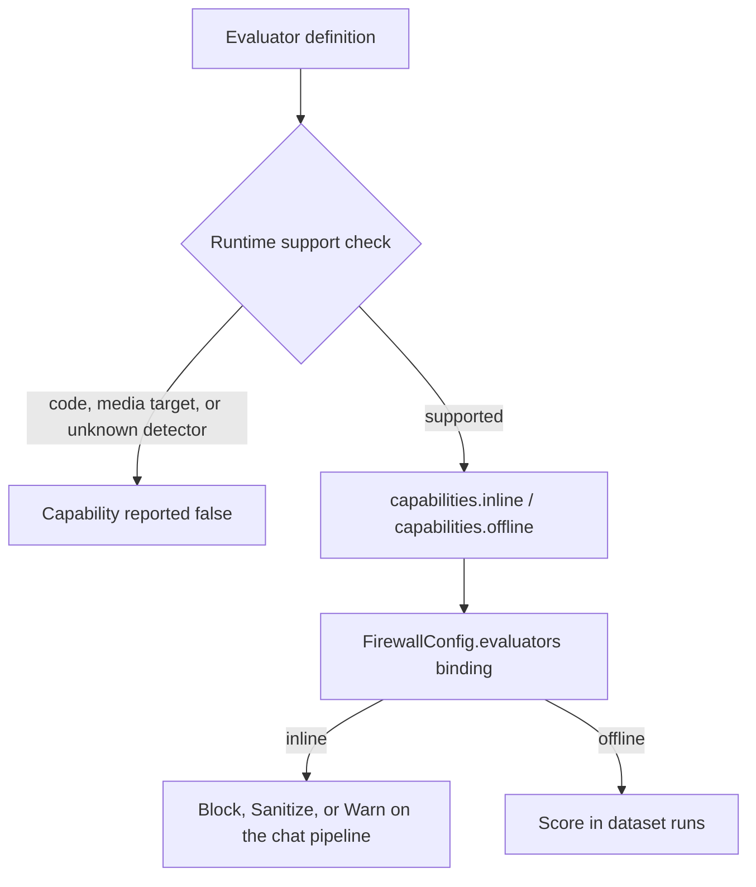

The [eval runner](/docs/gateway/evals) scores responses on three fixed dimensions. Separately, the
Gateway ships a **unified evaluator catalog**: one taxonomy that powers both inline guardrails and
offline eval scoring from a single definition.

```http
GET /v1/evaluators
```

The endpoint reads the built-in evaluator catalog without changing state or exposing provider
credentials.

- This static catalog remains public.
- Live evaluation snapshots require admin authorization.
- Direct firewall checks require an authenticated caller.



## The catalog

The catalog holds 30 built-in evaluators across 8 categories (`builtin_catalog`,
`apps/gateway/src/evaluators/catalog.rs`). Each entry carries a `capabilities` object with two
booleans, `inline` and `offline`.

- The booleans are derived from the entry's own config, so they can never disagree with it.
- The Gateway then turns off any capability it cannot execute (`gate_unavailable_capabilities`).
- This is a **gate**: an evaluator that is not inline-capable is never offered as an inline
  guardrail.

| Category | Count | Evaluators | Inline | Offline |
|---|---|---|---|---|
| **Security** | 3 | `pii_leakage`, `code_injection`, `prompt_injection` | Yes (enforced) | Yes |
| **Safety** | 2 | `toxicity`, `bias_fairness` | Yes (enforced, LLM judge) | Yes |
| **Quality** | 7 | `hallucination`, `assertions`, `code_checker`, `exact_match`, `correctness`, `conciseness`, `answer_relevance` | No | Yes, except `code_checker` |
| **Conversation** | 6 | `perceived_error`, `support_intent`, `tone`, `knowledge_retention`, `user_satisfaction`, `task_completion` | No | Yes |
| **Trajectory** | 3 | `plan_adherence`, `trajectory_accuracy`, `tool_selection` | No | Yes |
| **Image** | 2 | `explicit_content`, `sensitive_imagery` | No (catalogued only) | No |
| **Voice** | 5 | `audio_quality`, `user_interrupts`, `transcription_accuracy`, `vocal_affect`, `language` | No | No |
| **Custom** | 2 | `llm_as_a_judge`, `code_evaluator` | `llm_as_a_judge` only | `llm_as_a_judge` only |

Code-backed entries (`code_checker`, `code_evaluator`) and the Image and Voice entries stay in the
catalog as templates, but report both capabilities as `false`. See
[Evaluator availability](#evaluator-availability).

Key flags per entry:

- **`enforced`** - whether the evaluator is wired to execution. The five Security and Safety text
  detectors (`pii_leakage`, `code_injection`, `prompt_injection`, `toxicity`, `bias_fairness`)
  report `enforced: true`. Every other entry reports `false` so the UI can distinguish catalogued
  from wired.
- **`higherIsBetter`** - score polarity. Negative-signal judges (such as toxicity, bias, and
  hallucination) score a bad signal, so a high score is worse and this flag is `false`.

## Inline vs offline

| Mode | When it runs | What it needs | Action |
|---|---|---|---|
| **Inline** | On every scored request, before the response reaches the client | Only the request/response text | `FirewallPolicy` action: Block, Sanitize, or Warn |
| **Offline** | On demand (dataset runs, batch scoring) | A reference answer, conversation history, or trajectory | Score only; no inline action |

The five enforced inline detectors run on the chat pipeline for both input and output. See
[Binding an evaluator](#binding-an-evaluator) for how bindings cascade.

## Custom evaluators

Two blank-slate evaluators let you create your own:

| Evaluator | What it does | Configuration |
|---|---|---|
| `llm_as_a_judge` | Sends the response to a configurable judge model with a custom rubric | `judge_model`, `rubric` |
| `code_evaluator` | Runs JS/Python code against the response in a sandboxed environment | `language`, `code`, `entry_point` |

### Saving and applying

Saving a custom evaluator (`PUT /v1/config` with `custom_evaluators`) applies immediately. The
catalog, dataset runs, online evals, and inline guardrails use the new set on the next request, and
the configuration receipt reports `restartRequired: false`.

Custom `regex` evaluators run their own patterns inline and offline. Patterns that do not compile
within the size limit are rejected when you save.

### Builtin detectors

A custom evaluator can also use a named `builtin` detector, which runs the firewall's curated
patterns for that kind: `pii`, `secret`, `prompt_injection`, `code_injection`, `toxicity`, or
`bias`. It scores `1.0` when nothing matched and `0.0` when it flagged, inline and offline.

```json
{ "id": "no_secrets", "impl": { "kind": "builtin", "detector": "secret" } }
```

### Code evaluators and Desktop

Custom evaluators follow the same `inline`/`offline` capability pattern. The Gateway does not run
code inline, so a code evaluator is never an inline guardrail.

- In Desktop, the inline-guardrail toggle and the pass threshold appear only for an LLM judge.
- **Safety filters** lists inline evaluators, so it offers only the LLM-as-a-Judge editor.
- Create a code evaluator from an agent's **Evals** view.

Promptfoo-style JavaScript assertions can use the injected `output`, `input`, `expected`, `vars`,
and `context` names. They may return a boolean, a numeric score, or a `{ score, pass, reason }`
result. Ryu executes these forms in Core's deny-all sandbox and reports `executed: false` when the
required runtime is unavailable.

## Binding an evaluator

Evaluators are bound to a firewall scope through `FirewallConfig.evaluators`, a list of
`EvaluatorBinding` entries. Bindings cascade node → org → agent with the same union-plus-lock
semantics as the firewall dials (see [Hierarchical policy resolution](/docs/gateway/security)).

| Binding field | Meaning |
|---|---|
| `id` | The catalog evaluator this binding enables |
| `enabled` | Whether the binding is active in this scope |
| `inline_action` | The `FirewallPolicy` (Block / Sanitize / Warn) applied inline when it fires |
| `offline` | Offline scoring config (threshold, judge model) |
| `locked` | Freeze the binding so a narrower scope can only tighten it |

<Callout type="info">
Bindings are enforced on the chat pipeline only for evaluators that report `enforced: true`.
Image-target evaluators are catalogued but not yet enforced on the image path.
</Callout>

## Evaluator availability

Use `GET /v1/evaluators` to check each entry's `capabilities.inline` and `capabilities.offline`
before offering it for a run or guardrail. Entries can remain in the catalog as templates while both
capabilities are `false`.

### What is unavailable

| Evaluator kind | Inline | Offline |
|---|---|---|
| JavaScript/Python `code` evaluators | Unavailable | Unavailable |
| `builtin` with a detector name not in the list above | Unavailable | Unavailable |
| Image and audio targets | Unavailable (no media judge) | Unavailable (the dataset runner accepts text) |
| Wasm policy evaluators | Supported | Unavailable |

Supported text evaluators continue to run through their existing deterministic or LLM judge paths.
The agent evals surface can separately execute populated Code definitions through Core's sandbox
and merge their scores. This does not enable code guardrails in Gateway.

### How unavailable modes fail

- Offline runs requesting an unavailable mode return a `400` error before any provider or judge
  call.
- Configuration updates cannot enable an unavailable mode.
- Legacy active unavailable inline bindings reject traffic rather than silently allowing requests
  under an unexecuted guardrail. Disable or remove the binding to recover; disabled bindings may
  remain in configuration.
- Offline-only bindings do not guard live traffic.
- Custom definitions loaded from older configuration are projected with unavailable capabilities
  set to `false`.

## Related

<Cards>
  <DocCard href="/docs/gateway/evals" />
  <DocCard href="/docs/gateway/security" />
  <DocCard href="/docs/gateway/guardrail-policies" />
  <DocCard href="/docs/gateway/audit" />
</Cards>
