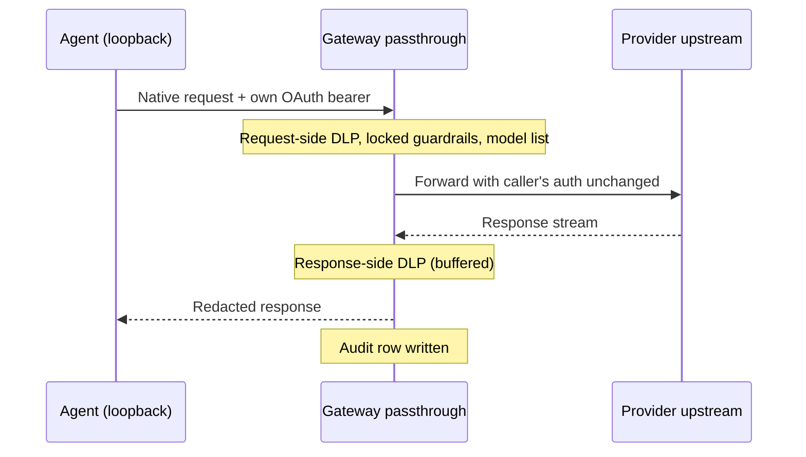

The Gateway serves an OpenAI-compatible API (`/v1/chat/completions`, `/v1/models`). A framework
that accepts a custom `baseURL` works without code changes: change the URL and add a Gateway API
key.

Each request then runs through the Gateway firewall, PII/DLP, rate limits, budgets, evals, and
audit log before it reaches the upstream provider.

## Prerequisites

- The Gateway running locally (default `http://127.0.0.1:7981`).
- A Gateway API key configured in your `gateway.toml` (see [Auth config](#auth-config) below).

## Auth config

Auth is controlled by `AuthConfig` in `apps/gateway/src/config.rs`. Add a static key to
`gateway.toml` as shown.

```toml
[auth]
require_auth = true

[[auth.api_keys]]
key  = "<at-least-24-character-random-secret>"   # e.g. from `openssl rand -hex 24`
name = "my-app"
```

Keys shorter than 24 printable characters, or containing whitespace, stop the Gateway from
starting. Every request must send the key as a Bearer token (`YOUR_GATEWAY_KEY` below stands for
the value you configured):

```http
Authorization: Bearer YOUR_GATEWAY_KEY
```

`require_auth = false` is an explicit local development override: every request is accepted
regardless of the header. The [field reference](/docs/gateway/configuration-access#field-reference)
lists every `[auth]` key.

### Manage local keys in Desktop

1. Open **Settings → Gateway → API & traffic**.
2. Copy the OpenAI-compatible, Anthropic Messages, or Gemini endpoint URL for the selected node.
3. Enter a name such as `Cursor`, then choose **Create key**.
4. Copy the plaintext key now. Desktop shows it once, and the key list masks it afterward.

Choose **Revoke** to remove a local key. If a create or revoke request fails, the current key list
stays visible so you can retry.

## Connect a local CLI from Desktop

Desktop can write the Gateway URL, a client key, and a model into the user-level config of Claude
Code, Codex CLI, OpenCode, Gemini CLI, and other coding CLIs, and reset them later. See
[Connect a coding CLI](/docs/gateway/connect-a-cli).

## OpenAI SDK (TypeScript)

```typescript
import OpenAI from "openai";

const client = new OpenAI({
  baseURL: "http://127.0.0.1:7981/v1",
  apiKey: "YOUR_GATEWAY_KEY", // from gateway.toml [auth.api_keys]
});

const response = await client.chat.completions.create({
  model: "gpt-4o",        // any model listed by GET /v1/models
  messages: [{ role: "user", content: "Hello from the Ryu Gateway!" }],
});

console.log(response.choices[0].message.content);
// x-provider header tells you which upstream handled the call
```

## Mastra

```typescript
import { Mastra } from "@mastra/core";
import { createOpenAI } from "@ai-sdk/openai";

// Override the OpenAI provider to point at the Gateway
const ryuGateway = createOpenAI({
  baseURL: "http://127.0.0.1:7981/v1",
  apiKey: "YOUR_GATEWAY_KEY",
});

const mastra = new Mastra({
  llm: ryuGateway("gpt-4o"),
});
```

## LangChain (TypeScript)

```typescript
import { ChatOpenAI } from "@langchain/openai";

const model = new ChatOpenAI({
  modelName: "gpt-4o",
  openAIApiKey: "YOUR_GATEWAY_KEY",
  configuration: {
    baseURL: "http://127.0.0.1:7981/v1",
  },
});

const response = await model.invoke("Hello from LangChain via the Ryu Gateway!");
console.log(response.content);
```

## Available models

`GET /v1/models` returns the routable models. The built-in list and how to add custom mappings
with `[routing.model_map]` are on [Routing](/docs/gateway/routing#the-model-list).

## Response headers

Chat responses carry these diagnostic headers:

| Header | Content |
|---|---|
| `x-provider` | Which upstream provider handled the call (`openai`, `anthropic`, `local`, …) |
| `x-request-id` | Unique request ID for the audit log |
| `x-routed-model` | The actual model selected after routing (may differ from the requested model) |
| `x-cache` | `HIT` or `MISS`, on non-streaming responses only |

Each accepted media generation receives a separate server-generated debit reference. Audit
correlation remains available for matching project receipts, but reusing a correlation ID does not
deduplicate generation or its charges.

## Smoke test

Send one chat completion to the local Gateway and print the response headers:

```bash
curl -sS -D - http://127.0.0.1:7981/v1/chat/completions \
  -H "Authorization: Bearer YOUR_GATEWAY_KEY" \
  -H "Content-Type: application/json" \
  -d '{"model": "gpt-4o", "messages": [{"role": "user", "content": "hi"}]}'
```

The `x-provider` header names the upstream that handled the call. Its value depends on your routing
config.

## Self-hosting checklist

1. Set upstream API keys in environment variables (`OPENAI_API_KEY`, `ANTHROPIC_API_KEY`, …).
2. Create `gateway.toml` with `[auth]` and at least one `[[auth.api_keys]]` entry.
3. Run `GATEWAY_CONFIG=gateway.toml cargo run --manifest-path apps/gateway/Cargo.toml`. Add
   `-- --bind=<host>:<port>` to listen on another address.
4. Set `baseURL = http://<host>:7981/v1` and `apiKey = <your-gateway-key>` in your agent.
5. Verify with `curl -H "Authorization: Bearer <key>" http://localhost:7981/v1/models`.

## Subscription-preserving passthrough (Claude Code, Codex)

The base-URL change above works for agents that speak OpenAI-compatible JSON and authenticate with
an API key. Two agents do neither:

| Agent | Wire format | Credential |
|---|---|---|
| Claude Code | Anthropic Messages | The user's own Pro/Max OAuth bearer |
| Codex (ChatGPT-login mode) | OpenAI Responses | An OAuth bearer plus a `ChatGPT-Account-ID` header |

The OpenAI-compatible chat path cannot govern either one. It would substitute the Gateway's own
provider key and move the request off the user's subscription billing.

For these agents the Gateway runs a **transparent reverse proxy** in the agent's native wire format
(`apps/gateway/src/passthrough/mod.rs`). Core points the agent at the proxy (see
[Default and opt-out](#default-and-opt-out)). Because the format is never translated and the caller's own credential is
forwarded unchanged, subscription billing is preserved end to end.



| Route | Upstream | Auth forwarded unchanged | Wire format |
|---|---|---|---|
| `/passthrough/anthropic/*` | `api.anthropic.com` | subscription OAuth bearer | Anthropic Messages |
| `/passthrough/openai-responses/*` | `chatgpt.com/backend-api/codex` | OAuth bearer + `ChatGPT-Account-ID` | OpenAI Responses |

Both upstreams can be overridden without a rebuild through `RYU_PASSTHROUGH_ANTHROPIC_UPSTREAM` and
`RYU_PASSTHROUGH_CODEX_UPSTREAM`. Endpoint-by-endpoint handling (which paths are inspected, proxied
or refused) is on [Loopback and internal routes](/docs/gateway/loopback-routes#passthrough-proxies-loopback-only).

### What the proxy redacts

The proxy uses the same firewall configuration as the OpenAI-compatible path (see
[Security](/docs/gateway/security)), including organization and agent overlays and custom patterns.
It applies that configuration differently for agent traffic.

The audit record is always written, even when the firewall is off and even when the upstream call
fails. With the firewall disabled, the proxy is a transparent forwarder plus an audit log.

#### Request side

When the firewall is enabled, the outbound body is parsed and every prompt-bearing string is
redacted:

| Agent | Redacted fields |
|---|---|
| Anthropic | `system`, message text, `tool_use` inputs, `tool_result` content (file contents and command output), document and search-result text, tool definitions |
| Codex | `instructions`, message content, `function_call` arguments, `function_call_output` and custom tool output, local shell calls and their output, tool definitions |

Signed or encrypted fields (thinking blocks, reasoning items, `encrypted_content`) and IDs are
forwarded unchanged so the upstream accepts the request. When inspection is on, a compressed or
non-JSON prompt body is refused instead of being forwarded uninspected.

#### Policy

Agent traffic is always redacted, whatever `firewall.policy` says. The proxy does not block a turn
because it contains PII or a secret: the agent resends the same history on every later turn, so a
block would stall the session. The local firewall's prompt-injection patterns are not enforced on
this path.

Two cases refuse the request with HTTP 403:

- a PII or secret match that survives redaction (for example, one obfuscated with zero-width
  characters);
- a control-plane policy violation, such as a locked guardrail or a model outside the
  organization's approved list.

Locked guardrails are enforced even when the local firewall is off. Which fields each one checks:

| Locked guardrail | Checked against |
|---|---|
| `pii`, `secrets` | Every prompt-bearing field, including the agent's own system prompt and tool definitions |
| `prompt_injection`, `code_injection`, `toxicity`, `bias` | The conversation only (messages, tool calls, and tool results) |

The second group skips the agent's system prompt and tool definitions because their built-in
wording (for example a shell tool's `$(cat <<'EOF' …)` commit example) would match on every turn.
Tool results are part of the conversation, so a file or command output that matches still refuses
that turn and the later turns that replay it.

With the local firewall off, nothing is redacted first, so a locked `pii` or `secrets` guardrail
refuses any request that contains a match.

#### Response side

When the firewall is enabled, the upstream response is buffered (up to 8 MB) and redacted in one
contiguous pass before any bytes reach the caller. A secret split across two text-delta events is
still rewritten to `[REDACTED:…]`.

- Non-text events (`message_start`, `ping`, tool-call deltas) pass through verbatim, and SSE
  framing is preserved.
- The redacted text is scanned once more to audit any residual outbound violation.
- An unparseable event passes through verbatim (fail open).

#### Attribution

The proxy takes no Gateway credential. `x-ryu-user-id`, `x-ryu-agent-id`, and `x-ryu-feature` are
recorded on the audit row only when the request also carries a trusted forwarder credential.
`x-ryu-*` headers are never forwarded to the provider.

### Response-side streaming DLP

The response redactor (`redact_response_passthrough`) reassembles each complete
`\n\n`-terminated SSE event from raw bytes, so a multibyte UTF-8 character split across network
chunks is never corrupted. It then rewrites only the assistant-text delta:

| Wire format | Event rewritten | Field redacted |
|---|---|---|
| Anthropic | `content_block_delta` | `delta.text` (the `text_delta`) |
| OpenAI Responses | `output_text.delta` | top-level `delta` string |

Each matched span runs through the firewall's `fw.sanitize()`, the same config-gated routine the
request side uses, and becomes a `[REDACTED:NAME]` marker. A scanner-less config or an unparseable
`data:` payload passes the raw event through unchanged.

<Callout type="warn">
  Streaming redaction is unit-tested across chunk boundaries. The full live round-trip needs a real
  subscription agent and has not been exercised end to end.
</Callout>

### Default and opt-out

The passthrough is **on by default** for newly installed and routable ACP agents. Each agent has a
Core preference that controls it:

| Agent | Preference | What Core does |
|---|---|---|
| Claude Code | `claude-gateway-routing` (`apps/core/src/claude_config/mod.rs`) | Injects `ANTHROPIC_BASE_URL` pointed at `/passthrough/anthropic` |
| Codex | `codex-gateway-routing` (`apps/core/src/codex_config/mod.rs`) | Writes an isolated `CODEX_HOME` pointed at `/passthrough/openai-responses` |

The isolated Codex `config.toml` declares a custom provider with `wire_api = "responses"` and no
`env_key`, so the subscription credential is what reaches upstream.

Both switches default to Gateway-governed egress. Turning either one off is the explicit
direct-egress choice, for when you want the subscription credential to bypass Ryu. Existing explicit
choices are preserved across restarts and upgrades.

#### Codex sign-in

The isolated Codex home starts from a copy of your Codex CLI sign-in, and the newest explicit
sign-in wins:

- Until you sign in, switch accounts, or sign out of Codex from Ryu, the copy follows your Codex
  CLI. Signing in to another account there, or signing out, carries over on the next turn. Routine
  token refreshes on either side never stop it following.
- Once you sign in, switch, or sign out from Ryu, that choice changes only the isolated copy. It
  stays in place through Codex CLI token refreshes and sign-outs.
- Signing in to a different account in the Codex CLI afterwards is a newer choice, so Ryu follows
  the CLI again from then on.

Your Codex CLI's own sign-in is never edited.

<Callout type="warn">
  The passthrough has not been verified with a full live round trip against a real subscription
  agent. Other limits:

  - The proxy is **loopback-only**: it refuses requests from non-loopback peers
    (`apps/gateway/src/passthrough/mod.rs`).
  - It is disabled entirely on a fleet (hosted) Gateway, so a remote Gateway never carries a user's
    subscription bearer.
  - With private networking (mesh) enabled, a tailnet peer can appear as a loopback caller and
    could relay its own subscription traffic through the node. It cannot use your credentials or
    set audit attribution.
  - Turn the per-agent switch off only when direct subscription egress is intentional.
  - The Gemini CLI is **not wirable** through either mechanism, because it exposes no base-URL
    hook.
</Callout>

## Generic Gateway routing for a BYO agent

For an OpenAI-compatible agent you added yourself (`engine = "acp-exec:<command>"`), Core offers a
generic per-agent toggle (`apps/core/src/agent_routing/mod.rs`). New and auto-installed routable
ACP agents start with it on.

Unless the toggle is explicitly disabled, `openai_gateway_cmd` injects two variables into that
agent's spawn command:

- `OPENAI_BASE_URL`, the local Gateway `/v1`;
- `OPENAI_API_KEY`, the Gateway token.

An agent whose HTTP client honours the OpenAI base URL then routes its model calls through the
Gateway's firewall, budget, and audit pipeline with no manual env wiring.

All toggles live under one `agent-gateway-routing` preference, a JSON object of agent id to enabled
boolean. A missing entry means Gateway-governed egress. Only an explicit `false` opts out to direct
provider traffic.

<Callout type="warn">
  The toggle has no effect on agents that do not read `OPENAI_BASE_URL`. Gemini speaks Google format,
  OpenClaw talks to its own gateway, Hermes uses its own credentials, and the managed Pi ignores the
  env var (it routes through its own `models.json` instead). The toggle is meant for the
  `acp-exec:` BYO path.
</Callout>
