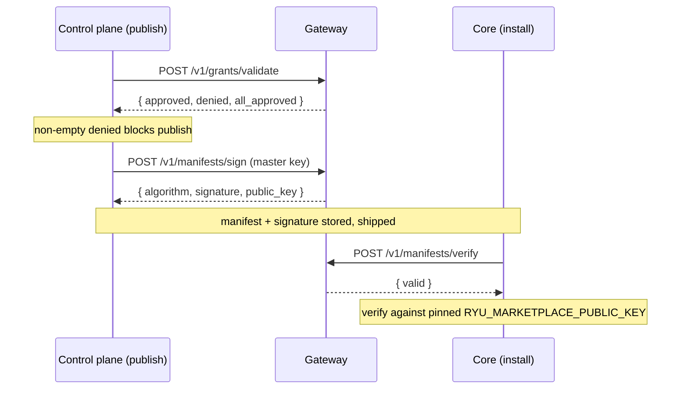

Publishing an app to the Ryu Marketplace and installing one are governed actions. Under the
[Core vs Gateway](/docs/start-here/architecture/core-vs-gateway) rule, the Gateway serves the two
checks that gate them: **grant validation** and **ed25519 manifest signing**. The control-plane
server calls them on publish. Core calls them on install. The same allowlist also authorizes
Passport credential scopes (`identity.read`, `browser.connect`).

The credential-vault mechanics are on [Passport](/docs/standalone/passport). The publishing flow is
on [Marketplace](/docs/extend/develop/extensions/marketplace).

Source: `apps/gateway/src/api/governance.rs` (HTTP surface) and
`apps/gateway/src/governance/mod.rs` (logic).

## The ceremony

## Endpoints

| Method | Route | Caller | Returns |
|---|---|---|---|
| `POST` | `/v1/grants/validate` | Server (publish), Core (install) | `{ approved, denied, all_approved }` |
| `POST` | `/v1/manifests/sign` | Server (publish), master key | `{ algorithm, signature, public_key }` |
| `POST` | `/v1/manifests/verify` | Core (install) | `{ valid }` |
| `GET` | `/v1/manifests/pubkey` | any | `{ algorithm, public_key }` |

Validate, verify, and pubkey are read-only computations over caller-supplied data. They mutate no
Gateway state and expose no secret (only the public verifying key), so they sit outside the
master-key admin gate that `/v1/config` and `/v1/audit` use. Sign is the exception: it produces
signatures under the trusted key, so it always needs the master key as
`Authorization: Bearer <master key>` (see the warning under [Key material](#key-material)). A
loopback address alone is not accepted as proof, because a co-resident process or a same-host
reverse proxy also arrives from loopback. Routes are registered in `apps/gateway/src/api/mod.rs`.

## Grant validation

A manifest declares the permission grant scopes it wants in its `ryu.json` `permission_grants`.
`POST /v1/grants/validate` decides each declared scope under the **capability grammar** and
partitions them into `approved` and `denied`. A non-empty `denied` set blocks publish. On Core's
side it aborts enable with `GrantsDenied`. The check fails closed, so an over-privileged manifest
cannot ship.

Request fields (`ValidateGrantsRequest`):

| Field | Type | Notes |
|---|---|---|
| `app_id` | `string?` | The requesting manifest id. Required for the owner-scoped and owner-exclusive rules below. Omitted means allowlist-only |
| `grants` | `string[]` | The declared scopes to check |

Matching is case-insensitive on the trimmed scope string, and an empty `grants` list approves
trivially. A scope is approved when one of these rules matches:

1. **Reviewed allowlist.** The scope is on `default_grant_allowlist()`
   (`apps/gateway/src/governance/mod.rs`), or on the `RYU_MARKETPLACE_GRANT_ALLOWLIST` operator
   override. Entries are exact scope strings. MCP servers, commands, and egress hosts are listed
   one by one (for example `mcp:spider`, `tool:command:rg`, `tool:http-egress:api.exa.ai`), not as
   wildcards. Examples by group:

   | Group | Example scopes |
   |---|---|
   | Tool / MCP | `mcp.tools`, `tools.read`, `tools.invoke`, `tool:execute`, `mcp:docs`, `tool:command:rg`, `tool:http-egress:api.tavily.com` |
   | Data | `memory.read`, `memory.write`, `spaces.read`, `spaces.write`, `spaces:docs`, `spaces:database`, `files.read`, `files:download` |
   | Model / network | `model.chat`, `model.embed`, `network.fetch`, `egress:http` |
   | Passport | `browser.connect`, `identity.read` |
   | Host integration | `hook:run-agent`, `hook:side-model`, `shell:integrate`, `storage:kv`, `widget:render`, `chat.sendFollowUp`, `core:list_agents`, `media:generate`, `media:transcribe`, `ghost:record`, `assistant:context` |

   `hook:run-agent` admits only read-only sub-agent presets.

2. **Owner-exclusive grant.** A short reviewed table (`OWNER_EXCLUSIVE_GRANTS`) approves a few
   scopes only for exact first-party app ids. For example, `hook:run-agent:write` (needed for
   `preset: "code_write"`) is approved only for `@ryu/autopilot` and `@ryu/sites` (and their
   legacy `com.ryu.*` ids). `execution:control` is approved only for `@ryu/kill-switch`, and `vault:fill` only for
   `@ryu/browser`.
   `chat:project-guidance`, which sets the goal and instructions every turn in a project
   carries, is approved only for `@ryu/projects`. These scopes are not on the global allowlist; the operator override can still add them.

3. **Owner-scoped self-grant.** The scope's namespace (the token before its first `:` or `.`)
   equals the last dot-separated segment of `app_id`, and that namespace is not reserved. So
   `@ryu/monitors` may declare `monitors:crud`, and `com.acme.invoices` may declare
   `invoices:crud`, with **no Gateway change at all**. This is what lets a third-party app be
   enabled; before the grammar, every new app needed its capability string pasted into Gateway Rust.

   Protected first-party namespaces add an exact-id check: `safe-actions:manage` is available to
   `@ryu/safe-actions` and the legacy `com.ryu.safe-actions` id, but not to `com.evil.safe-actions`.
   The exact id must own that namespace: another first-party app such as `@ryu/mail` cannot claim
   `monitors:jobs`. Every capability a first-party app provides to other apps (for example
   `teams:manage`, `dashboards:edit`, or `news:crud`) sits in a protected or reserved namespace,
   so `@evil/teams` cannot grant itself access to the Teams app. This keeps sensitive first-party
   app surfaces from being namespace-squatted while leaving ordinary app-owned namespaces open.

`reserved_namespaces()` separates the allowlist from the owner-scoped rule. Rule 3 never approves a
namespace that names a host primitive, however the manifest names itself. The reserved
namespaces are `sidecar`, `runtime`, `self_build`, `model`, `usage`, `memory`, `spaces`, `files`,
`identity`, `authorization`, `network`, `egress`, `tool`, `tools`, `plugins`, `mcp`, `pi`,
`warmup`, `subscriptions`, `vault`, `hook`, `execution`, `native`, `shell`, `storage`, `backups`, `chat`,
`widget`, `media`, `ghost`, `core`, `ui`, `views`, `assistant`, `browser`, `skills`, `quests`,
`runs`, and `app`. The list is not env-configurable. So `com.evil.memory` cannot self-approve
`memory.read`, and `sidecar:process` (arbitrary code execution) is approvable by no rule at all.

The reserved list covers every namespace Core gates on `approved_grants`, including namespaces no
allowlist entry mentions. `runtime:external` (the venv and `pip install` provisioning gate in
`external_runtime::may_provision`), `ui:render`, `ui:send_message`, and `views:actions` are host
verbs that no allowlist entry approves. They are reserved so the owner-scoped rule cannot hand
them to `com.evil.runtime`, `com.evil.ui`, or `com.evil.views`.

Override the allowlist with the `RYU_MARKETPLACE_GRANT_ALLOWLIST` env var (comma or whitespace
separated); it replaces the built-in list and can approve a reserved scope explicitly. Set
`RYU_MARKETPLACE_OWNER_SCOPED_GRANTS=0` to switch rule 3 off for a hand-curated,
closed capability set. Anything neither rule approves is denied.

<Callout type="warn">
Capability namespaces are a flat global vocabulary while manifest ids are hierarchical, so
`com.evil.monitors` derives the same owner namespace as `@ryu/monitors`. Reserved namespaces and
protected first-party ids keep such a squat out of host primitives and sensitive app-owned
surfaces. Ordinary app-owned families still front real Core endpoints (`invoices:crud` fronts an
invoice app's routes), so those routes remain gated on the **owning app being installed and
enabled** as well.
</Callout>

<Callout type="info">
Core calls this endpoint when enabling a plugin with requested grants. The Gateway owns the
approval decision; restore its connection before retrying an enable that failed because the
policy service was unavailable.
</Callout>

## Manifest signing and verification

The Gateway owns an ed25519 signing key. On publish the server asks the Gateway to sign the
manifest. On install Core asks the Gateway to verify the signature. A manifest or package
descriptor changed anywhere between the control-plane server, its MongoDB store, and Core fails
verification and is rejected.

Sign and verify both **canonicalize** the manifest first. Object keys are sorted recursively and
insignificant whitespace is dropped (`canonical_bytes` / `canonicalize`). The signed bytes do not
depend on key order, so a manifest re-serialized by MongoDB storage or a JSON round-trip still
verifies.

`POST /v1/manifests/sign` request is `{ manifest }`. Signing is an administrator operation: the
caller presents the Gateway master key as the bearer, from any peer and in any mode, so the
publisher can sign against a hosted Gateway over TLS. A Gateway with no master key cannot sign.
Cross-site browser requests are always refused. The response is:

| Field | Value |
|---|---|
| `algorithm` | `"ed25519"` (`SIGNING_ALGORITHM`) |
| `signature` | base64 ed25519 signature over the canonicalized manifest |
| `public_key` | base64 verifying key |

`POST /v1/manifests/verify` request is `{ manifest, signature, public_key? }`; the response is
`{ valid }`. When `public_key` is omitted the Gateway uses its own key. When supplied, it verifies
against that key.

For a portable Marketplace package, the signed value sent in the `manifest` field is an envelope
with both the package manifest and its descriptor: `{ descriptor, manifest }`. The descriptor binds
the package kind and version to the package digest, archive digest, and signed download
URL, so a valid package signature cannot be replayed with a different archive.

### Key material

| Env var | Role | Fallback |
|---|---|---|
| `RYU_MARKETPLACE_SIGNING_KEY` | base64 32-byte ed25519 seed (the private signing key) | a generated key, saved sealed at `secrets/marketplace-signing-key` in the data directory (a standalone Gateway keeps `marketplace-signing-key` in its profile's local data directory) only when the Gateway has a sealing key (one Core delivers, `RYU_MASTER_KEY`, or the master key the Gateway finds in the OS keychain or, with the keychain turned off, in its key file). Without a sealing key nothing is saved: the key changes on every restart and signatures it issued stop verifying, so set `RYU_MARKETPLACE_SIGNING_KEY`. A non-release profile reuses the key an older install shared across profiles |
| `RYU_MARKETPLACE_SIGNING_KEY_PATH` | overrides the on-disk path of the persisted signing key | the data-directory path above |
| `RYU_MARKETPLACE_PUBLIC_KEY` | the pinned verifying key Core verifies against on install | the manifest's self-attested key is never trusted |

<Callout type="warn">
Sign always requires the Gateway master key as a bearer token (`Authorization: Bearer <master
key>`). Loopback is a location, not an identity: any local process, a tailnet peer under mesh
userspace networking, or an external caller behind a same-host reverse proxy can arrive as
`127.0.0.1`, so a loopback peer without the key cannot use the oracle. A missing or wrong key gets
`401`, and a Gateway with no master key configured refuses every sign request. With the key, the
publisher may sign from any peer, including a hosted (fleet) Gateway over TLS; send the key only
over TLS or to a loopback Gateway. Verify, validate, and pubkey have none of these restrictions.
</Callout>

<Callout type="warn">
If `RYU_MARKETPLACE_SIGNING_KEY` is unset, the Gateway uses the persisted on-disk key. If it cannot
resolve a data directory or write the key file, it falls back to an **ephemeral** key and logs a
warning. Signatures from an ephemeral key do not survive a restart. Set
`RYU_MARKETPLACE_SIGNING_KEY` in production so published signatures stay valid.
</Callout>

Install-time verify uses a **pinned** `RYU_MARKETPLACE_PUBLIC_KEY`, never the public key the
manifest carries about itself. See [Marketplace](/docs/extend/develop/extensions/marketplace) for where
this sits in the publish and install flow.

## The identity.read grant

The `identity.read` and `browser.connect` scopes on the allowlist authorize
[Passport](/docs/standalone/passport). When an agent with a bound, authenticated connection calls
a tool that targets a matching domain, Core's consult seam checks the bound Passport metadata and
the Gateway-governed `read_credential` gate. In remote mode Passport consumes the sealed credential
inside its own process. The read exercises the `identity.read` grant and emits an audit record on
every authenticated tool hit.

The credential is consumed only at that boundary. It is never returned to the caller and never
placed in the tool result the model sees. A `NEEDS_AUTH` connection
returns a login elicitation envelope instead, and the tool is not dispatched.

<Callout type="warn">
A denied grant read withholds the credential. If the grant read is denied (for example an
unreachable dev Gateway), the tool call proceeds *without* the credential rather than failing,
and the tool surfaces its own auth error. The `NEEDS_AUTH` elicitation path is unaffected. The full
behavior, including which tools actually consume a credential, lives in
[Passport](/docs/standalone/passport-api).
</Callout>

## Related

<Cards>
  <DocCard href="/docs/standalone/passport" />
  <DocCard href="/docs/extend/develop/extensions/marketplace" />
  <DocCard href="/docs/gateway/security" />
  <DocCard href="/docs/gateway/evaluators" />
</Cards>
