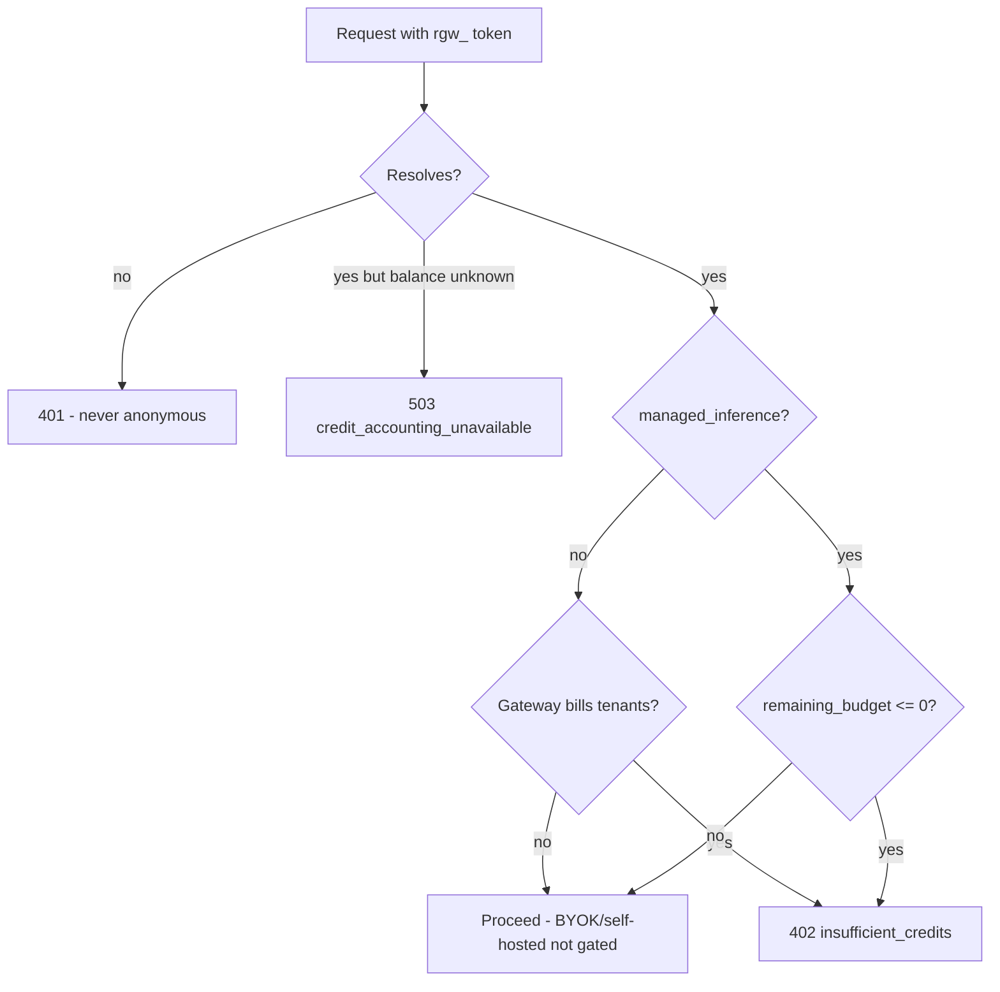

On the [managed data plane](/docs/gateway/managed-data-plane), each resolved `rgw_` token carries
its organization's credit budget and limits. These checks run on every request before and after
dispatch.

## Organization budgets and rate limits

Organization admins set budgets and rate limits in the control plane. They arrive with each
resolution and apply to every request on the organization's `rgw_` tokens:

| Cap | Applies to |
|---|---|
| Organization | All traffic in the organization |
| Member | One verified user. Users without their own entry get the member default |
| Team | Every verified member of the team |
| Key | Traffic on one `rgw_` credential |

Each cap can set a charged-spend budget over a UTC `daily`, `weekly`, `monthly`, or `lifetime`
window, the action taken when it is exhausted (`stop`, `downgrade` to a named cheaper model, or
`notify`), early-warning alert thresholds as percentages of the budget, and requests-per-minute and
tokens-per-minute ceilings. Leave a field empty (`null`) for no limit. A budget of `0` is a real
cap that blocks all charged spend; `rpm` and `tpm` must be at least `1`. Every applicable cap is checked,
and the most severe outcome wins: a request is blocked if any applicable `stop` cap is exhausted.
Exhausted caps and crossed thresholds are reported on the `x-ryu-policy-alert` response header, and a
`stop` returns `402 budget_exceeded`. Rate ceilings return `429` and keep a separate bucket per
member, team, key, and organization.

On the hosted Gateway, each plan also sets a ceiling on the organization-wide `rpm` and `tpm`,
because many organizations share the same Gateway capacity. Organizations without a managed plan
(the free baseline, a desktop license, or promotional and prepaid credit only) get the lowest
ceiling, and per-seat organization plans scale with their seat count. An organization cap you set
can lower these ceilings but cannot raise them. The ceiling travels separately from your limits,
and only a Gateway that bills tenants (one configured with the credits debit secret) applies it. A
Gateway without the debit secret enforces only the caps you set. The limits page and
`GET /api/control-plane/orgs/{orgId}/limits` show the ceiling as `planRateCeiling`.

A single request larger than a Gateway's whole per-minute token share is not refused outright. It is
admitted once that share is unused, and its excess counts against the following minutes, so
requests after it wait until the share recovers.

The node's own `[budgets]` rules still apply alongside the organization's caps. Spend counters persist
next to the audit database, and the Gateway reports daily spend per user, key, and team back to the
control plane.

## The pre-flight credit gate

Credit enforcement is **pre-flight**, in `preflight_credit_gate` (`apps/gateway/src/pipeline/budget_charge.rs`, run inside `enforce_budget`). It fires before dispatch, so an empty wallet blocks the request rather than one that already ran.

A Gateway that bills tenants (one configured with the credits debit secret) serves every `rgw_`
organization from its own provider keys. On that Gateway, an organization the control plane reports
as not managed (no plan allowance and no remaining balance, for example after promotional credit
runs out or a subscription lapses) is treated as having nothing left and receives
`402 insufficient_credits`. It is never served as bring-your-own-key traffic. A Gateway without the
debit secret keeps the control plane's reading unchanged.

A failed read is not an empty wallet. When the control plane cannot read an organization's plan or
credit balance (for example during a billing-provider outage), it answers with the plan and
balance it last read for that organization if that read is only a few minutes old, and the
Gateway's own debit responses keep gating spend. Without a recent read it reports the balance as
unknown, and a Gateway that bills tenants returns the retryable `503 credit_accounting_unavailable`
instead of `402 insufficient_credits`. It asks the control plane again after about 10 seconds rather than
waiting out the 60-second cache.

The gate reads the resolved balance (at most 60s old because of the cache), so it recovers on its own after a top-up. It does not keep a sticky wallet-empty flag.

For Chat Completions, clients may name the output ceiling with `max_tokens` or `max_completion_tokens`. When both are present, the managed-credit reservation uses the larger value so either provider interpretation has sufficient reserved credit. Send only one field to avoid provider-specific alias behavior.

`insufficient_credits` is a distinct error from `budget_exceeded`. Both return HTTP `402`, but they mean different things.

| Error code | HTTP | Meaning |
|---|---|---|
| `insufficient_credits` | 402 | A managed org's credit wallet is exhausted (the pre-flight gate) |
| `budget_exceeded` | 402 | A per-user / per-agent / per-session charged-cost cap ([Reliability](/docs/gateway/reliability)) or an organization budget `stop` cap was hit |
| `credit_accounting_unavailable` | 503 | The managed org's balance is unknown (unreadable at resolution, or a debit could not be recorded). Retry later |
| `budget_store_unavailable` | 503 | A budgeted request (a local user or agent budget rule, or control-plane org limits) was refused because the budget store (`spend.db`) is sealed under a different key or the Gateway has no sealing key. Restore the right key; see [Reliability](/docs/gateway/reliability) |

The post-call credit debit (which subtracts the served call's cost from the org wallet) is documented under `[credits]` in [Configuration and auth](/docs/gateway/configuration).

## Per-tool-call debits

The model-call debit above bills the model call. On the managed plan a request can also run **Composio**
tool actions, and Composio charges per action execution, so those are billed separately. Each tool
loop returns `(value, billable_count)`; `run_tool_loop` (`apps/gateway/src/tools/mod.rs`) counts the
executed `composio.*` calls (prefix `COMPOSIO_TOOL_PREFIX`) that pass the allowlist gate. Denied,
builtin, MCP, and app tool calls are free and never counted.

At request end, `spawn_tool_call_debit` (`apps/gateway/src/pipeline/tool_debit.rs`) fires one debit for the
whole request (`count × cost_per_tool_call_micro_usd`, at cost) against the org wallet.

| Field | Value | Why it matters |
|---|---|---|
| `reason` | `composio` | Distinguishes the tool-call ledger row from the `gateway_usage` model-call row |
| `refId` | `{request_id}:composio` | A **distinct** ref from the model-call debit's `{request_id}`. Ledger writes are idempotent on `refId`, so a shared ref would merge the tool debit into the model-call debit |
| Cost source | `[credits] cost_per_tool_call_micro_usd` | Per-executed-call rate; the default is `500` micro-USD ($0.50 per 1,000 Composio actions, the managed-app rate) |

The debit is spawned off the response path so it never adds client latency, and it is a no-op when
credits are inactive, the org is absent, the billable count is zero, or the per-call cost is zero.
Managed nodes provision the rate through the `GATEWAY_CREDITS_COST_PER_TOOL_CALL_MICRO_USD` env var
(`from_env` in `apps/gateway/src/config.rs`).

<Callout type="info">
  The service-to-service tool path (`POST /v1/exec/tool`, trusted-forwarder / master-key only) has no
  per-user org context, so it is not metered here. It is bounded by the exec budget instead, covered
  on the [tools](/docs/gateway/tools) page.
</Callout>

<Callout type="warn">
Credit debit failures are fail-closed by default. A transport error, non-success response, or
malformed success response marks accounting unavailable and the next managed request returns the
retryable `credit_accounting_unavailable` (503) error. This is kept separate from
`wallet_empty_action`, so a funded organization is not permanently classified as empty. Do not
disable `GATEWAY_CREDITS_FAIL_CLOSED` on a managed fleet; the Gateway refuses that combination at
fleet startup.
</Callout>

## Sandbox metering

An org-bound remote sandbox is metered through the same Gateway-to-control-plane debit boundary.
If that debit cannot be confirmed, the Gateway returns `kill_accounting` and Core destroys the
sandbox instead of continuing provider or compute spend without an accounting record. A malformed
or unknown tick response is also treated as an accounting failure. The final short-run tail is
retried before a completed billable execution is reported; if it still cannot be confirmed, the
execution reports an error after the remote workspace is destroyed. Unattributed local sandboxes
remain outside the billing path.

## Related

<Cards>
  <DocCard href="/docs/gateway/managed-data-plane" />
  <DocCard href="/docs/billing/credits" />
  <DocCard href="/docs/billing/metering" />
  <DocCard href="/docs/gateway/reliability" />
</Cards>
