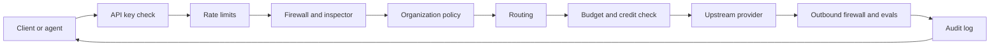

The **Gateway** (`apps/gateway`) is a Rust process between clients and model providers. It listens
on `127.0.0.1:7981` by default and exposes an OpenAI-compatible API, so any agent or tool that speaks
that protocol can use it. Core runs the Gateway as a sidecar in the default Desktop setup, and you
can also run it as a standalone service.

<Figure name="gateway" />

<Callout type="info">
  Core decides what runs. The Gateway decides what is allowed. See
  [Core vs Gateway](/docs/start-here/architecture/core-vs-gateway) for where each policy belongs.
</Callout>

## What runs on every request

## Connect agents

<Cards>
  <DocCard href="/docs/gateway/gateway-for-any-agent" />
  <DocCard href="/docs/gateway/connect-a-cli" />
  <DocCard href="/docs/gateway/acp-agent-governance" />
</Cards>

## Routing

<Cards>
  <DocCard href="/docs/gateway/routing" />
  <DocCard href="/docs/gateway/smart-routing" />
  <DocCard href="/docs/gateway/routing-planes" />
  <DocCard href="/docs/gateway/loopback-routes" />
</Cards>

## Configuration, security, and policy

<Cards>
  <DocCard href="/docs/gateway/configuration" />
  <DocCard href="/docs/gateway/provider-connections" />
  <DocCard href="/docs/gateway/security" />
  <DocCard href="/docs/gateway/model-screening" />
  <DocCard href="/docs/gateway/organization-policy" />
  <DocCard href="/docs/gateway/guardrail-policies" />
</Cards>

## Tools and channels

<Cards>
  <DocCard href="/docs/gateway/tools" />
  <DocCard href="/docs/gateway/web-services" />
  <DocCard href="/docs/gateway/channels" />
  <DocCard href="/docs/gateway/phone-assistant" />
</Cards>

## Observability and reliability

<Cards>
  <DocCard href="/docs/gateway/audit" />
  <DocCard href="/docs/gateway/traffic-map" />
  <DocCard href="/docs/gateway/evals" />
  <DocCard href="/docs/gateway/reliability" />
  <DocCard href="/docs/gateway/prompt-caching" />
  <DocCard href="/docs/gateway/batches" />
</Cards>

## Hosted fleet

<Cards>
  <DocCard href="/docs/gateway/managed-data-plane" />
  <DocCard href="/docs/gateway/hosted-budgets" />
  <DocCard href="/docs/gateway/managed-on-your-own-node" />
</Cards>
