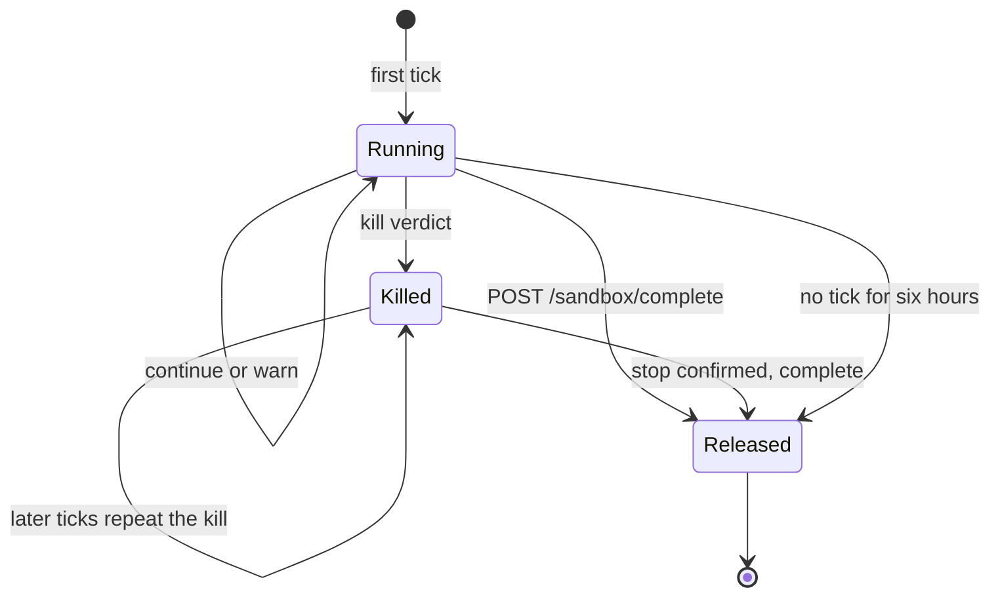
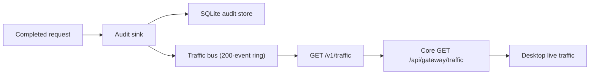

The [interactive Gateway API reference](/docs/extend/develop/api-reference/gateway) documents every
route a normal client should call. The routes below serve Core integration, subscription-preserving
agent proxies, or convenience aliases. They are not interchangeable with the standard `/v1/*`
client surface.

## Route coverage summary

| Route | Caller | Auth | Documented in |
|---|---|---|---|
| `POST /sandbox/tick` | Core sandbox heartbeat | Trusted-forwarder or master key | [OpenAPI](/docs/extend/develop/api-reference/gateway/audit/sandboxTick) |
| `POST /sandbox/quote` | Core Box credit check | Trusted-forwarder or master key | [OpenAPI](/docs/extend/develop/api-reference/gateway/audit/sandboxQuote) |
| `POST /sandbox/complete` | Core sandbox completion | Trusted-forwarder or master key | This page |
| `GET /v1/savings` | Core community-stats beacon (opt-out) | None (public aggregate) | [OpenAPI](/docs/extend/develop/api-reference/gateway/health/getCommunitySavings) |
| `POST /v1/cursor/chat/completions` | Cursor (OpenAI-compatible alias) | Bearer API key (when auth enabled) | [OpenAPI](/docs/extend/develop/api-reference/gateway/inference/createCursorChatCompletion) |
| `POST /v1/messages` | Claude Code / Anthropic-format clients | Bearer API key (when auth enabled) | [Protocol compat](/docs/extend/integrate/protocol-compat) |
| `POST /v1beta/models/{model}:generateContent` | Gemini CLI / Gemini-format clients | Bearer API key (when auth enabled) | [Protocol compat](/docs/extend/integrate/protocol-compat) |
| `GET /v1/traffic` | Live-traffic SSE dashboard | Admin-gated | This page (schema `TrafficEvent` in the Gateway OpenAPI spec) |
| `ANY /passthrough/anthropic/*` | Claude Code (loopback subprocess) | Caller's subscription OAuth bearer | This page (not OpenAPI) |
| `ANY /passthrough/openai-responses/*` | Codex ChatGPT-login (loopback subprocess) | Caller's OAuth bearer + `ChatGPT-Account-ID` | This page (not OpenAPI) |

## Passthrough proxies (loopback-only)

Claude Code and Codex (ChatGPT-login mode) authenticate with the user's own subscription
credentials, so the Gateway runs a transparent reverse proxy for them
(`apps/gateway/src/passthrough/mod.rs`). Why it exists, what it redacts, and how to turn it on or
off are on [subscription-preserving passthrough](/docs/gateway/gateway-for-any-agent#subscription-preserving-passthrough-claude-code-codex).

| Route | Upstream default | Wire format | How Core points the agent at it |
|---|---|---|---|
| `/passthrough/anthropic/*` | `api.anthropic.com` | Anthropic Messages | `ANTHROPIC_BASE_URL` |
| `/passthrough/openai-responses/*` | `chatgpt.com/backend-api/codex` | OpenAI Responses | Provider `base_url` in an isolated `CODEX_HOME` |

Upstream hosts can be overridden through `RYU_PASSTHROUGH_ANTHROPIC_UPSTREAM` and
`RYU_PASSTHROUGH_CODEX_UPSTREAM`.

### Endpoint handling

Endpoint handling is deny-by-default:

| Endpoint class | Handling |
|---|---|
| Every endpoint, inert ones included | Provider and region policy, checked before the body is read (see below) |
| Prompt endpoints: `v1/messages` and `v1/messages/count_tokens` (Anthropic), `responses` and `responses/compact` (Codex) | Model allowlist and request-side DLP. A prompt that names no model is refused while the approved-model list is set |
| Message Batches (`POST v1/messages/batches`) | The same checks on every `requests[].params` entry. One refused entry refuses the whole batch |
| Inert endpoints with no request body: model listing, and batch status, results, cancel and delete | Proxied without inspection |
| Any other endpoint | `403 Forbidden` while the local firewall, a locked guardrail or the approved-model list is in force |
| Paths with empty segments (`v1//messages`) | `400 Bad Request` |

Provider and region policy works as follows:

- The upstream provider (`anthropic` for Claude Code, `openai` for Codex) must be on the
  organization's approved-provider list.
- Neither upstream has verified data-region metadata, so while the policy sets allowed regions both
  routes return `403 Forbidden`.
- When a trusted forwarder vouches for the caller, the caller's own provider, region and model
  rules narrow the node policy first.

<Callout type="warn">
  **Loopback-only.** Both passthrough routes return `403 Forbidden` for non-loopback peers. A
  hosted Gateway does not mount them at all, so they return `404 Not Found` there. They are **not**
  part of the standard client API. Do not point external integrations at them.
</Callout>

## Sandbox metering (`POST /sandbox/tick`)

When Core runs a billed sandbox workspace, its heartbeat loop posts one tick per interval to
`{gateway_url}/sandbox/tick`. Each tick carries the elapsed second-delta, the provisioned `spec`,
and a monotonic `tick_index`. The Gateway then:

1. accrues the marked-up micro-USD cost for the delta;
2. debits the org wallet (when `org_id` is present and credits are active);
3. returns `{ accrued_micro_usd, balance_micro_usd, verdict }`.

| `verdict` | Meaning |
|---|---|
| `continue` | Keep running |
| `warn` | Keep running; the budget or balance is getting low |
| `kill_budget` | Stop: the run's budget is exhausted |
| `kill_balance` | Stop: the org wallet is exhausted |
| `kill_accounting` | Stop: the debit for an org-bound sandbox cannot be confirmed |



A kill verdict is final for that run. Later ticks for the same `run_id` return the same kill verdict
without accruing or debiting anything, so a workspace whose first stop attempt failed cannot start a
fresh budget window. Core keeps retrying the stop and refuses further commands in that workspace.

### Completing a run

When Core stops metering a run, it posts `{ "run_id": "..." }` to `{gateway_url}/sandbox/complete`.
That happens on a normal completion after the final charge, or on a kill whose workspace stop is
confirmed. The Gateway releases that run's accrual state and answers `{ run_id, removed }`.
Repeating the call is harmless.

Two fallbacks protect against a lost completion:

- A run with no tick for six hours is dropped.
- The Gateway tracks a bounded number of runs at once. A new run beyond that bound receives
  `kill_accounting` instead of evicting another run's accrual.

### Authentication

These routes authenticate like other Core→Gateway control calls (`POST /v1/exec/audit`):
trusted-forwarder or master key only. Unlike `POST /v1/exec/tool`, sandbox ticks, completions and
quotes are **not** refused under mesh mode.

Implementation: `apps/gateway/src/api/sandbox.rs`. Caller: `apps/core/src/sandbox_host.rs`.

## Sandbox rate quote (`POST /sandbox/quote`)

Before Core starts a Box it bills itself, it asks the Gateway what the Box will cost.

- Request: the shape a tick would carry, `{ "spec": {…}, "size": "small" | "default" | "large" }`.
- Response: `{ "rate_micro_usd_per_hour": N }`.
- Authentication: the same as `POST /sandbox/tick`.

The Gateway prices the quote exactly as it prices ticks: from its per-size Box rates when those are
configured, otherwise from its per-resource sandbox rates plus the sandbox markup. Core keeps no
price table of its own. When the Gateway cannot answer, Core refuses the new Box with
`503 session_box_rate_unavailable` instead of guessing.

## Community savings (`GET /v1/savings`)

A public, ungated aggregate of compression and cache savings.

```json
{
  "requests": 0,
  "input_tokens": 0,
  "output_tokens": 0,
  "tokens_saved": 0,
  "cache_hit_rate": 0.0
}
```

Core's opt-out community-stats beacon (`apps/core/src/stats_beacon.rs`) reads this endpoint. When
the user has not disabled sharing, it forwards anonymous totals to the control plane. Unlike
`GET /v1/metrics`, this response omits per-provider maps, quota state, and any secret material.

## Cursor chat alias (`POST /v1/cursor/chat/completions`)

Cursor's "Override OpenAI Base URL" setting already emits the standard OpenAI
`/v1/chat/completions` JSON shape. The Gateway registers an alias at `/v1/cursor/chat/completions`
that dispatches to the same governed chat pipeline. Point Cursor at `<gateway>/v1/cursor` instead
of `/v1`.

## Live traffic (`GET /v1/traffic`)

A live-only Server-Sent Events stream that sends each completed request as a small, redacted JSON
event. Desktop's live-traffic dashboard uses it to render requests as they complete without
re-querying the audit store.

- **Nothing is persisted.** The SQLite audit store remains the system of record.
- **Broadcast semantics.** A slow subscriber is dropped. Late joiners receive a bounded 200-event
  ring-buffer tail of recent history.
- **Coverage.** Every request that reaches the Gateway's audit sink is published. Guardrail blocks,
  sanitized requests, rate limits and provider calls (`POST /v1/providers/call`) are published even
  when the audit store is switched off.
- **Keys.** The API key is truncated to its prefix at the source and never broadcast in full.
- **Auth.** The feed is admin-gated like `GET /v1/audit`. It requires the master key, or a loopback
  peer when auth is disabled. A trusted-forwarder key is not accepted.



### Event fields

Each `data:` line is one JSON event. The original fields are unchanged: `request_id`, the truncated
`api_key`, `provider`, `model`, token counts, `cache_hit`, `latency_ms`, `error`, `event_type`,
`session_id`, `user_id`, `agent_id`, `managed_inference`, `provider_cost_micro_usd`, and `ts`.
Newer gateways add:

| Field | Meaning |
|---|---|
| `seq` | Strictly increasing number per gateway process. |
| `kind` | `completion`, `verdict` (a guardrail decision), `cache_hit` or `failure`. |
| `route` | The matched route template, for example `/v1/chat/completions`. |
| `custody` | `fleet` (hosted Ryu Gateway), `managed_node` or `self_hosted`. |
| `credential_origin` | Whose credential the request spent: `ryu_vault`, `ryu_fallback`, `node_operator`, `caller_subscription`, `local`, or `unknown` when it was refused before a provider was chosen. |
| `org_id`, `team_ids` | The organization and teams the request was charged to. |
| `credential_id_prefix` | The first characters of the hosted credential id, followed by `***`. |
| `status` | The HTTP status the client received (empty on a `verdict` row). |
| `verdict` | `decided_by` (`platform_floor`, `node`, `org`, `agent`, `evaluator`, `inspector`, `rate_limit`, `budget`, `standing`, `upstream` or `none`; `upstream` is a [provider safety refusal](/docs/gateway/account-standing#provider-safety-refusals)), `action` (`allow`, `warn`, `sanitize` or `block`), `detector_ids`, `evaluator_ids`, the error catalogue `code` when the request failed, and `event_id`, the [violation event](/docs/gateway/audit#violation-events) the decision recorded, when it recorded one. |
| `stage_latency_ms` | `screen` (checks before dispatch) and `upstream` (the rest of the request), in milliseconds. |

One request can produce several events, for example an inspector `verdict` row and then the
`failure` it caused, or a sanitized request's `completion`. Deduplicate on `seq`, not on
`request_id`.

Every route reports its verdict the same way: chat and its compatible routes, image, embedding and
rerank requests, and provider calls. A check on the response (an outbound block or sanitize) is
reported like a check on the request. The row a tool loop writes for the provider rounds it paid
for before failing carries the request's route and verdict.

### What events never carry

Events never carry prompt or response text, a full key, matched text or an end-user hash.

- A decision by Ryu's platform policy names only the detection kind (for example `secret`), never
  the pattern. Its `error` is a fixed summary such as `blocked by platform_floor`.
- An inspector or evaluator decision is summarized the same way, because its reason can quote the
  prompt.

### Filtering by organization

`GET /v1/traffic?org=<organization id>` streams only that organization's events, filtered on the
gateway.

- The master key sees every organization and may narrow with `org`.
- Any other caller bound to an organization only ever receives that organization's events. Asking
  for another one is refused with `403`.
- An event with no organization never reaches an organization-scoped stream.

### Core proxy for Desktop

Desktop never holds the Gateway master key. Core exposes a proxied SSE stream at
`GET /api/gateway/traffic` that fans out the Gateway's `/v1/traffic` using Core's own Gateway token.
Point a live-traffic dashboard at that route.

On an organization node, the proxy requires the `audit.view` permission, because the feed shows
every member's requests:

- Only the node owner token or a member's own signed-in session can open it. That includes the
  session Desktop and the CLI use to reach a managed node.
- Credentials delegated to an OAuth or MCP client, and paired-device credentials, are refused
  whatever scope they carry, even when an owner or admin authorized them.

When Desktop's **API & traffic** tab is refused, it shows a permission note instead of the feed and
stops reconnecting.

## Convenience aliases (same handler, alternate path)

Several observability routes are registered at two paths.

| Alias | Canonical route |
|---|---|
| `GET /metrics` | `GET /v1/metrics` |
| `GET /savings` | `GET /v1/savings` |
| `GET /health` | `GET /v1/health` |

The aliases behave identically. The interactive API reference lists them as **(Alias)** entries.
