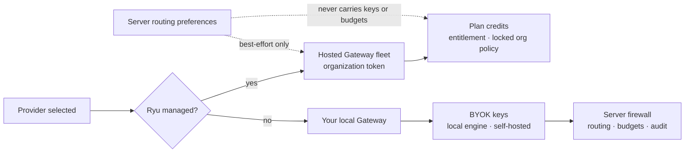

A server you host yourself can use **both** inference planes at once:

- the **Ryu (managed)** provider: included with your plan, billed against your organization's credits, and served by the hosted Gateway fleet that holds the provider keys;
- every **bring-your-own-key** provider (your OpenAI, Anthropic, OpenRouter or local engine keys), served by the Gateway that Core runs on your own machine.

They are not exclusive. Selecting the managed provider does not disable your local Gateway, and configuring your own keys does not stop you using the plan you pay for.

<Callout type="info">
Servers provisioned as Ryu Cloud servers are wired to the fleet for you. This page is for a machine you installed Core on yourself.
</Callout>

## Why the managed provider needs the fleet

The managed provider is pinned to Gateway routing and cannot be set to `direct`, so managed egress
is always metered. A **local** Gateway holds no Ryu provider keys, only the keys you gave it. The
managed provider must reach the hosted fleet, which holds the pooled provider credentials and your
organization's credit budget.

Until you supply fleet coordinates, the managed provider falls back to your local Gateway, which
cannot serve it. If you have not configured the fleet, pick a BYOK provider instead.



### What runs where

Once configured, selecting a provider decides which plane the request takes:

| Provider you select | Reaches | Paid with |
| --- | --- | --- |
| **Ryu (managed)** | hosted fleet | your plan's credits |
| **Ryu Gateway (governed)** | your local Gateway | your own keys |
| any BYOK provider (OpenAI, Anthropic, a local engine, …) | your local Gateway | your own keys |

To switch, change the active provider. Nothing restarts and no keys move.

### What the fleet decides, and what stays yours

The hosted fleet resolves your token to an organization on every request. It enforces the parts
that protect the shared pool, and a client cannot override them:

- your credit budget;
- your plan entitlement;
- any organization-level firewall policy your admins authored.

A server that could set its own budget could spend the organization's credits without limit.

Local preferences stay on your machine and are never sent to the fleet: which local engine is
resident, your own Gateway's provider list, and your BYOK keys. The
[routing preferences](#per-request-routing-preferences) envelope is the one exception. It contains
preferences only, not credentials or budget controls, and the fleet clamps it before use.

## Bind the server from Desktop

1. Sign in to Desktop and make the self-hosted Core the active server.
2. Open **Gateway settings → Workspace → Organization binding**.
3. Select the organization whose managed subscription the server should use.
4. Give the server a name of 1 to 128 characters, then select **Bind node**.

Desktop first asks you to confirm it's you. It then creates a ten-minute enrollment code through
the organization service and immediately gives it to the active Core. No secret appears in the form
or clipboard.

The code is the only organization authority. Core cannot submit a different organization, plan,
owner, or billing tier.

The completed card shows the bound organization, stable server ID, and managed inference readiness.
This state is loaded from Core after every restart.

### Who can bind

Binding requires `gateway.configure`. Owners and admins have it by default, and an
organization-scoped custom role can grant it to another operator. Members without that permission
see a read-only explanation.

The service checks the permission again when it issues and redeems the code, so disabling a button
is not the security boundary.

### Which organization a server uses

The organization selector used by billing pages changes which account you are viewing. It does not
move a server. A server's organization comes from its enrollment and remains fixed until the
binding is explicitly revoked and replaced. BYOK providers remain local and charge the provider
account behind the key stored on the server.

<Callout type="warn">
To move a server to another organization, revoke its current binding and use the explicit rebind
flow. Desktop never replaces an existing binding just because a different organization is selected.
</Callout>

## How subscription access works

Enrollment creates separate credentials for Fleet control and managed inference. The managed
inference credential names the organization but does not store its plan or balance. The hosted
fleet checks the organization's current subscription, credit balance, budgets, and locked policy on
every connection.

An enrolled server therefore starts using managed inference when the organization becomes entitled,
and stops when that entitlement or its credits run out. You do not need to enroll it again after a
plan change.

## Read usage without conflating billing

In the desktop app, open **Settings → Billing → Usage** to explore consumption with the same scope
model used by the rest of the app:

| Scope | Covers |
|---|---|
| **You** | Your profile-wide usage, regardless of which organization or server served the request |
| **Organization** | The selected organization's members and requests |
| **This server** | The active server, including requests handled locally, through BYOK, or through a self-hosted Gateway, even when they never touch Ryu's credit ledger |

Use the date-range picker, 15-minute/hourly/daily/weekly/monthly granularity, and provider/model
filters to compare traffic. The dashboard separates managed, BYOK, local, and self-hosted sources:

- **Credit spend** is shown only for managed requests.
- Local, BYOK, and self-hosted rows are consumption data and are labeled **Not billed** by Ryu.

Gateway and organization services aggregate activity into canonical 15-minute UTC buckets before
the desktop renders it. This keeps long-range totals complete without downloading a capped
raw-audit page. Long chart series are compacted only for drawing, and their totals remain exact.

## Manual credentials for existing installations

New installations should use organization binding above. Existing installations that already use a
manually issued organization Gateway token continue to work. This compatibility path also suits
unattended service units that cannot complete the Desktop flow.

You need two values, both scoped to your organization:

| Setting | Preference key | Environment variable |
| --- | --- | --- |
| Fleet base URL | `managed-gateway-url` | `RYU_MANAGED_GATEWAY_URL` |
| Organization token | `managed-gateway-token` | `RYU_MANAGED_GATEWAY_TOKEN` |

Both values are required. A URL without a token is refused rather than silently sent, because the
fleet would reject an unauthenticated bearer anyway.

### Issuing the token

The token is an organization Gateway token (`rgw_…`). Issue one from your organization's Gateway
keys page.

- The page pairs the **managed inference key** with the fleet URL. Copy both from the issue card
  before dismissing it, because the list keeps only key metadata and prefixes.
- The relay key is the value for `managed-gateway-token` / `RYU_MANAGED_GATEWAY_TOKEN`.
- Revoking a credential in the pair disables both its control and inference credentials.

Revoking the token stops that server from spending credits within about a minute, because the
hosted Gateway caches a resolved token for up to 60 seconds (see
[the resolve cache](/docs/gateway/managed-data-plane#the-resolve-cache)).

### From the desktop app

Open **Gateway settings → Network → Managed inference**, fill in the fleet URL and organization
token, and save. Both are stored on the server and take effect without a restart. Clearing both
fields returns the managed provider to your local Gateway. This manual pair is a compatibility
fallback, not a second organization binding.

How the form behaves:

- **Save** requires both fields or neither. If Core rejects either preference write, the entered
  values remain in the form and **Save** is available for a retry.
- Switching the selected node reloads that node's saved fleet URL and organization token. A save
  already sent to the previous node finishes there. It cannot change the new node's form or report
  its result as a save for the new node.
- Returning to that node or reopening settings waits for its pending save before loading an
  editable form.
- A failed read shows **Retry** and keeps saving unavailable, so unloaded fields cannot accidentally
  clear the saved fleet configuration.

### Using environment variables

Environment values win over enrolled and manually stored credentials. Use them only when you want
a service unit or container to override its enrollment:

```bash
RYU_MANAGED_GATEWAY_URL="https://<your-fleet-host>" \
RYU_MANAGED_GATEWAY_TOKEN="rgw_..." \
ryu-core
```

### Using preferences

Preferences persist across restarts. Core re-reads both keys as soon as either is written, so no
restart is needed:

```bash
curl -X PUT "http://127.0.0.1:7980/api/preferences/managed-gateway-url" \
  -H "Authorization: Bearer $RYU_TOKEN" \
  -H "content-type: application/json" \
  -d '{"value":"https://<your-fleet-host>"}'

curl -X PUT "http://127.0.0.1:7980/api/preferences/managed-gateway-token" \
  -H "Authorization: Bearer $RYU_TOKEN" \
  -H "content-type: application/json" \
  -d '{"value":"rgw_..."}'
```

`$RYU_TOKEN` is the node token Core accepts on its API. `127.0.0.1:7980` is Core's default address
for the release profile.

## Per-request routing preferences

After the fleet coordinates are configured, **Gateway settings → Network → Managed request
routing** can carry this server's preferences with each managed request. You can choose an ordered
fallback list and add custom firewall patterns.

The preference is best-effort:

- the fleet keeps the primary route;
- it drops providers outside its own funded chain;
- it applies firewall entries additively;
- it never changes your organization's budget, provider keys, entitlement, or locked guardrails.

The desktop stores the same atomic envelope under `node-routing-prefs`. For headless setups, its
value is JSON. If Core rejects a save in Gateway settings, the draft stays in the form for
correction or retry:

```json
{
  "fallback": ["anthropic", "openrouter"],
  "firewall": {
    "custom_patterns": [
      { "kind": "secret", "name": "internal_id", "regex": "id_[0-9]+" }
    ]
  }
}
```

The fleet may ignore a fallback that is not available or funded for your organization. Clearing
the preference restores fleet-global routing.

## Verifying it works

After binding, confirm the card says **Managed inference ready**. Select the managed provider, send
a request, and check that the bound organization's credit balance moves. If it does not:

- confirm Desktop shows the organization you intended and the active server's stable server ID;
- confirm the enrollment has not been revoked;
- check whether environment variables are overriding the enrolled credentials;
- confirm your plan includes managed inference. Without that entitlement the fleet refuses managed
  requests rather than billing them.

## Related

<Cards>
  <DocCard href="/docs/gateway/managed-data-plane" />
  <DocCard href="/docs/gateway/routing-planes" />
  <DocCard href="/docs/gateway/configuration" />
  <DocCard href="/docs/billing/credits" />
  <DocCard href="/docs/start-here/getting-started/self-host" />
  <DocCard href="/docs/core/node-and-presence" />
</Cards>
