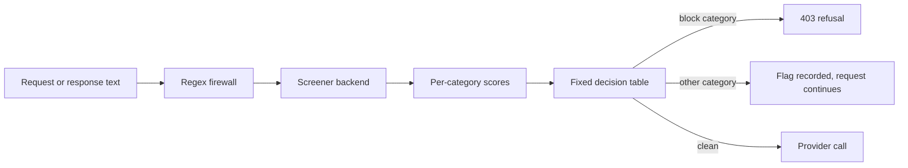

The [firewall](/docs/gateway/security) matches patterns. These two screens add a model's judgement
on top of it. Both run inside the same policy cascade as the firewall, so a locked setting at a
broader scope can only be tightened by a narrower one.

## LLM traffic inspector

Alongside the regex scanner, the firewall can run an opt-in cheap-LLM inspector. It asks a model
whether the inbound turn is a prompt injection or leaks PII or secrets, then applies the same
`FirewallPolicy` action (Block / Sanitize / Warn) to a flagged turn.

`InspectorConfig` takes these fields, and like the rest of the firewall it follows the cascade:

| Field | Meaning |
|---|---|
| `enabled` | Turns the inspector on. Off by default |
| `model` | The judge model. Blank resolves to the local classifier tier (see below) |
| `mode` | What to look for: `injection`, `dlp` (PII and secret leaks), or `both` (the default) |
| `min_chars` | Turns shorter than this many characters are not inspected. Default `40` |
| `timeout_ms` | Per-inspection timeout. On timeout the request is allowed. Default `1500` |
| `action` | The `FirewallPolicy` action for a flagged turn. Defaults to block |

### Model choice

The inspector model resolves through the normal `ModelRouter` and is called via `provider.complete`
directly, like smart routing, so it cannot recurse back into the pipeline or the tool loop.

- Leaving `model` blank resolves to this node's [local classifier tier](/docs/core/classifier-tier),
  a dedicated small model on its own port, rather than to your chat model or a hosted provider.
- Any other model id routes like any other request, so you can point inspection at a hosted model
  by setting `model`.

### Fail-open behavior

These cases all resolve to "not flagged" (allow) with a warning:

- a disabled config;
- a turn shorter than `min_chars`;
- an unconfigured provider, a provider error, or a timeout;
- an unparseable reply.

A cheap local model emits dirty JSON, so the verdict is parsed defensively: the first `{…}` block,
and on any failure, allow.

### What the judge adds over the regex scanner

The two layers complement each other. The regex patterns are narrow, and the judge covers the cases
they cannot reach:

| Regex catches | The judge is for |
|---|---|
| Structured PII: email, phone, SSN, credit card (Luhn-validated), public IPv4, IBAN | Contextual judgment: a slur quoted for discussion, or a term that is innocuous in context (`flame retardant`) |
| Known secret shapes: provider keys, PATs, bearer tokens, PEM blocks, connection strings | Identifiers that are only sensitive given context, and obfuscations no pattern anticipates |
| Seven fixed injection phrasings, over Unicode-normalized text (zero-width stripped, confusables folded) | Novel or paraphrased injections, and **encoded payload bodies** (the request to decode is a phrasing a pattern can match; the base64 body is not) |

Because the judge fails open, a flagged-vs-clean verdict and a judge that never answered are
different things. The verdict carries whether the judge actually ran, so a deterministic lexical
floor can back-stop the cases where it did not.

<Callout type="warn">
The inspector is **opt-in** (`enabled` defaults off). The `InspectorConfig` stage inspects the
**prompt**, not the response.

Response-side LLM judging is a separate mechanism: output-target `LlmJudge` evaluators (toxicity,
bias, PII leakage) run against the completion and apply the same Block / Sanitize / Warn actions;
see [evaluator catalog](/docs/gateway/evaluators). Those evaluators read the inspector's model and
timeout settings, so configuring this section also configures them.

A provider that cannot produce a verdict may fall back to deterministic scanning. Authentication,
DLP, model-policy, quota and credit denials remain enforced; a failed governance check is not an
allow verdict.
</Callout>

## Hazard screener

The hazard screener classifies what a request sends upstream, and what the model sends back,
against the MLCommons hazard categories `S1` to `S14` and prompt attacks. It runs after the regex
firewall and before any provider is called.

It screens every attempt the Gateway makes. A fallback attempt, a tool round, and text that a
skill, compression or pool handoff adds are screened again.

- **Chunking.** Long text is classified in overlapping chunks, so nothing is missed at a chunk
  boundary.
- **Cache.** Text already classified beside the same earlier conversation is answered from a
  per-node cache. A fallback attempt does not classify an unchanged body twice, and a later turn
  mostly classifies only the messages it adds and its tool definitions.
- The same text placed after different earlier messages is classified again.



The screener is pluggable. Each backend answers the same per-category scores. A fixed decision
table turns scores into an action, never the model's own allow or block answer:

| Backend `kind` | What it is |
|---|---|
| `decision_local` | A local closed-choice [decision model](/docs/core/decision-models) (Laya, Ollaya or Kev) on the `systemone` wire. The primary screener. Its weights hash must be pinned |
| `guard_model` | A guard model such as Llama Guard (`dialect = "llama_guard"`) or Qwen3Guard (`dialect = "qwen3guard"`) on an OpenAI-compatible engine |
| `inspector` | The LLM judge on a pinned endpoint, for prompt injection, PII and secrets only |
| `decision_remote` | A remote decision API on the same wire, such as TypeSafe's Jev. Prompts leave the machine, so it is off unless you opt in |

The screener never goes through the router, a provider slot or the model list, so it cannot be
reached by a request and never sees credentials or tenant identifiers. A remote backend receives
only the screened text.

### On your own Gateway

A self-hosted Gateway screens nothing until you opt in with `node_classifiers = true`. Its screener
then runs as your node's own policy, never Ryu's platform policy:

```toml
[screening]
node_classifiers = true

[screening.backends.decision_local]
kind = "decision_local"
base_url = "http://127.0.0.1:11435/v1/systemone"
model = "laya"
weights_sha256 = "<sha256 of the served weights>"

# Optional and off by default: prompts are sent to TypeSafe.
[screening.backends.jev]
kind = "decision_remote"
base_url = "https://api.typesafe.ai/v1/systemone"
model = "jev-latest"
api_key_env = "YOUR_SCREENER_KEY_VARIABLE"
processor_id = "typesafe"
allow_remote_processor = true
```

Each value can also come from an environment variable (`base_url_env`, `model_env`,
`weights_sha256_env`). A backend that cannot be built, for example a local decision model with no
weights hash, is left out and the Gateway still starts.

On your own Gateway:

- `S4`, `S9` and `S12` block, and every other category, prompt attacks included, is recorded as
  a flag. A block returns `403` with `code: "tenant_policy_blocked"` and `layer: "node"`. Responses
  are screened the same way before they return, and a stream ends with an error frame instead.
- A screener that is down, slow or answers outside its grammar never refuses your traffic: the
  request goes through under the regex firewall.
- Changes to `[screening]` apply on the next restart.

#### Screener endpoints from a Ryu node

When Ryu Core runs your Gateway, it can supply the screener endpoints for you. This is off by
default. Set `node.screener` in [`node-config.json`](/docs/start-here/configuration#core-node-config)
(or `RYU_NODE_SCREENER` in Core's environment) to choose the kinds:

| Value | What Core supplies |
|---|---|
| `on` or `decision` | A local decision model, the default kind. Run a `systemone` server such as Kev or Ollaya yourself, set `RYU_SCREENER_DECISION_URL` to its full `/v1/systemone` URL and `RYU_SCREENER_DECISION_SHA256` to the hash of the weights it serves. `RYU_SCREENER_DECISION_MODEL` defaults to `laya`, Ollaya's default alias; set `kev-latest` for Kev |
| `guard` | A guard model that Core runs itself. Qwen3Guard-Gen 0.6B is downloaded on first use and checked against a pinned hash. It does not cover `S4`, so pair it with a decision model |
| `decision,guard` | Both |

Core starts no decision server and downloads no guard weights until you opt in. Your Gateway still
screens nothing until its `[screening]` section turns `node_classifiers` on and names the variables
Core sets:

```toml
[screening]
node_classifiers = true

[screening.backends.decision_local]
kind = "decision_local"
base_url_env = "RYU_SCREENER_DECISION_URL"
model_env = "RYU_SCREENER_DECISION_MODEL"
weights_sha256_env = "RYU_SCREENER_DECISION_SHA256"

[screening.backends.guard_text]
kind = "guard_model"
dialect = "qwen3guard"
base_url_env = "RYU_SCREENER_GUARD_URL"
model_env = "RYU_SCREENER_GUARD_MODEL"
weights_sha256_env = "RYU_SCREENER_GUARD_SHA256"
```

Use the ids `decision_local` and `guard_text`, because they are the ids your Gateway's own screener
roles use. The guard model is never registered as a provider, so no request can be routed to it.

To use your own guard engine instead, set `RYU_SCREENER_GUARD_URL` and `RYU_SCREENER_GUARD_MODEL`
in Core's environment, and Core starts no guard model.

A node's screener is always your own policy. Ryu's platform policy never applies to a self-hosted
or bring-your-own-key node.

### On Ryu's hosted Gateway

Ryu's hosted Gateway screens every request under the
[Ryu platform policy](/docs/gateway/organization-policy#content-screening), which chooses its
backends and cannot be changed by an organization or a configuration write. A `PUT /v1/config`
with a `screening` section is refused there with `403` and `code: "platform_locked"`.

## Related

<Cards>
  <DocCard href="/docs/gateway/security" />
  <DocCard href="/docs/core/classifier-tier" />
  <DocCard href="/docs/gateway/evaluators" />
  <DocCard href="/docs/gateway/guardrail-policies" />
</Cards>
