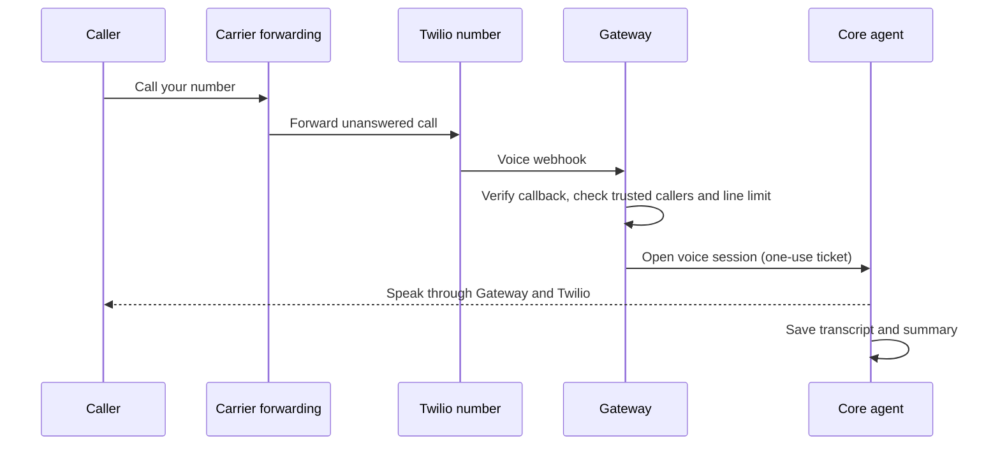

The phone assistant connects PSTN (public switched telephone network) calls to a Core agent. It can answer
calls routed to a Twilio number, place calls from a verified caller ID, speak with the person on the other end, and return a
transcript with a short summary in the Core conversation. The Ryu mobile app is the control panel;
Gateway and Core carry the call when the app is closed.

<Figure name="messaging" />

## What you need

- A Gateway operator who has configured the Twilio account for voice calls and exposed the Gateway
  webhook over public HTTPS.
- A Twilio voice number to receive calls. You can search for and purchase a number from **Phone
  assistant** in the Ryu mobile app. Twilio charges for the number and call usage.
- If you want outbound calls to show the number people already know, verify it with Twilio. Leaving
  the caller ID blank uses the Twilio number for outbound calls.
- A Core agent for the assistant to use. You can also set a human handoff number.

<Callout type="warn">
  Removing a line in Ryu stops routing but does not release its Twilio number. Release the number
  in Twilio Console to stop number charges.
</Callout>

### Keep your existing number

Ryu does not take over the phone's carrier audio. To keep your existing number, configure your
carrier to forward unanswered calls to the Twilio number shown in Ryu. You keep answering calls
normally, and the forwarded leg reaches the assistant when the carrier's forwarding rule fires.

Carrier settings and forwarding codes vary by provider and country. Porting the existing number is
another option, but unanswered-call handling does not require it.

### Verify your caller ID

Twilio requires caller-ID verification before it places outbound calls from a non-Twilio number.
Ryu starts the verification call and shows the code to enter when Twilio calls you. Verification
covers outbound caller ID only. Inbound calls still need forwarding or number porting.

## Connect a line

1. Open **Phone assistant** in Ryu Mobile and enable calling.
2. Search for a Twilio number and review the purchase prompt before buying it. Ryu saves a
   purchased number to a phone line right away, so it is not lost if you leave the screen first.
3. Optionally add the number people already know as the caller ID and complete Twilio's verification
   call. If you leave it blank, outbound calls use the Twilio number.
4. Choose the Core agent, set an optional greeting and human handoff number, and decide who can
   call: list **Trusted callers** and set **Simultaneous calls** on the line. Then save the line.
5. Set your carrier to forward unanswered calls to the Twilio number. Calls placed directly to the
   Twilio number use the same Ryu assistant.

Ryu shows the Voice webhook URL for the Twilio number. Numbers purchased in the app are configured
to use it automatically. For numbers you already own in Twilio, set their Voice webhook to that
URL.

## Make and manage calls

Enter the recipient and the result you want. Ryu speaks with the recipient and returns the outcome.
The assistant can use the configured Core agent's tools and connected services while it works.

On iOS, the recipient's numeric keypad has a **Done** control above it. The multi-line call goal
uses the keyboard's **Done** key to close the keyboard. These controls only dismiss the keyboard:
**Ask Ryu to call** opens a separate confirmation, and Cancel leaves the call unplaced.

The recent-calls list shows direction, numbers, status, duration, and the conversation transcript.
While a call is live, you can send the agent guidance, interrupt its current response, transfer the
caller to the configured person, or hang up. When the call ends, Ryu asks the agent to add a concise
summary and next steps to that same conversation.

For supported Core TTS engines, a line can select a voice engine and voice profile. Use only a voice
you own or have permission to use. Ryu's [Voice Studio](/docs/apps/voice) is where consented voice
profiles are managed.

## Call conversations

Each inbound Twilio call starts its own conversation. Caller ID is display
metadata and cannot resume an earlier call's history, including when the number
is withheld or shared. Turns and stream reconnects within the same provider call
keep that call's conversation. A new call does not reopen older caller-based
phone conversations.

Gateway verifies the provider callback and binds the stream to that call before
exchanging its Core credential for a one-use, conversation-bound voice ticket.
Malformed or missing provider call identities are refused. The bridge does not
offer cross-call history resumption without separate caller authentication.

## Security and provider availability

Twilio account credentials stay on the Gateway and are never sent to the mobile app. The mobile app receives line settings and call
records through Core's owner-only Gateway proxy. Calls use normal Gateway and Core authentication,
and call controls are restricted to the node owner.

Anyone who dials the Twilio number, or reaches it through forwarding, can reach the line's
assistant. Caller ID can be spoofed, so a caller is not the owner just because of the number they
call from. Each line in **Phone assistant** in Ryu Mobile has two controls for this, saved with
**Save call settings**.

| Control | `gateway.toml` / configuration API | Limits |
|---|---|---|
| **Trusted callers** | `allowed_callers` / `allowedCallers` | E.164 numbers, one per line, up to 100 |
| **Simultaneous calls** | `max_concurrent_calls` / `maxConcurrentCalls` | 1 to 20, default 2 |

### Trusted callers

When the list has numbers, calls from any other number are rejected before the assistant answers.
Listed callers get the line's full Core agent.

### Simultaneous calls

The limit counts inbound and outbound calls together:

- Further inbound calls get a busy signal before any speech, model, or voice work starts. This
  bounds the cost of a call flood.
- Outbound calls count from the moment Ryu asks Twilio to place them. When the line is full, Ryu
  refuses the call without placing it, so it does not ring or incur Twilio call charges.
- The Gateway answers that refusal with `503`, a temporary condition to retry later. It uses `400`
  for invalid input such as an unverified caller ID.
- A call that ends without being answered frees its place. A Gateway restart keeps the places of
  calls that may still be ringing.

### Unverified callers

When the trusted-caller list is empty, every caller is accepted as an unverified caller. Gateway
marks the call as untrusted when it opens the Core voice session. Core then enforces a restricted
tool profile on every turn of that call, checked when a tool runs rather than only by what the
model is shown.

The profile is an allowlist with at most one tool, a desktop notification to the owner
(`notify.desktop`), and only where the line's agent may already run it. The assistant can still
take a message without tools, because the transcript and summary are saved as usual.

For an unverified caller:

- Everything else is unavailable, including tools added later. That covers memory, mail and
  messages, contacts, calendar, files, shell, browser, payments, connected accounts, and MCP or
  plugin tools.
- Gateway does not offer tool search or the operator's always-on tools, and Core rechecks the
  profile when Gateway runs a tool for the call.
- Core leaves the owner's memory, personal profile, and skills out of the conversation.
- If the line's agent runs its own tools in a separate agent process, Core answers with the default
  model and the agent's instructions instead, because it cannot limit that process's tools.

Outbound calls you place keep the agent's normal tools.

### Provider limits and recording

Number availability, caller-ID verification, and forwarding behavior depend on Twilio and the local
carrier. Ryu stores the call transcript and generated summary in the Core conversation. The Gateway
does not store a call-audio recording. Let callers know they are speaking with an AI assistant.
