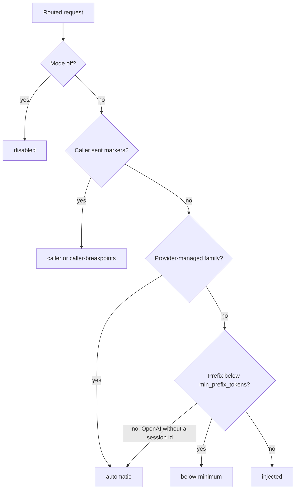

Provider prompt caching lets an upstream model provider reuse an eligible prefix from an earlier request. It can lower input cost and latency when requests share a stable prefix. The provider decides whether a request is eligible and whether a cache hit occurs.

<Callout type="info">
  This cache is upstream of Ryu. It reuses prompt input; it does not return a prior model response. The Gateway's exact and semantic response caches are separate and are described in [Reliability & budgets](/docs/gateway/reliability).
</Callout>

## Before enabling caching

Keep long-lived instructions, tool definitions, and shared context stable near the start of the prompt. Put per-turn details later. A changed prefix can prevent reuse.

Gateway transforms keep that prefix stable:

- Firewall redaction under the Sanitize policy rewrites each string identically on every request.
- Enabled skills are prepended to the system prompt without dropping its content parts or their `cache_control` markers.

Provider minimum prefix sizes, retention windows, and cache-write prices vary by model. Check the provider's current rules before choosing a cache lifetime.

Ryu defaults to **Auto** with each provider's short default lifetime. Some providers charge more for cache writes; Anthropic's one-hour lifetime has a higher write price than its five-minute lifetime.

## Choose a mode

| Mode | Gateway behavior |
|---|---|
| `auto` | Default. Uses a provider-supported automatic hint where one is available. The provider chooses the cache boundary. |
| `off` | Adds no markers. Caller-supplied markers pass through, and providers that cache automatically can still do so. |
| `explicit` | Adds supported breakpoints around the stable prefix. The configured breakpoint count is bounded by the provider format. |

Gateway selects a marker format from the routed model family. The exact model support and cache eligibility still belong to the provider.

| Model family | Marker behavior |
|---|---|
| Claude, selected Qwen models (such as `qwen3-max` and `qwen3-coder-plus`), DeepSeek V3.2, and Gemini models before 2.5 | Anthropic-style `cache_control` markers; explicit mode can place up to four breakpoints. |
| GPT and o-series models | OpenAI caches automatically; Ryu adds a sticky `prompt_cache_key` when the request carries a session id. Explicit mode places OpenAI breakpoints on GPT-5.6 and later only; earlier models keep automatic caching. OpenAI uses its own cache lifetime, so the configured TTL is not sent. |
| Gemini 2.5 and later, and families such as other DeepSeek models, Grok, Groq, Moonshot, and Z.AI | Provider-managed caching; Ryu does not add an explicit breakpoint. |
| Other model IDs | Ryu adds no explicit marker. The provider may still apply its own automatic caching rules. |

## Configure the Gateway

Set the policy in the `[prompt_cache]` section of `gateway.toml`.

```toml
[prompt_cache]
mode = "auto"              # auto, off, or explicit; default is auto
ttl = ""                   # empty uses the provider default; supported values: 5m or 1h
min_prefix_tokens = 1024   # skip adding markers below this estimated prefix size
breakpoints = 2            # explicit-mode maximum; clamped to 1–4
session_affinity = false   # opt in to OpenRouter cache-affinity routing
allow_request_override = true
```

| Setting | Purpose |
|---|---|
| `mode` | Default policy for requests that do not set an allowed request override. |
| `ttl` | Requested provider cache lifetime. Empty uses the provider default; Ryu accepts `5m` and `1h`. A longer lifetime can have a higher write price. |
| `min_prefix_tokens` | Avoids adding markers when the Gateway's prompt-size estimate is below this floor. A provider may require a higher minimum. |
| `breakpoints` | Maximum breakpoints in explicit mode; Ryu clamps the value to the supported range of 1–4. |
| `session_affinity` | When enabled, forwards the request's `x-ryu-session-id` (the Ryu conversation ID) as OpenRouter's `session_id` so related requests can reach the same provider cache. It is off by default because this changes routing affinity. |
| `allow_request_override` | Allows request headers to override the node mode and TTL. Set false when operators need a fixed node-wide cost policy. |

### Request overrides and caller markers

When request overrides are allowed, a caller can send `x-ryu-prompt-cache: off|auto|explicit` and `x-ryu-prompt-cache-ttl: 5m|1h`. An accepted request override takes precedence over `[prompt_cache]`. A missing section or mode defaults to `auto`.

The caller's own cache markers take precedence and are not rewritten. On the Anthropic-compatible `/v1/messages` endpoint, `cache_control` is carried through to a provider or model that reads those markers when it appears on:

- `system` blocks and message text blocks;
- tool use and tool result blocks;
- tools, and the request itself.

A request routed to an OpenAI endpoint has those markers removed first, because strict OpenAI endpoints reject them.

## Check what happened

The Gateway decides its action in this order, and reports it in the response `x-ryu-prompt-cache` header.



An OpenAI request with no session id and no explicit breakpoints gets no marker from Ryu, so it
also reports `automatic`.

| Value | Meaning |
|---|---|
| `disabled` | No Gateway marker policy was applied. |
| `caller` or `caller-breakpoints` | The request already contained cache markers, so Ryu preserved them. |
| `automatic` | The provider family handles caching without a marker from Ryu. |
| `below-minimum` | The estimated prompt prefix was below `min_prefix_tokens`. |
| `injected` | Ryu added a provider-supported marker. |

### Cache reads and writes

The Gateway audit and **Agent observability** view keep each request's cache-policy outcome and provider-reported cache reads and writes.

- A read count is a cache hit. A write count identifies new tokens written to the cache. One request can read an existing prefix and write a new suffix.
- The aggregate cache hit rate is read tokens divided by reported read-plus-write tokens. Request hit and miss counts appear separately.
- The `tokens.cached_input` metric remains the aggregate read-token count.
- Missing provider usage is shown as unreported.
- Selecting a model-call trace shows its input tokens against the model's reported context-window size.

These values are for observability, not a second billing calculation. Gateway billing uses the provider-reported cost where available.

Chat session stats show the provider-reported cache hit rate, reads, and writes alongside the current context length and model context window.

### Pi and OpenRouter

Pi's Claude and Qwen model entries enable its Anthropic-style cache markers. Its OpenAI-style path can also send `prompt_cache_key` for provider stickiness.

OpenRouter and Pi cache behavior, and how to read cache activity in agent observability, are on [OpenRouter prompt caching](/docs/providers/prompt-caching). For current provider-specific cache support, usage fields, and TTL pricing, see [OpenRouter's prompt-caching guide](https://openrouter.ai/docs/guides/best-practices/prompt-caching).

Tool-heavy prompt prefixes are covered on the [Tool execution governance](/docs/gateway/tools) page.
