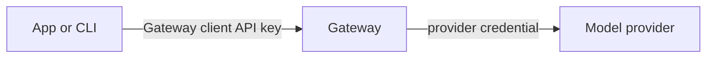

The Gateway uses two kinds of keys. Each kind has its own creation and revocation controls.

| Key | Authenticates | Managed in |
|---|---|---|
| Provider credential (API key or supplied access token) | Ryu's upstream calls to model providers | **Gateway → API keys** |
| Gateway client API key | Apps and CLIs that call your Gateway | **Gateway → API keys** or **Gateway → API & traffic** |



## Gateway client API keys

For local nodes, create and revoke Gateway client API keys in **Gateway → API keys** or
**Gateway → API & traffic** (the **Gateway client API keys** card). Each client key is shown in
full once at creation, then masked on readback. Managed organization keys use their web controls.

When the node supports direct web services, new client keys have explicit **Allowed
services** choices:

- LLM, embeddings, and media access is selected by default.
- Web search and web fetch require separate grants. Existing inference keys do not gain either
  grant automatically.

See [Web search and fetch](/docs/gateway/web-services#grant-client-access) for the
`allowed_operations` configuration.

These scopes require a Gateway version that reports `webServiceSchema: 1`.
Older versions do not enforce the new operation fields, so rotate or revoke scoped
client keys before downgrading. Scoped inference tokens remain inference-only.

## Connect an upstream provider

Open **Gateway → API keys** to add provider accounts.

Additional SDK connections have independent accounts for OpenAI, OpenAI Responses,
Gemini, Anthropic, Fireworks, Together, Groq, AIHubMix, MiMo, Moonshot, Nebius, xAI,
DeepSeek, Z.AI, BigModel, Aliyun, Baidu, Cohere, Ollama, Ollama Cloud, Vertex AI,
GitHub Models, OpenCode Go, Bedrock API, OpenRouter, and MiniMax.

Chutes, Hyperbolic, SiliconFlow, Venice, and Featherless are named API-key providers.
Configure each provider in settings, discover its available models, and select the
exact upstream model ID. Their credentials and account policies stay separate even
when they expose the same model.

Saved SDK model entries keep existing metadata and model enablement overrides.

[Kiro HTTP](/docs/providers/kiro) uses a saved AWS Builder ID login through Core's
authenticated relay. The Kiro CLI agent has its own isolated profile and discovery.
Gateway routing selectors display this connection as **Kiro**.

These connections support chat and streaming. Gemini also supports the image operation
advertised in its connection metadata. The SDK list does not imply support for other
service kinds. Native image, speech, video, and embedding integrations have their own
configuration.

### Tool calling on SDK connections

SDK connections, such as Gemini, xAI, DeepSeek, and Groq, accept OpenAI-style function
tools on chat completions, with or without streaming:

- `tools` entries of type `function` are forwarded with their name, description,
  `parameters` schema, and `strict` flag. Any other tool type fails the request
  instead of being dropped.
- `tool_choice` accepts `auto`, `none`, `required`, or a named function
  (`{"type": "function", "function": {"name": "…"}}`). It is sent only when the
  request also has tools. Other values are ignored.
- Responses return the calls as `message.tool_calls`, with arguments as a JSON
  string. `finish_reason` is `tool_calls` when the model calls a tool, unless the
  turn ended on the token limit (`length`) or a content filter. Streams use the
  same final `finish_reason`.
- Streams send each call as `delta.tool_calls` chunks. A call's first chunk carries
  its `index`, `id`, and function name; later chunks with the same `index` append to
  its arguments. Some providers deliver a call's arguments whole in its first chunk.
- To continue the loop, send the assistant turn's `tool_calls` back with `tool`
  messages that carry each `tool_call_id`. A tool message's content must be text
  or an array of text parts.

Direct web connections have their own search and fetch groups in the provider
controls. See [Web search and fetch](/docs/gateway/web-services) for the provider inventory,
client grants, endpoint formats, and accounting behavior.

## Manage accounts

For each stored account, set a name, enable or disable it, and assign a priority. Lower
numbers are tried first. Replace a specific credential through its account control.
Removing the primary account promotes the next stored credential.

Environment and fleet credentials show their source. Change those credentials at their source.
Environment accounts can still have Gateway name, enabled, and priority policies.

### When an edit takes effect

Credential and account policy edits apply to a running, locally managed Gateway without
restarting it:

- New requests use the applied provider connections.
- Requests already running finish with their original provider connection.
- Accepted media jobs keep their original polling connection until completion or expiry, even if
  that account is removed. Media jobs are held in memory and do not survive a process restart.

If the Gateway is externally managed, a saved credential change requires you to restart
that Gateway. The response distinguishes persistence from live application. A saved
change that cannot be applied leaves the previous running configuration active, and the UI
shows the next action and retains your draft.

### Apply saved connections

If a saved change is not active, open **Gateway → API keys → Provider application** and
choose **Apply saved connections**. This applies the saved revision without sending
the credentials again. If another edit supersedes it, refresh and apply the latest
saved connections. The status confirms when the saved provider settings are active.

While the Gateway restarts, the dialog can briefly report it unreachable. Account edits
you have not saved stay in place, and the dialog reloads the saved connections when the
Gateway is reachable again.

## Concurrent edits

Core and Gateway coordinate configuration writes and preserve unrelated authored
settings. Configuration readback includes `configRevision`. Send that value as
`expectedRevision` when saving a change based on the configuration you viewed.
A stale revision returns HTTP 409 before the file or live settings change. Refresh
the configuration and review your draft before saving again.

Account controls preserve an unsuccessful draft and show the server's explanation.
The configuration revision describes the stored file. Provider readiness and whether
a change is active are reported separately.

Credential-edit responses include `gateway_application` with one of these statuses:
`applied`, `already_applied`, `superseded`, `failed`, `offline`, or `unmanaged`.

- Successful application identifies the exact stored revision.
- A newer edit can supersede a saved revision before it becomes active.
- The receipt covers provider connections and their runtime routing settings only. Other
  configuration sections report their own live or restart requirements, so the receipt does not
  mean the entire configuration file is active.

## Configuration

```toml
[providers.genai.accounts.groq]
api_key = "YOUR_GROQ_KEY"
api_keys = ["YOUR_BACKUP_GROQ_KEY"]
allow_env = false

[routing.model_map.fast-chat]
provider = "genai-groq"
provider_model = "groq::llama-3.3-70b-versatile"
```

Keys remain in Gateway configuration under its existing local file storage. They are
write-only in the UI and omitted from configuration readback. The additional SDK editor
does not create an operating-system credential-store copy.

Environment import is explicit through `allow_env = true`, using the provider's declared
default environment variable. Clearing accounts disables that import. Legacy
`providers.genai.keys` and `gemini_api_keys` load into the canonical account format;
editing saves `providers.genai.accounts`. Legacy Gemini environment import is preserved
on migration.

Native and compatible connections control environment import separately:

```toml
[providers.environmentImports]
openrouter = false
fal = false
```

An omitted entry preserves the existing environment import behavior. Saving or clearing
a native credential through account controls disables environment import for that
connection, so an older environment value cannot replace or restore the edited key.

Account rows label their actual credential source. Fleet credentials remain controlled by the
fleet, and remove and targeted replacement controls apply to stored credentials. Use **Save local
credential** to explicitly replace an environment-supplied connection.

## Tokens and endpoint context

- Vertex AI requires a supplied bearer token, project, and location.
- Bedrock API requires its API bearer token and region. This connection does not use
  the AWS SigV4 credential chain.
- GitHub Models accepts a supplied token. This connection is separate from Copilot
  subscription OAuth.
- Ollama requires an HTTP or HTTPS endpoint and no upstream key. Gateway client
  authentication is still controlled separately.

Saving a supplied token does not establish browser OAuth or automatic refresh. Use the
dedicated OAuth account flow for subscription providers that offer it. Missing required
context leaves a connection inactive and shows an explanation.

```toml
[providers.genai.accounts.vertex]
api_key = "YOUR_CURRENT_ACCESS_TOKEN"
context = { kind = "vertex", project = "YOUR_PROJECT", location = "us-central1" }

[providers.genai.accounts.ollama]
context = { kind = "ollama", base_url = "http://127.0.0.1:11434" }
```

## OAuth sign-in state

OAuth accounts show **Sign in again** when their exact credential generation was
revoked or its refresh delivery is uncertain. A new saved login clears the state for that
newer generation.

Refresh is guarded so a potentially consumed token is not reused:

- Ryu records refresh dispatch before sending it, so restarting does not retry a potentially
  consumed token. Proactive refresh uses the same guard.
- Explicit temporary refresh rejections can cool down before retry. An unknown response is not
  treated as quota.
- Older credentials in Ryu's private Pi auth file are sealed before refresh. If account storage is
  unavailable, expired renewable credentials are paused rather than exchanged.
- Blocked credentials are omitted from Pi's shared auth file until a newer login is saved.

## Model routing and caching

Use SDK-qualified models such as `groq::…`, `xai::…`, or `cohere::…` with their
matching connection. Gemini retains its existing aliases. Native provider connections
keep their existing route IDs and credentials.

Provider and account rotation can reduce prompt-cache reuse. Choose a session-aware
routing strategy when cache affinity matters. An accepted or uncertain request is not
replayed to try another account. Gateway response-cache writes are skipped for
rotating account pools and requests whose route changes during fallback or budget
adjustment.

## Provider response limits

HTTP adapters, including SDK connections, cap buffered provider responses at 64 MiB before
parsing JSON or converting audio into a response envelope. The limit also applies when an upstream
response omits its content length, and larger responses fail explicitly.

Streaming chat responses continue to be forwarded as streams. SDK stream messages are limited
to 1 MiB so an unterminated event cannot grow without bound.

Gateway provider clients do not follow redirects. Fal job polling accepts only
references on the configured queue origin before attaching credentials. Provider
error logs record the provider and HTTP status without raw upstream error bodies.
